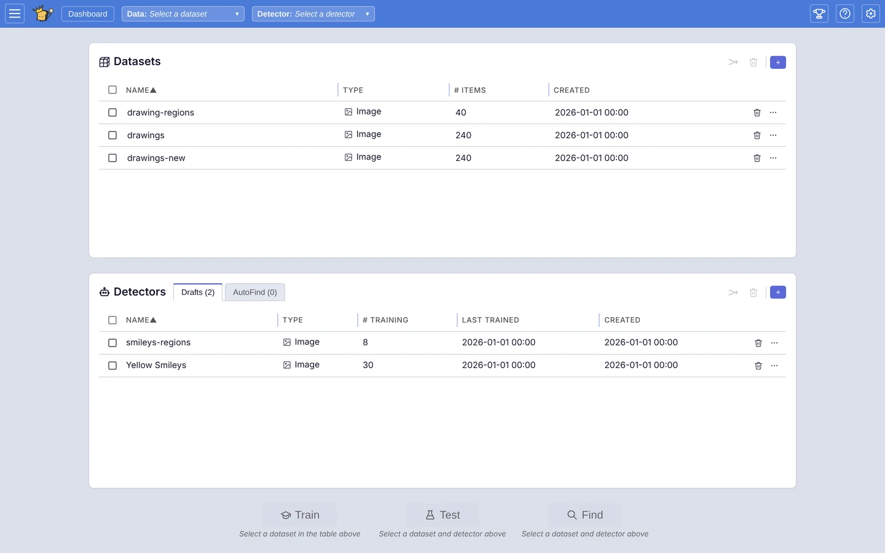

<!-- This file is served raw at GET /api/achievements/docs/readme/raw and its
     footer phrase is hash-matched against _DOCS_RAW in
     vtsearch/achievements_catalog.py (tests/core/test_achievements.py checks
     the two agree). Don't remove or reword the "Readme Reader code phrase"
     line without updating achievements_catalog.py to match. -->

# VTSearch

A trainable media search tool. VTSearch searches collections of audio clips, images, text paragraphs, videos, and documents using a **detector** (a small trained ranker that scores every item in the collection by how well it matches what you're looking for). You search either by **training a new detector** (vote a handful of items "good" or "bad" and a small neural net learns from your votes to rank the rest of the collection) or by **using an existing detector** (one you saved earlier, exported from another VTSearch instance, or imported from disk). Trained detectors are reusable: apply the same one to any future dataset of the same media type. A natural-language query ("dog barking", "red car in snow") seeds either flow via pretrained embeddings (LAION-CLAP for audio, SigLIP for images, X-CLIP for video, E5-base-v2 for text), and also works as a quick stand-alone search when you don't need a trained detector. Several demo datasets are available directly from the UI. Built with Flask (Python), Angular (TypeScript), and PyTorch.

<picture>
  <source media="(prefers-color-scheme: dark)" srcset="docs/user/assets/dashboard-loaded.dark.webp" />
  
</picture>

> **New to VTSearch?** Read **[docs/user/USER_GUIDE.md](docs/user/USER_GUIDE.md)** for a walkthrough of loading a dataset, training a detector with Autopilot (or applying an existing one), and exporting the matches. Most users never need anything else.

## Quick start

You need **Python 3.11+**, **Node.js 20.19+, 22.12+ or 24+** with npm, and Git. Then, from the repository root:

```bash
bash scripts/install.sh                            # install Python deps (auto-detects CPU vs GPU)
cd frontend && npm install && npm run build:prod   # build the Angular frontend into static/
cd .. && python app.py                             # start the app
```

The first start loads the ML libraries, so give it a minute. When the server is up it prints:

```
🌐 Open http://localhost:5000 in your browser
```

Open that URL. The app starts with no datasets loaded; add a demo dataset (below) or your own folder of media, then follow the [User Guide](docs/user/USER_GUIDE.md#step-by-step-your-first-search). Press **Ctrl+C** in the terminal to stop the server.

[docs/SETUP.md](docs/SETUP.md) is the full install walkthrough: prerequisites per OS, virtual environments, what `install.sh` does on a GPU machine (including headless installs), Docker images, SLURM clusters, and running the test suite. For production (gunicorn, reverse proxy, offline hosts, environment variables), see [docs/DEPLOYMENT.md](docs/DEPLOYMENT.md).

## Loading a demo dataset

When the app is running, click the **+** button on the **Datasets** card to open the **Add Dataset** dialog, then pick the **Demo** tab. **Downloaded Media** lists open datasets by media type; each is downloaded and embedded on first use, then cached for instant loading afterward. **Synthetic Media** generates a dataset on the spot and downloads nothing, which makes it the quickest thing to try: its images are the cartoon smiley faces the [User Guide](docs/user/USER_GUIDE.md#step-by-step-your-first-search) walks through, so you can follow it step by step.

See [docs/demos.md](docs/demos.md) for the full list of available demo datasets.

To load your own media, use the **Files** tab of the same dialog: point it at a folder (or a manifest of file paths) on the server.

## Where to read next

| You want to… | Start with |
|---|---|
| Use the app: load media, train and tune a detector, export matches | [User Guide](docs/user/USER_GUIDE.md), then [demo datasets](docs/demos.md) |
| Run detectors from scripts or cron, without the web UI | [CLI.md](docs/CLI.md) |
| Install on a new machine, a GPU box, Docker, or a SLURM cluster | [SETUP.md](docs/SETUP.md) |
| Run it as a service: security, gunicorn, reverse proxy, offline hosts, environment variables, troubleshooting | [DEPLOYMENT.md](docs/DEPLOYMENT.md) |
| Work on the code | [SETUP.md](docs/SETUP.md), then [ARCHITECTURE.md](docs/ARCHITECTURE.md#key-concepts), [FRONTEND.md](docs/FRONTEND.md) and [TESTING.md](docs/TESTING.md) |
| Add an importer, exporter, media type, embedder or detector | [EXTENDING.md](docs/EXTENDING.md) (see [Extending with plugins](#extending-with-plugins) below) |
| Use the ML core as a Python library, without Flask | [`vtscore` docs](vtscore/docs/README.md) |
| Call the HTTP API, or understand the model and its evaluation | [API.md](docs/API.md), [ML.md](docs/ML.md), [EVAL.md](docs/EVAL.md) |

What changed between versions is in [CHANGELOG.md](CHANGELOG.md).

---

## Command-line interface

VTSearch's `python app.py` entry point also runs detectors over a dataset and exports the hits without starting the web server (`--autodetect`, or a YAML `--pipeline` file), optionally merging external labels into a detector first. It also carries the server's own flags (port, login provider, admin restrictions) and plugin listings (`--list-plugins`). See [docs/CLI.md](docs/CLI.md) for the full CLI reference.

## Project structure

VTSearch is split into two Python packages along an **app tier / library tier** line, plus a third that stands on its own:

- **`vtsearch/`** — the app tier: Flask routes, authentication, settings, the achievements state machine, and the CLI entry point (`vtsearch/cli/main.py`). Anything that depends on Flask/Werkzeug lives here.
- **`vtscore/`** — the library tier: the ML (training, classifier head, thresholds), embedding runtime, media-type plugins (audio, image, text, video, document, and the convert-in `face` type), converters, datasets/importers, exporters, labels, evaluation, projection (VTSBrowse), concurrency, security, and the plugin/sync machinery. It is import-clean of Flask so it can be reused as a standalone library. The CLI orchestration (`vtscore/cli/`) lives here too.
- **`imagekit/`** — face localisation + embedding with a pluggable backend ("provider") seam: open SCRFD + ArcFace/MagFace weights on ONNX Runtime by default, a proprietary backend behind the same interface when a server selects it. Imports neither of the other two; the `face` media type reaches it through one bridge module. See [imagekit/README.md](imagekit/README.md).

The remaining top level:

```
├── app.py            # Flask entry point: builds the app, registers blueprints, parses CLI args
├── gunicorn.conf.py  # Gunicorn WSGI config (single worker + threads)
├── vtsearch/         # App tier (Flask routes, auth, settings, CLI entry point)
├── vtscore/          # Library tier (ML, embedding, media, datasets, plugins, projection)
├── imagekit/         # Face localisation + embedding with a pluggable provider seam
├── frontend/         # Angular SPA source (TypeScript, SCSS); builds into static/
├── static/           # Angular build output (HTML, JS, CSS, assets)
├── tests/            # App-tier test suite (pytest); grouped by folder (core, api, sorting, …)
├── tests_lib/        # Library-tier test suite (one folder per vtscore package, import-clean of Flask)
├── tests_shared/     # Test machinery shared by both suites
├── docs/             # Extended documentation (see docs/ARCHITECTURE.md for the full map)
├── docker/           # Dockerfiles and docker/compose/ files
├── requirements/     # pip requirement sets (base, gpu, no-AGPL, slim image variants)
├── scripts/          # install.sh, plus gates/, release/, install/, data/, experiments/, screenshots/, slurm/
├── slides/           # Slide-deck sources and build tooling
├── run-tests.sh      # The test and lint gate
└── pyproject.toml    # Project metadata and dependencies
```

For the package-level directory map, dependency graph, and the app-tier/library-tier rules, see **[docs/ARCHITECTURE.md](docs/ARCHITECTURE.md)**. For the Angular SPA — feature areas, service layer, zoneless change detection, and the generated API client — see **[docs/FRONTEND.md](docs/FRONTEND.md)**.

## HTTP API

VTSearch exposes a REST-style JSON API. See [docs/API.md](docs/API.md) for the full endpoint reference, including media listing, sorting, voting, dataset management, detector CRUD and scoring, exporter and importer operations, and settings.

## Machine learning

A detector is a **linear SVM head** trained on your votes over pretrained embeddings. See [docs/ML.md](docs/ML.md) for full details on the model architecture (including why the head is a linear SVM and where the older logistic and MLP paths survive), training configuration, PyTorch settings, embedding models, and the Coverage Atlas that drives diversity sampling and domain-shift detection.

## Evaluation

VTSearch includes an evaluation framework that measures sorting quality on demo datasets. Run it with:

```bash
python -m vtscore.eval --plot-dir eval_output
```

This runs text-sort and learned-sort evaluations across every demo dataset registered for evaluation (`--list` shows them; each downloads on first use, so `--datasets <id> …` narrows a first run), prints a summary, and saves visualisation charts as PNGs. See [docs/EVAL.md](docs/EVAL.md) for the full guide, including:

- **[CLI reference](docs/EVAL.md#cli-reference)**: All flags and options for the eval runner.
- **[Understanding the metrics](docs/EVAL.md#understanding-the-metrics)**: What mAP, P@k, R@k, F1, and other metrics mean.
- **[Visualisations](docs/EVAL.md#visualisations)**: Charts generated by the eval framework.
- **[Writing a custom evaluation script](docs/EVAL.md#writing-a-custom-evaluation-script)**: How to sweep over parameters, run voting-iteration simulations, and use the Python API directly.

## Extending with plugins

VTSearch has a plugin architecture built on auto-discovered plugin families — importers, exporters, converters, media types, embedders, and more. The authoritative family inventory is the generated table in [docs/EXTENDING-plugins.md](docs/EXTENDING-plugins.md#shared-plugin-architecture); `python app.py --list-plugins` enumerates every installed plugin. The extending guide is split into two topic-specific docs plus an index:

- **[docs/EXTENDING.md](docs/EXTENDING.md)**: index, authentication providers, dataset-import hooks, dependency management, and a one-stop checklist for every extension type.
- **[docs/EXTENDING-plugins.md](docs/EXTENDING-plugins.md)**: data importers, datasource importers, seed importers, results exporters, label importers, settings importers/exporters/sources, labelset sources.
- **[docs/EXTENDING-media.md](docs/EXTENDING-media.md)**: media types, embedders, clippers, cleaners, converters, media sources.

## License

VTSearch is licensed under the [Apache License 2.0](LICENSE). That covers the source code in this repository: both the `vtsearch` application and the `vtscore` library.

Two things it does **not** cover:

- **Model weights are separately licensed.** VTSearch downloads embedding models at runtime rather than vendoring them, and each publisher sets its own terms; some are more restrictive than this project's license. EUPE (Perception Encoder) is released under the FAIR Noncommercial Research License and cannot be used commercially; DINOv3 is gated on Hugging Face and requires accepting its license before download. Embedders with a usage restriction advertise it via their descriptor's `license_notice` field, which the UI shows as a warning on the embedder picker. Check the terms of any model you enable before deploying.
- **Two dependencies are copyleft, and can be skipped.** `ultralytics` (used by the image object clipper) and `PyMuPDF` (used by the PDF importer and document converters) are both AGPL-3.0. A default install pulls them in, so those features work out of the box. VTSearch's own Apache-2.0 grant is unaffected, but the AGPL terms may attach to a combined work you redistribute or run as a network service. If that doesn't suit your deployment, install without them:

  ```bash
  VTSEARCH_NO_AGPL=1 bash scripts/install.sh      # or: pip install -r requirements/base-no-agpl.txt
  docker build --build-arg REQUIREMENTS=base-no-agpl.txt -f docker/Dockerfile .
  ```

  Both packages live in the `agpl` extra in `pyproject.toml`, which every default install path requests; the commands above are the same install with that extra dropped. The result is permissively licensed, and the four features listed above report themselves as unavailable with an actionable message rather than half-working. Obtaining commercial terms for the packages is the other way to keep the features.

See [NOTICE](NOTICE) for the full attribution and dependency-licensing statement.

---

*Readme Reader code phrase:* `all aboard the embedding express`
