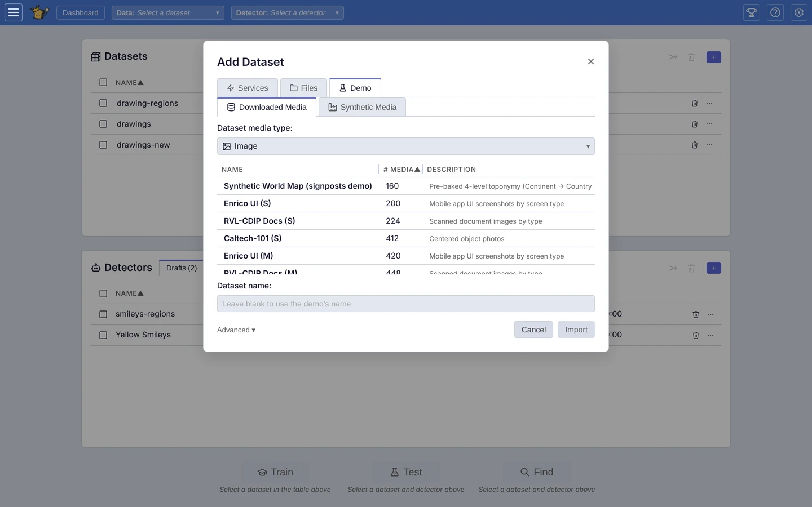

# Demo Datasets

This is the reference catalogue of every demo dataset VTSearch can download and embed on demand. For the step-by-step loading walkthrough (opening the **Add Dataset** dialog, the **Demo** tab, and the **🏭 Synthetic Media** offline generator), see **[user/USER_GUIDE.md](user/USER_GUIDE.md)**.

<picture>
  <source media="(prefers-color-scheme: dark)" srcset="user/assets/importer-picker.dark.webp" />
  
</picture>

Datasets are grouped by media type below. Most demos come in size variants — **S** / **M** / **L** (progressively larger samples) and **A** (all items in the underlying dataset); a few offer only some of them (e.g. only **A**), and the synthetic generators have none. Sizes are downloaded once and cached, so reloads are instant (the **Download** column is the raw-source download estimate; size variants of the same demo usually share one download, and **—** marks demos that need no network download at all, like the synthetic generators). The three long-form audio demos are the exception — see the note under the Audio table. On multi-user servers the downloaded sources can be shared between data dirs — see [DEPLOYMENT.md](DEPLOYMENT.md#sharing-demo-downloads-between-data-dirs-multi-user-servers).

The tables below are generated from the demo-dataset registry (each media type's `demo_datasets` declaration), so they always match what the app actually offers.

## Audio

<!-- BEGIN GENERATED: demos:audio -->
<!-- Generated by scripts/gen-docs-inventories.py; do not edit by hand. Refresh with: python scripts/gen-docs-inventories.py -->

| Demo | Display name | Description | Download |
|---|---|---|---|
| **esc50_s** | ESC-50 (S) | Animals, nature, cities, & homes | ~600 MB |
| **esc50_m** | ESC-50 (M) | Animals, nature, cities, & homes | ~600 MB |
| **esc50_l** | ESC-50 (L) | Animals, nature, cities, & homes | ~600 MB |
| **esc50_a** | ESC-50 (A) | Animals, nature, cities, & homes | ~600 MB |
| **gtzan_a** | GTZAN Music Genre (A) | 30sec music excerpts | ~1200 MB |
| **speech_commands_v2_s** | Speech Commands v2 (S) | Spoken keyword utterances | ~2300 MB |
| **speech_commands_v2_m** | Speech Commands v2 (M) | Spoken keyword utterances | ~2300 MB |
| **speech_commands_v2_l** | Speech Commands v2 (L) | Spoken keyword utterances | ~2300 MB |
| **speech_commands_v2_a** | Speech Commands v2 (A) | Spoken keyword utterances | ~2300 MB |
| **urbansound8k_s** | UrbanSound8K (S) | Urban recordings | ~6000 MB |
| **urbansound8k_m** | UrbanSound8K (M) | Urban recordings | ~6000 MB |
| **urbansound8k_l** | UrbanSound8K (L) | Urban recordings | ~6000 MB |
| **urbansound8k_a** | UrbanSound8K (A) | Urban recordings | ~6000 MB |
| **tut_sound_events_2017_s** | TUT Sound Events 2017 (S) | Long ~4min street soundscapes (clip them yourself) | ~1730 MB |
| **tut_sound_events_2017_m** | TUT Sound Events 2017 (M) | Long ~4min street soundscapes (clip them yourself) | ~1730 MB |
| **tut_sound_events_2017_l** | TUT Sound Events 2017 (L) | Long ~4min street soundscapes (clip them yourself) | ~1730 MB |
| **tut_sound_events_2017_a** | TUT Sound Events 2017 (A) | Long ~4min street soundscapes (clip them yourself) | ~1730 MB |
| **clotho_s** | Clotho (S) | Real-world Freesound clips for text search | ~1200 MB |
| **clotho_m** | Clotho (M) | Real-world Freesound clips for text search | ~1200 MB |
| **clotho_l** | Clotho (L) | Real-world Freesound clips for text search | ~1200 MB |
| **clotho_a** | Clotho (A) | Real-world Freesound clips for text search | ~1200 MB |
| **apollo11_audio_s** | Apollo 11 Mission Audio (S) | Long NASA mission loops — Quindar beeps, alarms, applause | ~10120 MB |
| **apollo11_audio_m** | Apollo 11 Mission Audio (M) | Long NASA mission loops — Quindar beeps, alarms, applause | ~10120 MB |
| **apollo11_audio_l** | Apollo 11 Mission Audio (L) | Long NASA mission loops — Quindar beeps, alarms, applause | ~10120 MB |
| **apollo11_audio_a** | Apollo 11 Mission Audio (A) | Long NASA mission loops — Quindar beeps, alarms, applause | ~10120 MB |
| **birdvox_full_night_s** | BirdVox Full Night (S) | 10min chunks of all-night birdsong — sub-second flight calls | ~5650 MB |
| **birdvox_full_night_m** | BirdVox Full Night (M) | 10min chunks of all-night birdsong — sub-second flight calls | ~5650 MB |
| **birdvox_full_night_l** | BirdVox Full Night (L) | 10min chunks of all-night birdsong — sub-second flight calls | ~5650 MB |
| **birdvox_full_night_a** | BirdVox Full Night (A) | 10min chunks of all-night birdsong — sub-second flight calls | ~5650 MB |
| **nixon_tapes_s** | Nixon White House Tapes (S) | Secret-taping-system conversations (rough audio, by design) | ~10200 MB |
| **nixon_tapes_m** | Nixon White House Tapes (M) | Secret-taping-system conversations (rough audio, by design) | ~10200 MB |
| **nixon_tapes_l** | Nixon White House Tapes (L) | Secret-taping-system conversations (rough audio, by design) | ~10200 MB |
| **nixon_tapes_a** | Nixon White House Tapes (A) | Secret-taping-system conversations (rough audio, by design) | ~10200 MB |
| **synthetic_world_audio** | Synthetic World Map (signposts demo) | Pre-baked 4-level toponymy (Continent → Country → State → City) with cheating ground-truth signposts — no download, loads instantly. | — |

<!-- END GENERATED: demos:audio -->

> **Long-form audio demos.** **Apollo 11 Mission Audio**, **BirdVox Full Night**, and **Nixon White House Tapes** are hours-long unlabelled recordings, imported as one undifferentiated bucket so you clip them yourself — the point is finding discrete events (a Quindar beep, a bird's flight call, a telephone ring) scattered through the runtime, rather than classifying a clip whose label is the whole clip.
>
> Because these sources run to several gigabytes, **each size variant downloads only its own slice** rather than the whole source: the **Download** column above is the full-source figure, so (S) costs roughly a twelfth of it for Apollo and Nixon, and a sixth for BirdVox. Start with (S) — the default audio clipper tiles every recording into overlapping 10-second segments, so even a small slice becomes a few thousand searchable clips, and the (A) variants become tens of thousands.
>
> BirdVox ships as six ~10-hour FLAC files, which are segmented into 10-minute chunks on download (a ten-hour file can't be handed to the clipper as a single item). Nixon tapes are served by NARA one MP3 per recorded conversation; only some tape numbers are online, so the demo lists numbers verified to serve audio.

## Image

<!-- BEGIN GENERATED: demos:image -->
<!-- Generated by scripts/gen-docs-inventories.py; do not edit by hand. Refresh with: python scripts/gen-docs-inventories.py -->

| Demo | Display name | Description | Download |
|---|---|---|---|
| **synthetic_world_image** | Synthetic World Map (signposts demo) | Pre-baked 4-level toponymy (Continent → Country → State → City) with cheating ground-truth signposts — no download, loads instantly. | — |
| **caltech101_s** | Caltech-101 (S) | Centered object photos | ~131 MB |
| **caltech101_m** | Caltech-101 (M) | Centered object photos | ~131 MB |
| **caltech101_l** | Caltech-101 (L) | Centered object photos | ~131 MB |
| **caltech101_a** | Caltech-101 (A) | Centered object photos | ~131 MB |
| **caltech256_s** | Caltech-256 (S) | Cluttered object photos | ~1200 MB |
| **caltech256_m** | Caltech-256 (M) | Cluttered object photos | ~1200 MB |
| **caltech256_l** | Caltech-256 (L) | Cluttered object photos | ~1200 MB |
| **caltech256_a** | Caltech-256 (A) | Cluttered object photos | ~1200 MB |
| **oxford_flowers_102_a** | Oxford Flowers 102 (A) | Close-up flower photos | ~330 MB |
| **food101_s** | Food-101 (S) | Crowd-sourced food photos | ~5000 MB |
| **food101_m** | Food-101 (M) | Crowd-sourced food photos | ~5000 MB |
| **food101_l** | Food-101 (L) | Crowd-sourced food photos | ~5000 MB |
| **food101_a** | Food-101 (A) | Crowd-sourced food photos | ~5000 MB |
| **eurosat_s** | EuroSAT (S) | Satellite imagery by land use | ~90 MB |
| **eurosat_m** | EuroSAT (M) | Satellite imagery by land use | ~90 MB |
| **eurosat_l** | EuroSAT (L) | Satellite imagery by land use | ~90 MB |
| **eurosat_a** | EuroSAT (A) | Satellite imagery by land use | ~90 MB |
| **places365_s** | Places365 (S) | Indoor & outdoor scenes | ~501 MB |
| **places365_m** | Places365 (M) | Indoor & outdoor scenes | ~501 MB |
| **places365_l** | Places365 (L) | Indoor & outdoor scenes | ~501 MB |
| **places365_a** | Places365 (A) | Indoor & outdoor scenes | ~501 MB |
| **enrico_s** | Enrico UI (S) | Mobile app UI screenshots by screen type | ~110 MB |
| **enrico_m** | Enrico UI (M) | Mobile app UI screenshots by screen type | ~110 MB |
| **enrico_l** | Enrico UI (L) | Mobile app UI screenshots by screen type | ~110 MB |
| **enrico_a** | Enrico UI (A) | All Enrico mobile UI screenshots across 20 screen-function topics | ~110 MB |
| **rico_screen2words_s** | RICO App UIs (S) | Mobile app UI screenshots by app category | ~1720 MB |
| **rico_screen2words_m** | RICO App UIs (M) | Mobile app UI screenshots by app category | ~1720 MB |
| **rico_screen2words_l** | RICO App UIs (L) | Mobile app UI screenshots by app category | ~1720 MB |
| **rico_screen2words_a** | RICO App UIs (A) | Mobile app UI screenshots across 16 Google Play app categories | ~1720 MB |
| **rico_icons_s** | Rico Icons (S) | Mobile UI screenshots with boxed, labelled icons | ~883 MB |
| **rico_icons_m** | Rico Icons (M) | Mobile UI screenshots with boxed, labelled icons | ~1115 MB |
| **rico_icons_l** | Rico Icons (L) | Mobile UI screenshots with boxed, labelled icons | ~1579 MB |
| **rico_icons_a** | Rico Icons (A) | All Rico screenshots carrying one of 32 boxed icon classes | ~8307 MB |
| **rvl_cdip_s** | RVL-CDIP Docs (S) | Scanned document images by type | ~180 MB |
| **rvl_cdip_m** | RVL-CDIP Docs (M) | Scanned document images by type | ~180 MB |
| **rvl_cdip_l** | RVL-CDIP Docs (L) | Scanned document images by type | ~180 MB |
| **rvl_cdip_a** | RVL-CDIP Docs (A) | Scanned document images across 16 RVL-CDIP document types | ~180 MB |
| **roxford5k_s** | ROxford5k (S) | Oxford landmarks — instance matching | ~1850 MB |
| **roxford5k_a** | ROxford5k (A) | Oxford landmarks — instance matching | ~1850 MB |
| **openlogo_s** | OpenLogo (S) | Brand logos in the wild — instance matching | ~4640 MB |
| **openlogo_a** | OpenLogo (A) | Brand logos in the wild — instance matching | ~4640 MB |
| **visual_genome_s** | Visual Genome (S) | Dense multi-label scenes with object boxes | ~14551 MB |
| **visual_genome_m** | Visual Genome (M) | Dense multi-label scenes with object boxes | ~14551 MB |
| **visual_genome_l** | Visual Genome (L) | Dense multi-label scenes with object boxes | ~14551 MB |
| **visual_genome_a** | Visual Genome (A) | Dense multi-label scenes with object boxes | ~14551 MB |
| **vggface2_faces_s** | Faces - VGGFace2 (S) | In-the-wild celebrity photos, one label per person | ~1935 MB |
| **vggface2_faces_m** | Faces - VGGFace2 (M) | In-the-wild celebrity photos, one label per person | ~1935 MB |
| **celebrity_together_s** | Celebrities in Context (S) | Celebrity event photos, several people each, labelled by who they were picked for | ~86 MB |
| **celebrity_together_m** | Celebrities in Context (M) | Celebrity event photos, several people each, labelled by who they were picked for | ~259 MB |

<!-- END GENERATED: demos:image -->

> **Box annotations.** Most image demos are single-label: one category per
> image, categories treated as disjoint. Three are not. `visual_genome_*` and
> `openlogo_*` are multi-label *photographs* that also carry ground-truth
> bounding boxes, and `rico_icons_*` is the boxed *screenshot* demo — each media
> is one Android screen, its categories are the icon semantics visible on it
> (Search, Back arrow, Overflow menu, …) and it carries one normalised box per
> icon instance. Boxes are stored on the media as `regions` and are read by the
> evaluation harness; they are not rendered in the app.
>
> **Rico Icons and Celebrities in Context are the two image sources whose
> Download column differs between variants.** Rico's screenshots run to
> ~7.7 GB across 67 shard folders, so the loader fetches the 535 MB annotation
> manifest first, slices it, then pulls only the shard folders that slice lands
> in — (S) is budgeted at three folders (its share of the 67, plus one for a
> slice that straddles a boundary), not sixty-seven. Celebrities in Context
> fetches only its variant's own photos (below). Every other image source's
> **Download** column is the full-source figure for all its variants.
>
> **Face demos.** Both face demos are image datasets meant to be loaded with
> the **Images → Faces** converter (`image2face`), which crops each face it
> finds for the FaceNet embedder; each photo's category is a person. Tick
> **Multi-Dataset** and then **Face** beside **Image** to load the faces and
> their photos as linked datasets, so a face can show its photo; **Convert
> to: Face** loads the faces alone.
> `vggface2_faces_*` photos are framed on one face. `celebrity_together_*`
> photos are whole scenes from [Celebrity Together](https://www.robots.ox.ac.uk/~vgg/data/celebrity_together/)
> (red carpets, events, press photos): 60 people, 20 (S) or 60 (M) photos
> each, picked so the person's face is at most 22% of the photo's height and
> no photo appears twice. Most photos hold other people too, labelled or not,
> so a face found in a photo filed under one person may be someone else's; the
> category says who the photo was picked for. The dataset's mirror holds its
> 11 GB of photos as one archive, plus about 100k of them as loose files, so
> the photos are pinned in `vtscore/media/assets/celebrity_together.json`
> (rebuilt by `scripts/build_celebrity_together_manifest.py`) and each variant
> downloads only its own; (M) reuses what (S) already fetched.
>
> **Celebrity Together's provenance and terms.** Treat it as a demo for
> experimenting with, not a dataset to publish results on or pass along:
>
> - *Source:* its authors (Zhong, Arandjelović & Zisserman, ECCV 2018
>   workshops) gathered the photos with Google Image Search, querying pairs of
>   celebrity names. They are agency and press photos (some carry Getty Images
>   or similar watermarks), and the files carry no credit or copyright
>   metadata.
> - *Availability:* the authors no longer distribute it: its page says it is
>   "no longer available from this website". The demo downloads from
>   `Juoguessr/celebritytogether` on Hugging Face, an anonymous re-upload with
>   no dataset card and no license, which may vanish.
> - *License:* neither the authors nor the mirror state one.
> - *Who is in it:* not only celebrities. 30% of the boxed faces in the demo's
>   3,600 photos are people the dataset labels "unknown" (bystanders, or
>   celebrities outside its 2,622 names), half the photos hold one, and about
>   one face in eight the app finds has no box in the dataset at all.
> - *What the demo keeps:* the dataset names its faces by box. The demo keeps
>   only one name per photo.

## Document

<!-- BEGIN GENERATED: demos:document -->
<!-- Generated by scripts/gen-docs-inventories.py; do not edit by hand. Refresh with: python scripts/gen-docs-inventories.py -->

| Demo | Display name | Description | Download |
|---|---|---|---|
| **ucsf_documents_a** | UCSF Documents (A) | Scanned industry documents (PDF) — convert to page images on load | ~50 MB |

<!-- END GENERATED: demos:document -->

## Text

<!-- BEGIN GENERATED: demos:text -->
<!-- Generated by scripts/gen-docs-inventories.py; do not edit by hand. Refresh with: python scripts/gen-docs-inventories.py -->

| Demo | Display name | Description | Download |
|---|---|---|---|
| **20newsgroups_s** | 20 Newsgroups (S) | Early-90s Usenet posts | ~15 MB |
| **20newsgroups_m** | 20 Newsgroups (M) | Early-90s Usenet posts | ~15 MB |
| **20newsgroups_l** | 20 Newsgroups (L) | Early-90s Usenet posts | ~15 MB |
| **20newsgroups_a** | 20 Newsgroups (A) | Early-90s Usenet posts | ~15 MB |
| **ag_news_s** | AG News (S) | Short news summaries | ~15 MB |
| **ag_news_m** | AG News (M) | Short news summaries | ~15 MB |
| **ag_news_l** | AG News (L) | Short news summaries | ~15 MB |
| **ag_news_a** | AG News (A) | Short news summaries | ~15 MB |
| **bbc_news_a** | BBC News (A) | BBC news articles | ~15 MB |
| **imdb_s** | IMDB Movie Reviews (S) | Long-form movie reviews | ~15 MB |
| **imdb_m** | IMDB Movie Reviews (M) | Long-form movie reviews | ~15 MB |
| **imdb_l** | IMDB Movie Reviews (L) | Long-form movie reviews | ~15 MB |
| **imdb_a** | IMDB Movie Reviews (A) | Long-form movie reviews | ~15 MB |
| **wikipedia_topics_s** | Wikipedia Topics (S) | Wikipedia abstracts | ~70 MB |
| **wikipedia_topics_m** | Wikipedia Topics (M) | Wikipedia abstracts | ~70 MB |
| **wikipedia_topics_l** | Wikipedia Topics (L) | Wikipedia abstracts | ~70 MB |
| **wikipedia_topics_a** | Wikipedia Topics (A) | Wikipedia abstracts | ~70 MB |
| **arxiv_abstracts_s** | arXiv Abstracts (S) | arXiv titles & abstracts | ~30 MB |
| **arxiv_abstracts_m** | arXiv Abstracts (M) | arXiv titles & abstracts | ~30 MB |
| **arxiv_abstracts_l** | arXiv Abstracts (L) | arXiv titles & abstracts | ~30 MB |
| **arxiv_abstracts_a** | arXiv Abstracts (A) | arXiv titles & abstracts | ~30 MB |
| **reuters21578_s** | Reuters-21578 (S) | Financial newswire | ~8 MB |
| **reuters21578_m** | Reuters-21578 (M) | Financial newswire | ~8 MB |
| **reuters21578_l** | Reuters-21578 (L) | Financial newswire | ~8 MB |
| **reuters21578_a** | Reuters-21578 (A) | Financial newswire | ~8 MB |

<!-- END GENERATED: demos:text -->

## Video

<!-- BEGIN GENERATED: demos:video -->
<!-- Generated by scripts/gen-docs-inventories.py; do not edit by hand. Refresh with: python scripts/gen-docs-inventories.py -->

| Demo | Display name | Description | Download |
|---|---|---|---|
| **ucf101_s** | UCF-101 (S) | YouTube action videos | ~171 MB |
| **ucf101_m** | UCF-101 (M) | YouTube action videos | ~171 MB |
| **ucf101_l** | UCF-101 (L) | YouTube action videos | ~171 MB |
| **ucf101_a** | UCF-101 (A) | YouTube action videos | ~171 MB |
| **hmdb51_s** | HMDB51 (S) | Human motion clips | ~2000 MB |
| **hmdb51_m** | HMDB51 (M) | Human motion clips | ~2000 MB |
| **hmdb51_l** | HMDB51 (L) | Human motion clips | ~2000 MB |
| **hmdb51_a** | HMDB51 (A) | Human motion clips | ~2000 MB |
| **ucf101_full_s** | UCF-101 Full (S) | Action videos, 101 classes | ~6960 MB |
| **ucf101_full_m** | UCF-101 Full (M) | Action videos, 101 classes | ~6960 MB |
| **ucf101_full_l** | UCF-101 Full (L) | Action videos, 101 classes | ~6960 MB |
| **ucf101_full_a** | UCF-101 Full (A) | Action videos, 101 classes | ~6960 MB |
| **kth_s** | KTH Actions (S) | Simple human actions | ~1150 MB |
| **kth_m** | KTH Actions (M) | Simple human actions | ~1150 MB |
| **kth_l** | KTH Actions (L) | Simple human actions | ~1150 MB |
| **kth_a** | KTH Actions (A) | Simple human actions | ~1150 MB |

<!-- END GENERATED: demos:video -->

> **Note:** Video demos are downloaded from two kinds of source: UCF-101 (both the subset and the full set) and HMDB51 from Hugging Face dataset mirrors, and KTH from `csc.kth.se`. On some networks or air-gapped systems this may require manual setup; see [DEPLOYMENT.md](DEPLOYMENT.md) for offline deployment instructions.

To load your own media instead, use the same dialog's **Files** tab (a folder, or a manifest of file paths, on the server); see [Loading a dataset](user/USER_GUIDE.md#loading-a-dataset).
