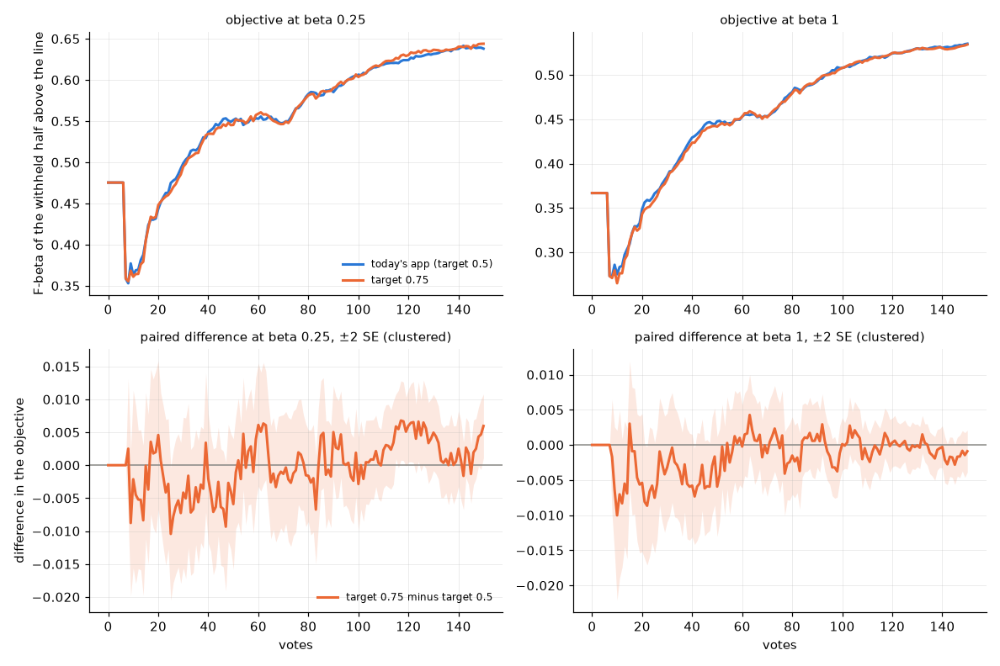
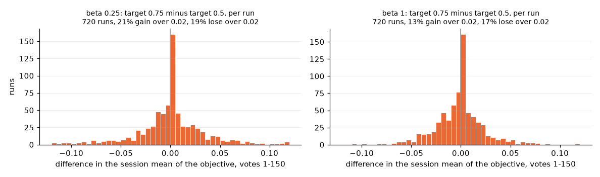

# Should Autopilot's acquisition target move with the preset? (issue #4746)

**No. Target pick precision 0.5 is confirmed at every preset.** Boundary picks and the atlas probe sample where
the labels line's corpus posterior falls below `ACQUISITION_TARGET_PRECISION` (#3546). Neither end of a per-preset
target beats 0.5 on the objective:

| target − 0.5, paired | beta 1/4 (0.75) | beta 1 (0.75) | beta 4 (0.25) |
|---|---|---|---|
| objective, session mean over votes 1–150 | +0.0000 ± 0.0013 | −0.0016 ± 0.0010 | +0.0005 ± 0.0007 |
| objective, short sessions (votes 1–50) | −0.0033 ± 0.0020 | **−0.0040 ± 0.0018** | +0.0006 ± 0.0003 ¹ |
| objective after the check | +0.0010 ± 0.0024 | −0.0008 ± 0.0014 | −0.0031 ± 0.0018 |
| AP at vote 150 | +0.0005 ± 0.0007 | +0.0008 ± 0.0007 | −0.0012 ± 0.0010 |
| AP, session mean | **−0.0015 ± 0.0007** | **−0.0016 ± 0.0008** | not read |
| Goods by vote 150 | **+1.2 ± 0.2** | **+1.3 ± 0.2** | **−1.2 ± 0.2** |
| Boundary picks that are Good | **43% → 47%** | **42% → 47%** | **38% → 32%** |

Beta 1/4 and 1 are today's app, 720 runs per arm. Beta 4 is #3546's cells re-read (432 runs per arm, the app of
2026-10-07); see "Step 1". ¹ #3546's analyzer reads votes 1–30, not 1–50. Bold means more than 2 SE from zero, the
SE clustered on category.

A target of 0.75 harvests more: it finds about one more Good by vote 150, and more of its Boundary picks are Good.
But the objective does not pay for it, and short sessions lose a little at beta 1. A target of 0.25 at beta 4
harvests less and is level or behind. Nothing ships; `ACQUISITION_TARGET_PRECISION` stays 0.5.

## The question

#3546 replaced Autopilot's line − 4 cut with a target pick precision of 0.5, the same at every preset. That
fixed a cut that drifted with the preset (Hard picks Good 24% / 22% / 19% at beta 1/4 / 1 / 4). It had beaten
"sample at the line", the fully beta-tied rule, which fell to 10% Good at beta 4. Its grid priced only 0.5 and 0.25,
each the same at all three presets. What it did not try is a target that moves with the preset, but by less than
the line moves:

- **Above 0.5 at beta 1/4**, where the line sits high and the preset rewards precision.
- **Below 0.5 at beta 4**, where the line sits deep and the preset rewards recall.

## Step 1: re-score #3546's cells (the low end)

#3546's `tp25` and `tp50` arms ran at all three presets and were still on `/expscratch`. They were re-read with
`analyze_acqcut_3546.py --rules tp50,tp25,line,ctl --control tp50`: 432 runs per arm, 3 seeds, the app of
2026-10-07, and the objective filled from that era's typed query (`tables/rescore_3546_paired.csv`).

| minus target 0.5 | objective, mean 1–150 | after the check | AP @150 | Goods by 150 | Hard picks Good |
|---|---|---|---|---|---|
| 0.25, beta 1/4 | +0.0007 ± 0.0009 | +0.0012 ± 0.0034 | +0.0011 ± 0.0011 | **−1.2 ± 0.2** | **−6.6 points** |
| 0.25, beta 1 | +0.0011 ± 0.0006 | +0.0008 ± 0.0018 | +0.0003 ± 0.0012 | **−1.2 ± 0.2** | **−6.7 points** |
| 0.25, beta 4 | +0.0005 ± 0.0007 | −0.0031 ± 0.0018 | −0.0012 ± 0.0010 | **−1.2 ± 0.2** | **−6.7 points** |
| at the line, beta 1/4 | +0.0001 ± 0.0011 | +0.0037 ± 0.0038 | +0.0017 ± 0.0010 | **+0.7 ± 0.2** | −0.6 points |

- **At beta 4, 0.25 is not ahead.** It is level over the session, and behind after the check and on AP, Goods
  and Hard picks. So the low end is settled without a new run.
- **Nothing above 0.5 had been run.** At beta 1/4, "at the line" put 37% of Hard picks on Goods, the same as 0.5
  (38%). The beta 1/4 line sits at about even odds, so that arm was a 0.5 arm in effect. The high end was open.

## Step 2: what was run (the high end)

| | |
|---|---|
| app | today's (dev ae05c9307: #4731's dry Good walk and quota, #4742's opening, the balance, the labels line, the weak check). Only `acq_target_p` changes |
| arms | `ctl` (today's app, target 0.5) and `tp75` (`CALIB_ACQ_TARGET_P=0.75`), each at beta 1/4 and 1, each preset on its own sessions and scored at its own beta |
| bench | `coco_better`, binary SigLIP, 144 class@band cells × 5 seeds = 720 runs per arm, 150 votes, the user's pool at 1%, the withheld half at the bench's 0.44% |
| commit | every cell on one frozen commit, `c6b51df44` (dev plus the launcher). 2,880 runs: 0 lost, 3 starved per arm (header-only) |
| scoring | the objective is F-beta at the preset's beta of the withheld half above the line the app shows, filled from the typed query's set at today's per-preset line until a detector shows (#4603, #4631). Paired on (category, seed), the SE clustered on category |

The prepare and the typed-query baseline are #4671's. `prepare_data.py`, `text_baseline.py` and
`vtscore/training/thresholds` are unchanged between #4671's run commit and this one. The analyzer checked the
baseline against every arm's own `n_test_pos` and found no mismatch. #4584's σ for an acquisition change is about
0.08 at beta 1. With 720 runs, an effect of about 0.006 on the session mean is resolvable.

## Result



*Top: the objective over votes, today's app (blue) and target 0.75 (orange). Bottom: their paired difference, ±2
SE. The arms part at vote 8, when the Boundary picks start after the opening's seven votes. Target 0.75 runs a
little behind until about vote 50 at both presets, then the curves meet. At beta 1/4 it ends +0.006 at vote 150;
that is one point on the curve, and it is gone after the check (+0.001).*

| | beta 1/4: 0.5 | 0.75 | beta 1: 0.5 | 0.75 |
|---|---|---|---|---|
| objective, mean 1–150 | 0.56 | 0.56 | 0.46 | 0.46 |
| objective, mean 1–50 | 0.48 | 0.47 | 0.37 | 0.37 |
| objective after the check | 0.64 | 0.65 | 0.53 | 0.53 |
| AP at vote 150 | 0.56 | 0.56 | 0.56 | 0.56 |
| Goods by vote 150 | 32 | 33 | 31 | 33 |
| Boundary picks Good | 43% | 47% | 42% | 47% |
| New (atlas) picks Good | 0.9% | 0.9% | 0.8% | 0.9% |

- **The harvest rises, and the objective does not follow.** Target 0.75 asks about items its model is surer of,
  so 4–5 more points of its Boundary picks are Good and it ends about one Good ahead. #3546 saw the same
  decoupling on its easiest classes, where target 0.5 found 5.8 fewer Goods and the objective did not charge for
  it. Goods are instrumental; a gain in them is not a gain on the withheld half.
- **The early sessions pay a little.** Over votes 1–50, 0.75 is −0.0033 ± 0.0020 at beta 1/4 and
  −0.0040 ± 0.0018 at beta 1. AP's session mean is −0.0015 ± 0.0007 and −0.0016 ± 0.0008. That fits picks that
  teach the young detector less about where it is unsure, though this grid does not test that reading.
- **The dial barely moves the cut.** At 1% prevalence the posterior falls from 0.75 to 0.5 within a few items at
  the top of the ranking. By vote 150 the 0.75 cut sits 0.0004 of the pool higher, about 2 of ~5,000 items. Both
  arms sample at the 99.9th percentile.
- **The atlas probe is unmoved.** Under 1% of New picks are Good in either arm.

## Per run



*Each run's session mean under 0.75 minus its pair under 0.5. About 100 runs per preset score exactly the same in
both arms. The rest spread evenly both ways: at beta 1/4, 21% gain more than 0.02 and 19% lose more than 0.02; at
beta 1, 13% gain and 17% lose.*

No size band moves: beta 1/4 small / medium / large +0.001 / −0.001 / +0.001, beta 1 +0.000 / −0.003 / −0.002.
The largest swings have the same Goods in both arms, so they are trajectories parting, not harvest:

| run | preset | session mean, 0.5 → 0.75 | Goods | after the check |
|---|---|---|---|---|
| `laptop@large` seed 3 | 1/4 | 0.82 → 0.68 | 44 → 44 | 0.85 → 0.87 |
| `dining table@large` seed 2 | 1/4 | 0.31 → 0.18 | 34 → 34 | 0.40 → 0.32 |
| `snowboard@medium` seed 0 | 1/4 | 0.53 → 0.73 | 54 → 54 | 0.81 → 0.93 |
| `toothbrush@small` seed 3 | 1/4 | 0.29 → 0.43 | 46 → 45 | 0.44 → 0.48 |
| `laptop@large` seed 3 | 1 | 0.69 → 0.58 | 44 → 44 | 0.80 → 0.80 |
| `tv@large` seed 2 | 1 | 0.60 → 0.50 | 49 → 49 | 0.77 → 0.74 |
| `snowboard@medium` seed 0 | 1 | 0.50 → 0.63 | 54 → 54 | 0.75 → 0.79 |
| median run, `bowl@medium` seed 3 | 1 | 0.08 → 0.08 | 14 → 14 | 0.13 → 0.13 |

## What is not settled

- **The beta 4 read is on the app of 2026-10-07**, three seeds, before #4603's typed-query line, #4731's dry Good
  walk and #4742's opening. The issue accepted that read for the low end. There 0.25 was level or behind at every
  preset, and here 0.75 is level on today's app: the objective is flat in the target on both apps.
- **Region voting and the deep regime** (more than 150 votes, #3547) are unmeasured, as they were for #3546.

## Reproducing

```bash
cd scripts/experiments/calibration
# step 1: #3546's cells, paired against target 0.5
python analyze_acqcut_3546.py --base /expscratch/$USER/acqcut-3546 \
  --baseline /expscratch/$USER/progression-4184-h0.01/text_baseline.csv \
  --rules tp50,tp25,line,ctl --control tp50 --out OUT1
# step 2: the high end on today's app
bash launch_acqtarget_4746.sh baseline     # copies #4671's typed-query baseline
bash launch_acqtarget_4746.sh preflight
LAUNCHER=$PWD/launch_acqtarget_4746.sh BASE=/expscratch/$USER/acqtarget-4746 JOB_PREFIX=acqt4746 \
  RUNGS="$(bash launch_acqtarget_4746.sh arms)" PER_RUNG=30 DRAIN_BY="<date>" bash drive_chunks.sh
python analyze_acqtarget_4746.py --base /expscratch/$USER/acqtarget-4746 --arms ctl,tp75 --presets b025,b1 --out OUT2
```

A cell peaks at about 1 GB. The first ~400 cells ran at 4G and the rest at 2G, which fits twice as many under the
per-user memory cap; the launcher now defaults to 2G.

`tables/` holds what this report quotes:
- `paired.csv`: target 0.75 minus 0.5, every read.
- `levels.csv`: each arm.
- `curves.csv` and `paired_curve.csv`: per vote.
- `per_run.csv`: every run's reads.
- `rescore_3546_paired.csv`: step 1.
- `provenance.json` and `rescore_3546_provenance.json`: the cell loads.
