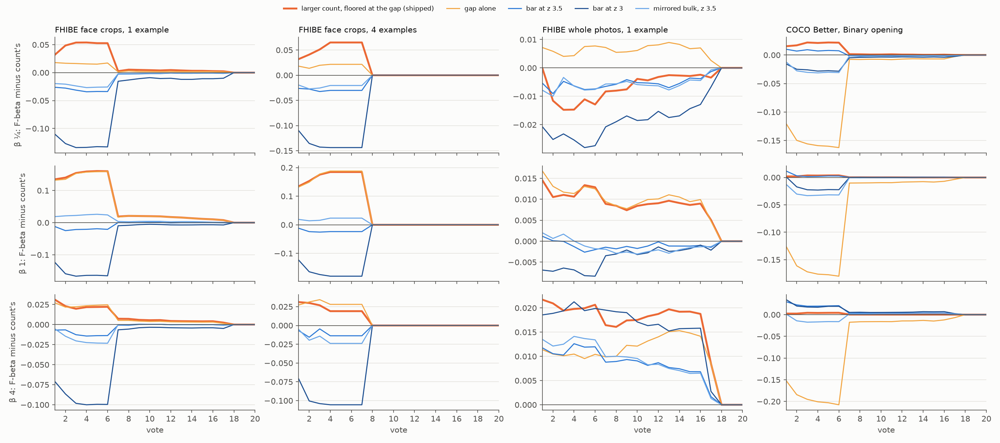

# The centroid's count misses a person's photos because they sit among the crowd's top; the widest drop finds them (#4759)

**2026-10-11.** Since #4732 the Goods' centroid draws the typed query's count line (#4603): it keeps
`beta ** 0.708` times the number of images above `median + 4 sigma`, beyond what a Gaussian bulk puts
there. On FHIBE's face crops that line keeps **one** of the median person's **four** withheld photos.

**The issue's candidates do not fix it.** A lower bar (z = 3 or 3.5) or a mirrored bulk changes
F-beta over votes 1–10 by −0.12 to +0.02 on face crops. A person's photos sit **3 to 4 bulk sigmas**
above the median, among the crowd's own most similar faces. At z = 3, a Gaussian bulk of 5,439 crops
puts about 7 images above the bar, more than the person has. Any bar low enough to reach their photos
also subtracts more than they add.

**What separates them is the drop just below the person's last photo.** The shipped line,
`count_gap_floor`, takes the larger of two counts: #4603's count and the number of images above the
widest drop between neighbours in the top 11. It scales that by `beta ** 0.708` as before, but never
keeps fewer than the drop's count. Paired against #4732's count line, mean F-beta of what a Find
returns over votes 1–10 changes by:

- FHIBE face crops: **+0.09 to +0.12** at beta 1, **+0.03 to +0.04** at beta ¼, **+0.02** at beta 4;
- FHIBE whole photos: **+0.01 to +0.02** at beta 1, **+0.02 to +0.03** at beta 4, and **−0.002 to −0.009**
  at beta ¼, each within 2 SE of zero;
- COCO Better's Binary opening: **+0.012** at beta ¼ and **+0.002** at beta 1 and 4.

On the centroid's own clicks with one example photo, the face line goes from keeping 1 crop (precision
0.84, recall 0.47) to keeping 3 (0.82, 0.67). Over the owner's single number, mean F-beta over votes
1–150, the gain is **+0.006 to +0.008** on faces at beta 1. That is a short-session gain: the tier lasts
5.6 to 7.9 votes on faces and COCO, and about 15 on whole photos from one example.



*Figure 1. Each candidate's mean F-beta minus #4732's count line, at every vote, over every run. Rows
are beta ¼, 1 and 4; columns are FHIBE face crops from 1 and 4 example photos, whole photos from 1, and
COCO's Binary opening. The shipped rule is the thick orange line. Every difference is zero once Find
stops giving the centroid: near vote 7 on faces with 1 example, at vote 8 with 4 (the examples are
votes 1–4), and near vote 17 on photos, where the walk rarely finds a second photo. `gap_floor` and
`count_gap` are not drawn: they are the shipped rule below and above beta 1.*

## What was run

- **One frozen commit** (`402aa4547`, worktree `vts-4759-run`), and the same benches as #4732:
  - **FHIBE** (#4699): the baseline's 562 people × 4 datasets (whole photos with SigLIP and face crops
    with FaceNet, each at 1024 and 640 px). One run starts from K = 1 example photo, one from K = 4.
    Each has 2,248 runs, cut at 40 votes, at the app's default balance (beta 1).
  - **COCO Better Binary Photo**: the State of the App's 144 cells (2026-10-08 grid) × 5 seeds, with
    the text opening, cut at 40 votes. 720 runs.
- **The lines are tagged rows on the same sessions** (`CALIB_CENTROID_LINE_VARIANTS`, as in #4732).
  At every click where Find gives the centroid, each rule redraws the line on the withheld half at
  beta ¼, 1 and 4. The centroid never picks and the opening reads no balance, so two rules differ only
  in what they keep on the centroid's clicks. The rules, all in `CENTROID_LINE_RULES`:
  - `count`: #4732's line, the reference;
  - `count_z3`, `count_z3.5`: #4603's Gaussian excess above a lower bar;
  - `mirror_z3.5`: the excess above the bar over the count as far below the median (#4603's mirror
    estimator);
  - `gap`: the count of cosines above the widest drop between neighbours in the top 11;
  - `count_gap`: the larger of `count`'s and `gap`'s counts;
  - `gap_floor`: `count`'s line, lowered to the widest drop when that keeps more;
  - `midpoint`: the line before #4732, which the reader pairs against.
- **`count_gap_floor` was found after the runs and is read off them.** It keeps exactly what
  `gap_floor` keeps at beta ≤ 1 and what `count_gap` keeps at beta ≥ 1, because `beta ** 0.708 ≥ 1`
  there. `test_count_gap_floor_is_gap_floor_below_beta_1_and_count_gap_above` pins that identity.
- **The read.** Every run counts in every average (#4631). 69 COCO runs found no Good by vote 40 and
  score 0 under every rule. Every centroid tier ended inside 40 votes, so the differences over votes
  1–50 and 1–150 are exact. Paired SEs cluster on the category, which on FHIBE is the person.
- **Before the runs, an offline exploration chose the candidates.** For each person and K, it rebuilt
  the opening centroid (the K example photos) and its cosines on the withheld half with the harness's
  own pieces, then priced 26 count rules on them in seconds (`fhibe/centroid_count_4759.py`). That is
  where the gap came from; the issue's candidates were priced in the runs anyway.
- **Cost.** About 1.6 min per FHIBE run and 2.3 min per COCO run on the cpu partition. The run took
  20:44–01:35 because the cap was shared with two other sessions' arrays.

## Results

### Against #4732's count line

`count_gap_floor` minus `count`, mean F-beta over votes 1–10 (paired, every run, ± SE):

| bench | runs | beta ¼ | beta 1 | beta 4 |
|---|---|---|---|---|
| FHIBE faces 1024, K=1 | 562 | +0.031 ± 0.004 | +0.099 ± 0.006 | +0.017 ± 0.002 |
| FHIBE faces 640, K=1 | 562 | +0.030 ± 0.003 | +0.089 ± 0.005 | +0.015 ± 0.002 |
| FHIBE photos 1024, K=1 | 562 | −0.009 ± 0.005 | +0.011 ± 0.003 | +0.019 ± 0.003 |
| FHIBE photos 640, K=1 | 562 | −0.002 ± 0.005 | +0.015 ± 0.003 | +0.017 ± 0.003 |
| FHIBE faces 1024, K=4 | 562 | +0.038 ± 0.003 | +0.120 ± 0.006 | +0.016 ± 0.002 |
| FHIBE faces 640, K=4 | 562 | +0.035 ± 0.003 | +0.117 ± 0.006 | +0.018 ± 0.002 |
| FHIBE photos 1024, K=4 | 562 | −0.006 ± 0.004 | +0.022 ± 0.002 | +0.027 ± 0.002 |
| FHIBE photos 640, K=4 | 562 | −0.004 ± 0.003 | +0.020 ± 0.002 | +0.025 ± 0.002 |
| COCO Better Binary, 5 seeds | 720 | +0.012 ± 0.002 | +0.002 ± 0.000 | +0.002 ± 0.001 |

Over votes 1–150 the same differences are +0.006 to +0.008 on faces at beta 1, +0.002 to +0.003 at
beta ¼ and +0.001 at beta 4. On photos they are −0.001 to +0.002, and on COCO 0.000 to +0.001
(`summary.csv`, `dd_1-150`). The one loss, whole photos at beta ¼, is not resolvable in any cell. Its
four cells all lean the same way, so read it as a small real cost there. On whole photos the
centroid's ranking is weak: what it ranks first is the person 19% to 26% of the time. A second image
is more often a stranger.

### The issue's candidates, and the gap's two halves

Each rule minus `count`, votes 1–10, at beta ¼ / 1 / 4. Ranges are over the four FHIBE datasets and
both K:

| rule | FHIBE faces | FHIBE photos | COCO |
|---|---|---|---|
| `count_z3` | −0.07 to −0.10 / −0.08 to −0.12 / −0.05 to −0.07 | −0.015 to −0.022 / −0.005 to −0.007 / +0.009 to +0.021 | −0.017 / −0.011 / +0.015 |
| `count_z3.5` | −0.016 to −0.021 / −0.012 to −0.018 / −0.006 to −0.008 | −0.005 to −0.006 / −0.001 to +0.002 / +0.009 to +0.012 | +0.004 / +0.003 / +0.014 |
| `mirror_z3.5` | −0.014 to −0.016 / +0.005 to +0.015 / −0.009 to −0.013 | −0.004 to −0.006 / −0.002 to +0.001 / +0.004 to +0.012 | −0.017 / −0.017 / −0.007 |
| `gap` | +0.010 to +0.014 / +0.087 to +0.121 / +0.016 to +0.021 | +0.002 to +0.013 / +0.011 to +0.019 / +0.009 to +0.022 | −0.094 / −0.103 / −0.121 |
| `gap_floor` | +0.030 to +0.038 / +0.089 to +0.120 / +0.013 to +0.018 | −0.002 to −0.009 / +0.011 to +0.022 / +0.003 to +0.009 | +0.012 / +0.002 / 0.000 |
| `count_gap` | +0.008 to +0.012 / +0.089 to +0.120 / +0.015 to +0.018 | −0.003 to +0.005 / +0.011 to +0.022 / +0.017 to +0.027 | +0.002 / +0.002 / +0.002 |
| **`count_gap_floor`** | +0.030 to +0.038 / +0.089 to +0.120 / +0.015 to +0.018 | −0.002 to −0.009 / +0.011 to +0.022 / +0.017 to +0.027 | +0.012 / +0.002 / +0.002 |

- **A lower bar loses on faces at every balance.** z = 3 costs up to 0.12. It wins only at beta 4 on
  photos and COCO, where keeping more pays whatever is kept.
- **The gap alone fails on COCO** (−0.09 to −0.12). An image centroid on COCO has no clean drop, so
  the widest one sits in the first few images and the line keeps 1 to 5 where the count keeps 6 to 44.
  Both hybrids keep at least what the count keeps, so neither can fall that way.
- **The two hybrids split by balance.** At beta ¼ the floor keeps the gap where the count's
  `3/8` multiple keeps one image; on faces that is +0.03 against +0.01. At beta 4 the count's `2.7×`
  multiple keeps more than the floor; on photos that is +0.017 to +0.027 against +0.003 to +0.009, and on
  faces the two tie. At
  beta 1 they are one rule. `count_gap_floor` takes each one's better side.

### What the lines keep

On the centroid's own clicks, at beta 1 (median kept; mean precision, recall and F-beta), and the
absolute mean F-beta of what a Find returns over votes 1–10:

| bench | `count` kept | P | R | F | shipped kept | P | R | F | F 1–10, count → shipped |
|---|---|---|---|---|---|---|---|---|---|
| FHIBE faces 1024, K=1 | 1 | 0.84 | 0.47 | 0.54 | 3 | 0.82 | 0.67 | 0.69 | 0.53 → 0.63 |
| FHIBE faces 640, K=1 | 1 | 0.83 | 0.45 | 0.52 | 3 | 0.82 | 0.63 | 0.66 | 0.51 → 0.60 |
| FHIBE photos 1024, K=1 | 1 | 0.19 | 0.09 | 0.10 | 2 | 0.17 | 0.11 | 0.11 | 0.10 → 0.11 |
| FHIBE faces 1024, K=4 | 1 | 0.89 | 0.50 | 0.57 | 3 | 0.87 | 0.72 | 0.74 | 0.55 → 0.67 |
| FHIBE faces 640, K=4 | 1 | 0.89 | 0.47 | 0.55 | 3 | 0.87 | 0.69 | 0.72 | 0.53 → 0.65 |
| FHIBE photos 1024, K=4 | 1 | 0.26 | 0.10 | 0.13 | 2 | 0.24 | 0.15 | 0.16 | 0.12 → 0.14 |
| COCO Better Binary | 17 | 0.55 | 0.27 | 0.28 | 17 | 0.55 | 0.27 | 0.29 | 0.24 → 0.24 |

At beta 4 the shipped line keeps 8 face crops (precision 0.41 to 0.44, recall 0.76 to 0.84). Keeping
the drop alone there (`gap_floor`, 4 crops) scores the same on faces, so the `2.7×` multiple costs
nothing. The best cut on the labels scores about 0.1 more on the opening centroid; that headroom is in
the people the drop misses (below).

## Why a bar cannot find them

From the exploration, on the opening centroid (the median over people of each quantity):

| dataset | crops in the withheld half | photos withheld | lowest photo (z) | median photo (z) | highest photo (z) | strangers above z 3, over a Gaussian's |
|---|---|---|---|---|---|---|
| faces 1024, K=1 | 5,439 | 4 | 3.0 | 3.5 | 3.9 | 0.68 |
| faces 1024, K=4 | 5,439 | 4 | 3.3 | 3.8 | 4.0 | 0.55 |
| faces 640, K=1 | 5,027 | 4 | 2.9 | 3.4 | 3.8 | 0.59 |
| photos 1024, K=1 | 5,139 | 4 | 1.3 | 2.0 | 2.7 | 0.72 |

A Gaussian bulk of 5,439 puts 7.3 crops above z = 3, 1.3 above 3.5 and 0.17 above 4. The real bulk
puts about two thirds of that above z = 3. So above z = 4 the count finds one of the person's photos.
Above z = 3 it finds all four plus about five strangers, then subtracts 7.3 and keeps one again. The
mirror estimator subtracts the bulk's lower tail instead. On FaceNet cosines that tail is lighter
than the upper one, so the mirror counts the upper tail's strangers as the person and keeps them too. The person's photos are not far from the crowd. They are
*just* past its edge, and what marks them is a drop between neighbours, not a distance from the
median.

### Literal examples

Face crops at 1024 px, one example photo, the opening centroid at beta 1. Each row is the top 12 of the
withheld half in bulk sigmas above the median; `*` marks the person's own photos. Drawn from a seeded
shuffle of the 562 people, the first three of each kind (`centroid_count_4759.py examples`):

**The gap wins** (the count keeps the top one; the drop sits right after the person's last photo):

| person | photos | top 12 (z) | count keeps | gap floor keeps | F count → floor |
|---|---|---|---|---|---|
| 26082f1a-20b4-4222-9d2f-db1b07c7faab | 4 | 3.15* 3.09* 3.02* 3.00* 2.88 2.76 2.75 2.75 2.71 2.69 2.66 2.58 | 1 | 5 | 0.40 → 0.89 |
| 1f3b5b3c-ab8b-4d43-b54f-15eb1b02f669 | 5 | 3.51* 3.34* 3.22* 3.07* 2.81 2.73 2.72 2.72 2.70 2.69 2.68 2.68 | 1 | 4 | 0.33 → 0.89 |
| 16065dbd-a5ab-4f01-a76e-7cec61057292 | 5 | 4.26* 4.10 3.97* 3.49* 3.43 3.42* 3.37 3.27 3.26 3.24 3.18 3.15 | 2 | 3 | 0.29 → 0.50 |

In the first row the drops after the fourth and fifth crops tie to two decimals in z; the fifth is a
hair wider, so the floor keeps one stranger too.

**The gap loses** (a stranger sits second, and the widest drop falls after it):

| person | photos | top 12 (z) | count keeps | gap floor keeps | F count → floor |
|---|---|---|---|---|---|
| 41935990-a27d-4733-bbff-9e9afb5706d2 | 4 | 4.04* 3.76 3.45* 3.32 3.26 3.25* 3.18 3.12 3.09 3.05 3.03 3.02 | 1 | 2 | 0.40 → 0.33 |
| ab7dfe38-50ba-4b81-abf9-c639044fccef | 4 | 3.59* 3.49 3.38 3.34 3.31 3.21 3.20 3.17 3.13 3.11 3.11 3.09 | 1 | 2 | 0.40 → 0.33 |
| c3ebcf09-142e-4bf9-95da-c7e25f95a374 | 4 | 3.20* 3.16 3.05 3.01* 2.95 2.90 2.87 2.87 2.86 2.86 2.82 2.79 | 1 | 2 | 0.40 → 0.33 |

**Both miss** (the person's best photo stands far above their others, so the widest drop is right
after it):

| person | photos | top 12 (z) | count keeps | gap floor keeps | F |
|---|---|---|---|---|---|
| 85a4998b-08ed-4067-8e99-e6231a12a099 | 4 | 4.11* 3.78* 3.70* 3.59 3.53* 3.34 3.21 3.17 3.10 3.02 2.97 2.95 | 1 | 1 | 0.40 |
| 2940a3f9-95e6-4ed0-80f5-7bdb7bb6d44a | 3 | 4.05* 3.58* 3.53* 3.33 3.27 3.08 3.00 2.92 2.88 2.87 2.85 2.82 | 1 | 1 | 0.50 |
| b22ab81f-e6ba-4ef6-8f86-698aeb343641 | 3 | 5.43* 5.00* 3.94 3.73* 3.39 3.36 3.35 3.32 3.31 3.29 3.28 3.13 | 2 | 2 | 0.80 |

The strangers ranked second in the middle table are other FHIBE subjects. If one of them were the same
person under a second subject id, the loss would be an annotation error. Those three ids are where to
look.

## What shipped

- `vtscore/detectors/centroid_head.py`: `CENTROID_LINE_RULE = "count_gap_floor"`. The candidates stay in
  `CENTROID_LINE_RULES` (`CENTROID_COUNTS` lists the counts), and `CENTROID_GAP_TOP = 10` is how deep the
  widest drop is looked for. `count` is #4732's line.
- `vtscore/training/thresholds/gmm.py`: `_count_line` splits into `_count_estimate(scores, z=, bulk=)`
  and `_count_keep_line(scores, beta, n_hat)`. The typed query's line is unchanged.
- The harness takes the app's rule by default, so every study's centroid rows move with it.
  `CALIB_CENTROID_LINE=count` is the arm before this change.
- `ML.md`, `EVAL.md`, both CHANGELOGs, and the docstrings that named the count line.

**What the app gets now, and what waits for #4779.** The harness draws the centroid's line on the
withheld half, which holds no voted media, as a Find on another collection would. On the collection
the user labelled, the app draws it over every media, Goods included (#4779). One example photo then
sits at cosine 1.0 at the top of its own ranking, and the widest drop usually falls right below it.
With the example added back to each face cell's withheld half, `count_gap_floor` keeps exactly what
`count` keeps in **78%, 91% and 88%** of face sessions at beta ¼, 1 and 4, and more in the rest. On
whole photos it keeps the same in at least 99.8%. So a Find on another collection gets the gain above
now. On the labelled collection the gain mostly waits for #4779, which draws the line over the unvoted
media. Neither path keeps fewer than before.

## Caveats

- **One balance per session.** The runs used beta 1 for the trained phase. The differences at beta ¼
  and 4 are exact, because the opening reads no balance; their absolute curves are not drawn.
- **The gap was chosen on FHIBE's opening centroids**, the same people the runs price. The rule has one
  knob, the depth of 11, and the exploration found 11, 31 and 101 within 0.002 of each other. COCO was
  not part of the choice and did not lose.
- **On whole photos at beta ¼ the shipped rule costs 0.002 to 0.009**, inside 2 SE in each cell.
- **`count_gap_floor` is read off two rules' rows**, not drawn in a run of its own. The identity is
  exact for distinct cosines; tied cosines at the line could differ by the tie.

## Follow-ups

- #4779 (open): draw an example sort's and the centroid head's line over the unvoted media. With it the
  labelled collection gets this report's gain.
- #4783: the widest drop stops after a person's standout photo. Among people whose top two or more
  crops are all their own, it keeps only the first in 16% to 24% of face sessions (the "both miss"
  rows above).

## Reproduce

```bash
# exploration (owner-only outputs; in a FHIBE run's environment)
python scripts/experiments/fhibe/centroid_count_4759.py dump --results <runs>/2026-10-09-k4/results --ks 1,4 --out <explore>/dumps
python scripts/experiments/fhibe/centroid_count_4759.py price --dumps <explore>/dumps --out <explore>/price-all
python scripts/experiments/fhibe/centroid_count_4759.py examples --dumps <explore>/dumps --dataset fhibe_faces_1024 --k 1 --out <explore>/examples.md
# the runs, from a frozen worktree at the pricing commit
bash scripts/experiments/fhibe/centroid_count_4759.sh dirs 1 && bash scripts/experiments/fhibe/centroid_count_4759.sh launch 1
bash scripts/experiments/fhibe/centroid_count_4759.sh dirs 4 && bash scripts/experiments/fhibe/centroid_count_4759.sh launch 4
bash scripts/experiments/state_of_app/centroid_count_4759.sh dirs 5 && bash scripts/experiments/state_of_app/centroid_count_4759.sh launch 5
# the read
python scripts/experiments/calibration/analyze_centroid_count_4759.py \
  --run fhibe-k1=<runs>/2026-10-10-4759-k1 --run fhibe-k4=<runs>/2026-10-10-4759-k4 \
  --run coco-b1=<sota>/2026-10-10-centroid4759-b1 --out <analysis> \
  --variants "$(bash scripts/experiments/fhibe/centroid_count_4759.sh variants 1)"
python scripts/experiments/calibration/figures_centroid_count_4759.py --curves <analysis>/curves.csv --out <dir> \
  --panel "fhibe-k1/fhibe_faces_1024=FHIBE face crops, 1 example" \
  --panel "fhibe-k4/fhibe_faces_1024=FHIBE face crops, 4 examples" \
  --panel "fhibe-k1/fhibe_1024=FHIBE whole photos, 1 example" \
  --panel "coco-b1/coco_better=COCO Better, Binary opening"
```

After this change the harness's default rule is `count_gap_floor`, so a rerun sets
`CALIB_CENTROID_LINE=count` to get the pricing commit's untagged rows back. The tagged rows are the
same either way.

Files here: `summary.csv` (per bench × rule × balance: runs, the tier's size and quality, each rule
minus `count` over votes 1–10/50/150 with SEs, absolute means at beta 1) and `exploration_summary.csv`
(per dataset × K × estimator × balance on the opening centroid, against `gauss_z4`, which is `count`).
FHIBE's per-run rows and cosines name people, so they stay owner-only in the release's
`runs/2026-10-10-4759-analysis` and `runs/2026-10-10-4759-explore`.
