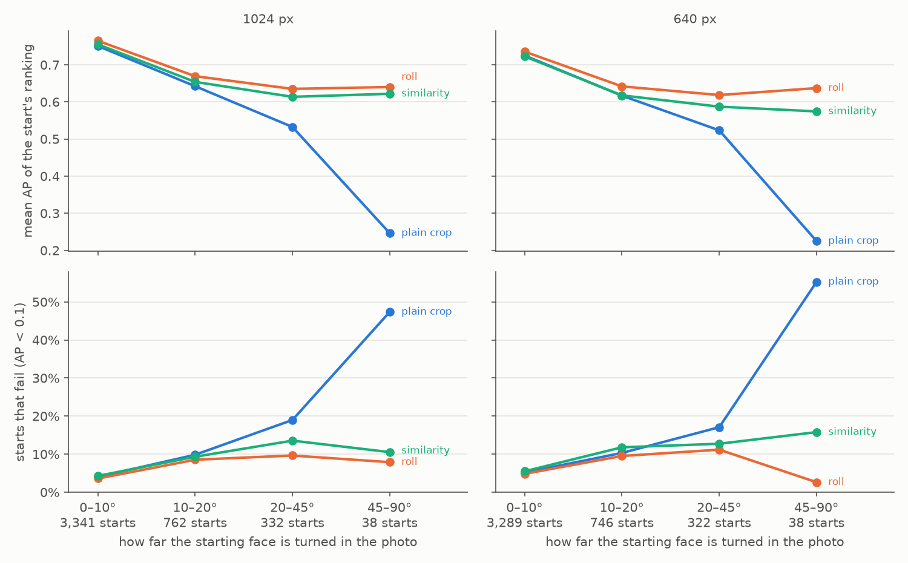
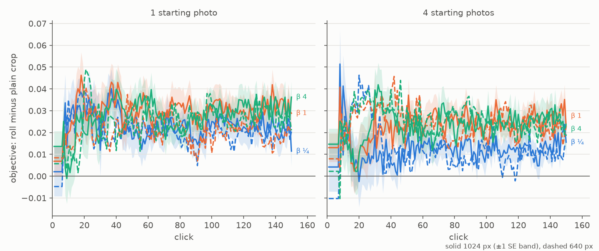

# Aligning face crops by their landmarks — 2026-10-10 (#4777)

**Turning each face crop upright before FaceNet embeds it helps every face session, and it ships
as the default.** `image2face` now fits MTCNN's five landmarks and turns the crop about its box
(`align="roll"`). The face review's 6,744 sessions (#4762) were run again on aligned crops, each
paired with the review's own session for the same person:

- the objective's mean over clicks 1–150 rises in **all 12 session sets**: **+0.020 to +0.029**
  from one starting photo and +0.012 to +0.025 from four (SE 0.004–0.005);
- **failed one-photo sessions fall from 12 to 7** at 1024 px and from 15 to 7 at 640;
- final AP rises by 0.018 to 0.029, and the full-label ceiling rises with it (0.891 → 0.909 at
  1024 px), so the headroom is unchanged.

The usual full 5-point alignment (`similarity`) was screened too and gains less: it re-scales the
crop to the landmarks' spread and zooms in on faces in profile. Alignment cannot fix a face in
profile, one turned down, or one lying sideways whose landmarks MTCNN itself gets wrong. Those are
6 of the 12 failures, and the last kind is #4788.

## What changed

`image2face` cropped MTCNN's box and handed it to FaceNet as it lay in the photo. A face lying
sideways or tilted reached FaceNet sideways or tilted. MTCNN also returns five landmarks per face
(the eyes, the nose and the mouth corners), so the converter now has an `align` field:

- **`none`**: the plain box crop, as before.
- **`roll`**: a least-squares similarity fit of the five landmarks to a template gives the face's
  angle in the photo. The photo is turned about the box's centre by that angle, then the same
  padded box is cropped. An upright face's crop is unchanged.
- **`similarity`**: the same fit, but the crop is a square at the fit's own scale, centred on the
  template: the usual 5-point alignment.

The template is where an upright face's landmarks sit in MTCNN's own box: the median over the
7,186 subject faces of FHIBE's one-person photos at 1024 px whose eye line is within 10° of level
(`align_landmarks_4777.py template`; 640 px agrees to 0.003). Alignment changes pixels only. Which
faces are found and kept, and the `source_box` each records, do not depend on it.

**How tilted are FHIBE's faces?** Of 9,807 subject faces at 1024 px, the fit finds a median roll of
5°, and **25% are turned more than 10°**, 8.6% more than 20°, 3.5% more than 30° and 0.8% more than
45°.

## The bench, and the control

The bench is the State of the App: Face review's (#4762): its 562 people, starting from 1 and from
4 photos, faces at 1024 and 640 px, one session set per preset (β ¼, 1, 4), 150 votes, shipped
defaults otherwise, one seed.

The aligned cells, `fhibe_faces_roll_{1024,640}` and `fhibe_faces_sim_{1024,640}`, are the same
detections, media ids and labels as `fhibe_faces_*`; only the crop pixels differ. The screen
refuses arms whose ids or labels differ, and all three paired. So every session pairs with the
review's session of the same person, size, starting photos and preset, with the same split and the
same starting photos.

**The review's 6,744 sessions are the control, not a re-run.** The code moved between the review's
commit and this study's (`c74d31dde`). So 24 of the review's cells (2 people × 2 sizes × 6 sets)
were re-run at `c74d31dde` on Intel nodes, as the review's were, and compared value for value
(`cells_identical.py`):

- every vote's pick is the same;
- every objective, AP and line column of the session rows is the same, to the sixth decimal
  (last-digit rounding of the thresholds, from the different Intel CPU);
- the only columns that moved are six `*_honest` cost diagnostics and some threshold-variant rows
  (`pooled_sim_oracle_*` and the like). The analyzer reads none of them.

MTCNN's detections are also reproducible across V100 nodes: a pass on rack8n06 gave the same media
ids and the same crop size for every subject crop as the cells built on rack7n03 and on an SXM2
node. The aligned cells were built on rack8n03.

## The screen: one starting photo, every photo a session could start from

Before the sessions, each arm was screened on click 0 for every possible start
(`align_screen_4777.py`). Each subject crop of the 562 people takes a turn as the one starting
photo. Its example sort (cosine to that crop) is scored by the AP of the person's other crops among
every other media in the cell. That is 4,473 starts at 1024 px and 4,413 at 640. A start fails at
AP below 0.1, the review's bar. Differences are paired, with SEs over people.

| size | arm | mean AP | vs plain | failed starts | fixed / made |
|---|---|---|---|---|---|
| 1024 | plain crop | 0.712 | | 290 (6.5%) | |
| 1024 | **roll** | **0.738** | **+0.026 ± 0.003** | **220** | 103 / 33 |
| 1024 | similarity | 0.726 | +0.014 ± 0.004 | 263 | 110 / 83 |
| 640 | plain crop | 0.686 | | 333 (7.5%) | |
| 640 | **roll** | **0.709** | **+0.023 ± 0.003** | **274** | 110 / 51 |
| 640 | similarity | 0.692 | +0.006 ± 0.004 | 324 | 117 / 108 |



*Figure 1. The screen by the starting face's roll (the angle the landmarks' fit removes). Top: mean
AP of the start's example sort. Bottom: the share of starts that fail (AP < 0.1). One column per
stored size.*

**`roll`'s gain grows with the tilt**, and it never loses:

| roll of the starting face | starts (1024) | plain | roll | Δ (1024) | Δ (640) |
|---|---|---|---|---|---|
| 0–10° | 3,341 | 0.751 | 0.765 | +0.014 ± 0.002 | +0.011 ± 0.002 |
| 10–20° | 762 | 0.642 | 0.669 | +0.027 ± 0.005 | +0.025 ± 0.006 |
| 20–45° | 332 | 0.533 | 0.635 | +0.103 ± 0.014 | +0.095 ± 0.013 |
| 45–90° | 38 | 0.246 | 0.640 | **+0.394 ± 0.058** | +0.412 ± 0.056 |

For starts turned 45–90°, the share that fail falls from 47% to 8% at 1024 px and from 55% to 3% at
640. Even near-upright starts gain a little (+0.014 at 1024 px): the median face in that band is
turned 3.4°, and levelling it still moves FaceNet's vector.

**`similarity` gains less in every band and makes more failures** (83 and 108 made, against 33 and
51 for `roll`). It re-scales each crop to the landmarks' spread, and on a face in profile the
landmarks bunch together: the crop zooms in on half a face. At 640 px it is level with the plain
crop for upright starts (−0.002 ± 0.004). **Only `roll` went on to sessions.**

## The sessions

`roll` ran the review's six session sets on `fhibe_faces_roll_{1024,640}`: 6,744 sessions, 0
failed. Each is paired with the review's session of the same person, size, starting photos and
preset (`align_compare_4777.py`). The objective is F-beta of the withheld set at the app's line,
at the set's own beta. The session mean is over clicks 1–150, filled as the review fills it: the
example sort until Autopilot shows a detector. SEs are over the 562 people.

| start | size | β | session mean: plain → roll | Δ | after the check, Δ | final AP, Δ | failed sessions: plain → roll |
|---|---|---|---|---|---|---|---|
| 1 photo | 1024 | ¼ | 0.83 → 0.85 | **+0.023 ± 0.005** | +0.020 ± 0.007 | +0.024 ± 0.005 | **12 → 7** |
| 1 photo | 1024 | 1 | 0.73 → 0.75 | **+0.029 ± 0.005** | +0.032 ± 0.007 | +0.024 ± 0.005 | 12 → 7 |
| 1 photo | 1024 | 4 | 0.74 → 0.77 | **+0.027 ± 0.005** | +0.039 ± 0.007 | +0.025 ± 0.005 | 12 → 7 |
| 1 photo | 640 | ¼ | 0.82 → 0.84 | +0.020 ± 0.005 | +0.024 ± 0.007 | +0.026 ± 0.006 | **15 → 7** |
| 1 photo | 640 | 1 | 0.70 → 0.72 | +0.020 ± 0.005 | +0.024 ± 0.008 | +0.026 ± 0.006 | 15 → 7 |
| 1 photo | 640 | 4 | 0.72 → 0.74 | +0.024 ± 0.005 | +0.019 ± 0.008 | +0.029 ± 0.006 | 15 → 7 |
| 4 photos | 1024 | ¼ | 0.85 → 0.86 | +0.012 ± 0.004 | +0.009 ± 0.006 | +0.018 ± 0.004 | 0 → 0 |
| 4 photos | 1024 | 1 | 0.73 → 0.76 | +0.023 ± 0.004 | +0.022 ± 0.007 | +0.018 ± 0.004 | 0 → 0 |
| 4 photos | 1024 | 4 | 0.74 → 0.76 | +0.023 ± 0.004 | +0.030 ± 0.007 | +0.018 ± 0.004 | 0 → 0 |
| 4 photos | 640 | ¼ | 0.84 → 0.85 | +0.012 ± 0.004 | +0.024 ± 0.008 | +0.018 ± 0.004 | 0 → 0 |
| 4 photos | 640 | 1 | 0.71 → 0.73 | +0.024 ± 0.004 | +0.029 ± 0.007 | +0.018 ± 0.004 | 0 → 0 |
| 4 photos | 640 | 4 | 0.72 → 0.74 | +0.025 ± 0.005 | +0.015 ± 0.007 | +0.019 ± 0.004 | 0 → 0 |

A failed session ends with AP below 0.1 although its own full-label ceiling reaches 0.5, the
review's 12 (and 15 at 640). Every set gains, by 3.3 to 6 SE. Starting from four photos gains too,
though no such session failed: alignment improves every photo's vector, the ones the session finds
later included. At click 0 the example sort's own objective barely moves (−0.010 to +0.015, each
within 2 SE), because its line keeps few photos. The gain comes as soon as the walk has a few Goods.



*Figure 2. Roll minus plain crop, in the objective the session shows at every click, mean over the
562 people; colour is the preset, solid 1024 px with a ±1 SE band, dashed 640 px. From about click
8 the gain holds at +0.02 to +0.03 for the rest of the session.*

**The 12 failures** (1 photo, 1024 px; the review named them by subject ID). `roll` fixes six:
`548d8580` (final AP 0.03 → 1.00), `7a21b1c4` (0.00 → 1.00), `a99c00ee` (0.01 → 0.87), `c22b8b53`
(0.00 → 0.95), `c34d07b0` (0.02 → 0.21) and `f5775002` (0.00 → 0.83). Five of them start from a
face turned 19° to 77°. The sixth, `c34d07b0`, starts nearly level under a cap and only just clears
the bar. The other six are faces alignment cannot fix:
- `0cdec9c8` and `48b38d95`: in profile;
- `4e5dabe1`: turned down;
- `4f3fa1da`: turned 35° and down, still failing;
- `2b76ec95` and `6fd3845d`: lying sideways. MTCNN's landmarks for those two faces are wrong: the
  fit reads 9° and 20°, so nothing is turned (#4788).

**What it made.** One session fails under `roll` that did not before, at each size (`11cae430` at
1024, `16c82ff4` at 640). Both start from a face turned steeply down, and the start's example sort
is near AP 0 in both arms (0.02 → 0.001 and 0.008 → 0.005). The plain session happened to recover
from that start and the aligned one did not.

**Every stratum gains** (1 photo, 1024 px, β 1): she/her +0.034 ± 0.008 against he/him +0.025 ±
0.006, so the review's pronoun gap (#4780) narrows by about 0.01, within the noise. Every age
bracket and skin-tone anchor gains as well.

**Headroom is unchanged.** The full-label ceiling is built from the same crops, so it rises too:
0.891 → 0.909 at 1024 px and 0.875 → 0.892 at 640. From one photo the final AP ends 0.007 below it
(0.902), against 0.012 before.

## Decision: `roll` is the default

The issue's bar was to ship if it wins. It wins on the owner's number in every session set, and on
failures and final AP. `image2face`'s `align` field now defaults to `roll`, so any face dataset
converted from now on is aligned. Datasets already converted keep their crops until they are
converted again. `similarity` and `none` stay available in the importer.

**The face review's cells.** `fhibe_faces_{1024,640}` stay plain crops, the app before #4777, so
#4762's report still reproduces. The next face review runs the shipped crops with
`SOTA_FACE_ARM=roll` (`fhibe_faces_roll_*`), and this study's roll sessions are that review's
2026-10-10 baseline (the state-of-the-app skill says so).

## Provenance

| | |
|---|---|
| Code | `c74d31dde` (branch `claude/face-align-4777`), run from a frozen worktree; the screen's start filter `055e51f06` |
| Cells | `fhibe_faces_{roll,sim}_{1024,640}`, built 2026-10-10 on rack8n03 (V100), owner-only beside the FHIBE release |
| Control | the review's run dirs `<release>-derived/runs/2026-10-10-sota-k{1,4}-b{025,1,4}` (#4762) |
| Arm | `<release>-derived/runs/2026-10-10-sota-roll-k{1,4}-b{025,1,4}` |
| Landmarks, screen, repro, comparison (owner-only) | `<release>-derived/runs/2026-10-10-align-4777/`, `2026-10-10-repro-sota-*` |

Reproduce:

```bash
# landmarks and the template
python scripts/experiments/fhibe/align_landmarks_4777.py detect --long-side 1024 --out <dir>   # and 640
python scripts/experiments/fhibe/align_landmarks_4777.py template --out <dir>
# the aligned cells
VTS_GPU_NODE=<a V100 node> VTS_BUILD_ARGS="--embedders face" bash scripts/experiments/pile/launch_pile.sh \
  fhibe_faces_roll_1024 fhibe_faces_roll_640 fhibe_faces_sim_1024 fhibe_faces_sim_640
# the screen
python scripts/experiments/fhibe/align_screen_4777.py --identities <ids> --rolls <dir>/subjects_1024.csv \
  --out <dir>/screen --starts 1024=<review k1-b1 cells> --starts 640=<review k1-b1 cells>
# the sessions, on the cpu partition
export SOTA_FACE_ARM=roll SOTA_FACE_DATE=2026-10-10 CALIB_PARTITION=cpu CALIB_PACK_PAR=4
bash scripts/experiments/fhibe/sota_face.sh prepare     # then, when both prepares are done:
bash scripts/experiments/fhibe/sota_face.sh dirs && bash scripts/experiments/fhibe/sota_face.sh tasks
bash scripts/experiments/fhibe/sota_face.sh pack 20 && bash scripts/experiments/fhibe/sota_face.sh baseline
bash scripts/experiments/fhibe/sota_face_analyze.sh <analysis> 1 4
python scripts/experiments/fhibe/align_compare_4777.py --plain <review analysis> --plain-baseline <review baseline> \
  --arm roll=<analysis>,<roll baseline> --out <dir>
# the control's reproducibility (24 cells re-run at this commit)
python scripts/experiments/fhibe/cells_identical.py --rerun <re-run cells> --run <review cells>
```
