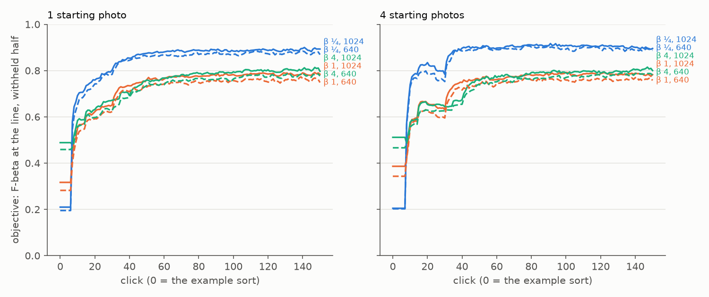
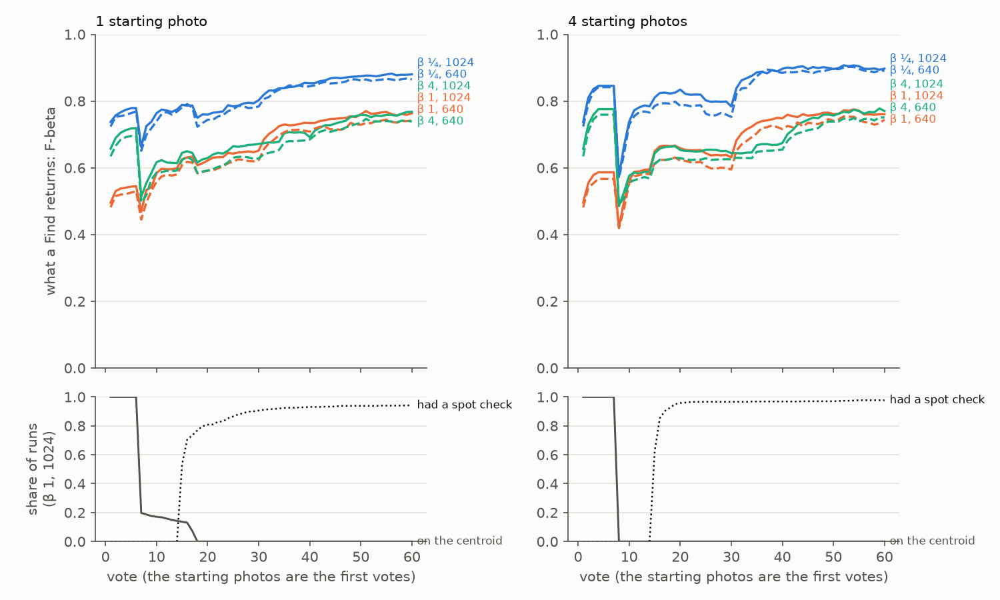
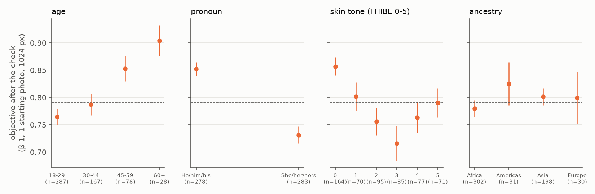

# State of the App: Face — 2026-10-10

**The first review of the face path:** FaceNet on `image2face` crops, on FHIBE (#4699), as it ships
today, after #4731 (the Good walk's dry run) and #4732 (the centroid's count line). The bench is the
#4699 baseline's 562 people. Each runs from **1 and from 4** starting photos, at both stored sizes
(1024 and 640 px), with one set of sessions per preset (β ¼, 1, 4). That is 6,744 sessions of 150
votes, scored on each person's withheld photos (#4762).

**A face session ends at the ceiling.** From one photo at 1024 px, the set a Find returns after the
check has F-beta **0.89 / 0.79 / 0.80** at β ¼ / 1 / 4:
- precision 0.93 / 0.87 / 0.72, recall 0.71 / 0.79 / 0.84;
- a median of 3, 3 and 4 faces;
- 91% / 85% / 85% of the best cut of its own ranking, level with the full-label ceiling's line
  (89% / 84% / 85%).

Its final AP, 0.88, is within 0.012 of the ceiling's 0.89. The mean over clicks 1–150, the owner's
single number, is **0.83 / 0.73 / 0.74**, against 0.21 / 0.32 / 0.49 for the example sort the user
starts from (Figure 1). Starting from 4 photos adds 0.00 to 0.02 to that mean; 640 px costs 0.01 to
0.03.

**The early session has two dips, and both have causes:**

1. **The hand-over.** At the label quota (vote 7 from one photo, 8 from four), the first trained
   head ranks the person's photos **worse** than the Goods' centroid it replaces: AP −0.17 to −0.22
   (SE 0.01), and Find's F-beta −0.13 to −0.29. It recovers over 5–10 votes. With four starting
   photos, AP at click 25 (0.79) is still below the example sort's own (0.88) (#4776).
2. **The spot checks.** The weak-separation check fires in **96–98%** of face sessions, first at
   vote 15, and its rounds take a mean of 32–48 of the 150 votes. Find plateaus while they run
   (#4778).

**2% of one-photo sessions fail outright, all for one reason.** In all 12 (at 1024 px; 15 at 640),
the starting photo shows the face in profile, lying sideways or turned down. The crop is not
aligned, and FaceNet's embedding of it ranks the person's other photos at random. From four photos
none fail (#4777).

**The app does measurably worse for some people.** she/her **0.73** against he/him **0.85**;
18–29 **0.76** against 60+ **0.90**; skin tone 3 **0.72** against FHIBE's darkest anchor **0.86**
(β 1, one photo, 1024 px). The gaps hold at both sizes and both starting-photo counts. These are
descriptive strata, not causes (#4780).



*Figure 1. What the session shows at every click: F-beta of the withheld set at the app's line, at
each set's own beta, over 562 people. Click 0 is the example sort at its own line; the session
shows it until Autopilot shows a detector. Colour is the preset (β ¼ blue, β 1 orange, β 4 aqua),
solid 1024 px, dashed 640 px. The steps near click 30 with four photos are the spot checks ending.
The viewer (`viewer.html`) draws what Test gives instead, so the two differ through the opening on
purpose.*

## The bench

- **People:** the #4699 baseline's 562 (`<release>-derived/runs/2026-10-09-k4/identities.txt`).
  These are FHIBE's most-photographed people: 7 to 10 one-person photos each, and a face found at
  both sizes. The stratified split leaves each about four photos to vote on and about four withheld.
- **Opening:** the example sort. The K starting photos are the first K votes, the screen shows their
  centroid's sort at its count line (#4732), and Autopilot walks it. There is no typed query on
  FHIBE.
- **Sessions:** shipped defaults; 150 votes; the stratified split; one seed, since people are the
  replication; the full-label ceiling. Six session sets (K × β), 1,124 cells each.
- **Run:** `scripts/experiments/fhibe/sota_face.sh`, run as four claiming V100 pack jobs from one
  commit. 11:32–15:32, 0 failed.
- **Analysis:** the State of the App's own analyzer, perp and by-click tools, per K and size
  (`fhibe/sota_face_analyze.sh`). Click 0 is `fhibe/example_baseline.py`: the example sort scored in
  `text_baseline.py`'s columns. It matches every run's vote-K row exactly (difference 0 at K = 1
  and 4).

Every run is in every average (#4631). No session ended without a detector: every one has a Good
from its starting photo.

## Headline: the returned set at each balance

Each preset's sessions, read at their own beta (`headline.csv`, `session_means.csv`). The share is
the returned set's F-beta over the best F-beta any cut of the same ranking reaches.

| start | size | β | click 0 (example sort) | click 25 | click 50 | after the check | share of best cut | precision / recall after | returned | mean over 1–50 | mean over 1–150 |
|---|---|---|---|---|---|---|---|---|---|---|---|
| 1 photo | 1024 | ¼ | 0.21 | 0.78 | 0.87 | **0.89** | 91% | 0.93 / 0.71 | 3 | 0.72 | **0.83** |
| 1 photo | 1024 | 1 | 0.32 | 0.64 | 0.76 | **0.79** | 85% | 0.87 / 0.79 | 3 | 0.62 | **0.73** |
| 1 photo | 1024 | 4 | 0.49 | 0.67 | 0.76 | **0.80** | 85% | 0.72 / 0.84 | 4 | 0.64 | **0.74** |
| 1 photo | 640 | ¼ | 0.20 | 0.78 | 0.86 | 0.88 | 89% | 0.91 / 0.67 | 3 | 0.71 | 0.82 |
| 1 photo | 640 | 1 | 0.28 | 0.62 | 0.73 | 0.76 | 83% | 0.85 / 0.77 | 3 | 0.59 | 0.70 |
| 1 photo | 640 | 4 | 0.46 | 0.63 | 0.74 | 0.78 | 83% | 0.70 / 0.84 | 4 | 0.62 | 0.72 |
| 4 photos | 1024 | ¼ | 0.21 | 0.80 | 0.90 | **0.90** | 91% | 0.93 / 0.72 | 3 | 0.75 | **0.85** |
| 4 photos | 1024 | 1 | 0.39 | 0.64 | 0.76 | **0.78** | 85% | 0.87 / 0.81 | 3 | 0.64 | **0.73** |
| 4 photos | 1024 | 4 | 0.51 | 0.65 | 0.76 | **0.80** | 85% | 0.73 / 0.85 | 4 | 0.64 | **0.74** |
| 4 photos | 640 | ¼ | 0.20 | 0.76 | 0.90 | 0.87 | 91% | 0.91 / 0.70 | 3 | 0.73 | 0.84 |
| 4 photos | 640 | 1 | 0.34 | 0.61 | 0.74 | 0.75 | 84% | 0.84 / 0.79 | 3 | 0.61 | 0.71 |
| 4 photos | 640 | 4 | 0.47 | 0.63 | 0.74 | 0.80 | 84% | 0.70 / 0.85 | 4 | 0.61 | 0.72 |

The full-label ceiling's own line on the same withheld half scores 0.87 / 0.77 / 0.80 at 1024 px, so
the session's line ends level with it. The returned set's path through a session
(`precision_recall_path_k1_1024.png`, from one photo at 1024 px) climbs in precision first, then in
recall.

**The ranking** (`headline.csv`): from one photo, AP goes 0.74 (example sort) → 0.77 (click 25) →
0.86 (click 50) → **0.88** final, against a ceiling of 0.89. From four it starts at 0.88, dips to
0.79 at click 25 (the hand-over, below), and ends at 0.89, at the ceiling. Autopilot finds a mean
of 4.1 of the person's photos, essentially all of the ~4 in the voting half, and 3.7 of them by
click 25.

## The dip



*Figure 2. What a Find returns at every vote (Test, which the viewer draws), votes 1–60, over 562
people; the colours and styles as in Figure 1. Below: the share of runs (β 1, 1024 px) whose Find
still gives the Goods' centroid, and the share that has had a prompted spot check by then.*

The 2026-10-09 baseline found Find near zero for votes 1–7 and a dip over votes 10–25. #4732 fixed
the first: the centroid's count line now returns 0.48–0.74 from vote 1. The dip remains, with two
causes.

**1. The hand-over: the first trained head ranks worse than the centroid.** Paired per run, at the
last vote that gave the centroid and the first that gave the trained head (`handover.csv`):

| start | size | vote | AP: centroid → trained head | ΔAP | Find's F-beta, β 1: centroid → head | runs whose F drops (β 1) |
|---|---|---|---|---|---|---|
| 1 photo | 1024 | 7 | 0.81 → 0.61 | −0.21 ± 0.01 | 0.55 → 0.42 | 51% |
| 1 photo | 640 | 7 | 0.79 → 0.57 | −0.22 ± 0.01 | 0.54 → 0.39 | 52% |
| 4 photos | 1024 | 8 | 0.88 → 0.70 | −0.17 ± 0.01 | 0.59 → 0.42 | 59% |
| 4 photos | 640 | 8 | 0.86 → 0.67 | −0.19 ± 0.01 | 0.57 → 0.42 | 59% |

The head is a linear SVM on 3–4 Goods and 4 Bads, and the Bad phase votes those Bads at the example
sort's midpoint, in the bulk of other faces. The centroid of the same Goods ranks the person better.
At β 4 the head also keeps more (a median of 8–16 faces against 3), and its F-beta falls by 0.27 to
0.29. Find recovers over the next 5–10 votes as the walk adds Goods and Hard picks.

**2. The spot checks hold the line.** The weak-separation check (#4496) fires when the labels
separate weakly past the opening. On faces it fires in **96%** of one-photo and **98%** of
four-photo sessions, first at **vote 15**. Its rounds take a mean of **32 votes at β ¼ and 1 and 42
at β 4** from one photo (36 and 49 from four), against 150 in a session. While they run, Find
plateaus. With four photos at β ¼ it sags from 0.83 to 0.78 over votes 22–30, then steps up when the
rounds end. A person has about four photos to find, and all are found by vote ~25, so the class
model behind "weak" rests on a handful of Goods. The end-of-run check adds **+0.000 to +0.012** (its
range covers the truth in every run).

## The spot check

| start | size | β | after the check | the check's effect | its votes |
|---|---|---|---|---|---|
| 1 photo | 1024 | ¼ | 0.89 | +0.000 ± 0.003 | 20 |
| 1 photo | 1024 | 1 | 0.79 | +0.006 ± 0.004 | 20 |
| 1 photo | 1024 | 4 | 0.80 | +0.005 ± 0.005 | 30 |
| 4 photos | 1024 | ¼ | 0.90 | −0.000 ± 0.006 | 20 |
| 4 photos | 1024 | 1 | 0.78 | +0.001 ± 0.006 | 20 |
| 4 photos | 1024 | 4 | 0.80 | −0.002 ± 0.004 | 30 |

At 640 px it moves −0.017 to +0.015 (+0.007 to +0.012 from one photo). Its precision range covered the truth in every run of every set.

## Where the app does well and where it does poorly



*Figure 3. The objective after the check, ±1 SE, per stratum (β 1, one photo, 1024 px; strata with
5+ people). The dashed line is everyone (0.79). Skin tone is FHIBE's `natural_skin_color` scale:
0 is its darkest anchor (RGB 102, 78, 65) and 5 its lightest (198, 180, 157).*

| stratum | 1 photo, 1024 | 1 photo, 640 | 4 photos, 1024 | 4 photos, 640 |
|---|---|---|---|---|
| he/him (278 people) | 0.85 | 0.83 | 0.86 | 0.83 |
| she/her (283) | 0.73 | 0.69 | 0.71 | 0.68 |
| age 18–29 (287) | 0.76 | 0.75 | 0.76 | 0.73 |
| age 30–44 (167) | 0.79 | 0.76 | 0.78 | 0.75 |
| age 45–59 (78) | 0.85 | 0.76 | 0.82 | 0.77 |
| age 60+ (28) | 0.90 | 0.88 | 0.92 | 0.92 |
| skin tone 0, darkest (164) | 0.86 | 0.82 | 0.86 | 0.82 |
| skin tone 2 (95) | 0.76 | 0.68 | 0.75 | 0.70 |
| skin tone 3 (85) | 0.72 | 0.72 | 0.72 | 0.72 |
| skin tone 5, lightest (71) | 0.79 | 0.75 | 0.76 | 0.72 |
| ancestry Africa (302) | 0.78 | 0.75 | 0.78 | 0.75 |
| ancestry Asia (198) | 0.80 | 0.77 | 0.78 | 0.77 |

**The pronoun gap is the largest: 0.12–0.15**, about six standard errors, in every set. Older people
do better. Skin tone is not monotone: the darkest anchor does best and the middle anchors worst.
Ancestry is flat. The strata are correlated with each other and with how photos were taken (pose,
accessories, hair, distance), and this review does not separate them; #4780 asks which carries the
gap. Every stratum, with SEs and the face-size and photo-count strata too, is in `strata.csv`.

**The hardest people.** From one photo at 1024 px, **12 of 562 sessions fail outright.** Each ends
with AP below 0.1 against a ceiling of 0.64–1.00, after finding no second photo. In all 12 the
starting photo is a hard view of the face: in profile, lying sideways, turned down, or tilted under
a cap. The person's other photos are upright and frontal. Subject ID prefixes:
`0cdec9c8, 2b76ec95, 48b38d95, 4e5dabe1, 4f3fa1da, 548d8580, 6fd3845d, 7a21b1c4, a99c00ee,
c22b8b53, c34d07b0, f5775002`. For example, `2b76ec95-7bf8-49d0-9711-397ff95a19a2` starts from a
photo of him lying on his back, his face turned 90°; his seven other photos are upright, and the
session's AP ends at 0.00 against a ceiling of 0.89. FHIBE's own head-pose annotation calls most of
the 12 starting photos "Typical". `image2face` does not align its crops (#4777). From four photos no
session fails.

The hardest people from four photos are different: their own ceiling is low.
- `9f17578a-6215-4fab-a860-ed107e398ad3`: ceiling AP 0.36, AP 0.38, F 0.00 at β 1.
- `802df938-3350-47b5-b998-a930dcec7595`: ceiling AP 0.11.
- `43037860-b413-413a-a60e-f740cb4c752e`: ceiling AP 0.53.

There the embedder cannot tell the person's photos apart even with every label, and no session loop
will fix it.

## Headroom

The ceiling's AP minus the final AP: **0.012** from one photo at 1024 px and 0.017–0.019 at 640;
**−0.003 to −0.002** from four photos, where the session matches its ceiling. Better clicking can buy
little more AP on this bench. What is left is early (the hand-over, the checks) and in the
embedder (the strata, the low-ceiling people).

## What the clicks bought

The final AP minus the example sort's: **+0.14** from one photo (0.74 → 0.88), **+0.02** from four
(0.88 → 0.89). Four photos of a person already rank them almost as well as 150 votes do. The
clicks' value there is the line: the objective goes from 0.21–0.51 at click 0 to 0.78–0.90.

**Click 0 itself is low at β ¼ for an avoidable reason.** The example sort draws its count line over
every media, and the starting photo sits at the top of its own sort. From one photo at β ¼, the line
keeps that photo and nothing else in **75%** of sessions. Test's line, drawn on the withheld half,
scores 0.74 on the same sort at vote 1 (#4779).

## Images

No per-image claim is possible. With one seed per person, an image is clicked at most 7 times and
mostly 3–5. The analyzer asks for 10 or more before an image's residual z means anything, so its
image tables (`<analysis>/k*/images.csv`) are not read here.

## Known regimes to flag, not to fix

- **The positives run out early.** A person has about four photos in the voting half, and Autopilot
  has found 3.7 of them by click 25 and 4.1 by the end. The rest of the session votes negatives.
  That is the face bench's shape, not a fault, but it means the late session cannot add Goods.
- **640 px loses people, not only points.** These 562 are those runnable at both sizes. #4709's
  census found the 640 px loss is mostly faces under MTCNN's floor.
- **The population is the most-photographed** (7–10 photos each). A one-photo run on everyone
  runnable from one photo (1,705 people) was the alternative the owner set aside for this review.

## What to A/B next

- #4776: keep the Goods' centroid until the trained head beats it, or start the head from it. The
  hand-over costs AP 0.17–0.22 on faces.
- #4778: price the weak-separation check on faces. It fires in 97% of sessions and takes a quarter
  of them.
- #4777: align `image2face` crops by their landmarks. That is 12 of 562 one-photo failures.
- #4779: an example sort's count line should not count the starting photos.
- #4780: what carries the pronoun, age and skin-tone gaps.

## Against the baseline, in one line

The 2026-10-09 baseline (#4699) read Find, before #4731 and #4732. Its mean over votes 1–150 on face
crops at 1024 px was 0.67 / 0.68 from one / four photos. The same quantity today, at β 1, is **0.74 /
0.74** (`find_by_vote.csv`).

## The viewer

`viewer.html` holds all six session sets: a chip per beta, and the dataset menu as size × starting
photos (`fhibe_faces_1024, 1 photo`, and so on). It shows people as strata (age bracket, pronoun,
skin tone), never by subject ID. It draws what Test gives, opening included, as every review's
viewer does; this report reads the session, so the two differ through the opening.

## Provenance

| | |
|---|---|
| App / harness | `ddd385973`–`21cba5089` (branch `claude/sota-face-4762`; no harness change between them) |
| FHIBE release | `fhibe-full-resolution-674a7dcf`, cells by #4712 |
| Run dirs (owner-only) | `<release>-derived/runs/2026-10-10-sota-k{1,4}-b{025,1,4}` |
| Analysis (owner-only, names people) | `<release>-derived/runs/2026-10-10-sota-analysis`, `…/2026-10-10-sota-baseline` (click 0, strata) |
| Files here | `headline.csv`, `session_means.csv`, `strata.csv`, `find_by_vote.csv`, `handover.csv` (aggregates), figures, `viewer.html` |

Reproduce:

```bash
bash scripts/experiments/fhibe/sota_face.sh dirs && bash scripts/experiments/fhibe/sota_face.sh tasks
CALIB_PACK_PAR=38 bash scripts/experiments/fhibe/sota_face.sh pack 4
bash scripts/experiments/fhibe/sota_face.sh baseline                       # click 0
python scripts/experiments/fhibe/person_strata.py --identities <ids> --out <baseline dir>/person_strata.csv
bash scripts/experiments/fhibe/sota_face_analyze.sh <analysis> 1 4
python scripts/experiments/fhibe/sota_face_tables.py --analysis <analysis> --runs <runs> --date <date> \
  --strata <baseline dir>/person_strata.csv --out <analysis>/tables
python scripts/experiments/fhibe/sota_face_figures.py --analysis <analysis> --tables <analysis>/tables --out <dir>
bash scripts/experiments/fhibe/sota_face_viewer.sh <dir>/viewer.html
```
