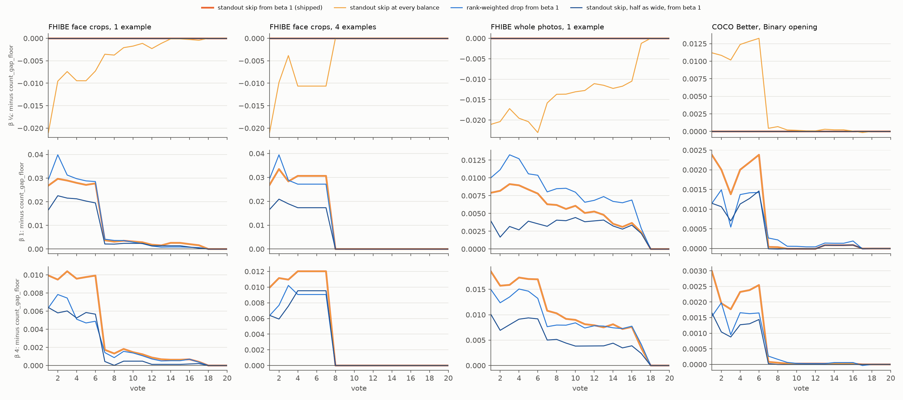

# Looking past a standout photo from beta 1 up (#4783)

**2026-10-11.** Since #4759 the Goods' centroid's line never keeps fewer than the media above the widest
drop between neighbours in the top 11 (`count_gap_floor`). When a person's best photo stands far above
their others, that drop is the one right after it. On the opening centroid, among people whose top two
or more crops are all their own, the line keeps only the first in **16% to 24%** of face sessions.

**Shipped: look past a standout, from beta 1 up.** The new line, `count_gap_floor_skip25_b1`, checks
whether the widest drop is the first one. If so, it takes the widest drop below the second cosine,
provided that drop is at least a quarter as wide. Below beta 1 it stays at the widest drop. Paired
against `count_gap_floor`, mean F-beta of what a Find returns over votes 1–10 changes by:

- FHIBE face crops: **+0.018 to +0.027** at beta 1, **+0.007 to +0.013** at beta 4;
- FHIBE whole photos: **+0.008 to +0.012** at beta 1, **+0.014 to +0.020** at beta 4;
- COCO Better's Binary opening: **+0.001** at beta 1 and 4;
- beta ¼: **0** everywhere, by construction.

Every one of those is at least 3 SE from zero, and nothing loses. It is a small gain: over votes 1–150
it is **+0.001 to +0.002**.

**Why the gate.** At beta ¼ the same look-past loses on every FHIBE bench (−0.008 to −0.018). Past a
standout, the next images include strangers often enough that precision, weighted 16 times recall
there, pays for them. A lone standout is the right set at a precision balance.

**Where the app gains more than this.** The harness draws the line on the withheld half, as a Find on
another collection would. On the collection the user labelled, the example itself sits at cosine 1.0
at the top of its own ranking. That is exactly the standout this rule looks past. With one example photo
on face crops, the line's F-beta on the unvoted media goes from **0.39 to 0.55 at beta 1**, and the share
of sessions where it keeps nothing new from **45% to 22%**. Beta ¼ there stays at today's line (0.30,
nothing new in 66%) until #4779 draws the line over the unvoted media. The owner chose that split on
2026-10-11.



*Figure 1. Each rule's mean F-beta minus `count_gap_floor`'s, at every vote, over every run. Rows are
beta ¼, 1 and 4; columns are FHIBE face crops from 1 and 4 example photos, whole photos from 1, and
COCO's Binary opening. The shipped rule (thick orange) is zero at beta ¼ and coincides with the ungated
skip (light orange) from beta 1 up. Every difference is zero once Find stops giving the centroid.*

## What was run

- **One frozen commit** (`16703e22d`, worktree `vts-4783-run`) on #4759's benches:
  - **FHIBE** (#4699): 562 people × 4 datasets, one run each from K = 1 and K = 4 example photos
    (2,248 runs each), cut at 40 votes, at beta 1;
  - **COCO Better Binary Photo**: the State of the App's 144 cells × 5 seeds (720 runs), cut at 40
    votes.
- **The candidates are tagged rows on the same sessions** (`CALIB_CENTROID_LINE_VARIANTS`, as in
  #4732 and #4759), each `count_gap_floor` with another drop (`CENTROID_DROPS`):
  - `count_gap_floor_skip25` / `_skip50`: when the widest drop is the first, the widest one below the
    second cosine, if at least ¼ (½) as wide;
  - `count_gap_floor_rank5`: the widest of the first five drops once each is weighted by its rank
    (`i × d_i`, which evens out a bulk tail's spacings);
  - `count_gap_floor`, the reference, and `midpoint`, which the reader pairs against.
- **The gated forms are read off those rows.** A rule gated on beta 1 keeps exactly one rule's set
  below it and another's from it up. So `skip25_b1` is `count_gap_floor`'s rows at beta ¼ and
  `count_gap_floor_skip25`'s at beta 1 and 4 (`analyze_centroid_count_4759.py --derive`).
  `test_the_gated_rule_is_the_floor_below_beta_1_and_the_skip_above` pins the identity for the shipped
  rule.
- **The read** is #4759's: every run in every average (#4631), paired SEs clustered on the person (the
  category on COCO). Every centroid tier ended inside 40 votes, so votes 1–150 are exact.
- **First, an offline exploration** priced eleven drop rules on each person's opening centroid in #4759's
  dumps (`fhibe/centroid_drop_4783.py price`), inside `count_gap_floor`'s composition. It also priced an
  oracle drop: exactly the person's photos above the first stranger. The oracle's gain bounds what any
  drop can do here: **+0.06 to +0.08** at beta 1 on faces, about 0 at beta 4, and a loss on photos.
- **The labelled collection** is simulated from the same dumps (`labelled`), with K = 1 only. Each
  person's example is put back into its own corpus at cosine 1.0. The line is drawn over example and
  withheld half, and scored on the withheld half, which stands in for the unvoted media.
- **Cost.** About 1.6 min per FHIBE run and 2.5 min per COCO run on the cpu partition, 08:42–13:09.
  The run was memory-bound behind another session's 24 GB region cells. Its pending tasks were held
  for about 6 minutes while `/expscratch` was full; no cell was lost.

## Results

### The shipped rule against count_gap_floor

`skip25_b1` minus `count_gap_floor`, mean F-beta over votes 1–10 (paired, every run, ± SE). Beta ¼ is
0 by construction:

| bench | runs | beta 1 | beta 4 |
|---|---|---|---|
| FHIBE faces 1024, K=1 | 562 | +0.018 ± 0.002 | +0.007 ± 0.001 |
| FHIBE faces 640, K=1 | 562 | +0.027 ± 0.003 | +0.013 ± 0.002 |
| FHIBE photos 1024, K=1 | 562 | +0.008 ± 0.003 | +0.014 ± 0.003 |
| FHIBE photos 640, K=1 | 562 | +0.008 ± 0.002 | +0.017 ± 0.003 |
| FHIBE faces 1024, K=4 | 562 | +0.021 ± 0.002 | +0.008 ± 0.001 |
| FHIBE faces 640, K=4 | 562 | +0.025 ± 0.003 | +0.009 ± 0.001 |
| FHIBE photos 1024, K=4 | 562 | +0.009 ± 0.002 | +0.018 ± 0.002 |
| FHIBE photos 640, K=4 | 562 | +0.012 ± 0.002 | +0.020 ± 0.002 |
| COCO Better Binary, 5 seeds | 720 | +0.0012 ± 0.0003 | +0.0014 ± 0.0003 |

On the centroid's own clicks at beta 1, with one example photo on face crops, the line keeps a median
of 3 either way. Precision goes 0.82 → 0.79 and recall 0.67 → 0.71, for F-beta 0.69 → 0.72; with four
example photos, 0.74 → 0.77. On COCO the median kept stays at 17: the count, not the drop, sets
COCO's line.

### The candidates

Each candidate minus `count_gap_floor`, votes 1–10, at beta ¼ / 1 / 4 (ranges over the four FHIBE
datasets and both K):

| rule | FHIBE faces | FHIBE photos | COCO |
|---|---|---|---|
| `count_gap_floor_skip25`, every balance | −0.008 to −0.014 / +0.018 to +0.027 / +0.007 to +0.013 | −0.017 to −0.018 / +0.008 to +0.012 / +0.014 to +0.020 | +0.007 / +0.001 / +0.001 |
| `skip25_b1` (**shipped**) | 0 / +0.018 to +0.027 / +0.007 to +0.013 | 0 / +0.008 to +0.012 / +0.014 to +0.020 | 0 / +0.001 / +0.001 |
| `skip50_b1` | 0 / +0.013 to +0.022 / +0.004 to +0.007 | 0 / +0.003 to +0.006 / +0.007 to +0.011 | 0 / +0.001 / +0.001 |
| `rank5_b1` | 0 / +0.020 to +0.028 / +0.004 to +0.011 | 0 / +0.006 to +0.010 / +0.012 to +0.017 | 0 / +0.001 / +0.001 |

- **The gate matters only at beta ¼**, where every ungated candidate loses on FHIBE. On COCO the
  ungated skip gains there (+0.007), but COCO's opening shows the typed query, not the centroid
  (#4758).
- **Skip at ¼ and rank-weighting tie on faces at beta 1**; skip wins on photos at beta 4 and on COCO.
  Skip at ½ fires less often and gains less everywhere.
- In the exploration, the ¼ skip moved the drop in 86% to 91% of standout face sessions. It also moved
  it in 7% to 30% of the sessions where the widest drop was already right. Those are the "loses"
  examples below.

### On the labelled collection

F-beta of what the line keeps among the unvoted media, with the example in the corpus (one example
photo, `labelled_summary.csv`), and the share of sessions where it keeps nothing new:

| dataset | rule | beta ¼ | beta 1 | beta 4 |
|---|---|---|---|---|
| faces 1024 | `count` (#4732) | 0.14, 82% | 0.32, 52% | 0.59, 0% |
| | `count_gap_floor` (#4759) | 0.30, 66% | 0.39, 45% | 0.61, 0% |
| | **`skip25_b1`** | 0.30, 66% | **0.55, 22%** | **0.66, 0%** |
| | `count_gap_floor_skip25`, every balance | 0.66, 27% | 0.55, 22% | 0.66, 0% |
| faces 640 | `count_gap_floor` | 0.27, 70% | 0.36, 48% | 0.58, 0% |
| | **`skip25_b1`** | 0.27, 70% | **0.53, 24%** | **0.63, 0%** |
| photos 1024 | `count_gap_floor` | 0.03, 81% | 0.04, 65% | 0.11, 0% |
| | **`skip25_b1`** | 0.03, 81% | 0.05, 60% | 0.11, 0% |

The ungated rule would gain +0.36 at beta ¼ here. The owner chose the gate and #4779 instead. #4779's
fix draws the line over the unvoted media, which removes the example from this corpus. The gated rule
is then right on both, and an ungated one would keep its beta ¼ loss.

### Literal examples

Face crops at 1024 px, one example photo, the opening centroid at beta 1, drawn from a seeded shuffle
(`centroid_drop_4783.py examples --rule skip1_b0.25`). Each row is the top 12 of the withheld half in
bulk sigmas above the median; `*` marks the person's own photos.

**The skip wins** (a standout first photo, then the rest of the person):

| person | photos | top 12 (z) | widest keeps | skip keeps | F |
|---|---|---|---|---|---|
| 85a4998b-08ed-4067-8e99-e6231a12a099 | 4 | 4.11* 3.78* 3.70* 3.59 3.53* 3.34 3.21 3.17 3.10 3.02 2.97 2.95 | 1 | 5 | 0.40 → 0.89 |
| 2940a3f9-95e6-4ed0-80f5-7bdb7bb6d44a | 3 | 4.05* 3.58* 3.53* 3.33 3.27 3.08 3.00 2.92 2.88 2.87 2.85 2.82 | 1 | 3 | 0.50 → 1.00 |
| f4e67b03-0a47-4ecd-a85d-3965be85e5f8 | 4 | 3.57* 3.23 3.20* 3.03 2.96 2.95 2.94 2.94 2.89 2.88 2.88 2.88 | 1 | 3 | 0.40 → 0.57 |

**The skip loses** (the standout is alone at the top, and the next wide drop sits among strangers):

| person | photos | top 12 (z) | widest keeps | skip keeps | F |
|---|---|---|---|---|---|
| 43037860-b413-413a-a60e-f740cb4c752e | 3 | 3.56* 3.34 3.28 3.24 3.24 3.23* 3.15 3.12 3.11 3.10 3.10 3.09 | 1 | 6 | 0.50 → 0.44 |
| 99e0c33a-6995-490f-b2c7-6bbc3061b596 | 3 | 4.37* 4.11* 3.99 3.80* 3.68 3.59 3.36 3.33 3.27 3.20 3.20 3.19 | 2 | 6 | 0.80 → 0.67 |
| 0cb5c39d-70bd-4a1b-8af7-8beb2bdbe23e | 4 | 4.73* 4.16* 4.15 3.99 3.98 3.97 3.70 3.57 3.53 3.52 3.51 3.48 | 3 | 6 | 0.57 → 0.40 |

The strangers inside a person's run in the losing rows (3.34 for `43037860`, 3.99 for `99e0c33a`,
4.15 for `0cb5c39d`) are where to look for a second subject id of the same person.

## What shipped

- `vtscore/detectors/centroid_head.py`: `CENTROID_LINE_RULE = "count_gap_floor_skip25_b1"`.
  - `CENTROID_DROPS` names each candidate's drop, which `_top_gap_count(..., drop=)` draws.
  - `CENTROID_GATED` maps a gated rule to its rules below and from beta 1; `centroid_cut` resolves it at
    the line's beta, so a balance change redraws the right one (`CentroidLine.threshold_at`).
  - `count_gap_floor` is #4759's line.
- The harness follows the app. `CALIB_CENTROID_LINE=count_gap_floor` is the arm before #4783.
- `analyze_centroid_count_4759.py --derive NEW=BELOW:ABOVE` reads a beta-gated rule off two rules'
  rows. `figures_centroid_count_4759.py` takes `--rule`, `--reference` and `--name`.
  `fhibe/centroid_count_4759.sh` and `state_of_app/centroid_count_4759.sh` take `CC_STUDY`, which
  `centroid_drop_4783.sh` sets.
- `ML.md`, `EVAL.md` and both CHANGELOGs.

## Caveats

- **The gains are small.** Over votes 1–150 they are +0.001 to +0.002, because the centroid lasts about
  6 to 8 votes. The labelled collection's +0.16 at beta 1 is a simulation (K = 1, the withheld half as
  the unvoted media), not a run.
- **The gate is at exactly beta 1.** It was chosen from three presets, so a balance between ¼ and 1
  takes the floor. That was not priced in between.
- **The quarter in `skip25` was picked from four values** (¼, ⅓, ½, ¾) on the opening centroids of the
  same people the runs priced. COCO was not part of the choice and did not lose.

## Follow-ups

- #4779: draw the line over the unvoted media. With it, beta ¼ on the labelled collection keeps the
  floor's own set rather than the example alone.

## Reproduce

```bash
# exploration on #4759's dumps (owner-only outputs)
python scripts/experiments/fhibe/centroid_drop_4783.py price --dumps <explore-4759>/dumps --out <explore>
python scripts/experiments/fhibe/centroid_drop_4783.py labelled --dumps <explore-4759>/dumps --out <explore>
python scripts/experiments/fhibe/centroid_drop_4783.py examples --dumps <explore-4759>/dumps \
  --dataset fhibe_faces_1024 --k 1 --rule skip1_b0.25 --out <explore>/examples.md
# the runs, from a frozen worktree at the pricing commit
bash scripts/experiments/fhibe/centroid_drop_4783.sh dirs 1 && bash scripts/experiments/fhibe/centroid_drop_4783.sh launch 1
bash scripts/experiments/fhibe/centroid_drop_4783.sh dirs 4 && bash scripts/experiments/fhibe/centroid_drop_4783.sh launch 4
bash scripts/experiments/state_of_app/centroid_drop_4783.sh dirs 5 && bash scripts/experiments/state_of_app/centroid_drop_4783.sh launch 5
# the read
python scripts/experiments/calibration/analyze_centroid_count_4759.py \
  --run fhibe-k1=<runs>/2026-10-11-4783-k1 --run fhibe-k4=<runs>/2026-10-11-4783-k4 \
  --run coco-b1=<sota>/2026-10-11-centroid4783-b1 --out <analysis> --reference count_gap_floor \
  --variants "$(bash scripts/experiments/fhibe/centroid_drop_4783.sh variants 1)" \
  --derive skip25_b1=count_gap_floor:count_gap_floor_skip25 \
  --derive skip50_b1=count_gap_floor:count_gap_floor_skip50 \
  --derive rank5_b1=count_gap_floor:count_gap_floor_rank5
python scripts/experiments/calibration/figures_centroid_count_4759.py --curves <analysis>/curves.csv --out <dir> \
  --name fig_centroid_drop.png --reference count_gap_floor \
  --rule "skip25_b1=standout skip from beta 1 (shipped)" --rule "count_gap_floor_skip25=standout skip at every balance" \
  --rule "rank5_b1=rank-weighted drop from beta 1" --rule "skip50_b1=standout skip, half as wide, from beta 1" \
  --panel "fhibe-k1/fhibe_faces_1024=FHIBE face crops, 1 example" --panel "fhibe-k4/fhibe_faces_1024=FHIBE face crops, 4 examples" \
  --panel "fhibe-k1/fhibe_1024=FHIBE whole photos, 1 example" --panel "coco-b1/coco_better=COCO Better, Binary opening"
```

Files here: `summary.csv` (per bench × rule × balance, every rule minus `count_gap_floor` over votes
1–10/50/150 with SEs), `exploration_summary.csv` (the opening-centroid pricing, with how often each
rule fixes a standout and moves a right drop) and `labelled_summary.csv`. FHIBE's per-run rows name
people and stay owner-only in the release's `runs/2026-10-11-4783-analysis` and
`runs/2026-10-11-4783-explore`.
