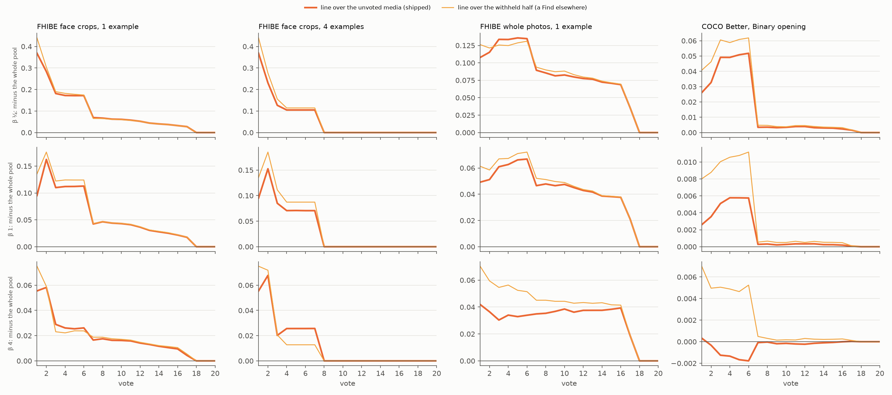

# The centroid's line counts the unvoted media (#4779)

**2026-10-11.** Below the label quota, Test, Find and AutoFind give the Goods' centroid, and an example sort
ranks the collection by cosine to its starting photos. Both draw a line that keeps about as many images as
stand out (#4732, #4759, #4783). On the collection the user labelled, the app drew that line over every
media. The starting photos and every voted image were included, and they sit at the top of their own
ranking. So the line counted them as what stands out, and often kept nothing new. With one example of a
face at beta ¼, an example sort kept the starting photo alone in **63%** of sessions.

**Shipped: the line counts the unvoted media only.** The centroid head's line leaves out the media the
labelset labels. An example sort's line leaves out the active detector's voted media and the example
itself. The head still scores everything, and Autopilot's picks do not move. Priced through the session
on the same runs, against the line over the whole pool, mean F-beta of what a Find returns over votes 1–10
changes by:

| bench | beta ¼ | beta 1 | beta 4 |
|---|---|---|---|
| FHIBE face crops (K = 1 and 4, 1024 and 640) | **+0.11 to +0.18** | **+0.06 to +0.10** | +0.02 to +0.03 |
| FHIBE whole photos | +0.09 to +0.11 | +0.05 to +0.06 | +0.02 to +0.04 |
| COCO Better's Binary opening | +0.027 ± 0.004 | +0.003 ± 0.001 | −0.001 ± 0.001 |

Every FHIBE cell is at least 7 SE from zero. COCO at beta 4 is not resolvable. Over votes 1–150 the
gain is **+0.008 to +0.015** on faces at beta ¼ and +0.004 to +0.009 at beta 1. At click 0, the example
sort alone, with one example on faces at beta ¼, F-beta goes from **0.33 to 0.70** and the share of
sessions keeping nothing new from 63% to 14%.

This is the other half of #4783's decision. #4783 looks past a standout first photo only from beta 1 up,
so at beta ¼ the labelled collection waited for this change. It now gets the gain.



*Figure 1. Mean F-beta of what a Find returns at every vote, minus the same line drawn over the whole pool
(the app before #4779), over every run. Rows are beta ¼, 1 and 4; columns are FHIBE face crops from 1
and 4 example photos, whole photos from 1, and COCO's Binary opening. Thick orange is the shipped line,
over the unvoted media. The thin line is drawn over the withheld half alone, the harness's default and
what a Find on another collection does. It sits a little higher at beta ¼ and 1 on a different corpus:
half the cell, with none of the vote half's unvoted media. Every difference is zero once Find stops giving
the centroid.*

## What was run

- **Through the session**, from one frozen commit (`a437d1fb3`, worktree `vts-4779-run`), on #4759's
  benches:
  - FHIBE's 562 people × 4 datasets from K = 1 and K = 4 example photos (2,248 runs each);
  - COCO Better's 144 Binary cells × 5 seeds (720 runs);
  - all at beta 1, cut at 40 votes.
- **The corpora are tagged rows on the same sessions.** `CALIB_CENTROID_LINE_VARIANTS` now takes
  `<rule>~<corpus>@<beta>` (`CENTROID_LINE_CORPORA`). The app's rule, `count_gap_floor_skip25_b1`, ran
  three ways at each balance, each scored on the withheld half:
  - over the withheld half, the default: a Find on another collection;
  - `~pool`: over every media of the cell, voted ones included, as the app's labelled collection held
    them;
  - `~unvoted`: over every media less the voted ones, the fix.

  The centroid never picks, so the three differ only in what the line keeps.
- **At click 0**, offline (`fhibe/centroid_unvoted_4779.py`): each cell's example sort was rebuilt with the
  harness's own pieces. The app's line was drawn over the pool with the examples and without them, and
  scored on the withheld half. This covered FHIBE (K = 1 and 4) and COCO Better opened on K example
  photos instead of a typed query, which is the issue's "typed-query-free" opening (`click0_summary.csv`).
- **The read** is #4759's: every run in every average (#4631), paired SEs clustered on the person (the
  category on COCO). Every centroid tier ended inside 40 votes, so votes 1–150 are exact.
- **Cost.** 14:22–16:53 on the cpu partition. The first hour was memory-bound behind another session's
  24 GB region cells.

## Results

### Through the session

`~unvoted` minus `~pool`, mean F-beta over votes 1–10 (paired, every run, ± SE):

| bench | runs | beta ¼ | beta 1 | beta 4 |
|---|---|---|---|---|
| FHIBE faces 1024, K=1 | 562 | +0.161 ± 0.010 | +0.088 ± 0.007 | +0.029 ± 0.003 |
| FHIBE faces 640, K=1 | 562 | +0.184 ± 0.011 | +0.103 ± 0.007 | +0.029 ± 0.003 |
| FHIBE photos 1024, K=1 | 562 | +0.110 ± 0.010 | +0.055 ± 0.006 | +0.036 ± 0.004 |
| FHIBE photos 640, K=1 | 562 | +0.109 ± 0.010 | +0.055 ± 0.005 | +0.033 ± 0.004 |
| FHIBE faces 1024, K=4 | 562 | +0.115 ± 0.007 | +0.062 ± 0.005 | +0.025 ± 0.002 |
| FHIBE faces 640, K=4 | 562 | +0.117 ± 0.007 | +0.071 ± 0.005 | +0.021 ± 0.003 |
| FHIBE photos 1024, K=4 | 562 | +0.095 ± 0.007 | +0.056 ± 0.004 | +0.025 ± 0.003 |
| FHIBE photos 640, K=4 | 562 | +0.093 ± 0.007 | +0.054 ± 0.004 | +0.025 ± 0.003 |
| COCO Better Binary, 5 seeds | 720 | +0.027 ± 0.004 | +0.003 ± 0.001 | −0.001 ± 0.001 |

On the centroid's own clicks at beta 1:

| bench | over the pool: kept (median), precision, recall, F | over the unvoted: kept, precision, recall, F |
|---|---|---|
| faces 1024, K=1 | 3, 0.89, 0.56, 0.58 | 3, 0.81, 0.68, **0.70** |
| faces 1024, K=4 | 3, 0.90, 0.64, 0.66 | 3, 0.87, 0.72, **0.75** |
| photos 1024, K=1 | **0**, 0.21, 0.06, 0.05 | 3, 0.16, 0.12, **0.11** |
| COCO Binary | 17, 0.57, 0.26, 0.28 | 17, 0.55, 0.27, **0.28** |

On whole photos from one example, the line over the pool kept a median of **no** new image: the Goods
used up the whole count. COCO hardly moves. The count there runs to 17 or more, so one or two Goods
barely change it.

### At click 0, the example sort

F-beta on the withheld half, the line over the pool (examples in) → over the unvoted (examples out), and
the share of sessions where the line keeps nothing of the withheld half:

| bench | beta ¼ | beta 1 | beta 4 |
|---|---|---|---|
| faces 1024, K=1 | 0.33 → **0.70**; nothing new 63% → 14% | 0.52 → 0.62; 27% → 5% | 0.62 → 0.68 |
| faces 640, K=1 | 0.29 → **0.70**; 67% → 14% | 0.48 → 0.60 | 0.60 → 0.66 |
| faces 1024, K=4 | 0.80 → 0.90 | 0.71 → 0.79 | 0.79 → 0.82 |
| photos 1024, K=1 | 0.02 → 0.13; 79% → 22% | 0.05 → 0.10 | 0.09 → 0.14 |
| COCO example opening, K=1 | 0.23 → 0.24 | 0.18 → 0.18 | 0.26 → 0.26 |
| COCO example opening, K=4 | 0.27 → 0.31; 32% → 9% | 0.21 → 0.22 | 0.30 → 0.29 |

The click-0 gain is larger than the mean over votes 1–10 because that mean also covers the clicks after
the centroid's tier, where the trained head gives the same result under either line.

## What shipped

- `vtscore/detectors/centroid_head.py`: `fit_centroid(..., line_mask=)` and
  `fit_centroid_head(..., line_mask=)` count only the flagged media. `CentroidLine` keeps those cosines,
  so a balance change redraws the same line.
- `vtscore/detectors/labelset_training.py`: both centroid call sites pass `_unvoted_mask`, the scored
  media the labelset does not label. In a haystack those are named by its own ids.
- `vtscore/training/query_sort.py`: `cosine_sort_cuts(..., exclude_ids=)`.
  - By default it leaves out the active detector's voted media (`_voted_media_ids`), and always any media at
    `EXAMPLE_SELF_COSINE` (0.9999) or above, which is the example itself.
  - `/api/example-sort-by-id` adds its own media.
  - The acquisition cut still reads every media, so Autopilot's picks do not move.
- The eval/app sync note for `detectors.label_quota_centroid` now says both sides count unvoted media: the
  harness's withheld half holds none. Re-pinned.
- The harness's priced lines take a corpus (`<rule>~pool@<beta>`, `<rule>~unvoted@<beta>`).
- `ML.md`, `EVAL.md` and both CHANGELOGs.

## Caveats

- **The harness models the labelled collection as the cell's pool.** That is its vote half plus withheld
  half, with the run's own votes as the voted media, scored on the withheld half. A user's collection can
  hold more than one person or class.
- **An uploaded example that is not in the collection** was never counted. The fix changes nothing for it.
  A copy of it in the collection is caught by the 0.9999 cosine rule.
- **COCO's opening shows the typed query** (#4758). So COCO's session numbers price Find under the quota,
  not what is on screen. The example-opening click 0 is where COCO's example sort shows, and it gains +0.01
  to +0.04 at beta ¼ and at most +0.005 elsewhere.

## Reproduce

```bash
# click 0 (owner-only outputs for FHIBE), in each grid's environment
python scripts/experiments/fhibe/centroid_unvoted_4779.py --results <runs>/2026-10-09-k4/results --ks 1,4 --out <click0>
CALIB_DATASETS=coco_better CALIB_N_SEEDS=5 python scripts/experiments/fhibe/centroid_unvoted_4779.py \
  --results <sota>/2026-10-08-b1/results --ks 1,4 --out <click0-coco>
# through the session, from a frozen worktree at the pricing commit
bash scripts/experiments/fhibe/centroid_unvoted_4779.sh dirs 1 && bash scripts/experiments/fhibe/centroid_unvoted_4779.sh launch 1
bash scripts/experiments/fhibe/centroid_unvoted_4779.sh dirs 4 && bash scripts/experiments/fhibe/centroid_unvoted_4779.sh launch 4
bash scripts/experiments/state_of_app/centroid_unvoted_4779.sh dirs 5 && bash scripts/experiments/state_of_app/centroid_unvoted_4779.sh launch 5
python scripts/experiments/calibration/analyze_centroid_count_4759.py \
  --run fhibe-k1=<runs>/2026-10-11-4779-k1 --run fhibe-k4=<runs>/2026-10-11-4779-k4 \
  --run coco-b1=<sota>/2026-10-11-centroid4779-b1 --out <analysis> \
  --variants "$(bash scripts/experiments/fhibe/centroid_unvoted_4779.sh variants 1)" \
  --reference "count_gap_floor_skip25_b1~pool"
python scripts/experiments/calibration/figures_centroid_count_4759.py --curves <analysis>/curves.csv --out <dir> \
  --name fig_centroid_unvoted.png --reference "the whole pool" \
  --rule "count_gap_floor_skip25_b1~unvoted=line over the unvoted media (shipped)" \
  --rule "count_gap_floor_skip25_b1=line over the withheld half (a Find elsewhere)" \
  --panel "fhibe-k1/fhibe_faces_1024=FHIBE face crops, 1 example" --panel "fhibe-k4/fhibe_faces_1024=FHIBE face crops, 4 examples" \
  --panel "fhibe-k1/fhibe_1024=FHIBE whole photos, 1 example" --panel "coco-b1/coco_better=COCO Better, Binary opening"
```

Files here: `summary.csv` (per bench × rule × balance, each corpus minus `~pool` over votes 1–10/50/150 with
SEs) and `click0_summary.csv` (per dataset × K × balance: each corpus's F-beta and keeps-nothing share, and
the paired difference). FHIBE's per-run rows name people and stay owner-only in the release's
`runs/2026-10-11-4779-analysis` and `runs/2026-10-11-4779-click0`.
