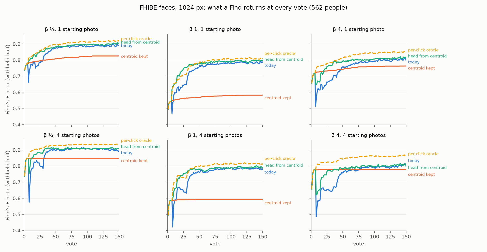
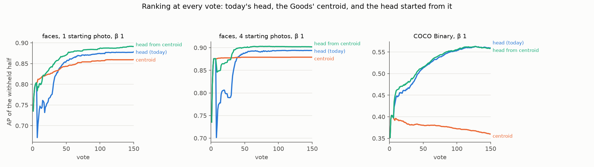
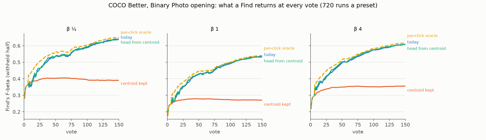

# The hand-over to the trained head: fix the head, not the hand-over (#4776)

**2026-10-11.** Below the label quota (#4643), Test gives the Goods' centroid. At the quota (3 Goods
and 4 Bads, or a Good and 16 Bads) it hands over to the trained head, a linear SVM. The face review
(#4762) found that on FHIBE's face crops the first head ranks a person's withheld photos **worse**
than the centroid it replaces: AP 0.81 → 0.61 from one starting photo, 0.88 → 0.70 from four. The
issue asked for a hand-over rule, priced on the FHIBE cells and guarded on COCO Better's Binary
opening. Candidates: keep the centroid until the head beats it on the labels, or a head that starts
from the centroid.

**No hand-over rule wins on both benches.** Each rule was priced on the same sessions: 6,744 FHIBE
face sessions (562 people, 1 and 4 starting photos, 1024 and 640 px, β ¼ / 1 / 4) and 2,160 COCO
Binary sessions (720 a preset). The rules that keep the centroid past the quota split the faces by
preset, and they lose on COCO:

- **Keeping the centroid** (no hand-over), on faces at 1024 px, over votes 1–50: **+0.06 / +0.10** at
  β 4 (1 / 4 photos), about **0** at β ¼, and **−0.09 / −0.08** at β 1. Over votes 1–150 it loses at
  β ¼ and β 1 (−0.04 to −0.16). On COCO it loses **0.06 to 0.07** over votes 1–50 and **0.14 to
  0.16** over 1–150.
- **A judge on the labels** cannot tell the two apart on faces. The rule holds each Good out in turn,
  ranks it among the unvoted media under the centroid of the other Goods and under the head fitted
  without it, and shows the head when its held-out Goods rank better. On faces the centroid ranks
  90–94% of held-out Goods first, and the head ranks one better only 3% of the time. So the judge
  keeps the centroid on 91–99% of clicks and prices like keeping it. On COCO every variant loses,
  by 0.001 to 0.034 over votes 1–50.
- **A fixed delay is small either way.** Handing over at 8 Bads instead of 4 moves faces by
  −0.003 to +0.030 over votes 1–50 and COCO by −0.006 to −0.014.

**The head is the fix.** A linear SVM started from the Goods' centroid (the issue's second candidate)
is a new eval head, `CALIB_HEAD=linear_svm_prior`. It is the shipped head's objective with the
centroid made a cheap direction, so the head starts at the centroid and leaves it as the labels pay
for it. Run as full sessions (it trains every fit, so Test, the picks, the folds and the line all
move), paired with today run for run, Find's F-beta goes up in **every one of the 12 face sets**:

- **+0.037 to +0.073** over votes 1–50 (SE ≤ 0.004);
- **+0.017 to +0.033** over votes 1–150, and still +0.001 to +0.016 over votes 51–150;
- it wins 68–84% of runs and loses 15–29%.

The AP dip at the hand-over goes from −0.21 / −0.17 to **−0.03 / −0.01** (one / four photos), and at β 1
the F-beta dip is gone. On COCO Better's Binary opening (the guard) it gains a little at every preset: **+0.004 to +0.007** over votes 1–50 and **+0.002 to +0.004** over votes 1–150 (SE 0.001–0.002).

**Recommendation: ship the head started from the centroid as the trained head; keep today's hand-over at the quota.** It wins on both benches and every preset, and it needs no rule. The build is #4785: production fits, the eval harness's default head, and a pricing of the region path, which this study did not run. The β 4 line at the first trained click, which the arm only halves, is #4786.



*Figure 1. What a Find returns at every vote on FHIBE's face crops (1024 px, 562 people): F-beta of
the withheld half at the set's own β. Today (blue) dips at the hand-over (vote 7 from one photo, 8
from four). Keeping the centroid past the quota (orange) avoids the dip and then stalls on its own
line. The head started from the centroid (aqua) is a separate set of sessions, paired with today
person for person. The per-click oracle (dashed) shows, at each click, whichever of today's head and
the centroid scores better. It is a bound on every hand-over rule, not a rule.*

## What was priced

### Hand-over rules: one session set prices every rule

Neither the centroid nor the head picks. Autopilot's picks come from the learned sort, which trains
the head whatever Test gives (`labelset_train_and_score(label_quota=False)`). A hand-over rule
therefore changes only what Test shows, so every rule is priced on the same sessions.

`CALIB_HANDOVER_SHADOW=1` (`vtscore/eval/arms_handover.py`) adds, at every click past the quota:

- the centroid's Test, as rows tagged `handover:centroid`, scored exactly as its rows under the quota
  are (its count line, #4732);
- the evidence a rule may read from the labels and the corpus alone, in `__handover.csv`. Each Good is
  held out in turn and ranked among the unvoted pool under the centroid of the other Goods and under
  the head fitted without it.

With the shadow on, the session is unchanged. Sample cells match the face review's (#4762) and
#4743's COCO cells pick for pick. Across all 6,744 face sessions, the hand-over this run records
reproduces the face review's `handover.csv` to four decimals (`dip.csv`, "today").

The rules, each reading only what Test could read at that click:

| rule | Test gives the head when |
|---|---|
| today | the quota is met |
| centroid kept | never |
| head from G Goods / B Bads | the labels hold G Goods / B Bads (G = 4, 5, 6, 8; B = 8, 16, 32, 64) |
| judge (MRR, mean log rank, median rank, wins) | its held-out Goods rank better than the centroid's; with one Good the centroid stays (`+g1`: the head) |
| judge, sticky | as above, and the head stays once it has won |
| per-click oracle | its F-beta on the withheld half is the higher (a bound) |

### The head started from the centroid: an arm

`LINEAR_SVM_PRIOR_HEAD` (`vtscore/training/svm_prior.py`) fits the shipped head's objective on the votes
plus one feature: 10 times each vector's dot with the unit Goods' centroid of the rows it is fitted
on. The objective is squared hinge, L2, C = 1, balanced. A weight on that feature costs 1/100 of the
same move in any other direction, so the head starts at the centroid. It folds back into one
`Linear(D, 1)`, so the calibration folds (each with its own Goods' centroid), the line and the
scoring take it as they take the SVM. In the shadow's ranking-only pricing, scale 10 ranked best of
1, 3 and 10 over votes 1–50 on both benches. Over 1–150 on COCO, 3 led it by 0.0003. It is an eval head; the app cannot reach it.

The arm reruns the same people, classes, seeds and settings (6,744 face sessions, 2,160 COCO
sessions) with `CALIB_HEAD=linear_svm_prior`.
Its control is the shadow run's untagged rows, today's sessions. The two diverge from the quota on,
so they pair run for run.

### Scoring

What a Find returns at every vote, read as the face review reads it: Test's rows with the end-of-run
check left out, carried between rows, 0 before the first. Every run is in every average (#4631).
COCO's 18 runs a preset that never find a Good give Test nothing under any rule or head, and count as
zero differences. Each number is a session mean over votes 1–50 or 1–150, the arm or rule minus
today per run, then the mean ± SE over runs.

## The hand-over rules

**Faces, 1024 px, votes 1–50** (each rule minus today; 640 px in `tables.md`):

| rule | 1 photo, β ¼ | 1 photo, β 1 | 1 photo, β 4 | 4 photos, β ¼ | 4 photos, β 1 | 4 photos, β 4 |
|---|---|---|---|---|---|---|
| centroid kept (no hand-over) | -0.009 ± 0.006 | -0.093 ± 0.008 | +0.057 ± 0.006 | +0.010 ± 0.007 | -0.075 ± 0.009 | +0.102 ± 0.008 |
| head from 5 Goods | -0.003 ± 0.006 | -0.079 ± 0.008 | +0.056 ± 0.006 | +0.011 ± 0.006 | -0.064 ± 0.008 | +0.088 ± 0.007 |
| head from 8 Bads | +0.005 ± 0.001 | -0.003 ± 0.001 | +0.020 ± 0.001 | +0.016 ± 0.002 | +0.005 ± 0.002 | +0.030 ± 0.001 |
| head from 16 Bads | +0.005 ± 0.002 | -0.011 ± 0.002 | +0.030 ± 0.002 | +0.019 ± 0.003 | -0.003 ± 0.003 | +0.044 ± 0.002 |
| head from 32 Bads | +0.007 ± 0.004 | -0.041 ± 0.005 | +0.053 ± 0.005 | +0.025 ± 0.005 | -0.027 ± 0.006 | +0.089 ± 0.006 |
| judge: held-out Goods' MRR | -0.009 ± 0.006 | -0.091 ± 0.008 | +0.055 ± 0.006 | +0.010 ± 0.007 | -0.075 ± 0.009 | +0.101 ± 0.007 |
| judge: MRR, head kept once it wins | -0.005 ± 0.005 | -0.076 ± 0.008 | +0.053 ± 0.006 | +0.008 ± 0.006 | -0.076 ± 0.008 | +0.087 ± 0.007 |
| judge: mean log rank | -0.008 ± 0.006 | -0.089 ± 0.008 | +0.058 ± 0.006 | +0.010 ± 0.007 | -0.074 ± 0.009 | +0.101 ± 0.007 |
| per-click oracle (a bound, not a rule) | +0.047 ± 0.004 | +0.047 ± 0.003 | +0.100 ± 0.005 | +0.067 ± 0.005 | +0.062 ± 0.004 | +0.142 ± 0.006 |
| *today, for scale (F-beta)* | 0.802 | 0.651 | 0.672 | 0.833 | 0.662 | 0.673 |

**Faces, 1024 px, votes 1–150:**

| rule | 1 photo, β ¼ | 1 photo, β 1 | 1 photo, β 4 | 4 photos, β ¼ | 4 photos, β 1 | 4 photos, β 4 |
|---|---|---|---|---|---|---|
| centroid kept (no hand-over) | -0.047 ± 0.006 | -0.164 ± 0.010 | -0.002 ± 0.006 | -0.036 ± 0.006 | -0.151 ± 0.010 | +0.027 ± 0.007 |
| head from 5 Goods | -0.034 ± 0.006 | -0.132 ± 0.009 | +0.005 ± 0.006 | -0.026 ± 0.006 | -0.121 ± 0.010 | +0.025 ± 0.006 |
| head from 8 Bads | +0.002 ± 0.000 | -0.001 ± 0.000 | +0.007 ± 0.000 | +0.005 ± 0.001 | +0.002 ± 0.001 | +0.010 ± 0.000 |
| head from 16 Bads | +0.002 ± 0.001 | -0.004 ± 0.001 | +0.010 ± 0.001 | +0.006 ± 0.001 | -0.001 ± 0.001 | +0.015 ± 0.001 |
| head from 32 Bads | +0.002 ± 0.001 | -0.014 ± 0.002 | +0.018 ± 0.002 | +0.008 ± 0.002 | -0.009 ± 0.002 | +0.030 ± 0.002 |
| judge: held-out Goods' MRR | -0.045 ± 0.005 | -0.155 ± 0.009 | -0.003 ± 0.006 | -0.033 ± 0.006 | -0.145 ± 0.010 | +0.025 ± 0.007 |
| judge: MRR, head kept once it wins | -0.036 ± 0.005 | -0.128 ± 0.009 | +0.000 ± 0.005 | -0.031 ± 0.006 | -0.139 ± 0.009 | +0.021 ± 0.006 |
| judge: mean log rank | -0.043 ± 0.005 | -0.154 ± 0.009 | -0.001 ± 0.006 | -0.032 ± 0.006 | -0.145 ± 0.010 | +0.026 ± 0.007 |
| per-click oracle (a bound, not a rule) | +0.033 ± 0.004 | +0.032 ± 0.003 | +0.068 ± 0.004 | +0.041 ± 0.004 | +0.042 ± 0.003 | +0.094 ± 0.005 |
| *today, for scale (F-beta)* | 0.858 | 0.736 | 0.751 | 0.881 | 0.741 | 0.751 |

**COCO Better Binary, votes 1–50:**

| rule | β ¼ | β 1 | β 4 |
|---|---|---|---|
| centroid kept (no hand-over) | -0.058 ± 0.006 | -0.071 ± 0.005 | -0.071 ± 0.006 |
| head from 5 Goods | +0.006 ± 0.001 | +0.004 ± 0.001 | +0.001 ± 0.002 |
| head from 8 Bads | -0.006 ± 0.002 | -0.012 ± 0.002 | -0.014 ± 0.002 |
| head from 16 Bads | -0.024 ± 0.004 | -0.034 ± 0.004 | -0.035 ± 0.003 |
| head from 32 Bads | -0.053 ± 0.005 | -0.067 ± 0.005 | -0.065 ± 0.005 |
| judge: held-out Goods' MRR | -0.024 ± 0.003 | -0.033 ± 0.004 | -0.034 ± 0.004 |
| judge: MRR, head kept once it wins | -0.001 ± 0.002 | -0.004 ± 0.002 | -0.005 ± 0.002 |
| judge: mean log rank | -0.006 ± 0.003 | -0.012 ± 0.003 | -0.017 ± 0.003 |
| per-click oracle (a bound, not a rule) | +0.038 ± 0.002 | +0.026 ± 0.002 | +0.027 ± 0.002 |
| *today, for scale (F-beta)* | 0.447 | 0.340 | 0.402 |

**COCO Better Binary, votes 1–150:**

| rule | β ¼ | β 1 | β 4 |
|---|---|---|---|
| centroid kept (no hand-over) | -0.145 ± 0.007 | -0.163 ± 0.007 | -0.160 ± 0.007 |
| head from 5 Goods | +0.003 ± 0.001 | +0.002 ± 0.000 | +0.001 ± 0.001 |
| head from 8 Bads | -0.002 ± 0.001 | -0.004 ± 0.001 | -0.005 ± 0.001 |
| head from 16 Bads | -0.008 ± 0.001 | -0.012 ± 0.001 | -0.012 ± 0.001 |
| head from 32 Bads | -0.023 ± 0.002 | -0.029 ± 0.002 | -0.026 ± 0.002 |
| judge: held-out Goods' MRR | -0.020 ± 0.003 | -0.030 ± 0.003 | -0.031 ± 0.003 |
| judge: MRR, head kept once it wins | -0.002 ± 0.001 | -0.004 ± 0.002 | -0.004 ± 0.002 |
| judge: mean log rank | -0.004 ± 0.001 | -0.008 ± 0.002 | -0.009 ± 0.002 |
| per-click oracle (a bound, not a rule) | +0.023 ± 0.001 | +0.015 ± 0.001 | +0.017 ± 0.001 |
| *today, for scale (F-beta)* | 0.542 | 0.439 | 0.510 |

On COCO, *today* is the mean over the 702 runs a preset that find a Good; the differences count all 720.

**Why keeping the centroid splits by preset on faces.** The centroid does rank a person better than
the first head. Today's head only catches up around vote 39–48 (AP). But a Find is scored at its
line, and the two lines differ:

- **At β 1 the centroid's count line keeps too few.** It keeps a median of 1 face at every vote
  from 10 to 100, where the head's labels line keeps 3. A person has about three withheld photos, so
  the centroid's recall is stuck (#4759). The head's F-beta overtakes the centroid's by vote 10–11,
  although its AP stays lower until vote 39–40.
- **At β 4 the head's labels line keeps too many at first.** From four photos it keeps a median of 16
  faces at the hand-over. The centroid's count line keeps β^0.708 times its count and is right there
  (F-beta 0.78 against 0.49).
- **On COCO the head ranks as well as the centroid from the hand-over on**, and soon far better: AP
  −0.07 over votes 1–50 if the centroid is kept.

**Why the judge cannot find the hand-over.** It reads ranking, the right thing for AP. On faces
the centroid ranks 90–94% of the held-out Goods first, and the head 84–89%. The head ranks a held-out
Good better than the centroid does in only 3% of cases, and worse in 10–15%. So the judge keeps the
centroid on 91–99% of clicks, and on F-beta it prices like keeping the centroid. The per-click
oracle would gain 0.05 to 0.14 on faces over votes 1–50. It chooses by F-beta at each detector's own
line, which the judge does not read.

## The head started from the centroid

**In the shadow (ranking only, on today's picks).** On faces it ranked the withheld half at least as
well as today's head at every vote from the quota on. The centroid stays ahead of it, by up to 0.016
(one photo) or 0.023 (four), until vote 18 or 30–32; the new head leads after that. On COCO it ranked
above today's head until about vote 50 and about 0.001 below it after. Session means, each minus
today's head:

| set | centroid kept, 1-50 | head from centroid, 1-50 | centroid kept, 1-150 | head from centroid, 1-150 |
|---|---|---|---|---|
| 1 photo, β 1 | +0.034 ± 0.004 | +0.043 ± 0.002 | +0.000 ± 0.003 | +0.020 ± 0.001 |
| 4 photos, β 1 | +0.045 ± 0.004 | +0.048 ± 0.003 | +0.006 ± 0.004 | +0.022 ± 0.002 |
| COCO, β ¼ | -0.069 ± 0.004 | +0.010 ± 0.001 | -0.133 ± 0.005 | +0.002 ± 0.000 |
| COCO, β 1 | -0.069 ± 0.004 | +0.010 ± 0.001 | -0.133 ± 0.005 | +0.002 ± 0.000 |
| COCO, β 4 | -0.068 ± 0.004 | +0.011 ± 0.001 | -0.131 ± 0.005 | +0.003 ± 0.000 |

**As full sessions (F-beta at its own line):**

| set | runs | today, 1-50 | Δ 1-50 | today, 1-150 | Δ 1-150 | Δ 51-150 | wins / losses (1-150) | ΔAP 1-50 | ΔAP 1-150 |
|---|---|---|---|---|---|---|---|---|---|
| 1 photo, β ¼ | 562 | 0.802 | +0.037 ± 0.003 | 0.858 | +0.018 ± 0.003 | +0.008 ± 0.004 | 71% / 25% | +0.044 ± 0.003 | +0.023 ± 0.002 |
| 1 photo, β 1 | 562 | 0.651 | +0.058 ± 0.003 | 0.736 | +0.027 ± 0.003 | +0.012 ± 0.003 | 75% / 21% | +0.044 ± 0.003 | +0.023 ± 0.002 |
| 1 photo, β 4 | 562 | 0.672 | +0.069 ± 0.004 | 0.751 | +0.033 ± 0.003 | +0.016 ± 0.003 | 84% / 15% | +0.051 ± 0.003 | +0.026 ± 0.002 |
| 4 photos, β ¼ | 562 | 0.833 | +0.042 ± 0.004 | 0.881 | +0.017 ± 0.002 | +0.004 ± 0.003 | 69% / 29% | +0.046 ± 0.003 | +0.021 ± 0.002 |
| 4 photos, β 1 | 562 | 0.662 | +0.055 ± 0.003 | 0.741 | +0.024 ± 0.002 | +0.008 ± 0.003 | 77% / 21% | +0.046 ± 0.003 | +0.021 ± 0.002 |
| 4 photos, β 4 | 562 | 0.673 | +0.073 ± 0.004 | 0.751 | +0.030 ± 0.003 | +0.009 ± 0.003 | 81% / 19% | +0.056 ± 0.003 | +0.025 ± 0.002 |
| COCO, β ¼ | 720 (702 with a Good) | 0.447 | +0.006 ± 0.002 | 0.542 | +0.003 ± 0.002 | +0.002 ± 0.002 | 52% / 46% | +0.010 ± 0.002 | +0.004 ± 0.001 |
| COCO, β 1 | 720 (702 with a Good) | 0.340 | +0.004 ± 0.002 | 0.439 | +0.002 ± 0.001 | +0.002 ± 0.001 | 52% / 45% | +0.010 ± 0.002 | +0.004 ± 0.001 |
| COCO, β 4 | 720 (702 with a Good) | 0.402 | +0.007 ± 0.002 | 0.510 | +0.004 ± 0.001 | +0.003 ± 0.002 | 53% / 45% | +0.011 ± 0.002 | +0.004 ± 0.001 |

**The dip** (`dip.csv`). At the last centroid vote and the first trained one, paired per run, 1024 px:

| start | β | AP: centroid → head, today | ... with the head from the centroid | F-beta: centroid → head, today | ... with the head from the centroid |
|---|---|---|---|---|---|
| 1 photo | β ¼ | 0.81 → 0.61 (-0.21) | 0.81 → 0.78 (-0.03) | 0.79 → 0.58 (-0.21) | 0.79 → 0.76 (-0.02) |
| 1 photo | β 1 | 0.81 → 0.61 (-0.21) | 0.81 → 0.78 (-0.03) | 0.55 → 0.42 (-0.13) | 0.55 → 0.61 (+0.06) |
| 1 photo | β 4 | 0.81 → 0.61 (-0.21) | 0.81 → 0.78 (-0.03) | 0.73 → 0.45 (-0.28) | 0.73 → 0.63 (-0.09) |
| 4 photos | β ¼ | 0.88 → 0.70 (-0.17) | 0.88 → 0.86 (-0.01) | 0.85 → 0.58 (-0.27) | 0.85 → 0.75 (-0.09) |
| 4 photos | β 1 | 0.88 → 0.70 (-0.17) | 0.88 → 0.86 (-0.01) | 0.59 → 0.42 (-0.17) | 0.59 → 0.59 (+0.01) |
| 4 photos | β 4 | 0.88 → 0.70 (-0.17) | 0.88 → 0.86 (-0.01) | 0.78 → 0.49 (-0.29) | 0.78 → 0.62 (-0.15) |

The AP dip is 84–92% gone. What is left of the F-beta dip at β 4 (−0.09 / −0.15) is the labels
line keeping too many at the hand-over. At vote 8 it keeps a median of 4–5 faces, against today's 5–16.



*Figure 2. AP of the withheld half at every vote, β 1: today's head, the Goods' centroid (kept past
the quota), and the arm's head. The arm's sessions are its own, paired with today's.*

## The COCO guard



*Figure 3. What a Find returns at every vote on COCO Better's Binary Photo opening (720 runs a preset, every run counted), the same four as Figure 1.*

On COCO the head started from the centroid runs close to today's head. At single votes the paired difference ranges from −0.011 to +0.020. Every session mean is positive at every preset. Over votes 1–150 the gain is +0.002 to +0.004, about 2–3 SE, and the SE barely moves when clustered on category (seeds share a class). AP gains +0.010 to +0.011 over votes 1–50. The arm wins 52–53% of runs and loses 45–46%.

The centroid is the wrong thing to keep on COCO: its AP falls as Goods accumulate (Figure 2). One reading is that a broad category's Goods average to a point between its kinds; this study did not test that.

## What this does not settle

- **The β 4 line at the hand-over.** With either head, the labels line keeps too many faces at the
  first trained click. The arm halves the F-beta drop there, and what is left is the line's.
- **The centroid's count line at β 1** keeps one face of a person's ~3 (#4759). Below the quota the
  session still shows it.
- **Region path.** The shadow's judge and the arm were run on single-vector sessions only. The head
  is a `Linear(D, 1)` and would max-pool like the SVM, but no region session was run.
- **Node drift in the pairing.** The arm and its control ran on a mix of V100 and cpu nodes, and
  runs on different CPU vendors drift late (#4481). That adds noise to a run's paired difference, not
  a direction, and 562 people (or 702 COCO runs) a set average it out.

## Provenance

| | |
|---|---|
| Code | branch `claude/face-handover-4776`: shadow run at `63895b758`, arm at `792f99422` (frozen worktrees `vts-4776-run`, `vts-4776-prior`) |
| FHIBE release | `fhibe-full-resolution-674a7dcf`, cells by #4712, the #4699 baseline's 562 people |
| Run dirs (owner-only) | `<release>-derived/runs/2026-10-10-4776-k{1,4}-b{025,1,4}` (shadow), `…/2026-10-10-4776prior-…` (arm); analyses `…-4776-analysis`, `…-4776prior-analysis` |
| COCO | `state-of-the-app/2026-10-10-handover4776-b{025,1,4}` (shadow), `…/2026-10-10-prior4776-…` (arm), on the 2026-10-08 grid |
| Files here | `rules_faces.csv`, `rules_coco.csv` (every rule), `prior_ab.csv` (the arm), `dip.csv`, `curves_*.csv`, `tables.md`, figures |

Reproduce:

```bash
# shadow (today's sessions plus the centroid's Test and the judge's evidence past the quota)
SOTA_FACE_TAG=4776 CALIB_HANDOVER_SHADOW=1 bash scripts/experiments/fhibe/sota_face.sh dirs   # then tasks, pack 4
bash scripts/experiments/state_of_app/handover_4776.sh dirs && bash scripts/experiments/state_of_app/handover_4776.sh launch 1   # and 0.25, 4
# the arm
SOTA_FACE_TAG=4776prior CALIB_HEAD=linear_svm_prior bash scripts/experiments/fhibe/sota_face.sh dirs   # then tasks, pack 4
HO4776_ARM=prior bash scripts/experiments/state_of_app/handover_4776.sh launch 1                 # and 0.25, 4
# analysis
python scripts/experiments/fhibe/handover_4776.py --set k1-b1-1024=<shadow k1-b1 cells>::fhibe_faces_1024 ... --out <dir>
python scripts/experiments/fhibe/prior_4776.py --pair k1-b1-1024=<arm cells>::<shadow cells>::fhibe_faces_1024 ... --out <dir>
python scripts/experiments/fhibe/handover_4776_tables.py --rules ... --ab ... --runs-of coco-b1=720 ... --out tables.md
python scripts/experiments/fhibe/handover_4776_figures.py --curves ... --arm ... --out <dir>
```
