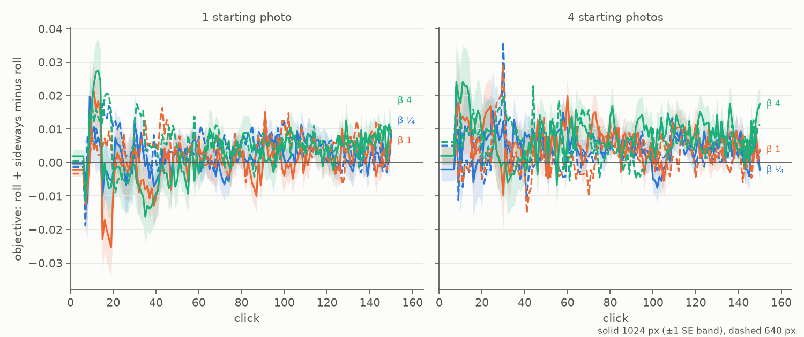

# Finding sideways faces before aligning them — 2026-10-11 (#4788)

**Looking for each face again in the photo turned a quarter each way fixes faces lying on their
side, and it ships opt-in.** `image2face` gains a `sideways` checkbox (default off). Each face MTCNN
finds is looked for again at 90° and 270°, and its landmarks come from whichever pass MTCNN is most
confident of. Then `roll` alignment (#4777) turns it upright. Paired against `roll` on the face
review's 6,744 sessions, both arms at one commit:

- **both sideways failures are fixed**: `2b76ec95` and `6fd3845d` go from final AP 0.00 to 1.00
  (session means 0.00 → 0.90 and 0.92) at both sizes. Failed one-photo sessions fall from 7 to 6 at
  1024 px (2 fixed, 1 made) and from 7 to 5 at 640;
- the objective's session mean moves by **about +0.004**: −0.000 to +0.008 across the 12 session
  sets, all but one positive, each within 1–3 SE;
- it costs **about 2.8× the face-detection time per photo** (CPU, 1024 px: 0.24 → 0.70 s).

The owner chose opt-in: the gain is small and the slower conversion would fall on every face import.
A half turn is never searched: MTCNN finds upright faces in the upside-down copy too, so all 15 such
picks would have flipped an upright face over.

## The problem

Since #4777, `image2face` turns each face crop upright by the angle MTCNN's five landmarks give
(`align="roll"`, the default). For a face lying on its side, MTCNN usually still finds the face,
but it places the landmarks as if the face were upright. The fit then reads a small angle, and
nothing is turned. Two of the face review's 12 failed one-photo sessions (#4762) were this case and
still failed under `roll`:
- `2b76ec95`: the face is turned about 90°, and the fit reads 9°;
- `6fd3845d`: the person is lying sideways, and the fit reads 20°.

## The fix: ask MTCNN again on the photo turned a quarter each way

A new `sideways` checkbox on `image2face` (default off) runs MTCNN twice more, on the photo turned
90° and 270°. For each face the plain pass kept, it looks for the same face in each turned copy:
the detection whose box, mapped back to the photo, overlaps the face's own box at IoU 0.5 or more.
**The face's landmarks then come from whichever of the three passes MTCNN is most confident of.**
The faces kept, their boxes and their confidences stay the plain pass's own. So `fhibe_faces_side_*`
holds the same media ids and labels as `fhibe_faces_roll_*`, and only the switched faces' pixels
differ.

Two choices, both made from data (`orient_landmarks_4788.py`: MTCNN at all four turns on every
one-person FHIBE photo, mapped back to the stored frame):

- **Re-landmark found faces; add no new ones.** The turned passes find 1,426 / 1,473 / 1,523 faces
  (90° / 180° / 270°, at 1024 px) that the plain pass does not keep at all. In the contact sheets
  they are mostly textures and patterns that look like faces once rotated. Adding them would also
  change which photos each person has, and so the splits and starting photos, breaking the pairing
  with #4777's sessions.
- **Quarter turns only, never 180°.** A most-confident rule over all four turns picks the
  upside-down copy for 15 faces at 1024 px. In the contact sheet **all 15 are upright faces**:
  MTCNN also finds them in the upside-down copy, confidently, with upside-down landmarks, so the
  half turn would have flipped every one of them over. Among the quarter-turn picks, a sample of 20
  random switches shows the crop more upright than `roll`'s in most, and about level in the rest.

At 1024 px the rule switches 178 of 9,768 subject faces (1.8%): 77 to the 90° copy and 101 to the
270°. At 640 px it switches 158 of 9,399. The switched faces are turned a median 73° by their new
landmarks, against 31° by the plain pass's. The built cells agree: exactly those 178 (and 158)
subject crops differ from `roll`'s, plus 24 (and 10) stray faces.

| face | plain pass: confidence, fit angle | most confident quarter turn | its fit angle |
|---|---|---|---|
| `2b76ec95` (sideways) | 0.988, 9° | 90°: 0.9998 | 119° |
| `6fd3845d` (sideways) | 0.814, 20° | 90°: 0.9999 | 99° |
| `548d8580` (turned 77°) | 0.793, 77° | 90°: 0.99997 | 81° |
| `7a21b1c4` (turned −75°) | 0.966, −75° | 270°: 0.99994 | −69° |
| `0cdec9c8`, `48b38d95` (profiles) | 0.87, 0.80 | not found turned | – |

Where `roll` was already right, the turned pass agrees with it to within a few degrees.

## The screen

The click-0 screen of #4777 (`align_screen_4777.py`): every subject crop of the 562 people takes a
turn as the one starting photo, scored by the AP of the person's other crops in the whole cell.
Paired against `roll`, with SEs over people:

| size | roll | roll + sideways | Δ | failed starts: roll → side | fixed / made |
|---|---|---|---|---|---|
| 1024 | 0.738 | 0.742 | **+0.0045 ± 0.0014** | 220 → 205 | 21 / 6 |
| 640 | 0.709 | 0.711 | +0.0024 ± 0.0010 | 274 → 270 | 10 / 6 |

Against the plain crop, `roll` + `sideways` is +0.031 ± 0.003 at 1024 px (`roll` alone: +0.026)
and +0.025 at 640 (`roll`: +0.023).

**Both sideways starts are fixed at click 0.** `2b76ec95`'s start ranks the person at AP 0.0007
under `roll` and **0.69** with `sideways` (0.63 at 640). `6fd3845d`'s goes from 0.002 to **0.98**
(0.69 at 640).

## What it costs

`sideways` runs MTCNN three times per photo instead of once (`sideways_cost_4788.py`, 200 FHIBE
photos):

| | plain pass | with `sideways` |
|---|---|---|
| 1024 px, V100 | 81 ms | 222 ms (2.7×) |
| 1024 px, CPU, 4 threads | 239 ms | 697 ms (2.9×) |
| 640 px, V100 | 52 ms | 134 ms (2.6×) |
| 640 px, CPU, 4 threads | 127 ms | 355 ms (2.8×) |

Building a FHIBE face cell took 2,094 s against `roll`'s 969 s at 1024 px. FaceNet's embedding is
the same 18 s either way.

## The sessions

`sideways` ran the face review's six session sets on `fhibe_faces_side_{1024,640}`: 6,744 sessions,
0 failed, on four claiming V100 pack jobs. Each is paired with the `roll` session of the same person,
size, starting photos and preset (`align_compare_4777.py --plain-tag roll`). The objective is F-beta
of the withheld set at the app's line, filled over clicks 1–150 as the review fills it. SEs are over
the 562 people.

**The control was re-run.** The first comparison used #4777's `roll` sessions, run at `c74d31dde`.
Between that commit and this arm's (`a86f0a498`), #4784 (the #4759 centroid count line) merged, and
it changes the opening. That comparison showed "gains" of +0.017 to +0.033 from four photos, at about
10 SE, for a change that touches 1.8% of the crops. So `roll` was run again at `a86f0a498`. Paired
against yesterday's run, #4784's effect is all in the opening: after the check, and in final AP,
Δ = 0.000 in every set. Click 0 rises from 0.21 to 0.82 from four photos at β ¼ (1024 px), and the
session mean by +0.013 to +0.029 from four photos and +0.001 to +0.004 from one
(`compare_4784_roll.csv`). The numbers below pair the two arms at one commit (`compare.csv`).

| start | size | β | session mean: roll → side | Δ | after the check, Δ | final AP, Δ | failed sessions |
|---|---|---|---|---|---|---|---|
| 1 photo | 1024 | ¼ | 0.859 → 0.861 | +0.002 ± 0.003 | +0.000 ± 0.004 | +0.007 ± 0.003 | 7 → 6 |
| 1 photo | 1024 | 1 | 0.757 → 0.757 | −0.000 ± 0.003 | +0.002 ± 0.004 | +0.007 ± 0.003 | 7 → 6 |
| 1 photo | 1024 | 4 | 0.769 → 0.771 | +0.002 ± 0.003 | +0.006 ± 0.005 | +0.007 ± 0.003 | 7 → 6 |
| 1 photo | 640 | ¼ | 0.840 → 0.845 | +0.004 ± 0.003 | −0.009 ± 0.005 | +0.006 ± 0.003 | 7 → 5 |
| 1 photo | 640 | 1 | 0.722 → 0.726 | +0.004 ± 0.003 | −0.003 ± 0.005 | +0.006 ± 0.003 | 7 → 5 |
| 1 photo | 640 | 4 | 0.742 → 0.747 | +0.005 ± 0.003 | +0.009 ± 0.005 | +0.005 ± 0.003 | 7 → 5 |
| 4 photos | 1024 | ¼ | 0.893 → 0.897 | +0.005 ± 0.002 | +0.006 ± 0.005 | +0.005 ± 0.002 | 0 → 0 |
| 4 photos | 1024 | 1 | 0.770 → 0.776 | +0.006 ± 0.002 | +0.012 ± 0.004 | +0.005 ± 0.002 | 0 → 0 |
| 4 photos | 1024 | 4 | 0.775 → 0.783 | +0.008 ± 0.003 | +0.006 ± 0.004 | +0.005 ± 0.002 | 0 → 0 |
| 4 photos | 640 | ¼ | 0.879 → 0.882 | +0.003 ± 0.002 | +0.002 ± 0.005 | +0.003 ± 0.002 | 0 → 0 |
| 4 photos | 640 | 1 | 0.746 → 0.748 | +0.003 ± 0.002 | +0.006 ± 0.005 | +0.003 ± 0.002 | 0 → 0 |
| 4 photos | 640 | 4 | 0.758 → 0.764 | +0.006 ± 0.003 | +0.006 ± 0.005 | +0.003 ± 0.002 | 0 → 0 |



*Figure 1. Roll + sideways minus roll, in the objective the session shows at every click, mean over
the 562 people; colour is the preset, solid 1024 px with a ±1 SE band, dashed 640 px.*

**The failures.** The 7 one-photo failures left under `roll` (1024 px, β 1) were 2 sideways faces,
2 profiles, 1 face turned down, 1 face turned 35° and down, and 1 face turned steeply down (#4777).
`sideways` fixes the two sideways faces, `2b76ec95` (final AP 0.00 → 1.00) and `6fd3845d` (0.00 →
1.00), and no other. It makes one: `87619745`, a profile drinking from a bottle. The plain pass read
it as nearly level (−5°, confidence 0.85). The 90° copy was more confident (0.93) and put its
landmarks 60° round, so the crop was turned wrong and the start's example sort fell from AP 0.07 to
0.001. At 640 px it fixes the same two faces and makes none.

**A wrong switch has a signature.** In the 20-switch sample, the switches that looked worse or level
had turned-copy confidences of 0.92 to 0.99, and `87619745`'s was 0.93. Every one that looked
right was at 0.994 or above, as are the four picks in the orientation table (the two sideways faces
at 0.9998 and 0.9999). A floor on
the turned copy's confidence might remove most wrong switches, but that threshold was read off these
cases. It would need pricing of its own before it ships.

## Decision: `sideways` ships opt-in

The owner's call, given the numbers above. The gain on the owner's metric is real but small
(+0.004), and it comes from the few photos whose faces lie on their side. The cost, about 2.8× the
detection time, falls on every face conversion. So `sideways` stays off by default, and the
importer offers it as **Find sideways faces** for collections where faces lie down or are turned.
`roll` stays the default.

## Provenance

| | |
|---|---|
| Code | `a86f0a498` (branch `claude/face-orient-4788`), run from a frozen worktree |
| Cells | `fhibe_faces_side_{1024,640}`, built 2026-10-11 on rack8n03 (V100), owner-only beside the FHIBE release |
| Control | `roll` re-run at `a86f0a498`, `<release>-derived/runs/2026-10-11-sota-roll-*` (#4777's `2026-10-10-sota-roll-*`, at `c74d31dde`, for #4784's effect) |
| Arm | `<release>-derived/runs/2026-10-11-sota-side-*`, run as 4 claiming V100 pack jobs (the cpu partition was memory-bound) |
| Turned passes, screen, comparison (owner-only) | `<release>-derived/runs/2026-10-11-orient-4788/` |

Reproduce:

```bash
# MTCNN at four turns, and the per-face table
python scripts/experiments/fhibe/orient_landmarks_4788.py detect --long-side 1024 --turn 90 --out <dir>   # each size x turn
python scripts/experiments/fhibe/orient_landmarks_4788.py table --long-side 1024 --out <dir>
# the cells, and the cost
VTS_GPU_NODE=<a V100 node> VTS_BUILD_ARGS="--embedders face" bash scripts/experiments/pile/launch_pile.sh \
  fhibe_faces_side_1024 fhibe_faces_side_640
python scripts/experiments/fhibe/sideways_cost_4788.py --long-side 1024 --n 200
# the screen, against roll
python scripts/experiments/fhibe/align_screen_4777.py --identities <ids> --rolls <4777 dir>/subjects_1024.csv \
  --arms faces_roll,faces_side --starts 1024=<review k1-b1 cells> --starts 640=<review k1-b1 cells> --out <dir>
# the sessions (prepare as sota_face.sh prepare does; on V100 here), analysis, comparison
SOTA_FACE_ARM=side SOTA_FACE_DATE=2026-10-11 bash scripts/experiments/fhibe/sota_face.sh dirs   # then tasks, pack 4, baseline
bash scripts/experiments/fhibe/sota_face_analyze.sh <analysis> 1 4
python scripts/experiments/fhibe/align_compare_4777.py --plain <roll analysis> --plain-baseline <roll baseline> \
  --plain-tag roll --arm side=<analysis>,<side baseline> --out <dir>
```
