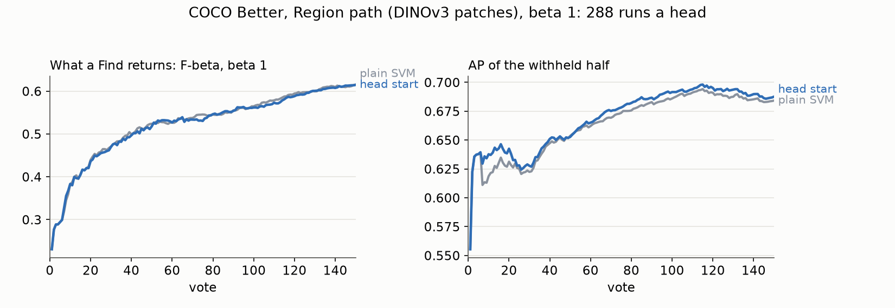

# The head start on the Region path (#4785)

**2026-10-11.** #4776 priced the linear SVM started from the Goods' centroid on single-vector data. On
FHIBE's face crops it raised Find's F-beta by +0.037 to +0.073 over votes 1–50, and on COCO Better's
Binary Photo opening by +0.004 to +0.007
(`docs/experiments/2026-10-11-face-handover-4776`). The owner switched those paths (#4785) and left one
question open: does the Region path switch too? This prices it on the Region path's own sessions:
DINOv3 patches opened on SigLIP's text sort, `max_patch`.

**On Region the head start ranks a little better and returns no better a set.** Paired run for run,
over 288 runs (2 seeds × 144 classes) at β 1:

| | votes 1–50 | votes 1–150 | votes 51–150 |
|---|---|---|---|
| Find's F-beta, head start minus plain SVM | −0.003 ± 0.003 | −0.002 ± 0.002 | −0.002 ± 0.003 |
| AP of the withheld half | **+0.007 ± 0.003** | **+0.005 ± 0.002** | +0.004 ± 0.002 |
| runs the head start wins / loses (F-beta, 1–150) | | 44% / 54% | |

- **The F-beta difference is about one SE and favours the plain SVM.** The SEs barely move when
  clustered on class: 0.0031, 0.0023 and 0.0027 become 0.0032, 0.0024 and 0.0029.
- **The ranking gain is real but small.** AP is up about 2.8 SE over the session, and the AP dip at the
  hand-over is shallower: from 0.639 at vote 6 to 0.611 at vote 7 for the plain SVM, against 0.630 for
  the head start.
- **The line does not use it.** At vote 10 the head start keeps a median of 53 images against 58; at
  vote 50, 43 against 45. What a Find returns scores the same, a hair lower.
- **Why the face gain does not carry over** is not tested here. A Region Good is a box's patch row and a
  Bad floods its whole patch stack, so the "Goods' average" is an average of patch vectors. That may be
  a weaker prior for a class of objects than a face embedding's average is for one person.

**Decision (owner, 2026-10-11): Region switches too.** One head everywhere, so the app and the eval
harness carry no per-space rule. On this bench that trades about 0.002 of F-beta, within one SE, for
+0.005 AP.



*Figure 1. Region path, β 1, 288 runs a head. F-beta of what a Find returns (left; every run counted,
the 9 that never find a Good at 0) and AP (right), the plain SVM in grey and the head start in blue.*

## Method

- **Two arms from one frozen tree,** `vts-4785-run` at `401ec98e1`, on today's app with only the head
  changed:
  - control: the plain SVM;
  - arm: `CALIB_HEAD=linear_svm_prior`.
- **Bench:** COCO Better's 2026-10-08 grid, the Region block of seeds 0 and 1, trajectory pass, 150
  votes, β 1. This is #4743's Region check.
- **Compute:** seed 0 ran as V100 packs with the GPU hidden, seed 1 as cpu arrays, the same split for
  both arms.
- **Scoring** is the face study's: what a Find returns at every vote, carried between rows, 0 before the
  first, every run in every average (#4631). The 9 runs that never find a Good return nothing under
  either head and count as zero differences: 279 of 288 have rows, and the F-beta differences and SEs
  above are scaled by 279/288.
- **Only β 1** was run, as in #4743's Region check. On faces the head start's gain grew from β ¼ to β 4
  (+0.04 to +0.07 over votes 1–50), so a β 4 run is the place a Region gain would show, if anywhere.

## Provenance

| | |
|---|---|
| Run dirs | `state-of-the-app/2026-10-11-region4776{control,prior}-b1` (288 cells each, 0 failed) |
| Analysis | `scripts/experiments/fhibe/prior_4776.py --pair region-b1=<prior cells>::<control cells>`; figure `scripts/experiments/fhibe/region_4785_figure.py --scale 0.969` |
| Files here | `region_ab.csv` (the pair's session means, unscaled), `region_curves.csv` (per vote), `fig_region_by_vote.webp` |

Reproduce:

```bash
export VTSEARCH_DATA_DIR=/expscratch/$USER/vts-cache/datadir
HO4776_PATH=region HO4776_ARM=control HO4776_DATE=<date> bash scripts/experiments/state_of_app/handover_4776.sh dirs
HO4776_PATH=region HO4776_ARM=control HO4776_DATE=<date> bash scripts/experiments/state_of_app/handover_4776.sh pack 1
HO4776_PATH=region HO4776_ARM=prior   HO4776_DATE=<date> bash scripts/experiments/state_of_app/handover_4776.sh pack 1
```
