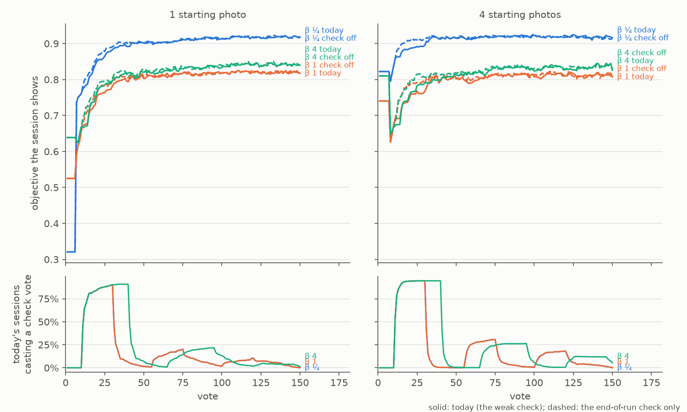
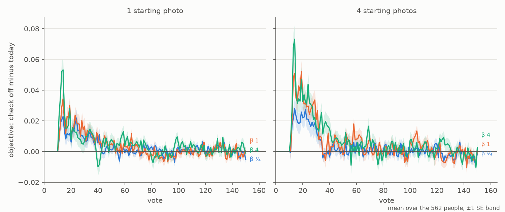

# The weak-separation check on faces — 2026-10-11 (#4778)

**The weak-separation check costs face sessions a little at every preset, from 1 photo and from 4, so
turning it off on faces gains. A minimum Good count is not the remedy: on COCO it would remove the checks
that pay the most.** The face review's 562 people were run twice at one commit, today's app against the
same app with only the end-of-run check (3,372 paired sessions an arm):

- **The session mean of the objective rises at every preset when the check is off: +0.007 to +0.018 over
  votes 1–50 and +0.003 to +0.007 over votes 1–150**, 4 to 8 SE (one photo +0.007 / +0.011 / +0.009 and
  four photos +0.009 / +0.015 / +0.018 at β ¼ / 1 / 4, over votes 1–50).
- **The whole cost sits in the first check's window.** The check prompts in 92–95% of sessions, first at
  vote 11–12 (median), and its first check spends 20 votes (30 at β 4), all but 0.07–0.19 a session on
  Bads. Check off leads by +0.02 to +0.07 near vote 14; the arms are level by vote 40 and stay level
  (votes 51–150: −0.000 to +0.002).
- **Nothing the check is for moves.** The objective after the end-of-run check, final AP, Goods found and
  failed sessions (7 of 562 from one photo, 0 from four) are the same in both arms.
- **A Good gate would cut COCO's best checks.** On #4496's paired COCO runs, sessions whose first check
  starts with fewer than 6 Goods gain the most from it (+0.015 to +0.037 over votes 1–150, against +0.005
  to +0.011 with 20 or more), and so do its earliest checks. Faces lose because nothing is left to find:
  a face session holds all its Goods by vote ~11, while COCO's check votes find Goods as often as
  acquisition does.

The remedy the data supports is no prompted check on the face path (the arm priced here); whether to ship
it is the owner's call (Options).

## What was priced

The weak-separation check (#4496, shipped in #4503) prompts a spot check when Find's labels line
separates the Goods from the Bads by fewer than 1.5 spreads (d' < 1.5). Autopilot runs it once it has
left the opening, from the 10th vote on, and again 25 votes after each check ends while separation stays
weak. A check is rounds of 5 picks drawn evenly across the line's bands. The picks are votes: they count
against the session's votes and train the head, but since #4452 they never move the line.

The face review (#4762) found it prompting in 96–98% of FHIBE face sessions and taking 32–48 of the 150
votes, and asked whether it pays there. It had only been priced on COCO Better's Binary path.

**The arm** turns the prompted check off and keeps the end-of-run check (`CALIB_SPOT_CHECK=end`, the
harness before #4496). **The control** is today's app.

## The bench, and the control

- **The face review's recipe** (#4762): its 562 people, sessions starting from 1 photo and from 4,
  β ¼, 1 and 4, 150 votes, one seed. The faces are the shipped crops at 1024 px
  (`fhibe_faces_roll_1024`, aligned by roll since #4789). 3,372 sessions an arm.
- **Both arms ran at one commit**, `6b6b0d986`. That is #4790's commit, where every detector's head is the
  SVM started from the Goods' centroid (#4785), plus this study's launcher change. No earlier run is
  reused as the control (the #4788 lesson: a control from before a merge pairs with a different app).
- **Paired by person.** The two sets share people, splits, starting photos and seeds, so a session
  and its pair are the same session until the control's first prompted vote. That holds exactly: every
  one of the 3,372 pairs agrees pick for pick up to the control's first prompted vote, and the 28–44
  sessions a set never prompted are identical through vote 150. The cells ran on Intel (V100 nodes) and AMD (rack7n11) alike; the `OPENBLAS_CORETYPE` pin
  (#4481) leaves no vendor drift.
- **β ¼ and β 1 read nearly the same sessions.** On faces the two presets cast identical votes 1–150 in
  97–99% of sessions (the preset moves Find's line, and rarely the picks), so their rows are two readings
  of one session set, not two replications. β 4's checks run 30 votes, so its sessions differ.

The objective is F-beta of the withheld set above Find's line at the session's own β, the face
review's. It is filled as `by_click.py` fills it: the example sort's own set until the app shows a
detector, then the last value carried. The single number is its **session mean**, over votes 1–50 and
1–150; votes 1–25 and 51–150 are given too. Differences are paired, arm minus control, with SEs over
people.

## Results

Check off minus today, mean over the 562 people ± 1 SE; "today" is the control's own session mean.

| start | β | votes 1–25 | votes 1–50 (today) | votes 51–150 | votes 1–150 (today) | sessions check off wins / loses, 1–50 |
|---|---|---:|---:|---:|---:|---:|
| 1 photo | ¼ | +0.009 ± 0.002 | **+0.007 ± 0.002** (0.79) | +0.001 ± 0.000 | **+0.003 ± 0.001** (0.87) | 51% / 27% |
| 1 photo | 1 | +0.012 ± 0.002 | **+0.011 ± 0.002** (0.73) | −0.000 ± 0.001 | **+0.004 ± 0.001** (0.79) | 43% / 26% |
| 1 photo | 4 | +0.013 ± 0.002 | **+0.009 ± 0.002** (0.75) | +0.002 ± 0.001 | **+0.005 ± 0.001** (0.81) | 61% / 27% |
| 4 photos | ¼ | +0.012 ± 0.003 | **+0.009 ± 0.002** (0.88) | −0.000 ± 0.001 | **+0.003 ± 0.001** (0.91) | 52% / 27% |
| 4 photos | 1 | +0.020 ± 0.002 | **+0.015 ± 0.002** (0.76) | +0.001 ± 0.001 | **+0.006 ± 0.001** (0.79) | 49% / 25% |
| 4 photos | 4 | +0.023 ± 0.003 | **+0.018 ± 0.003** (0.77) | +0.002 ± 0.001 | **+0.007 ± 0.001** (0.81) | 61% / 31% |

What the check is for, and what it costs, in today's sessions (`ab.csv`):

| start | β | prompted | first check starts at vote (median) | its votes inside the 150, mean (median) | checks a session | Goods its votes found | after the end-of-run check: today, check off − today | final AP (vote 150) | failed sessions |
|---|---|---:|---:|---:|---:|---:|---:|---:|---:|
| 1 photo | ¼ | 92% | 12 | 26 (20) | 1.3 | 0.19 | 0.92, +0.002 ± 0.002 | 0.91, +0.000 | 7 → 7 |
| 1 photo | 1 | 92% | 12 | 26 (20) | 1.3 | 0.19 | 0.82, −0.001 ± 0.003 | 0.91, +0.000 | 7 → 7 |
| 1 photo | 4 | 92% | 12 | 35 (30) | 1.2 | 0.19 | 0.84, +0.002 ± 0.002 | 0.91, +0.000 | 7 → 7 |
| 4 photos | ¼ | 95% | 11 | 29 (20) | 1.5 | 0.07 | 0.91, +0.003 ± 0.003 | 0.92, +0.000 | 0 → 0 |
| 4 photos | 1 | 95% | 11 | 29 (20) | 1.5 | 0.07 | 0.81, +0.002 ± 0.003 | 0.92, +0.000 | 0 → 0 |
| 4 photos | 4 | 95% | 11 | 40 (30) | 1.3 | 0.07 | 0.83, −0.003 ± 0.004 | 0.92, +0.000 | 0 → 0 |

The review (#4762, on the plain head and plain crops) had 96–98% prompted and 32–48 votes; with today's
head and aligned crops it is 92–95% and 26–40.



*Figure 1. The objective each set shows at every vote, mean over the 562 people. Solid: today's app;
dashed: the end-of-run check only. Bottom row: the share of today's sessions casting a check's vote (β ¼
lies under β 1: the same sessions). The first check fills votes 11–30 (to 40 at β 4); the later humps are
the repeats 25 votes after a check ends.*



*Figure 2. Check off minus today at every vote, ±1 SE over people. The gap opens at vote 11, peaks near
vote 14 and closes by vote 35–40; afterwards it is noise around zero, with a dip at vote 40 at β 4 from one
photo, where today's 30-vote check ends and its labels land at once.*

- **The cost is early and temporary.** Votes 1–25 carry the largest difference (+0.009 to +0.023); votes
  51–150 carry almost none. Over votes 1–150 the gain is the early window averaged over the session.
- **It is larger from four photos** (+0.009 to +0.018 over votes 1–50, against +0.007 to +0.011 from
  one).
- **Per person it cuts both ways.** Turning the check off wins in 43–61% of sessions and loses in 25–31%
  over votes 1–50; the rest are unchanged. At one photo and β 1, 14% of sessions gain more than 0.05 and
  5% lose more than 0.05 (`per_run.csv`, owner-only).

## Why faces lose

**There is nothing left to find.** A FHIBE person has about four crops in the voting half, and the
opening finds them: the first check starts with a median of 4 Goods in hand, from one photo and from four
(`goods_at_prompt.csv` in the compare directory). Its votes then find 0.19 Goods a session (one photo) and 0.07 (four photos), and
acquisition finds about as few in the same sessions: 0.7 against 1.2 Goods per 100 votes from one photo
at β 1, 0.2 against 0.2 from four.
On COCO, check votes and acquisition votes both find a Good about every 7 (12–16 per 100), so a check there
still collects positives, and its labels repay their window several times over by vote 150.

**So on faces the window's votes only decide which Bads get labelled**, and the acquisition's choice
moves Find's line better on average. At vote 25, with the check off, Find's returned set is both more
precise (+0.015 to +0.058) and recalls more (+0.004 to +0.021); by vote 50 recall agrees to ±0.006 and
precision to ±0.002, except +0.022 from one photo at β 4. The check's rounds walk down the line's bands
(scores 0.6 down to 0.3 in the examples below), while acquisition keeps to the ranking's top or the
atlas's next region. Neither finds a Good.

**Goods in hand do not explain who loses.** Split the same way as COCO below, face sessions lose in every
stratum they reach: those starting the check with fewer than 4 Goods (one photo only, 123 of 562) lose
−0.012 to −0.020 over votes 1–50, those with 4–5 lose −0.004 to −0.019 (`goods_strata_faces.csv`, read
from Test's rows rather than the filled objective, so within ±0.002 of the table above).

## Would a minimum Good count fix it?

The issue's suggestion: face sessions hold about four Goods when the check fires, so "weak" might be the
label count speaking, and d' could need a minimum number of Goods before it may call separation weak.

That only helps if the checks it would remove are the ones that do not pay. #4496's own paired runs
(COCO Better, Binary, 702 sessions a preset; the shipped learned-phase check against the end-of-run
check only) were split by the Goods in hand when the first check started
(`weak_check_goods_4778.py`; `goods_strata_coco.csv`):

| Goods in hand at the first check | sessions (β ¼ / 1 / 4) | check's effect, votes 1–150: β ¼ | β 1 | β 4 |
|---|---|---:|---:|---:|
| never prompted | 368 / 370 / 379 | 0 | 0 | 0 |
| fewer than 4 | 50 / 49 / 51 | **+0.037 ± 0.010** | **+0.015 ± 0.005** | +0.009 ± 0.006 |
| 4–5 | 56 / 59 / 54 | **+0.025 ± 0.008** | **+0.015 ± 0.004** | **+0.017 ± 0.005** |
| 6–9 | 45 / 44 / 44 | **+0.035 ± 0.011** | **+0.017 ± 0.006** | +0.006 ± 0.006 |
| 10–19 | 58 / 58 / 55 | +0.010 ± 0.004 | +0.008 ± 0.003 | −0.001 ± 0.004 |
| 20 or more | 125 / 122 / 119 | +0.011 ± 0.003 | +0.006 ± 0.002 | +0.005 ± 0.003 |

*The check's effect is check on minus check off, the session mean of the objective over votes 1–150, ±1 SE
over sessions. Over votes 1–50 every stratum is within ±0.003 of zero: the shipped check rarely starts
before vote 30 on COCO (median vote 67).*

**On COCO, the checks a Good gate would remove are the best ones.** Sessions that start their first check
with fewer than 6 Goods gain +0.015 to +0.037 over votes 1–150, two to three times what sessions with 20 or
more gain. A gate at 6 Goods would remove every face check, but also a quarter of Binary's first checks
(the 2026-10-08 review's runs) and 60% of the Region path's (median 5 Goods, #4776's runs), and those are
COCO's most valuable. The few Goods in hand are not what makes the check lose on faces.

The other lever, a later earliest vote for the first check (`WEAK_CHECK_MIN_VOTES`, 10 today), fails the
same way. Split by the vote the first check started at (`--by vote`, `vote_strata_coco.csv`), COCO's
earliest checks pay the most:

| first check starts at vote | sessions (β ¼ / 1 / 4) | votes 1–150: β ¼ | β 1 | β 4 |
|---|---|---:|---:|---:|
| 11–29 | 13 / 11 / 11 | +0.045 ± 0.021 | +0.028 ± 0.008 | +0.044 ± 0.017 |
| 30–49 | 111 / 110 / 106 | +0.026 ± 0.005 | +0.013 ± 0.003 | +0.007 ± 0.004 |
| 50–79 | 122 / 117 / 119 | +0.020 ± 0.005 | +0.013 ± 0.003 | +0.006 ± 0.003 |
| 80 or later | 88 / 94 / 87 | +0.009 ± 0.004 | +0.005 ± 0.002 | +0.002 ± 0.002 |

Checks that start at votes 30–49 cost −0.003 to −0.006 over votes 1–50, their own window, and repay it
several times over by vote 150. On faces the window's cost is larger and is never repaid (above).

These COCO runs are #4496's (2026-10-05: the plain SVM head, before the centroid start and the openings
since). The split is internal to its paired sessions, so the comparison holds, but the sizes are those of
that app.

## Examples

The two one-photo sessions at β 1 where the check mattered most (subject ids are the FHIBE category ids'
first 8 characters; the images stay out). The picks of votes 9–32 are listed as `vote:phase+label(the
detector's score)`: `h` hard, `n` new (the atlas), `p` the prompted check, `G` a Good, `b` a Bad.

**17c283d5: the check cost the most** (check off +0.24 over votes 1–50). Three withheld crops.

| vote | 10 | 15 | 20 | 25 | 30 | 35 | 50 |
|---|---:|---:|---:|---:|---:|---:|---:|
| today: objective (recall) | 0.50 (0.33) | 0.50 (0.33) | 0.50 (0.33) | 0.50 (0.33) | 0.50 (0.33) | 0.80 | 1.00 |
| check off | 0.50 (0.33) | **1.00 (1.00)** | 1.00 | 1.00 | 1.00 | 1.00 | 1.00 |

- today: `11–15 pb(0.61, 0.61, 0.60, 0.61, 0.63)`, `16–20 pb(0.47, 0.52, 0.45, 0.45, 0.45)`, `21–25
  pb(0.31–0.41)`, `26–30 pb(0.34–0.40)`, then `31 hb(0.52)`.
- check off: `11–30 hb`, scores falling steadily from 0.63 to 0.39.

Both label twenty Bads. The acquisition's first five (0.51–0.63) put all three withheld crops above the
line at vote 15; the check's first five, from the same top band, did not, and its next fifteen came from
lower bands. Precision is 1.00 throughout in both: the difference is the line's count.

**6e58344d: the check helped the most** (check off −0.13 over votes 1–50). Five withheld crops.

| vote | 10 | 15 | 25 | 30 | 35 | 50 | 100 | 150 |
|---|---:|---:|---:|---:|---:|---:|---:|---:|
| today: objective (recall) | 0.33 (0.2) | **0.75 (0.6)** | 0.75 | 0.75 | 0.75 | 0.75 | 0.57 | 0.75 |
| check off | 0.33 (0.2) | 0.33 (0.2) | 0.33 (0.2) | 0.57 (0.4) | 0.75 | 0.75 | 0.75 | 0.75 |

- today: `11–15 pb(0.58–0.62)`, then rounds at 0.40–0.53, 0.28–0.36 and 0.31–0.37.
- check off: `11–25 nb` (the atlas, scores 0.23–0.47), `26–27 hb(0.63, 0.57)`, then `nb` again.

Here acquisition spent the window in the atlas's far regions and the check's top round was the useful
one. Both end at 0.75. Per session the window can go either way; on average it favours acquisition.

## Options

The pricing does not change the app; the ship form is the owner's call, as for #4496 and #4788.

1. **No prompted check on the face path** (recommended). The arm priced here: Autopilot keeps the end-of-run
   check for `image2face` crops and stops prompting mid-session; COCO's paths keep today's check. It gains
   +0.007 to +0.018 over votes 1–50 and +0.003 to +0.007 over 1–150, with nothing lost after the check, in
   final AP or in failures. It is a per-path rule, which the app has avoided (one head everywhere, #4785).
2. **Keep the check everywhere.** The cost is small and early (−0.007 to −0.018 over votes 1–50).
3. **A generic rule, unpriced.** What separates faces is that the positives are exhausted by the first
   check. A gate that prompts only while the count line's estimate exceeds the Goods in hand would express
   that without naming the path, but it needs a knob and both benches priced.

Rejected on the evidence: a minimum Good count, and a later earliest vote for the first check. Each removes
COCO's most valuable checks.

## Reproduce

Launch from a frozen worktree at `6b6b0d986` (owner-only results under
`<release>-derived/runs/`):

```bash
export SOTA_FACE_DATE=2026-10-11 SOTA_FACE_ARM=roll SOTA_FACE_BASE=2026-10-11-prep-roll SOTA_FACE_SIZES=1024
SOTA_FACE_TAG=4778weak bash scripts/experiments/fhibe/sota_face.sh dirs   # today's app
SOTA_FACE_TAG=4778end CALIB_SPOT_CHECK=end bash scripts/experiments/fhibe/sota_face.sh dirs
# then, per tag (and CALIB_SPOT_CHECK=end for 4778end): tasks, pack, baseline
SOTA_FACE_TAG=4778weak bash scripts/experiments/fhibe/sota_face_analyze.sh <runs>/2026-10-11-4778weak-roll-analysis
SOTA_FACE_TAG=4778end bash scripts/experiments/fhibe/sota_face_analyze.sh <runs>/2026-10-11-4778end-roll-analysis
python scripts/experiments/fhibe/weak_check_4778.py --runs <runs> \
    --control 2026-10-11-4778weak-roll::<runs>/2026-10-11-4778weak-roll-analysis \
    --arm 2026-10-11-4778end-roll::<runs>/2026-10-11-4778end-roll-analysis --out <compare>
python scripts/experiments/fhibe/weak_check_4778_figures.py --compare <compare> --out <dir>
python scripts/experiments/fhibe/weak_check_goods_4778.py \
    coco-b1=<sota>/2026-10-05-weakl-b1/results/cells::<sota>/2026-10-04-floor-b1/results/cells::thresholds ...
```

Files here: `ab.csv` and `curves.csv` (`weak_check_4778.py`'s aggregates), `goods_strata_faces.csv`,
`goods_strata_coco.csv` and `vote_strata_coco.csv` (`weak_check_goods_4778.py`), and the two figures.
`per_run.csv` (subject ids) stays in the owner-only compare directory,
`<runs>/2026-10-11-weak-4778-compare/`.
