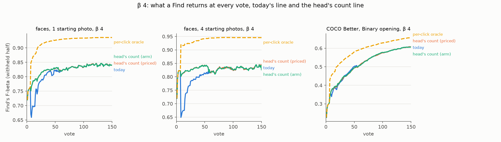
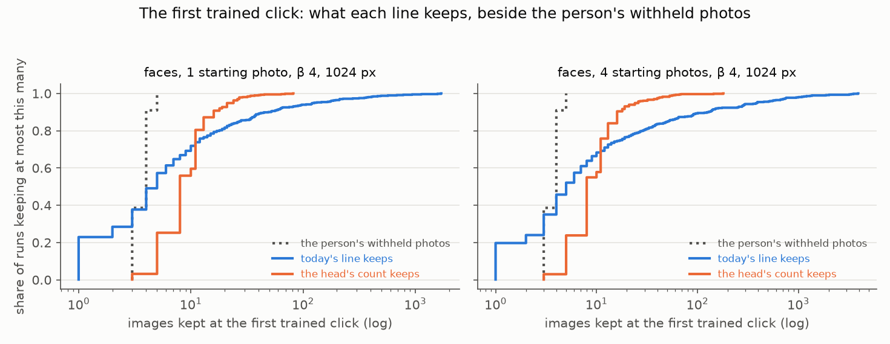
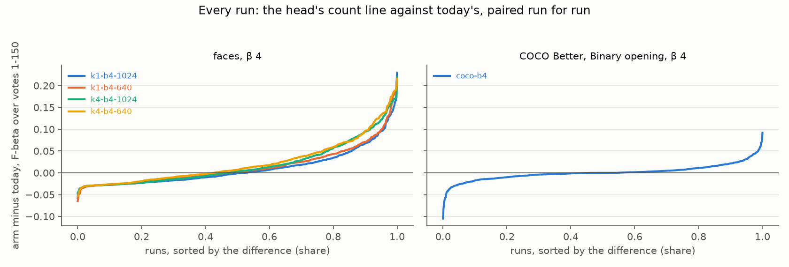

# β 4's line at the first trained clicks: the head's own count while the class model is thin (#4786)

**2026-10-12.** Below the label quota Test gives the Goods' centroid. At the quota it hands over to
the trained head, and since #4785 that head starts from the centroid, so it ranks a person almost
as well as the centroid did (AP 0.86 against 0.88 at the hand-over, #4776). At β 4 Find's F-beta
still fell 0.78 → 0.62 there. The rest of that drop is the line. The labels line is cut on a class
model fitted to the head's held-out scores of the votes, and at the hand-over that model has four
Bads and two to four Goods to stand on. A recall-leaning cut reaches deep into its tail. The issue
asked for a rule for the first trained clicks at β 4, priced on the FHIBE face sessions (1 and 4
starting photos, 1024 and 640 px) and guarded on COCO Better's Binary opening.

**The rule: while the class model is thin, a recall-leaning line keeps what stands out in the
head's own scores.** Above β 1, until the class model holds 32 held-out Bads (about 50 in hand)
and while it holds fewer than 6 held-out Goods, the line keeps what the Goods' centroid's count
rule finds standing out in the head's logit scores (`head_count_cut`). That rule is the count line
Test showed until the hand-over (#4732, #4759, #4783), now drawn on the head. Priced on today's
sessions (every click's line re-cut from the recorded ranking, exact to the last digit), mean
F-beta of what a Find returns at β 4 goes up:

- **+0.029 to +0.065** over votes 1–50 on faces, in all four sets (SE ≤ 0.006);
- **+0.010 to +0.023** over votes 1–150;
- **+0.001 ± 0.001 and +0.000 ± 0.000** on COCO's Binary opening (720 runs).

Run as full sessions, with the rule in every fit's line and paired with today run for run, the
numbers hold to the third decimal. Faces gain +0.029 to +0.065 over votes 1–50 and +0.010 to
+0.023 over 1–150, and give nothing back over votes 51–150. COCO gains +0.003 ± 0.002 and +0.001 ±
0.001. The ranking does not move (ΔAP 0.000).

At the first trained click, today's line keeps a median of 5 of a person's faces, against 4
withheld. In the worst tenth of sessions it keeps 44 to 189. The head's count keeps 8, and 16 in
the worst tenth. The F-beta drop at the hand-over goes from −0.12 to −0.19 to −0.02.

**Rejected:** both of the issue's candidates and every gate that reads separation. Carrying the
centroid's count, capping today's line at a multiple of the Goods in hand, and a cut at β 1 scaled
up all help faces, but each loses on COCO, by 0.008 to 0.072 over votes 1–50. COCO's broad
targets have many positives for each Good found.



*Figure 1. What a Find returns at every vote at β 4: F-beta of the withheld half. Today's line (blue)
dips at the hand-over (vote 7 from one photo, 8 from four). The head's count line priced on today's
sessions (orange) and run as its own sessions (aqua) does not. The per-click oracle (dashed) is
the best count on the withheld half at each click: a bound, not a rule. On COCO all three lines
lie on top of each other.*

## What was priced

### Count rules: one session set prices every rule

A rule for the line changes which images Test returns, not the ranking. `CALIB_LINE_COUNTS=1`
(`vtscore/eval/arms_line_counts.py`) adds a side frame, `__linecounts.csv`. At every click Test
gives the trained head, it records the positions of the withheld half's positives in the head's
ranking. It also records the count each candidate reads:

- the labels line at each preset (today's line at the run's β);
- the Goods' centroid's count line on the withheld half, the app's rule at the run's β;
- that count rule drawn on the head's own logit scores;
- the Goods and Bads in hand, the class model's held-out Goods and Bads, and its d′.

A rule is a count *k* per click, and keeping the head's top *k* scores exactly:
`F = (1 + β²) TP / (β² P + k)`. Across all 323,000 trained clicks the recorded ranking reproduces
Test's own F-beta at today's count with no mismatch. Nothing in the frame picks or trains. In the
tests the session is identical with it on, and #4776's centroid shadow row counts the same.

The rules, each reading only what the line could read at that click:

| rule | the line keeps |
|---|---|
| today | the labels line (the app) |
| the head's count | what the centroid's count rule finds standing out in the head's own logit scores |
| the fewer of today's and the head's count | the smaller of the two |
| the centroid's count carried | the Goods' centroid's count line on the corpus (the issue's first candidate) |
| the fewer of today's and the centroid's count | the smaller of the two |
| at most *m* × the Goods in hand | today's, capped (the issue's second candidate; *m* = 1, 1.5, 2, 3, 4) |
| at most β^0.708 × the β 1 line's | today's, capped by the count line's own scaling (#4603) |
| the β 1 labels line | the line a balanced user gets |
| the centroid's own Test | #4776's "head from N Bads" on today's head |
| per-click oracle | the best count on the withheld half (a bound) |

Each applies while a gate is open, with today's line after it. The gates priced are fewer than N
Bads in hand, fewer than N of the class model's held-out Bads, a thin class model (fewer than N
held-out Bads and fewer than P held-out Goods), and d′ below D. The class model's held-out counts
are what a rule inside the line can read, in Train and in a Find on another corpus alike. Its
held-out Bads run about 0.6 of the Bads in hand.

### Scoring

What a Find returns at every vote, read as the face review reads it (#4762): Test's rows with the
end-of-run check left out, carried between rows, 0 before the first. Every run is in every average
(#4631). COCO's 18 runs that never find a Good give Test nothing under any rule, so they count as
zero differences. Each number is a session mean over votes 1–50 or 1–150, the rule minus today per
run, then the mean ± SE over runs. Today's sessions are the app at the head of #4790: the head
started from the centroid, faces aligned by roll (#4777), every centroid line rule through #4779.

## The rules at β 4

**Votes 1–50** (the shipped gate, a thin class model):

| rule | k1-b4-1024 | k1-b4-640 | k4-b4-1024 | k4-b4-640 | coco-b4 |
|---|---|---|---|---|---|
| the head's count (the centroid's rule on the head's scores) | +0.029 ± 0.005 | +0.039 ± 0.005 | +0.054 ± 0.006 | +0.065 ± 0.006 | +0.001 ± 0.001 |
| the fewer of today's and the head's count | +0.017 ± 0.002 | +0.018 ± 0.002 | +0.026 ± 0.003 | +0.030 ± 0.003 | -0.009 ± 0.001 |
| the centroid's count carried | +0.022 ± 0.005 | +0.035 ± 0.005 | +0.047 ± 0.006 | +0.060 ± 0.006 | -0.009 ± 0.002 |
| the fewer of today's and the centroid's count | +0.016 ± 0.002 | +0.017 ± 0.002 | +0.026 ± 0.003 | +0.029 ± 0.003 | -0.021 ± 0.001 |
| today's, at most 2 x the Goods in hand | +0.019 ± 0.002 | +0.020 ± 0.002 | +0.031 ± 0.003 | +0.036 ± 0.003 | -0.072 ± 0.002 |
| today's, at most 3 x the Goods in hand | +0.017 ± 0.002 | +0.018 ± 0.002 | +0.026 ± 0.003 | +0.030 ± 0.003 | -0.059 ± 0.002 |
| today's, at most beta^0.708 x the beta-1 line's | +0.010 ± 0.001 | +0.008 ± 0.001 | +0.013 ± 0.001 | +0.013 ± 0.001 | -0.008 ± 0.000 |
| the beta-1 labels line | -0.028 ± 0.004 | -0.030 ± 0.004 | -0.020 ± 0.004 | -0.025 ± 0.004 | -0.031 ± 0.001 |
| the centroid's own Test (#4776's hand-over) | +0.015 ± 0.006 | +0.024 ± 0.006 | +0.048 ± 0.007 | +0.052 ± 0.007 | -0.017 ± 0.002 |
| per-click oracle (a bound, not a rule) | +0.114 ± 0.005 | +0.127 ± 0.005 | +0.140 ± 0.006 | +0.153 ± 0.006 | +0.081 ± 0.002 |
| *today, for scale (F-beta)* | 0.773 | 0.746 | 0.771 | 0.750 | 0.409 |
| *runs* | 562 | 562 | 562 | 562 | 720 |

**Votes 1–150:**

| rule | k1-b4-1024 | k1-b4-640 | k4-b4-1024 | k4-b4-640 | coco-b4 |
|---|---|---|---|---|---|
| the head's count (the centroid's rule on the head's scores) | +0.010 ± 0.002 | +0.014 ± 0.002 | +0.019 ± 0.002 | +0.023 ± 0.002 | +0.000 ± 0.000 |
| the fewer of today's and the head's count | +0.006 ± 0.001 | +0.007 ± 0.001 | +0.010 ± 0.001 | +0.011 ± 0.001 | -0.004 ± 0.000 |
| the centroid's count carried | +0.008 ± 0.002 | +0.012 ± 0.002 | +0.017 ± 0.002 | +0.021 ± 0.002 | -0.004 ± 0.001 |
| the fewer of today's and the centroid's count | +0.006 ± 0.001 | +0.006 ± 0.001 | +0.010 ± 0.001 | +0.011 ± 0.001 | -0.008 ± 0.001 |
| today's, at most 2 x the Goods in hand | +0.007 ± 0.001 | +0.008 ± 0.001 | +0.011 ± 0.001 | +0.013 ± 0.001 | -0.025 ± 0.001 |
| today's, at most 3 x the Goods in hand | +0.006 ± 0.001 | +0.007 ± 0.001 | +0.009 ± 0.001 | +0.011 ± 0.001 | -0.021 ± 0.001 |
| today's, at most beta^0.708 x the beta-1 line's | +0.004 ± 0.000 | +0.003 ± 0.000 | +0.005 ± 0.001 | +0.005 ± 0.001 | -0.003 ± 0.000 |
| the beta-1 labels line | -0.011 ± 0.002 | -0.011 ± 0.002 | -0.008 ± 0.002 | -0.010 ± 0.002 | -0.011 ± 0.000 |
| the centroid's own Test (#4776's hand-over) | +0.004 ± 0.002 | +0.008 ± 0.002 | +0.016 ± 0.003 | +0.018 ± 0.003 | -0.007 ± 0.001 |
| per-click oracle (a bound, not a rule) | +0.104 ± 0.006 | +0.121 ± 0.006 | +0.124 ± 0.006 | +0.136 ± 0.007 | +0.066 ± 0.001 |
| *today, for scale (F-beta)* | 0.814 | 0.787 | 0.810 | 0.790 | 0.514 |
| *runs* | 562 | 562 | 562 | 562 | 720 |

*k1 / k4: one / four starting photos; 1024 / 640: the face crop's size in pixels. Each cell is the rule minus today's line, mean ± SE over runs; COCO's 18 runs with no Good count as zeros.*

**Why the head's count and not the centroid's.** On faces the two count lines are close: the
head ranks a person almost as the centroid does, and the same count rule reads either one's
scores. On COCO the centroid ranks a broad target worse as Goods accumulate (#4776), and carrying
its count loses 0.009 over votes 1–50. The head's count reads the ranking Test actually returns.

**Why a count and not a cap on today's line.** Today's line goes wrong in both directions at the
first clicks (Figure 2). In 30% of face sessions it keeps fewer images than the person has
withheld, and in 22% exactly one. In the worst tenth it keeps from 44 to thousands. A cap fixes only the second
failure, and the capped rules gain about half as much.



*Figure 2. What each line keeps at the first trained click on faces at β 4, as the share of runs
keeping at most that many (log scale), beside the person's withheld photos (dotted).*

| set | runs | withheld photos (median) | today keeps (median / p90) | the head's count keeps (median / p90) | F-beta: centroid before → today | → the head's count |
|---|---|---|---|---|---|---|
| k1-b4-1024 | 562 | 4 | 5 / 49 | 8 / 16 | 0.77 → 0.64 | 0.75 |
| k1-b4-640 | 562 | 4 | 4 / 44 | 8 / 16 | 0.75 → 0.63 | 0.73 |
| k4-b4-1024 | 562 | 4 | 5 / 127 | 8 / 16 | 0.82 → 0.65 | 0.80 |
| k4-b4-640 | 562 | 4 | 5 / 189 | 8 / 16 | 0.81 → 0.62 | 0.79 |
| coco-b4 | 702 | 50 | 58 / 1292 | 84 / 407 | 0.37 → 0.34 | 0.35 |

*Medians over runs; F-beta means over runs, at the last centroid click and at the first trained one.*

Literal examples from the β 4 sessions (FHIBE subject ids; four starting photos unless noted):

- **Too deep.** `2c1d4b99-e09b-405a-ac4c-910e8a4d01db` at 1024 px. At vote 8 today's line kept
  3,925 faces for 3 withheld (F-beta 0.01). Its corpus fit estimated 0.0 positives, but the cut
  ran to the corpus's end anyway (below). The head's count keeps 8 (0.91). Also
  `1f3b5b3c-ab8b-4d43-b54f-15eb1b02f669` (3,504 kept, d′ 1.8) and
  `e6f7418f-2053-43cb-a6bb-2c5a23b66771` (3,356 at 1024 px, 2,726 at 640).
- **Too shallow.** `59843888-b8c7-4fed-ab9b-1b58533a6591` at 1024 px. Today's line kept 1 face of 5
  withheld (0.21); the head's count keeps 5 (1.0). Also `e95d7f13-5627-48fd-9e5f-ac9c85d1217c`
  from one photo (1 of 3 → 3 of 3).
- **Where the head's count is worse.** `0a27c33b-3e6b-4840-8d26-1d82a618d500` from one photo:
  today kept 6 (0.94), the head's count 24 (0.71). And `14c2e0fb-6b3e-4144-9d2b-0815a5c22324`:
  9 (0.89) against 40 (0.58). At the first click the head's count beats today in 51% of face
  sessions and loses in 45%.

## The gate

The head's count under each gate (the rule minus today), **votes 1–50**:

| rule | k1-b4-1024 | k1-b4-640 | k4-b4-1024 | k4-b4-640 | coco-b4 |
|---|---|---|---|---|---|
| fewer than 16 Bads in hand | +0.018 ± 0.002 | +0.021 ± 0.002 | +0.030 ± 0.002 | +0.032 ± 0.002 | +0.002 ± 0.001 |
| fewer than 32 Bads in hand | +0.027 ± 0.003 | +0.032 ± 0.004 | +0.046 ± 0.004 | +0.054 ± 0.004 | -0.002 ± 0.002 |
| fewer than 48 Bads in hand | +0.030 ± 0.005 | +0.039 ± 0.005 | +0.055 ± 0.006 | +0.066 ± 0.006 | -0.002 ± 0.002 |
| every trained click | +0.030 ± 0.005 | +0.039 ± 0.005 | +0.055 ± 0.006 | +0.066 ± 0.006 | -0.002 ± 0.002 |
| fewer than 12 held-out Bads | +0.020 ± 0.002 | +0.024 ± 0.002 | +0.034 ± 0.003 | +0.036 ± 0.002 | +0.000 ± 0.001 |
| fewer than 20 held-out Bads | +0.025 ± 0.003 | +0.031 ± 0.004 | +0.044 ± 0.004 | +0.050 ± 0.004 | -0.005 ± 0.002 |
| fewer than 32 held-out Bads | +0.029 ± 0.005 | +0.039 ± 0.005 | +0.054 ± 0.006 | +0.065 ± 0.006 | -0.005 ± 0.002 |
| thin: fewer than 20 held-out Bads and 6 held-out Goods | +0.025 ± 0.003 | +0.031 ± 0.004 | +0.044 ± 0.004 | +0.050 ± 0.004 | +0.001 ± 0.001 |
| thin: fewer than 32 held-out Bads and 4 held-out Goods | +0.023 ± 0.004 | +0.033 ± 0.004 | +0.035 ± 0.004 | +0.042 ± 0.004 | +0.002 ± 0.001 |
| thin: fewer than 32 held-out Bads and 6 held-out Goods (shipped) | +0.029 ± 0.005 | +0.039 ± 0.005 | +0.054 ± 0.006 | +0.065 ± 0.006 | +0.001 ± 0.001 |
| thin: fewer than 32 held-out Bads and 8 held-out Goods | +0.029 ± 0.005 | +0.039 ± 0.005 | +0.054 ± 0.006 | +0.065 ± 0.006 | +0.001 ± 0.002 |
| fewer than 6 held-out Goods, any Bads | +0.030 ± 0.005 | +0.039 ± 0.005 | +0.055 ± 0.006 | +0.066 ± 0.006 | +0.004 ± 0.001 |
| d' below 1.5 | +0.032 ± 0.003 | +0.035 ± 0.003 | +0.049 ± 0.004 | +0.052 ± 0.004 | -0.008 ± 0.001 |
| d' below 2 | +0.038 ± 0.003 | +0.042 ± 0.004 | +0.056 ± 0.004 | +0.060 ± 0.004 | -0.008 ± 0.001 |
| *today, for scale (F-beta)* | 0.773 | 0.746 | 0.771 | 0.750 | 0.409 |
| *runs* | 562 | 562 | 562 | 562 | 720 |

**Votes 1–150:**

| rule | k1-b4-1024 | k1-b4-640 | k4-b4-1024 | k4-b4-640 | coco-b4 |
|---|---|---|---|---|---|
| fewer than 16 Bads in hand | +0.006 ± 0.001 | +0.007 ± 0.001 | +0.010 ± 0.001 | +0.011 ± 0.001 | +0.001 ± 0.000 |
| fewer than 32 Bads in hand | +0.009 ± 0.001 | +0.011 ± 0.001 | +0.015 ± 0.001 | +0.018 ± 0.001 | -0.002 ± 0.001 |
| fewer than 48 Bads in hand | +0.010 ± 0.002 | +0.013 ± 0.002 | +0.019 ± 0.002 | +0.022 ± 0.002 | -0.006 ± 0.001 |
| every trained click | +0.014 ± 0.005 | +0.028 ± 0.006 | +0.033 ± 0.006 | +0.044 ± 0.006 | -0.021 ± 0.002 |
| fewer than 12 held-out Bads | +0.007 ± 0.001 | +0.008 ± 0.001 | +0.011 ± 0.001 | +0.012 ± 0.001 | +0.000 ± 0.000 |
| fewer than 20 held-out Bads | +0.008 ± 0.001 | +0.010 ± 0.001 | +0.015 ± 0.001 | +0.017 ± 0.001 | -0.002 ± 0.001 |
| fewer than 32 held-out Bads | +0.010 ± 0.002 | +0.014 ± 0.002 | +0.019 ± 0.002 | +0.023 ± 0.002 | -0.008 ± 0.001 |
| thin: fewer than 20 held-out Bads and 6 held-out Goods | +0.008 ± 0.001 | +0.010 ± 0.001 | +0.015 ± 0.001 | +0.017 ± 0.001 | +0.000 ± 0.000 |
| thin: fewer than 32 held-out Bads and 4 held-out Goods | +0.008 ± 0.001 | +0.012 ± 0.002 | +0.012 ± 0.002 | +0.015 ± 0.002 | +0.000 ± 0.000 |
| thin: fewer than 32 held-out Bads and 6 held-out Goods (shipped) | +0.010 ± 0.002 | +0.014 ± 0.002 | +0.019 ± 0.002 | +0.023 ± 0.002 | +0.000 ± 0.000 |
| thin: fewer than 32 held-out Bads and 8 held-out Goods | +0.010 ± 0.002 | +0.014 ± 0.002 | +0.019 ± 0.002 | +0.023 ± 0.002 | -0.000 ± 0.001 |
| fewer than 6 held-out Goods, any Bads | +0.014 ± 0.005 | +0.028 ± 0.006 | +0.033 ± 0.006 | +0.044 ± 0.006 | -0.003 ± 0.001 |
| d' below 1.5 | +0.023 ± 0.002 | +0.025 ± 0.002 | +0.035 ± 0.003 | +0.039 ± 0.003 | -0.014 ± 0.001 |
| d' below 2 | +0.032 ± 0.003 | +0.035 ± 0.003 | +0.044 ± 0.004 | +0.048 ± 0.004 | -0.014 ± 0.001 |
| *today, for scale (F-beta)* | 0.814 | 0.787 | 0.810 | 0.790 | 0.514 |
| *runs* | 562 | 562 | 562 | 562 | 720 |

**The Goods half.** With the Bads gate alone, the head's count costs COCO 0.008 over votes 1–150.
The loss is all at clicks where the class model already holds several Goods (the head's count
minus today, per click, while it holds fewer than 32 held-out Bads):

| held-out Goods | COCO clicks | Δ F-beta | today keeps (median) | the head's count keeps | withheld positives | face clicks | Δ F-beta |
|---|---|---|---|---|---|---|---|
| 0–1 | 927 | +0.073 | 1 | 52 | 50 | 590 | +0.073 |
| 2–3 | 4,020 | +0.014 | 80 | 79 | 50 | 42,607 | +0.037 |
| 4–5 | 3,088 | +0.014 | 56 | 138 | 50 | 13,908 | +0.053 |
| 6–7 | 3,058 | −0.011 | 60 | 164 | 50 | — | — |
| 8–11 | 5,197 | −0.017 | 59 | 178 | 50 | — | — |
| 12+ | 13,470 | −0.053 | 57 | 196 | 49 | — | — |

From 6 held-out Goods on, a broad target's labels line is sound. A count of what stands out keeps
three to four times its positives there. Examples: `stop sign` (large instances) kept a median of
53 under today's line and 617 under the head's count, for 49 withheld (−0.30 per click); `surfboard`
(medium) 45 against 451; `traffic light` (large) 67 against 561. A face session never reaches 6
held-out Goods in the window, so the Goods half costs faces nothing. A gate on Goods alone would
leave a person with few photos on the count for the whole session. Over votes 1–150 it gains more
on faces (+0.014 to +0.044) but loses 0.003 on COCO, and it would change the line well past the
first clicks, which is more than the issue asked.

**Why not d′.** The worst of today's line follows weak separation: at d′ ≤ 1.5 on faces its mean
F-beta per click is 0.55, against 0.77 for the head's count and 0.88 for the oracle. But weak
separation is common on COCO's broad targets, where the labels line is right to keep many: under
a d′ gate (D = 1.5 to 4) the head's count lost 0.014 to 0.023 on COCO over votes 1–150, and every
other rule lost more.

## The arm: the rule in every fit's line

Test is not the only reader of the line. Autopilot's Stable light counts the predictions that flip
across it, and Smart prices the labelset at it, so a rule for the line can move the picks. The arm
runs the rule as the app runs it (`4131eef90`: `LabelsLine.threshold`) on the same people, classes
and seeds, and today's sessions are its control, run for run.

| set | runs | today, 1-50 | Δ 1-50 | today, 1-150 | Δ 1-150 | Δ 51-150 | wins / losses (1-150) | ΔAP 1-50 | kept at vote 8, today → arm (median) |
|---|---|---|---|---|---|---|---|---|---|
| k1-b4-1024 | 562 | 0.773 | +0.029 ± 0.005 | 0.814 | +0.010 ± 0.002 | +0.000 ± 0.000 | 48% / 51% | +0.000 ± 0.000 | 5 → 8 |
| k1-b4-640 | 562 | 0.746 | +0.039 ± 0.005 | 0.787 | +0.014 ± 0.002 | +0.002 ± 0.000 | 53% / 46% | +0.000 ± 0.000 | 5 → 8 |
| k4-b4-1024 | 562 | 0.771 | +0.053 ± 0.006 | 0.810 | +0.019 ± 0.002 | +0.001 ± 0.000 | 52% / 48% | -0.000 ± 0.000 | 5 → 8 |
| k4-b4-640 | 562 | 0.750 | +0.065 ± 0.006 | 0.790 | +0.023 ± 0.002 | +0.002 ± 0.000 | 58% / 42% | -0.000 ± 0.000 | 5 → 8 |
| coco-b4 | 720 | 0.409 | +0.003 ± 0.002 | 0.514 | +0.001 ± 0.001 | -0.000 ± 0.001 | 45% / 45% | +0.000 ± 0.001 | 54 → 87 |

*Medians of the images Test keeps at vote 8. Every run is in every average; COCO's 18 runs with no
Good count as zeros.*

The picks are identical in 98% of face runs from one photo and 95% from four. Where they part,
they part late: the first differing pick falls at a median vote of 41–42, past the gate. On COCO
they are identical in 57% of runs, and the rest part at a median vote of 21. The rule changes what
a Find returns, not the votes a session collects. Figure 3 shows every run. On faces the losses are
small and bounded: about 45% of runs lose 0.02 to 0.03, and none more than 0.07. That is a person
whose photos today's line already kept, where the count keeps about twice as many. The gains run
to +0.23, where today's line kept one face or thousands. On COCO the spread is small both ways.



*Figure 3. Every run's paired difference, the arm minus today, in Find's F-beta over votes 1–150,
sorted. Faces at β 4 (four sets) and COCO's Binary opening at β 4.*

## β ¼ and β 1

The rule serves only above β 1, so sessions at β ¼ and β 1 are unchanged. Today's sessions at
those presets, with the line counts, are still running; what the head's count would do there is
priced here once they finish.

## The cost: a corpus with none of the target

The head's count is a count on the corpus it cuts, which the labels line otherwise never draws
(#4452). On a corpus with none of the target it still keeps the widest drop among the top's
scores, times β^0.708. On a Gaussian bulk alone at β 4 that is a median of 8 images, never more than
27 in 200 draws, at any corpus size from 200 to 20,000. At β 2 the median is 5. That is
exactly what the centroid's count line already returns before the label quota. The rule extends it
by about 25 votes, while the class model is thin. The test `TestACorpusWithNoPositives` pins it.

## What this does not settle

- **The deep cut has a cause the rule only sidesteps.** `corpus_cut` scores its F-beta against
  `P = max(the 2-part total, the sum of the 3-part chances)`. Under a thin or weakly separated
  class model the 3-part fit gives the corpus's bulk diffuse chances, a few hundredths each, and at
  β 4 every such item clears the cut's marginal bar (`(1 + β²) p > F`). The cut then runs to the
  corpus's end, whatever the 2-part total says: the first example above estimated 0.0 positives
  and kept 3,925. Past the gate, weakly separated sessions still do it: 2% of face clicks there
  keep more than ten times the person's withheld photos, at most 798, in 113 of 2,248 runs. Filed
  as #4798.
- **The per-click oracle is far above every rule:** +0.11 to +0.15 on faces over votes 1–50.
  Most of it is the line, not the ranking.
- **Region path.** Priced on single-vector sessions only (FHIBE faces, COCO's Binary opening).
  The rule reads only the head's scores, so it applies to a Region detector unchanged, unpriced.

## Provenance

| | |
|---|---|
| Code | branch `claude/beta4-line-4786`, stacked on #4790: today's sessions at `cb26dcfae` (frozen worktree `vts-4786-run`), the arm at `4131eef90` (`vts-4786-arm2`) |
| FHIBE release | `fhibe-full-resolution-674a7dcf`, faces aligned by roll (#4777), the #4699 baseline's 562 people |
| Run dirs (owner-only) | `<release>-derived/runs/2026-10-11-4786-roll-k{1,4}-b{025,1,4}` (today, with line counts), `…/2026-10-11-4786thin-roll-k{1,4}-b4` (the arm); analyses `…/2026-10-11-4786-analysis` |
| COCO | `state-of-the-app/2026-10-11-line4786-b{025,1,4}` (today, with line counts), `…/2026-10-11-line4786thin-b4` (the arm), on the 2026-10-08 grid |
| Files here | `rules_b4.csv`, `rules_low.csv` (every rule and gate), `ab.csv` (the arm), `curves_*.csv`, `tables.md`, figures |

Reproduce:

```bash
# today's sessions, with the line counts (from a frozen worktree)
SOTA_FACE_TAG=4786 SOTA_FACE_ARM=roll CALIB_LINE_COUNTS=1 bash scripts/experiments/fhibe/sota_face.sh dirs   # then tasks, pack
bash scripts/experiments/state_of_app/line_4786.sh dirs && bash scripts/experiments/state_of_app/line_4786.sh launch 4   # and 1, 0.25
# the arm: the shipped rule (the default from 4131eef90 on)
SOTA_FACE_TAG=4786thin SOTA_FACE_ARM=roll CALIB_LINE_COUNTS=1 bash scripts/experiments/fhibe/sota_face.sh dirs   # beta 4 tasks, pack
LINE4786_ARM=thin CALIB_LINE_COUNTS=1 bash scripts/experiments/state_of_app/line_4786.sh launch 4
# analysis
python scripts/experiments/fhibe/line_4786.py --set k4-b4-1024=<cells>::fhibe_faces_roll_1024 ... --set coco-b4=<cells> --out <dir>
python scripts/experiments/fhibe/prior_4776.py --pair k4-b4-1024=<arm cells>::<today's cells>::fhibe_faces_roll_1024 ... --out <dir>
python scripts/experiments/fhibe/line_4786_tables.py --rules <rules.csv> --first <first_clicks.csv> --ab <prior_ab.csv> --runs-of coco-b4=720 --gate neg32pos6 --out tables.md
python scripts/experiments/fhibe/line_4786_figures.py --curves <curves.csv> --first <first_clicks.csv> --arm <prior_curves.csv> --out <dir>
```
