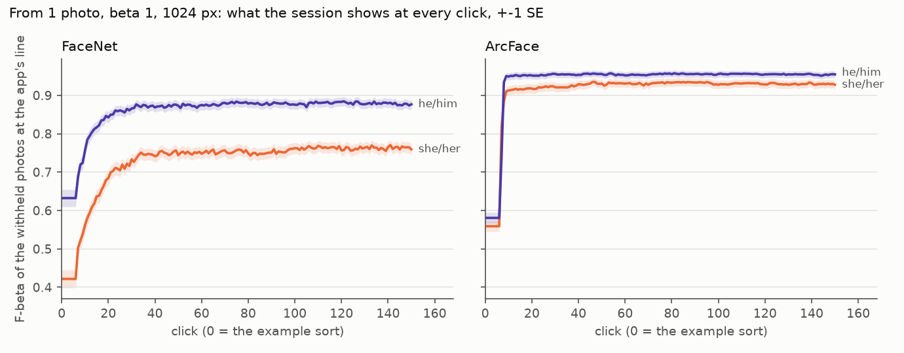
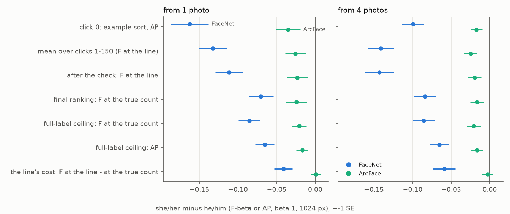
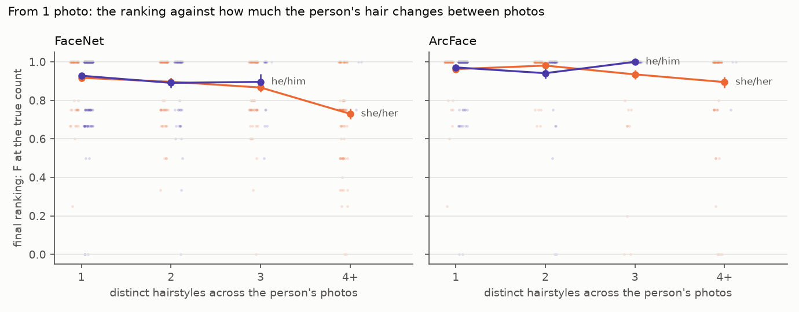
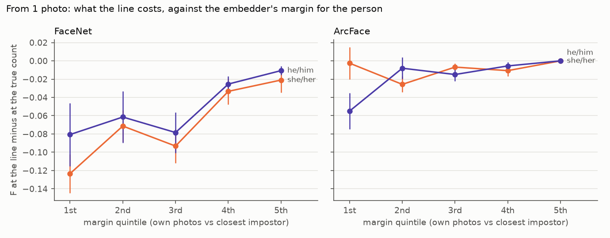

# What carries the face review's gaps between people — 2026-10-12 (#4780)

**FaceNet carries the gaps. The photos set them off, and under FaceNet the app's line adds a third of
the pronoun gap on top.** The face review (#4762) found the app doing worse on FHIBE's face crops for
she/her people than he/him, for younger people and for the middle skin tones. Here the same 562 people
were run again at one commit through two embedders, FaceNet (shipped) and ArcFace, on the same faces,
paired session for session (β 1, 1024 px, 1,124 sessions an arm):

| she/her minus he/him | FaceNet, 1 photo | ArcFace, 1 photo | FaceNet, 4 photos | ArcFace, 4 photos |
|---|---:|---:|---:|---:|
| after the check (the objective) | **−0.11** ± 0.02 | **−0.023** ± 0.013 | **−0.14** ± 0.02 | **−0.020** ± 0.009 |
| mean over clicks 1–150 | −0.13 | −0.026 | −0.14 | −0.025 |
| 18–29 minus 45+, after the check | −0.077 | −0.003 | −0.097 | −0.011 |
| skin tone 2–3 minus 0, after the check | −0.10 | −0.033 | −0.12 | −0.021 |

- **Where:** in FaceNet's sessions, about two thirds of the pronoun gap is the ranking. That part is
  already in the full-label ceiling, and the session reaches the ceiling for both groups. The other
  third is the app's line, which costs she/her people more.
- **The photos:** how they were taken does not explain it. Matching on camera distance, head pose,
  face size and accessories leaves the gap where it was. How a person looks across their photos does:
  she/her people wear **2.7 distinct hairstyles** across their photos against 1.4 for he/him, and were
  photographed over more months. With that in the fit, FaceNet's pronoun gap in the ranking falls from
  −0.069 to −0.016 ± 0.016. she/her people who keep one hairstyle rank like he/him (0.92 vs 0.93).
- **The embedder:** ArcFace sees her photos as less alike too, but its own photos sit far above the
  closest impostor (a margin of 0.24–0.34, against FaceNet's −0.02 to +0.06), so the same variation
  costs little. FaceNet on ArcFace's tight crop keeps FaceNet's gap: it is the model, not the crop.
- **The line:** under FaceNet it costs she/her people −0.041 / −0.059 more than he/him. Among people
  with the same FaceNet margin, that extra cost is within noise (−0.021 ± 0.017). Under ArcFace it is
  gone.
- **Age** is FHIBE's population as FaceNet sees it: 56% of the photos are of people aged 18–29, so a
  young face has far more same-age look-alikes. Against an impostor pool redrawn with equal ages,
  FaceNet's age gap vanishes. ArcFace has none.
- **Alignment (#4777)** narrows FaceNet's ranking gap by 0.03, but the line gives it back: the
  objective's gap moves −0.004 ± 0.013.

ArcFace also lifts everyone, she/her twice as much as he/him: session mean **+0.13** ± 0.01, the objective
after the check +0.12 (one photo) and +0.15 (four). It is a measuring instrument here. The model's licence
is non-commercial research, and its other costs are below, so whether the app should move to an
ArcFace-class embedder is a follow-up (#4805).



*Figure 1. What the session shows at every click from one photo, she/her and he/him, ±1 SE (β 1,
1024 px, 283 and 278 people). Click 0 is the example sort at its own line. With FaceNet the groups are
0.21 apart at click 0 and 0.11–0.14 apart from click 30 on. With ArcFace both jump at the label quota
(votes 7–8) and stay 0.02–0.04 apart.*

## The question and the bench

The review's table read the objective after the check per stratum of the people: she/her 0.73 against
he/him 0.85, age 18–29 0.76 against 60+ 0.90, skin tone 3 0.72 against FHIBE's darkest anchor 0.86. It
called them descriptive strata. #4780 asks whether the gaps hold in matched subsets of the photos, whether
they survive alignment, whether a second face embedder shows them, and which of the embedder, the photos
or the session loop carries them.

The bench is the review's: its **562 people** (283 she/her, 278 he/him, 1 they/them), sessions of 150
votes from 1 and from 4 starting photos, scored on each person's withheld photos, one seed. This study
reads **β 1 at 1024 px**, the review's table, on today's app (`bcb425042`: dev at #4758, aligned crops,
the head started from the Goods' centroid, no prompted check on faces). Today's FaceNet sessions reproduce
#4778's end-check arm exactly (every person's objective, final and ceiling AP), so the app's face path has
not moved since.

**Two arms** ran at that commit, 1,124 sessions each, and pair person for person: the same starting
photos and the same withheld photos in all 1,124 pairs (checked).

- **FaceNet**: the shipped face path, `image2face` crops turned upright (`fhibe_faces_roll_1024`).
- **ArcFace**: the same faces with the same ids and labels, each vector replaced by ArcFace's. The model
  is insightface's `buffalo_l` recognition model, `w600k_r50`: a ResNet-50 trained with the ArcFace loss
  on WebFace600K, given its own 112 × 112 crop aligned on MTCNN's five landmarks. The harness reads a cell
  by name, so the ArcFace cell stood in for FaceNet's in a private copy of the pile. Nothing in the app
  changed: the same head, opening, line and Autopilot ran on the other vectors.

The review's plain-crop sessions (#4762) and the first aligned ones (#4777) pair the same way and answer
the alignment question.

**What each photo is.** FHIBE annotates every photo: camera distance (CD I–V), camera position, head
pose, scene, lighting, and a segmentation of face skin, head hair, headwear, eyewear and masks. It also
gives the person's hairstyle in that photo, facial hair, and marks such as make-up. Per person these
become two groups of measures.

- **Photo conditions:** face size at 1024 px, camera distance, the share of atypical head poses and
  camera positions, the share with an accessory, roll, outdoor.
- **Appearance across the photos:** the number of distinct hairstyles, the share of the face box
  covered by hair, the share that is visible skin, and the number of capture months.

**How a gap is split.** Each session's withheld ranking gives three Fs: at the app's line (the objective),
at the true count of the person's withheld photos (the ranking's own F, no line to set), and the
full-label ceiling's F at the true count. The objective minus the true-count F is what the line costs.
The static read asks the same of the embedder alone. Each photo is a query over all 10,879 faces, scored
by the AP of the person's other photos (leave-one-out), their cosine to each other (genuine) and to the
closest face that is not theirs (impostor). The margin is genuine minus impostor.

## Where in a session the gap sits

| she/her minus he/him | FaceNet 1 | ArcFace 1 | FaceNet 4 | ArcFace 4 |
|---|---:|---:|---:|---:|
| click 0: the example sort's AP | −0.16 | −0.035 | −0.10 | −0.017 |
| mean over clicks 1–150 | −0.13 | −0.026 | −0.14 | −0.025 |
| after the check: F at the line | **−0.11** | **−0.023** | **−0.14** | **−0.020** |
| … precision / recall | −0.066 / −0.11 | −0.009 / −0.032 | −0.089 / −0.12 | −0.011 / −0.022 |
| final ranking: F at the true count | −0.070 | −0.024 | −0.084 | −0.016 |
| full-label ceiling: F at the true count | −0.086 | −0.021 | −0.086 | −0.021 |
| full-label ceiling: AP | −0.065 | −0.017 | −0.065 | −0.017 |
| **what the line costs** (line − true count) | **−0.041** | +0.001 | **−0.059** | −0.003 |
| faces returned, she/her minus he/him | +0.59 | +0.61 | +1.6 | +0.33 |

On the F and AP rows the SEs are 0.012–0.024 for FaceNet and 0.007–0.016 for ArcFace (`stages.csv`).



*Figure 2. she/her minus he/him at each stage, ±1 SE, from 1 and from 4 photos.*

- **The ranking part is there with every label.** The session's final ranking is within 0.02 of the
  full-label ceiling's for both groups, so the loop is not losing ground on she/her people in the
  ranking. FaceNet's ceiling already ranks them worse.
- **The line part is the loop's, and only under FaceNet.** FaceNet's line returns more faces for she/her
  people (+0.59 a session from one photo, +1.6 from four) and costs them 0.04–0.06 more F than it costs
  he/him people. Under ArcFace the line costs both groups the same.
- **ArcFace leaves −0.02, all in the ranking.** That residual is the photos again (below).

## The photos

**How the photos were taken does not explain the gap.** Coarsened exact matching puts people in the
same stratum of mean face size (thirds), camera distance, share of atypical head poses and share with an
accessory. It keeps 276 of 283 she/her people in 25 strata (`matched.csv`):

| she/her minus he/him, after the check | raw | matched on photo conditions |
|---|---:|---:|
| FaceNet, 1 photo | −0.11 ± 0.02 | −0.11 ± 0.02 |
| FaceNet, 4 photos | −0.14 ± 0.02 | −0.13 ± 0.02 |
| ArcFace, 1 photo | −0.023 ± 0.013 | −0.024 ± 0.016 |
| ArcFace, 4 photos | −0.020 ± 0.009 | −0.020 ± 0.011 |

The two groups' photos do differ (`photos_by_pronoun.csv`):

| per person | she/her | he/him |
|---|---:|---:|
| distinct hairstyles across their photos | **2.7** | **1.4** |
| keep one hairstyle | 22% | 72% |
| capture months | 4.2 | 3.1 |
| share of the face box covered by hair | 0.15 | 0.10 |
| share of photos with headwear, eyewear or a mask | 0.37 | 0.19 |
| roll of the face (degrees) | 9.6 | 6.5 |
| share of atypical head poses | 0.28 | 0.22 |
| face size at 1024 px | 117 | 111 |

**What a person's appearance does across their photos explains most of it.** A least-squares fit of each
session's outcome, with the pronoun, age and skin tone as terms (`regress.csv`). The she/her coefficient,
± SE:

| outcome (1 photo) | raw | + photo conditions | + conditions + hairstyles | + conditions + all appearance |
|---|---:|---:|---:|---:|
| FaceNet, after the check | −0.12 ± 0.02 | −0.096 | **−0.047 ± 0.020** | −0.059 |
| FaceNet, ranking (true count) | −0.069 ± 0.015 | −0.053 | **−0.016 ± 0.016** | −0.029 |
| FaceNet, ceiling AP | −0.063 ± 0.012 | −0.046 | **−0.018 ± 0.013** | −0.036 |
| FaceNet, the line's cost | −0.051 ± 0.013 | −0.044 | −0.032 ± 0.015 | −0.031 |
| ArcFace, after the check | −0.027 ± 0.013 | −0.020 | **−0.010 ± 0.015** | −0.019 |

"All appearance" adds hair cover, visible skin and capture months to the hairstyle count. Facial hair and
make-up are left out, because each is near zero for one pronoun and cannot be told apart from it. From four
photos the pattern is the same (FaceNet −0.15 → −0.068 after the check, −0.080 → −0.024 in the ranking).



*Figure 3. The final ranking's F at the true count against the person's distinct hairstyles, per pronoun,
from one photo; faint dots are people. Only 3 he/him people wear 4 or more.*

| FaceNet, 1 photo | 1 hairstyle | 2 | 3 | 4+ |
|---|---:|---:|---:|---:|
| she/her: ranking F (people) | 0.92 (63) | 0.90 (73) | 0.87 (69) | **0.73** (78) |
| he/him: ranking F (people) | 0.93 (201) | 0.89 (58) | 0.90 (16) | (3) |

With ArcFace the 4+ she/her people's ranking F is 0.90.

**The same holds pair by pair.** Take every two photos of one person (15,784 pairs, `pairs.csv`, SEs
clustered on the person). 52% of she/her pairs share a hairstyle, against 87% of he/him pairs.

| she/her minus he/him, genuine cosine | FaceNet | ArcFace |
|---|---:|---:|
| all pairs | −0.056 ± 0.008 | −0.096 ± 0.010 |
| pairs in the same hairstyle, month, typical pose, no accessory | −0.018 ± 0.012 | −0.047 ± 0.017 |
| adjusted for the pair's covariates | −0.008 ± 0.009 | −0.049 ± 0.011 |
| in units of the embedder's spread of genuine cosines, adjusted | −0.05 | −0.27 |

A change of hairstyle costs a pair 0.05 (she/her) to 0.10 (he/him) in FaceNet cosine. For FaceNet, the
pronoun gap in how alike a person's photos look is how often her photos differ. ArcFace finds her photos
less alike even when they were taken alike, by about a quarter of a spread.

## The embedder

**ArcFace narrows every gap, paired person for person** (`arms.csv`, ArcFace minus FaceNet):

| 1 photo | she/her | he/him | gap narrows by |
|---|---:|---:|---:|
| after the check | +0.17 | +0.077 | **0.088 ± 0.017** |
| mean over clicks 1–150 | +0.19 | +0.080 | 0.11 ± 0.02 |
| ceiling AP | +0.083 | +0.034 | 0.049 ± 0.011 |
| the line's cost | +0.072 | +0.030 | 0.042 ± 0.013 |

From four photos the objective's gap narrows by 0.12 ± 0.02.

**Without a session, on all 10,879 faces** (`static_gaps.csv`):

| | leave-one-out AP, she/her / he/him | gap | genuine cosine gap | closest impostor gap | margin, she/her / he/him |
|---|---:|---:|---:|---:|---:|
| FaceNet, plain crop | 0.62 / 0.82 | −0.20 | −0.066 | +0.020 | −0.033 / +0.053 |
| FaceNet, aligned crop (shipped) | 0.65 / 0.84 | −0.19 | −0.056 | +0.022 | −0.017 / +0.061 |
| FaceNet on ArcFace's tight crop | 0.64 / 0.82 | −0.18 | −0.055 | +0.024 | −0.024 / +0.055 |
| ArcFace | 0.92 / 0.96 | −0.041 | −0.096 | +0.004 | +0.24 / +0.34 |

- **It is FaceNet's model, not its crop.** `image2face`'s padded box shows hair that ArcFace's 112-pixel
  crop leaves out. FaceNet given ArcFace's crop (scaled to 160 px) keeps its gap, −0.18 against −0.19.
- **The photos' variation reaches both.** Her photos are less alike to both models. FaceNet's own photos
  sit, on average, level with the closest impostor (a margin of −0.02 for she/her, +0.06 for he/him), so
  a little variation lets impostors in. ArcFace's sit 0.24–0.34 above, so the same variation rarely
  does.
- **Her closest impostors are slightly closer under FaceNet** (+0.02) and level under ArcFace. For a she/her
  person the closest impostor is another she/her person 93–94% of the time under FaceNet (91% under
  ArcFace). The corpus is balanced (5,008 he/him faces, 4,685 she/her), so
  this is not a matter of numbers.

## The line

FaceNet's line misjudges how many faces to keep most where impostors sit closest to a person's own photos.
That is everyone in FaceNet's thinnest margins, and she/her people are more of them.



*Figure 4. The line's cost (F at the line minus at the true count) by quintile of the person's static
margin under that embedder, per pronoun, from one photo.*

| the line's cost, she/her minus he/him | raw | at equal final AP | at equal margin (the arm's own) |
|---|---:|---:|---:|
| FaceNet, 1 photo | −0.041 ± 0.012 | −0.054 ± 0.013 | **−0.021 ± 0.017** |
| FaceNet, 4 photos | −0.059 ± 0.014 | −0.073 ± 0.020 | **−0.023 ± 0.021** |
| ArcFace, 1 photo | +0.001 ± 0.007 | −0.001 ± 0.007 | +0.011 ± 0.009 |
| ArcFace, 4 photos | −0.003 ± 0.007 | −0.007 ± 0.006 | +0.007 ± 0.011 |

The extra cost survives matching on the ranking itself: at the same final AP she/her people still lose
more to the line, and at AP 1.00 the line still returns extra faces. It does not survive matching on the
margin. The line is drawn on scores, and where the person's photos and the next person's score alike,
it keeps too many or too few. So the loop carries this third of the gap, but it is the embedder's thin
margin that the loop meets. With ArcFace's margin the line costs both groups the same.

## Age

The age gap is not hairstyle: adding the photo conditions and hairstyle count to the fit moves FaceNet's
age term only from +0.036 to +0.030 F per decade. It is who else is in the corpus. 56% of FHIBE's
one-person photos are of people aged 18–29 and 4% of people 60 or over, so a young face has many more
same-age faces to be confused with. Under FaceNet a young person's closest impostor is 0.030 closer than an
older person's, while their own photos are as alike (`static_gaps.csv`).

| 18–29 minus 45+ | leave-one-out AP | against an age-balanced impostor pool |
|---|---:|---:|
| FaceNet, aligned crop | −0.092 ± 0.025 | **−0.014 ± 0.018** |
| FaceNet, plain crop | −0.082 ± 0.026 | −0.003 ± 0.020 |
| ArcFace | −0.008 ± 0.013 | −0.003 ± 0.010 |

The balanced pool redraws the other people's faces with equal numbers from each age bracket (the smallest
bracket's count), five draws. In sessions, ArcFace's age gap after the check is −0.003 (one photo) and
−0.011 (four), against FaceNet's −0.077 and −0.097.

## Skin tone

Skin tone 0, FHIBE's darkest anchor, is 74% he/him people, and tones 3–5 are 64–66% she/her. Most of the
review's skin-tone pattern is the pronoun mix plus hairstyle. In FaceNet's fit with pronoun and age, tones
2 and 3 rank 0.06–0.07 below tone 0. With hairstyles too, that becomes −0.046 ± 0.026 (tone 2) and
−0.028 ± 0.030 (tone 3), and under ArcFace tones 2–3 minus 0 is −0.033 ± 0.020 after the check. Tone 2's
residual (under 2 SE) is the one stratum effect nothing measured here accounts for.

## Alignment (#4777)

The review's plain-crop sessions pair person for person with the first aligned ones (#4777):

| plain minus aligned, she/her minus he/him | 1 photo | 4 photos |
|---|---:|---:|
| final AP | −0.030 ± 0.010 | −0.023 ± 0.008 |
| ranking: F at the true count | −0.036 ± 0.011 | −0.025 ± 0.010 |
| the line's cost | +0.032 ± 0.012 | +0.020 ± 0.015 |
| **after the check** | **−0.004 ± 0.013** | **−0.005 ± 0.013** |

she/her people's faces are tilted more (9.6° against 6.5°), so turning crops upright helped their ranking
more. But the extra positives near the top met the same thin margin, the line kept more faces, and the
objective's gap stayed where it was. The gaps survive alignment.

## What ArcFace does not fix

- **The residual pronoun gap, −0.02 (about 2 SE), is hairstyle again.** With hairstyle count in the fit it
  is −0.010 ± 0.015.
- **Failed one-photo sessions are 9, not 7.** A failed session ends with final AP below 0.1 against a
  ceiling of 0.5 or more. ArcFace fixes two of FaceNet's (`4e5dabe1`, `4f3fa1da`) and adds four. Three of
  the four start from a turned view: `a99c00ee` (one of the review's 12 hard starts), `b2e04b02` (camera
  high, eyes 24 px apart on a 105 px face) and `49b8483a` (FHIBE's atypical head pose, rolled 20°).
  ArcFace's crop depends on the landmarks entirely. The fourth, `6f5a62a1`, starts from a photo that
  looks frontal by every measure here (typical pose, roll 5°, the nose centred between the eyes), and why
  it fails is not known. From four photos neither arm fails.
- **The example sort's line was fitted on FaceNet's scores.** At click 0 from four photos it scores 0.53
  under ArcFace against 0.74 under FaceNet, while ArcFace's sort ranks better (AP 0.97 against 0.89). From
  one photo click 0 is level (0.57 / 0.53), and by the label quota at vote 7 ArcFace leads.

## Examples

Subject ids are FHIBE's category ids' first 8 characters; the images stay out. The hairstyles are FHIBE's
own labels, one per photo, so an odd one can be checked against the photo. All from one photo, β 1.

- **`1149db92`** (she/her, 22): Down (Long) ×5, Down (Medium) ×2, Up (Long) ×2, Half-up (Long) ×1, over 8
  months. FaceNet's margin is −0.31: her own photos score 0.31 below the closest other face. Its final AP
  is 0.38, and its line keeps **58 faces** for 4 withheld photos (F 0.13). ArcFace (margin +0.09): AP
  1.00, 4 faces kept, F 1.00.
- **`f3bb556f`** (she/her, 23): five hairstyles (None ×2, Down (Short) ×2, Not listed (Short) ×2,
  Half-up (Short), Up (Short)). FaceNet final AP 0.22 and F 0.00. ArcFace AP 1.00 and F 1.00. FHIBE's
  "None" is a photo where no hair shows, shaved or covered.
- **`4efb4ddd`** (she/her, 22): Down (Long) ×5, Half-up (Long) ×4, Up (Long) ×1. FaceNet ranks her
  perfectly (final AP 1.00), but its line keeps **21 faces** for 5 (F 0.38). ArcFace keeps 5 (F 1.00).
  This is the line's cost in one session.
- **`f53249ae`** (he/him, 25, one hairstyle): the line errs the other way. FaceNet's AP is 1.00, but it
  returns 1 face of 4 (F 0.40). ArcFace's line returns 5 (F 0.89).
- **What ArcFace still misses:** **`056355aa`** (she/her, 35): Not listed (Medium) ×5, Down (Short) ×2,
  Up (Long), None. She fails under both (FaceNet F 0.26, ArcFace 0.00); her ArcFace margin is −0.21,
  the only negative one among these. **`b2e04b02`** (she/her, 20) is one of ArcFace's four new failures
  from a hard starting view: FaceNet F 0.89, ArcFace AP 0.01.

Below F 0.5 after the check from one photo: FaceNet 58 she/her and 25 he/him sessions; ArcFace 10 and 6.

## What follows

- **#4805: price an ArcFace-class face embedder the app could ship.** On this bench ArcFace adds +0.13
  to the session mean, and it takes the pronoun gap from −0.11 to −0.02 and the age gap to 0.
  `w600k_r50`'s licence is non-commercial research, so the candidate has to be one the app may
  distribute. Its count lines need refitting (click 0 above), and its failures from hard starting views
  need a look (above).
- No change to the app follows from this study by itself. Under FaceNet, alignment does not narrow the
  objective's pronoun gap, and the line's share of it follows the embedder's margin. A different line
  rule was not priced here; it would act on the symptom, and the embedder is where the gap is made.

## Reproduce

From a frozen worktree at `bcb425042` (owner-only results under `<release>-derived/runs/`;
`<pile>` is a private copy of the pile whose `fhibe_faces_roll_{1024,640}__face.pkl` are the ArcFace
cells):

```bash
python scripts/experiments/fhibe/face_gap_4780_covariates.py --out <runs>/2026-10-12-gap-4780/photo_covariates.csv
for s in 1024 640; do   # ArcFace in FaceNet's place, id for id; the tight-crop control the same way
  python scripts/experiments/fhibe/face_gap_4780_arcface.py --size $s --model <buffalo_l>/w600k_r50.onnx \
    --out <release>-derived/cells-4780 --pile <pile>
done
python scripts/experiments/fhibe/face_gap_4780_arcface.py --size 1024 --embedder facenet_tight --out <release>-derived/cells-4780
export SOTA_FACE_DATE=2026-10-12 SOTA_FACE_ARM=roll SOTA_FACE_BETAS=1 SOTA_FACE_SIZES=1024
SOTA_FACE_TAG=4780fn SOTA_FACE_BASE=2026-10-12-4780fn-prep-roll bash scripts/experiments/fhibe/sota_face.sh prepare
VTS_PILE=<pile> SOTA_FACE_TAG=4780arc SOTA_FACE_BASE=2026-10-12-4780arc-prep-roll bash scripts/experiments/fhibe/sota_face.sh prepare
# then, per arm (VTS_PILE=<pile> for 4780arc): dirs, tasks, pack 2, baseline, sota_face_analyze.sh <analysis> 1 4
python scripts/experiments/fhibe/face_gap_4780_static.py --cell facenet_plain=... --cell facenet_roll=... \
  --cell facenet_tight=... --cell arcface_roll=... --identities <ids> --strata <person_strata.csv> \
  --covariates <photo_covariates.csv> --balanced-ages 5 --out <runs>/2026-10-12-gap-4780/static
python scripts/experiments/fhibe/face_gap_4780.py --strata <person_strata.csv> --covariates <photo_covariates.csv> \
  --landmarks <runs>/2026-10-10-align-4777/landmarks_1024.pkl --static <static>/static_people.csv \
  --pairs <static>/static_pairs.csv --out <runs>/2026-10-12-gap-4780/gap \
  --set fn=<fn analysis>::<runs>/2026-10-12-4780fn-roll::<fn baseline>::fhibe_faces_roll \
  --set arc=<arc analysis>::<runs>/2026-10-12-4780arc-roll::<arc baseline>::fhibe_faces_roll \
  --set plain@4762=... --set roll@c74d=...
python scripts/experiments/fhibe/face_gap_4780_figures.py --analysis <runs>/2026-10-12-gap-4780/gap \
  --sets "FaceNet=fn:facenet_roll,ArcFace=arc:arcface_roll" --out <dir>
```

| | |
|---|---|
| App / harness | `bcb425042` (dev `9e4b915ff` plus this study's scripts; no app change) |
| ArcFace | insightface `buffalo_l` `w600k_r50.onnx`, sha256 `4c06341c…9e43`, onnxruntime 1.30 on CPU |
| Run dirs (owner-only) | `<runs>/2026-10-12-4780{fn,arc}-roll-k{1,4}-b1`, analyses `…-analysis`, click 0 `…-baseline` |
| Analysis (owner-only, names people) | `<runs>/2026-10-12-gap-4780/` (`photo_covariates.csv`, `static/`, `gap/people.csv`) |
| Files here (aggregates) | `stages.csv`, `matched.csv`, `regress.csv`, `photos_by_pronoun.csv`, `pairs.csv`, `static_gaps.csv`, `arms.csv`, `curves_by_group.csv`, four figures |
