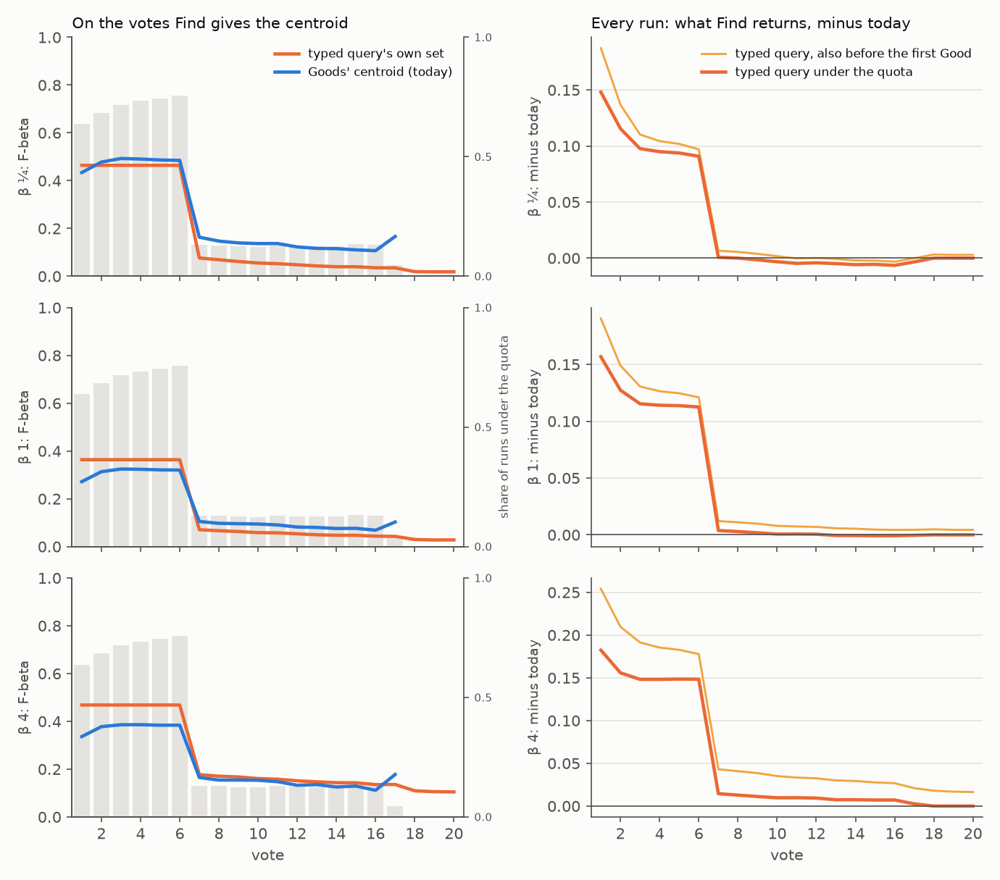

# Find gives the typed query's own set until a trained head (#4758)

**2026-10-12.** In a typed-query session the screen shows the typed query's own set, the text sort at its
line, through Autopilot's opening (#4605). Until this change a Find gave something else. Before the first
Good it gave nothing: Test was refused and AutoFind dropped the detector. From the first Good until the
label quota (#4643) it gave the Goods' centroid. #4732 found that set worse than the one on screen, 0.28
against 0.36 at beta 1, because a labelset does not carry the typed query.

**Shipped: a detector made from a typed query gives that query's own set until its labels give a trained
head.** The query lives on the detector, not the labelset: its file and registry entry already held it
(`text_query`). Test, AutoFind, a load, a cold Find, an export and the CLI now give the text sort as a head,
the query's unit vector cut where the sort draws its display line at the detector's balance. That holds
from the first vote until 3 Goods and 4 Bads (or a Good and 16 Bads). A detector with no query, and a
dataset with no text slot, give the centroid and nothing as before.

The table compares mean F-beta of what a Find returns on COCO Better's Binary opening (720 sessions) with
today's centroid. It is paired per run with SEs clustered on the 144 categories. The shipped design is the
typed query "from the first vote":

| | beta ¼ | beta 1 | beta 4 |
|---|---|---|---|
| on the votes under the quota: typed query's set / centroid's | 0.56 / 0.43 | 0.44 / 0.28 | 0.54 / 0.35 |
| difference there | +0.13 ± 0.02 | +0.15 ± 0.02 | +0.20 ± 0.02 |
| **from the first vote**, votes 1–10 | **+0.076 ± 0.009** | **+0.088 ± 0.009** | **+0.136 ± 0.010** |
| from the first vote, votes 1–50 | +0.016 ± 0.002 | +0.020 ± 0.002 | +0.037 ± 0.003 |
| from the first vote, votes 1–150 | +0.005 to +0.006 | +0.007 to +0.008 | +0.012 to +0.017 |
| from the first Good only, votes 1–10 | +0.064 ± 0.010 | +0.075 ± 0.009 | +0.098 ± 0.010 |

The centroid is drawn here as a Find on the collection being labelled, over its unvoted media (#4779).
Drawn as a Find on another collection, the differences are within 0.01 of these (`summary.csv`). The
window is short: a median session has its first Good at vote 1 and meets the quota at vote 7. That is
why the gain is large over votes 1–10 and small over 1–150. The 1–150 range for "from the first vote" is
there because 69 of the 720 runs found no Good by vote 40, when the runs were cut. Their votes past 40
are counted either as the typed query's set (the high end) or as nothing (the low end).

**Region, indicative.** On the Region path (COCO Better, DINOv3 learning with SigLIP's typed query, 288
sessions, beta 1 only), the typed query's set also beats the centroid on the quota's votes: 0.45 against
0.38, +0.07 ± 0.02. From the first vote it gains **+0.051 ± 0.010** over votes 1–10 and +0.011 over 1–50.
That run drew the centroid with #4732's line, not today's, and the owner chose not to re-run it. The
line rules since #4732 moved COCO's Binary centroid by about 0.006 over votes 1–10 at beta 1, a tenth of this gap.



*Figure 1. COCO Better's Binary opening, rows beta ¼, 1 and 4. Left: F-beta at each vote over the runs
whose Find gives the centroid there, the typed query's set (orange) and the centroid's (blue), with the
share of runs under the quota as grey bars. Right: what Find returns minus today, over every run. Thick
orange: the typed query from the first Good. Thin: also before it, the shipped design. From vote 7 only
~13% of runs are still under the quota: those whose typed query met the Bads quota before 3 Goods. There
the centroid is the better set at beta ¼ and 1, which is the dip in the left panels.*

## What was run

**No new sessions.** Neither the centroid nor a Find picks, and the opening reads no balance. So the
designs share every session and differ only in what Find returns before the quota. Both are read off
runs already on disk:

- **Binary:** #4779's 720 sessions (`state-of-the-app/2026-10-11-centroid4779-b1`). These are 144 cells
  × 5 seeds at beta 1, cut at 40 votes, from frozen commit `a437d1fb3`. Each carries the centroid's
  tagged rows (`centroid_line:<rule>@<beta>`) at beta ¼, 1 and 4. The shipped rule,
  `count_gap_floor_skip25_b1`, is read twice: over the withheld half (a Find on another collection) and
  over the unvoted media (`~unvoted`, a Find on the labelled collection).
- **Region:** #4785's control run (`state-of-the-app/2026-10-11-region4776control-b1`). These are 144
  cells × 2 seeds at beta 1, 150 votes, from `401ec98e1`, with the centroid in the untagged rows.
- **The typed query's set** is the State of the App's `text_baseline.csv` (2026-10-08) for the same cell
  and seed: the typed query's display line at each balance, drawn over the haystack and scored on the
  withheld half. This is what the session shows (#4631). `text_sort_cuts` has changed only by a refactor
  since that file was written.
- **The two runs are today's app before the quota.** Dev has moved since `a437d1fb3` only by #4785's head,
  which starts after the quota and is the same in both designs, and by #4776's shadow rows, which are off.
- **Each vote's tier** comes from the pick log's counts after that vote (`label_quota`). It matched the
  harness's own centroid rows in all 720 Binary runs and all 288 Region runs. Every run is in every
  average (#4631). A vote before the first Good is scored as nothing today, and as the typed query's set
  in the shipped design.

The analyzer is `scripts/experiments/calibration/analyze_find_typed_query_4758.py`. It writes per-run
differences over votes 1–10, 1–50 and 1–150, per-vote curves, and the vote-level breakdown below.

## Where the centroid is the better set

On the votes under the quota, by the Goods in hand and by whether the typed query has **missed** (the
Bads quota met before 3 Goods). This is Binary, with the centroid over the labelled collection
(`votes_under_quota.csv`):

| | beta ¼ | beta 1 | beta 4 |
|---|---|---|---|
| 1 Good, query not yet missed (704 votes) | +0.19 | +0.19 | +0.25 |
| 1 Good, query missed (671) | −0.03 | +0.00 | +0.07 |
| 2 Goods, not missed (605) | +0.16 | +0.17 | +0.23 |
| 2 Goods, missed (431) | −0.02 | +0.02 | +0.10 |
| 3 Goods, waiting for the 4th Bad (1,622) | +0.14 | +0.18 | +0.21 |
| small-instance categories (917) | −0.04 | +0.01 | +0.06 |
| medium (1,638) / large (1,478) | +0.11 / +0.19 | +0.13 / +0.22 | +0.19 / +0.26 |

The typed query loses only where it is visibly weak, and only at beta ¼. That happens when the query
has missed, or on small instances, which a whole-image text match ranks poorly. A rule that gives the
centroid once the query has missed, and the query otherwise, was priced on the same votes against the
query throughout. It gains +0.0007 over votes 1–50 at beta ¼ and −0.0003 at beta 1, and loses −0.0025
at beta 4. That is not worth a rule on Binary.

On Region the same rule gains +0.0027 over votes 1–50 at beta 1. There the region centroid, built from
a Good's own box, beats a typed query that missed by 0.10 on those votes. That is #4800.

## What shipped

- **`vtscore/detectors/query_head.py`** (new).
  - `fit_query_head` builds the same `Linear(D, 1)` the centroid is, over the query's unit vector. Its
    line is the text sort's, `centroid_cut(rule="text")`, which is `text_sort_cuts`' display line at the
    balance. It is drawn over every media scored, voted ones included, as the sort counts them.
  - The head scores in the snapshot's text slot. On a dual-embedder dataset that is not the space the
    detector learns in, so every scorer asks `head_score_embedder` which rows to build.
  - `detector_text_query` reads the detector's `text_query`, else its first text example.
- **`labelset_training`.** `install_query_head` is new. `train_from_labelset(..., text_query=)` and
  `labelset_train_and_score(..., label_quota=True, text_query=)` take the query.
- **`model_loading.resolve_or_train_detector`** reads the query and returns a head for a detector that
  has a query and no labels. `cached_head_is_current` refuses a query head built from another query, and
  a centroid cached for a detector that now has a query.
- **The tier.** `label_quota.TIER_QUERY` (`"query"`) is reported by `served_quota` off the model.
  `is_quota_head` replaces `is_centroid_head` where a head's own line is redrawn or kept out of an
  export: the balance redraw, the balance state, acquisition, and `labels.sync`.
- **The app's paths.** `/api/find-label`, AutoFind and the export score the head in its text space.
  The export's manifest names that embedder. The multi-dataset Find builds a typed-query detector fresh
  on each dataset, so its line is drawn there. A load and a re-embed pass the query. The CLI scores a
  label-less typed-query detector and emits `detector_query`.
- **The API, the frontend and the docs** name the new tier. Test's note and Find Results say the typed
  query's set is what the detector gives until the quota.
- **The eval harness follows the app.** A run that opens on a typed query writes a row from its first
  vote, with `detector_tier="query"` until the quota. The step is the opening's own text-sort cosines
  cut by the same two functions on the withheld half (`_query_test`, `step_trainers._query_step`,
  `StepModel.id_scores`). `CALIB_QUERY_TIER=0` is the arm before. The sync gate pins the new mirror,
  `detectors.label_quota_query`.
  - **What this changes for later studies:** a typed-query run's Find curves now start at vote 1 with
    the query's set, and its centroid line variants are no longer written. Example and known-good
    openings, such as FHIBE's, are unchanged. So is the State of the App's session read, which scores
    the screen.

## Decisions

- **From the first vote, not just from the first Good.** This was the owner's choice, asked with the
  numbers (2026-10-12). A Find before any Good now returns the set on screen rather than an error.
- **Every dataset with a text slot, including dual-embedder ones, and no new Region run.** Also the
  owner's choice. The Region read above is indicative.
- **The detector's stored query, not the session's.** This was my call. The re-sort prompt and the sort
  bar change the query in the browser and never save it, so after a re-sort the screen and Find can show
  two different queries. That is #4801.

## Reproduce

```bash
S=/expscratch/sgreenberg/state-of-the-app
python scripts/experiments/calibration/analyze_find_typed_query_4758.py \
  --run $S/2026-10-11-centroid4779-b1 --text-baseline $S/2026-10-08-b1/text_baseline.csv --out <binary>
python scripts/experiments/calibration/analyze_find_typed_query_4758.py \
  --run $S/2026-10-11-region4776control-b1 --text-baseline $S/2026-10-08-b1/text_baseline.csv \
  --corpus withheld_count4732=app --betas 1 --horizon 150 --out <region>
python scripts/experiments/calibration/figures_find_typed_query_4758.py --curves <binary>/curves.csv --out <dir>
```

Files here:

- `summary.csv`: Binary, per corpus × beta. Runs, votes before the first Good and under the quota, the
  two sets' F-beta there, and each design's difference over votes 1–10, 1–50 and 1–150 with clustered SEs.
- `summary_region.csv`: the same for Region at beta 1.
- `votes_under_quota.csv`: the breakdown above.
