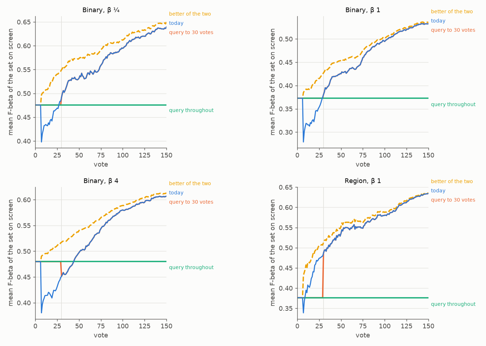
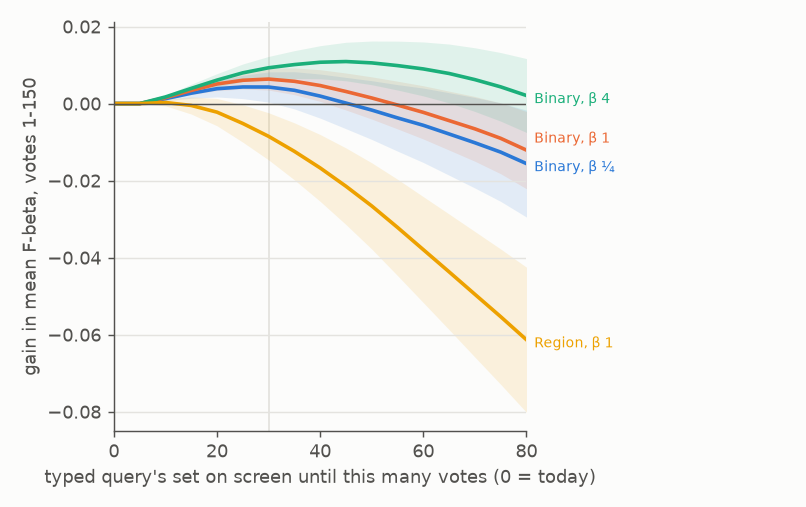

# The typed query's set stays on screen until 30 votes on the Binary path (#4736)

**2026-10-12.** Since #4742 Autopilot's photo opening is `g3@top,b4@mid` again. The app asks the head's Hard
questions from vote 8, and it also shows the head's set from there: the trained head on the quota's 3 Goods
and 4 Bads. #4671 measured that set against keeping the typed query's set on screen through the opening:
it lost **0.046 / 0.035 / 0.044** over votes 1-25 at beta 1/4, 1 and 4. This issue asked for the
combination: ask as the old opening does, and show the typed query's set until the head beats it.

**Shipped: on a single-vector space (the Binary path), a typed-query detector keeps giving its query's own
set past the quota until its labels number 30.** That covers the screen (the Train view keeps the text sort
while Autopilot asks from the head) and Find, Test, AutoFind, a load, an export and the CLI (the label
quota's `query` tier, #4758). Autopilot's questions are unchanged: it asks the head's Hard picks from the
quota on, as today. The Region path keeps the hand-over at the quota, because its head passes the typed
query by about vote 10.

The table is the shipped rule as the harness runs it (the arm below), paired per run against today, with SEs
clustered on the 48 classes. It covers COCO Better's Binary opening, 702 sessions a preset.

| | beta ¼ | beta 1 | beta 4 |
|---|---|---|---|
| votes 1-10 | +0.023 ± 0.005 | +0.028 ± 0.004 | +0.033 ± 0.004 |
| **votes 1-25** | **+0.025 ± 0.010** | **+0.037 ± 0.007** | **+0.050 ± 0.007** |
| votes 1-50 | +0.012 ± 0.006 | +0.019 ± 0.004 | +0.028 ± 0.004 |
| **votes 1-150 (the session mean)** | **+0.0041 ± 0.0020** | **+0.0064 ± 0.0014** | **+0.0094 ± 0.0015** |
| votes 51-150 | 0 | 0 | 0 |
| the five seeds, votes 1-150 | +0.002 to +0.006 | +0.005 to +0.008 | +0.009 to +0.010 |
| Region, beta 1, votes 1-25 / 1-150 (offline; not shipped) | | -0.035 / -0.009 | |

*Figure 1. Mean F-beta of the set on screen at every vote, over every run. Blue: today, the head from the
quota (vote 7 in a median run). Green: the typed query's set throughout. Orange: the shipped hold. It is
the green line until vote 30 (the grey rule) and the blue line from there. Yellow, dashed: whichever set is
better at that vote, with hindsight. Binary at beta ¼, 1 and 4, and Region at beta 1, where the head passes
the query by about vote 10. Offline prices on the text baseline (below).*

*Figure 2. The gain in the session mean against how long the typed query's set is held, with two SEs
shaded. Binary peaks at 25-30 votes at beta ¼ and 1 and at 40-45 at beta 4. Every hold loses on Region.*

## What was run

**The sessions are today's app.** The hold changes what Test gives, never a pick: the opening's picks come
off the text sort, and Hard's and New's off the head, which the harness trains at every vote from the quota
whether it is shown or not. So one session set prices every hand-over rule exactly.

- **Binary:** #4786's sessions, 144 cells × 5 seeds, 150 votes at each preset:
  - `state-of-the-app/2026-10-11-line4786all-b025` and `-b1`, from `8338a115c`;
  - `-line4786thin-b4` at beta 4, from `4131eef90`, with the same beta-4 line.
- **Region:** #4785's prior-head arm (`2026-10-11-region4776prior-b1`), 144 cells × 2 seeds, beta 1 only,
  from `401ec98e1`. It predates #4786's line. The 18 Binary cells a preset (and 9 Region cells) with no
  rows are cells the grid skips, as in #4637.
- **They match dev.** Twelve cells re-run on dev `c4ad866e6` (4 at each preset) picked identically, click for
  click, and drew the same trained head's F-beta at every vote. Since `8338a115c` dev added #4758's query
  tier (rows only, before the quota), #4799 (faces only) and UI work.
- **The typed query's set** in the offline prices is `2026-10-08-b1/text_baseline.csv`: the display line at
  each preset, drawn over the haystack and scored on the withheld half. The harness's own query rows
  (#4758's `_query_step`) draw that line over the withheld half instead. They differ by up to about 0.01 a
  run and by under 0.001 on average. The shipped numbers above are the harness's.
- **Every run is in every average** (#4631). The scores are the session mean of the objective over votes
  1-150, paired, with SEs clustered on class. Rules with a parameter are cross-fitted: the parameter is
  chosen on one half of the classes and scored on the other, both ways.

The analyzer is `scripts/experiments/state_of_app/handover_4736.py`:
- `extract` builds a preset's per-vote arrays from the cells;
- `price` prices every rule (`rules.csv`, `crossfit.csv`);
- `figures` draws both figures and writes `holds.csv`;
- `arm` checks the arm against today's sessions run for run.

## Which rule

The early loss is still there on today's app. Since #4671, #4785 (the head started from the Goods'
centroid) and #4786 (the head's count line while the class model is thin) both made the early head better.
Even so, the head's mean F-beta passes the typed query's only around **vote 27 at beta ¼, vote 28 at beta 1
and vote 45 at beta 4**. Keeping the query's set throughout wins +0.026 / +0.037 / +0.050 over votes 1-25,
and loses 0.08 / 0.08 / 0.05 over the session.

A rule chooses, per run, the vote from which the head's set is shown. Each family below is cross-fitted:

| family (choice on one half / the other) | beta ¼, 1-150 | beta 1, 1-150 | beta 4, 1-150 |
|---|---|---|---|
| **a fixed vote** (25-30 / 30 / 40-50) | **+0.0041 ± 0.0018** | **+0.0064 ± 0.0014** | **+0.0099 ± 0.0026** |
| votes past the quota (15-20 / 20 / 20-50) | +0.0022 ± 0.0018 | +0.0060 ± 0.0013 | +0.0069 ± 0.0028 |
| votes judge: each set's F-beta on the picks the head scored before their vote (#4604's rule) | +0.0007 ± 0.0022 | +0.0037 ± 0.0014 | +0.0121 ± 0.0022 |
| the same judge, switching back and forth | -0.0034 ± 0.0026 | +0.0008 ± 0.0017 | +0.0100 ± 0.0023 |
| Goods in hand (4-8) | -0.0029 ± 0.0015 | +0.0014 ± 0.0011 | +0.0069 ± 0.0020 |
| the class model's Goods (2-6) | -0.0006 ± 0.0004 | +0.0011 ± 0.0014 | +0.0065 ± 0.0018 |
| separation, d' (1-2.5) | -0.0000 ± 0.0001 | -0.0001 ± 0.0003 | +0.0003 ± 0.0003 |
| *better set at every vote, hindsight* | *+0.032* | *+0.023* | *+0.031* |
| *best single hand-over vote per run, hindsight* | *+0.028* | *+0.020* | *+0.029* |

Counts of Bads, Goods × Bads grids, a fixed vote that then waits for the judge, and the judge with a fixed
vote as its latest were all within 0.001 of the fixed vote. The best was +0.0047 / +0.0063 / +0.0118.

**The fixed vote is the rule, and 30 is the count at every preset.** The per-preset optima are 25-30, 30
and 40-45. At beta 4, 45 adds +0.0016 over 30 at the price of twice the variance (SE 0.0025 against 0.0015):
16% of runs lose more than 0.01, against 9%. 30 is positive in every seed and every size band but small
instances at beta ¼ (-0.002). The rule is a count of labels, like the quota, so the app needs no new
state: `label_quota.query_holds`.

**The judges fail for want of evidence.** Hard picks sit at the head's own line, where its calls are coin
flips. The query's calls on the same picks look good there even when the head's set is better over the
collection. A judge that reads the votes where the two sets disagree, sized by how much they disagree, is
#4816.

**The dry exit's hand-over (#4743).** 196 of the 702 runs get their first head from the dry exit (a Good
and 16 Bads, #4731), at votes 17-27. At beta 4 the hold helps them too: +0.0026 over 1-150 at 30 votes, and
+0.007 at 50-60. That is the early loss #4743 found, on the head's set against the typed query's. At beta ¼
it costs them 0.003 and at beta 1 nothing, since the head beats a query that found one Good by vote 25.

## Region

On the Region path (DINOv3 patches, SigLIP's typed query) the head's set passes the query's by about vote 10
and stays ahead: +0.10 by vote 20, +0.17 by vote 50. Every hold loses, -0.035 ± 0.015 over votes 1-25 and
-0.0085 ± 0.0031 over the session at 30 votes. So the hold is for a single-vector space only. The app
reads the embedder's capability (`_patch_space_for`); the harness reads the run's patch grid. These
sessions predate #4786's line, which makes a thin head better, so the sign cannot flip.

## The arm

The shipped rule ran as the harness runs it: `query_hold` at the app's 30 (`CALIB_QUERY_HOLD` unset), from
frozen `f052d037e`. It covered the same 720 cells at each preset, as V100 pack jobs
(`state-of-the-app/2026-10-12-hold4736v60-b*`, launcher `hold_4736.sh`), with sessions cut at 60 votes. The
hold ends at vote 30, and from there the arm is today's code. A cut at 60 leaves votes 1-30 exactly as in
a 150-vote session: the voting budget is read only by the prompted weak check, which starts only when its
rounds fit the votes left (15 at beta ¼ and 1, 25 at beta 4). A first launch cut at 30 votes skipped every
check due after vote 15, picked differently from there, and was cancelled. `handover_4736.py arm` compares
each run with the same run of today's sessions through vote 30, and scores today's from vote 30 on:

| check, of 702 runs a preset | beta ¼ | beta 1 | beta 4 |
|---|---|---|---|
| picks identical, click for click | 702 | 702 | 702 |
| the `hold:head` rows equal today's head at those clicks | 702 | 702 | 702 |
| the untagged trained rows (vote 30 on) equal today's | 702 | 702 | 702 |
| one typed-query set per run | 702 | 702 | 702 |
| held rows marked as showing a detector (`app_trained`) | 0 | 0 | 0 |
| runs that hold past the quota | 637 | 637 | 637 |

The arm's typed-query set differs from the text baseline's by under 0.001 on average (-0.0005 / +0.0004 /
+0.0000). Its gains match the offline prices to within 0.0007 at every span: votes 1-25 +0.025 / +0.037 /
+0.050 against +0.026 / +0.037 / +0.050, and 1-150 +0.0041 / +0.0064 / +0.0094 against +0.0043 / +0.0064 /
+0.0093. Per seed over votes 1-150: beta ¼ +0.0053, +0.0060, +0.0039, +0.0032, +0.0021; beta 1 +0.0075,
+0.0070, +0.0071, +0.0053, +0.0050; beta 4 +0.0097, +0.0103, +0.0095, +0.0087, +0.0088 (`arm.csv`).

**Region guard.** The four Region cells run with the hold on (`2026-10-12-hold4736region-b1`, 30 votes)
hand over at the quota (vote 7), as today, with no `hold:head` rows.

## The build

- **The rule:** `vtscore/detectors/label_quota.py` has `QUERY_HOLD_LABELS = 30` and `query_holds(n_good,
  n_bad, patch_space=)`. It is true on a known single-vector space below 30 labels; a patch space, or an
  embedder the registry does not know, has no hold.
- **Find, Test, AutoFind, a load, an export, the CLI:** `labelset_training._query_tier` gives the typed
  query's head past the quota while the query holds. `model_loading.cached_head_is_current` refuses the
  learned sort's cached head then, so a Find takes the query's set.
- **The Train view:** the learned-sort payload carries `query_hold`. While it is true in a session opened on
  a typed query, the client keeps the text sort on screen and takes Autopilot's Hard pick from the learned
  ranking it did not install. From the first payload without it, the head's ranking is shown, as today.
  The held ranking feeds every pick (`SortRunnerService.askWindow()`): the Hard pick, the New phase's
  atlas steer, and the weak check's balance (`askBalance`). So Autopilot asks what it would with the learned
  ranking on screen. Stopping Autopilot ends the hold under the Sort it leaves selected. An example opening,
  retrain mode and a document dataset's walk never hold.
- **The harness:** `simulate_voting_iterations(query_hold=)`, knob `CALIB_QUERY_HOLD`. Unset is the app
  (30); `0` is the hand-over at the quota. A held click's untagged row is the typed query's set, with
  `app_trained` 0. The head's rows that would have been untagged are tagged `hold:head`, so any other hold
  is priced on the same session. The sync mirror `detectors.label_quota_default` describes it.

## Not done here

- **A judge** that reads which set is better from the votes where they disagree: #4816.
- **#4798** (the beta-4 labels line on diffuse chances, in progress) changes the beta-4 head's later votes.
  If it makes that head better, the beta-4 optimum moves toward 30, so it argues for one count rather than
  against it.
