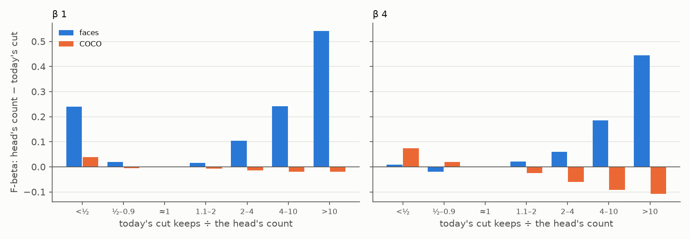
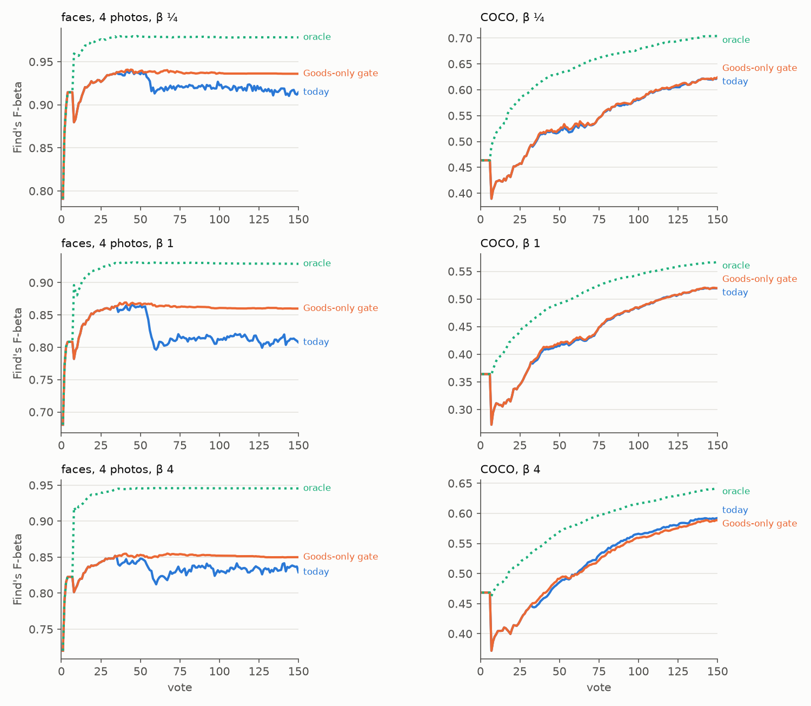

# No fix to the labels line's positives total wins; the head's count until the class model has 6 Goods (#4798)

**2026-10-13.** At β 4 the labels line sometimes keeps a whole corpus. #4786 put the head's own
count in its place while the class model is thin (fewer than 32 held-out Bads and fewer than 6
held-out Goods). Past that gate, 2.5% of β 4 face clicks still keep more than ten times the
person's withheld photos, up to 704 of them, in 114 of 1,124 runs. The issue asked for a fix to
`corpus_cut`'s positives total, priced on #4786's line counts and guarded on COCO Better's Binary
opening at every preset.

**No fix to the total wins.** Six were priced on the same sessions, re-cut exactly from their
recorded rankings: `P` from the 2-part total, from the 3-part chances' own sum or from the smaller
of the two; the chances held to the counted bound or to the total; and a count cap. Every one
loses on COCO at every preset, by up to 0.12 over votes 1–150, and none gains faces more than 0.001.

**Why: past the gate, the faces' runaway cuts and a hard COCO category's sound deep cuts look the
same to the line.** In both, the 3-part chances have collapsed to almost nothing while the 2-part
total stays well above the withheld positives, so `F` is small at every cut and β 4's marginal
bar falls to the corpus's end. On faces that keeps 73 photos for 4 withheld; on COCO's hardest
categories, where the ranking is poor, keeping deep is what β 4 wants. Read by everything the line
holds (the Goods and Bads behind the class model, its d′, either count, the session's hit rate,
how long since its last Good), the two cannot be told apart, and the same move gains one by up to
0.44 at a click and costs the other up to 0.11 (Figure 1).

**What does remove them: the head's count until the class model holds 6 held-out Goods, whatever
its Bads.** That is #4786's gate with its Bads half dropped. A class model with two to five
held-out Goods cannot place the corpus's positives however many Bads it holds. No face session
here reaches 6 held-out Goods, so on faces the class model never cuts. Run as full sessions, paired
with today
run for run:

| | faces from 1 / 4 photos, votes 1–150 | faces, votes 51–150 | COCO, votes 1–150 | COCO, votes 51–150 |
|---|---|---|---|---|
| β ¼ | +0.008 / +0.012 | +0.012 / +0.017 | +0.001 ± 0.001 | +0.002 ± 0.001 |
| β 1 | +0.023 / +0.032 | +0.034 / +0.048 | +0.001 ± 0.000 | +0.001 ± 0.000 |
| β 4 | +0.004 / +0.014 | +0.005 / +0.019 | −0.002 ± 0.001 | −0.005 ± 0.001 |

Face SEs are 0.002–0.005 over votes 1–150 and 0.003–0.007 over 51–150; every face set gains except
β 4 from one photo, which is within its SE. Over votes 1–50 every set is +0.001 to +0.003: #4786's
gate holds the line until about vote 55 either way. The ranking does not move.

No β 4 face click past the gate keeps more than ten times the withheld photos (today 2.5%), and
the most kept is 27 (today 704). The cost is COCO at β 4: −0.002 ± 0.001 over votes 1–150, in
its hardest categories, where a session finds almost nothing and a cut that keeps deep picks up a
few more positives. At β ¼ and β 1 COCO gains a little.

**Recommended: ship it.** It removes the issue's failure outright, gains faces at every preset
(most at β 1), gains COCO at two presets of three, and simplifies #4786's gate to one condition.
The price is the β 4 cost on COCO's hardest categories and a count on the corpus for the whole of
a rare target's session (below). The gate change is `97b254919`; nothing ships until the owner
rules on that trade.

## What was priced

### One session set prices every fix

A fix to the class model's cut changes what Test returns, not the ranking. #4786's line counts
(`CALIB_LINE_COUNTS=1`, `vtscore/eval/arms_line_counts.py`) record, at every click Test gives the
trained head, where the withheld half's positives sit in the head's ranking and what each line
keeps there. This issue adds what the class model's cut keeps under each fix (`k_cut_<name>`,
`vtscore/eval/arms_cut_total.py`) and the 3-part chances' sum. Each fix reads only what the line
holds, so a winner would move into `LabelsLine.threshold` unchanged:

| fix | `corpus_cut` scores each cut against |
|---|---|
| today | `P = max(2-part total, sum of every chance)` |
| `ptotal` | `P = max(2-part total, the kept set's chances)` |
| `pchances` | `P` = the sum of every chance (the 3-part fit's own total) |
| `pmin` | `P = max(min(2-part total, sum of every chance), the kept set's chances)` |
| `capsum` | today's, with the chances scaled down to at most twice the counted bound |
| `captotal` | today's, with the chances scaled down to at most the 2-part total |
| `ncap` | today's, keeping at most β^0.708 × the 2-part total (#4603's multiple) |

The app keeps #4786's head count while the class model is thin, so each fix applies only past that
gate, with the head's count before it. Across the 2026-10-12 sessions' trained clicks past the
gate (170,000 at β 4), the re-cut reproduces today's F-beta with no mismatch.

Beside the fixes, three rules that move the gate instead, priced the same way:

| rule | past #4786's Bads gate, while the class model holds fewer than 6 held-out Goods |
|---|---|
| `headgoods` (the Goods-only gate) | the head's count |
| `floorhead` | never fewer than the head's count |
| `caphead` | never more than the head's count |
| `caphead-dry` | `caphead`, once the session has gone 16 votes without a Good (#4488's dry run) |

`headgoods` is `floorhead` and `caphead` together. The arm runs `headgoods` in every fit's line
(`CALIB_HEAD_COUNT_BADS=100000`: no code change) on the same frozen worktree as today's sessions.

### Scoring

As #4786: what a Find returns at every vote, Test's rows with the end-of-run check left out,
carried between rows, every run in every average (#4631). Each number is a session mean over votes
1–50 or 1–150, the rule minus today per run, then the mean ± SE over runs. Faces are FHIBE at 1024
px, the #4699 baseline's 562 people, from 1 and from 4 starting photos (`k1`, `k4`); COCO is the
Binary opening, 5 seeds × 144 classes = 720 runs a preset. Today is dev at `9e2bbaffa` (#4786
merged, #4799's unprompted check on faces).

## The fixes to the total

Votes 1–150, the fix minus today, mean ± SE over runs (every number in `tables.md`):

| fix | β ¼, faces 1 / 4 | β ¼, COCO | β 1, faces 1 / 4 | β 1, COCO | β 4, faces 1 / 4 | β 4, COCO |
|---|---|---|---|---|---|---|
| `ptotal` | 0.000 / 0.000 | −0.002 ± 0.000 | 0.000 / 0.000 | −0.014 ± 0.001 | −0.001 / −0.001 | −0.029 ± 0.003 |
| `pchances` | 0.000 / +0.001 | −0.053 ± 0.003 | −0.004 / −0.005 | −0.065 ± 0.003 | −0.007 / −0.007 | −0.089 ± 0.004 |
| `pmin` | 0.000 / +0.001 | −0.055 ± 0.003 | −0.004 / −0.005 | −0.079 ± 0.003 | −0.008 / −0.008 | −0.118 ± 0.004 |
| `capsum` | 0.000 / 0.000 | −0.001 ± 0.000 | 0.000 / 0.000 | −0.002 ± 0.000 | 0.000 / 0.000 | −0.001 ± 0.000 |
| `captotal` | 0.000 / 0.000 | −0.001 ± 0.000 | 0.000 / 0.000 | −0.002 ± 0.000 | 0.000 / 0.000 | −0.001 ± 0.000 |
| `ncap` | −0.012 / −0.012 | −0.016 ± 0.001 | −0.006 / −0.006 | −0.020 ± 0.002 | −0.005 / −0.006 | −0.022 ± 0.001 |

Face SEs are at most 0.002. None changes the faces' deep cuts much: under `ptotal` 2.5% of β 4 face
clicks past the gate still keep more than ten times the withheld photos, as today; under `pmin`,
0.8% (up to 401).

The fixes split into two groups:

- **`ptotal`, `capsum` and `captotal` change almost nothing on faces.** Past the gate `P` is
  already the 2-part total (on every face click that keeps more than ten times its positives), and
  the chances already sit far below it. On COCO they trim the chances where a sound cut needed them.
- **`pchances` and `pmin` shrink `P` to the chances, which are near zero.** `F` then peaks at the
  very top and the cut keeps one item. That is the right count on a face click that ran away, and
  the wrong one on every COCO click whose chances are small but whose positives are many.
- **`ncap`** cuts at β^0.708 × the 2-part total, which on COCO's hardest categories is far below
  what β 4 wants from a poor ranking.

## Why the line cannot fix it

**Which count runs away.** The issue's example (vote 8, 3,925 faces kept) was diffuse chances
under a 2-part total of 0.0, inside #4786's window, and #4786 already fixes it. Past the gate it is
the other way round. On every β 4 face click that keeps more than ten times its withheld photos
(2,719 clicks), `P` is the 2-part total: a median of 17.8 positives estimated for 4 withheld, while
the chances sum to 0.8. COCO's such clicks (1,800) are the same: `P` is the total on 94% of them, a
median of 174 estimated for 50 withheld, chances summing to 0.01. `TP` is then a fraction of a
positive at every cut, `F` is tiny everywhere, and the marginal bar falls with it. The class model
behind it holds two to five held-out Goods: on faces past the gate never more.

**The same signature, opposite answers.** Past #4786's Bads gate and below 6 held-out Goods, take
the head's count in place of today's cut. Figure 1 bins those clicks by how much more today's cut
keeps than the head's count:



*Figure 1. Past #4786's Bads gate, below 6 held-out Goods: Find's F-beta at a click with the head's
count, minus today's cut, by today's count over the head's (clicks where the two agree drop out).
Left β 1, right β 4. Faces from 1 and 4 photos at 1024 px; COCO's Binary opening.*

Where today keeps more than twice the head's count, faces gain (+0.06, +0.19, +0.44 at β 4) and
COCO loses (−0.06, −0.09, −0.11). The COCO clicks there are its hardest categories, where the
ranking is poor (the per-click oracle 0.24–0.27): a recall-leaning cut that keeps deep is what
β 4 asks of a poor ranking. The face clicks have a good ranking (oracle 0.89) and few positives.
Nothing the line holds tells them apart. On those clicks (today keeping more than twice the head's
count, at β 4), median for faces / COCO:

| | faces | COCO |
|---|---|---|
| Goods in hand | 4 | 5 |
| Bads in hand | 92 | 99 |
| Goods per vote so far | 0.044 | 0.045 |
| held-out Bads behind the class model | 56 | 60 |
| d′ | 1.3 | 0.8 |
| 2-part total ÷ the head's count | 1.2 | 1.2 |
| votes since the last Good | 77 | 15 |

The d′ ranges overlap (10th–90th percentile 0.5–2.1 and 0.3–1.6), and on every click below 6 Goods
d′ points opposite ways on the two benches: under 1.5 the head's count gains faces 0.20–0.29 and
costs COCO 0.05–0.11; above 3 it is the other way round (faces −0.05, COCO +0.07). The dry streak
shifts where the clicks fall but not the sign: COCO loses 0.05–0.11 wherever today keeps more than
twice the head's count, at every streak length, including past 64 votes without a Good. Any fix that
trims the faces' runaway cuts trims COCO's sound ones with them; the six fixes to the total are such
fixes, and so is any gate on these quantities. The best of them, the head's count as a cap once the
session has gone 16 votes without a Good, nets faces +0.006 / +0.010 at β 4 for COCO −0.003 (below),
the same trade as the gate.

## Moving the gate instead

**The Goods-only gate** keeps the head's count until the class model holds 6 held-out Goods,
however many Bads it holds. It is `floorhead` and `caphead` together: never fewer than the head's
count (which helps COCO, where the class model's cut sometimes keeps a single item, and faces at
β ¼ and β 1) and never more (the deep-cut fix). Re-cut on today's sessions, votes 1–150:

| rule | β ¼, faces 1 / 4 | β ¼, COCO | β 1, faces 1 / 4 | β 1, COCO | β 4, faces 1 / 4 | β 4, COCO |
|---|---|---|---|---|---|---|
| `headgoods` | +0.008 / +0.012 | +0.002 ± 0.001 | +0.023 / +0.032 | +0.001 ± 0.000 | +0.004 / +0.014 | −0.003 ± 0.001 |
| `floorhead` | +0.005 / +0.007 | +0.002 ± 0.000 | +0.018 / +0.025 | +0.002 ± 0.000 | −0.002 / +0.004 | +0.003 ± 0.000 |
| `caphead` | +0.003 / +0.005 | 0.000 ± 0.000 | +0.005 / +0.007 | −0.001 ± 0.000 | +0.006 / +0.010 | −0.006 ± 0.001 |
| `caphead-dry` | +0.002 / +0.005 | 0.000 ± 0.000 | +0.005 / +0.007 | 0.000 ± 0.000 | +0.006 / +0.010 | −0.003 ± 0.000 |

Face SEs are 0.001–0.005 (`tables.md`). Over votes 1–50 every gate rule is within 0.003 of today,
none below it: on faces #4786's gate holds the line until about vote 55, and the rules differ only
after.
A gate on the Bads between 32 and unbounded trades the two in proportion: 48 held-out Bads keeps
30% of the β 1 face gain (4 photos) and 22% of the β 4 COCO cost, 64 keeps 56% and 67%.

**The arm.** `headgoods` in every fit's line (`CALIB_HEAD_COUNT_BADS=100000`), Train and Find alike,
run as full sessions on the same frozen worktree as today's and paired run for run:

| preset | set | runs | today, 1–50 | Δ 1–50 | Δ 1–150 | runs gaining / losing (1–150) | ΔAP 1–150 |
|---|---|---|---|---|---|---|---|
| β ¼ | k1-b025-1024 | 562 | 0.890 | +0.001 ± 0.000 | +0.008 ± 0.002 | 45% / 14% | 0.000 |
| β ¼ | k4-b025-1024 | 562 | 0.921 | +0.001 ± 0.000 | +0.012 ± 0.002 | 48% / 15% | 0.000 |
| β ¼ | coco-b025 | 720 | 0.470 | +0.001 ± 0.000 | +0.001 ± 0.001 | 19% / 13% | 0.000 |
| β 1 | k1-b1-1024 | 562 | 0.814 | +0.001 ± 0.000 | +0.023 ± 0.003 | 38% / 17% | 0.000 |
| β 1 | k4-b1-1024 | 562 | 0.841 | +0.002 ± 0.001 | +0.032 ± 0.003 | 42% / 16% | 0.000 |
| β 1 | coco-b1 | 720 | 0.361 | +0.001 ± 0.000 | +0.001 ± 0.000 | 22% / 11% | 0.000 |
| β 4 | k1-b4-1024 | 562 | 0.807 | +0.001 ± 0.000 | +0.004 ± 0.004 | 30% / 69% | 0.000 |
| β 4 | k4-b4-1024 | 562 | 0.833 | +0.003 ± 0.001 | +0.014 ± 0.005 | 34% / 66% | 0.000 |
| β 4 | coco-b4 | 720 | 0.438 | +0.003 ± 0.000 | −0.002 ± 0.001 | 17% / 20% | 0.000 |

The ranking does not move (ΔAP within 0.0002). The arm matches the re-cut on today's sessions: faces
to the third decimal at every preset, COCO within 0.0003 (β 4: −0.0024 against −0.0027), so the line
does not move the sessions. Over votes 51–150, after the gate, faces gain +0.012 / +0.017 at β ¼,
+0.034 / +0.048 at β 1 and +0.005 / +0.019 at β 4; COCO +0.002, +0.001 and −0.005 ± 0.001.



*Figure 2. Find's F-beta by vote: today, the Goods-only gate (the arm), and the per-click oracle
(the best count on the withheld half; a bound). Faces from 4 photos at 1024 px, and COCO, at each
preset.*

On faces today's line drops at about vote 55, where #4786's Bads half opens and the class model
takes over with two to five Goods; the gate removes that drop, and with it every face click past
the gate that keeps more than ten times the withheld photos (2.5% of β 4 clicks today, 0.5% at
β 1). The most kept at β 4 falls from 704 to 27.

## What it costs

- **COCO at β 4, its hardest categories.** The arm costs COCO −0.002 ± 0.001 over votes 1–150 at β 4
  (+0.003 over votes 1–50). Re-cut per run, the cost sits where today's session reaches a mean
  F-beta below 0.2 (159 of 720 runs, −0.013 each: bowl, bottle and book at medium size, scissors and
  bird small), and is level where it reaches 0.4 or more. For a target the session cannot find, a β
  4 cut that keeps deep picks up a few more positives than a count of what stands out.
- **Most face runs lose a little at β 4.** 66–69% of face runs lose and a third gain a lot; the
  mean is +0.004 (1 photo, within its SE) and +0.014 (4 photos). Where the class model's cut keeps
  a little less than the head's count (a median of 6 against 8) it is the better one, by 0.019 a
  click. At β ¼ and β 1 the gains are broad: 38–48% of face runs gain and 14–17% lose.
- **A count on the corpus for the whole session, for a rare target.** #4786 accepted a count on
  the corpus while the class model is thin; on a corpus with none of the target it keeps a median
  of 2, 3 and 8 images at β ¼, 1 and 4. With the Bads half gone, a session that never reaches 6
  held-out Goods (about 10 Goods in hand; no face session here does) keeps that count at every
  click, and so does every Find it runs. #4786's report named this as the reason to leave the
  later clicks to this issue.

## What this does not settle

- **The class model with two to five Goods.** The gate steps around a class model that cannot
  place the positives; it does not make one that can. The collapse is in the 3-part fit (its
  chances fall to nearly nothing past 32 Bads while the 2-part total does not), and a fit that
  stays honest with few Goods is unpriced. The per-click oracle stays far above every rule
  (+0.05 to +0.10 over votes 1–150).
- **The Goods half.** `HEAD_COUNT_GOODS` stays at #4786's 6; a lower bar would hand faces back
  to the class model sooner. Not re-priced.
- **640 px faces and the Region path.** Faces were run at 1024 px only (#4786's gains held at both
  sizes), single-vector sessions only.

## Provenance

| | |
|---|---|
| Code | branch `claude/cut-total-4798` from dev `9e2bbaffa` (#4786 merged): today's sessions with the line counts and the arm at `142ac8c9a` (frozen worktree `vts-4798-run`); the gate change `97b254919` |
| FHIBE release | `fhibe-full-resolution-674a7dcf`, faces aligned by roll (#4777), the #4699 baseline's 562 people, 1024 px |
| Run dirs (owner-only) | `<release>-derived/runs/2026-10-12-4798-roll-k{1,4}-b{025,1,4}` (today, with line counts), `…/2026-10-12-4798goods-roll-k{1,4}-b{025,1,4}` (the arm); analyses `…/2026-10-12-4798-analysis` |
| COCO | `state-of-the-app/2026-10-12-cut4798-b{025,1,4}` (today, with line counts), `…/2026-10-12-cut4798goods-b{025,1,4}` (the arm), on the 2026-10-08 grid |
| Files here | `rules_b{025,1,4}.csv` (every fix and gate rule, today's sessions re-cut), `ab.csv`, `ab_curves.csv` (the arm against today), `curves_b{025,1,4}.csv` (per vote), `tables.md`, figures |

Reproduce:

```bash
# today's sessions, with the line counts (from a frozen worktree)
SOTA_FACE_TAG=4798 SOTA_FACE_ARM=roll CALIB_LINE_COUNTS=1 CALIB_CELLS_GZIP=1 bash scripts/experiments/fhibe/sota_face.sh dirs   # then tasks (1024 px), pack
bash scripts/experiments/state_of_app/cut_4798.sh dirs && bash scripts/experiments/state_of_app/cut_4798.sh launch 4   # and 1, 0.25
# the arm: the Goods-only gate, no code change
SOTA_FACE_TAG=4798goods SOTA_FACE_ARM=roll CALIB_HEAD_COUNT_BADS=100000 CALIB_CELLS_GZIP=1 bash scripts/experiments/fhibe/sota_face.sh dirs   # tasks, pack
CUT4798_ARM=goods CALIB_HEAD_COUNT_BADS=100000 bash scripts/experiments/state_of_app/cut_4798.sh launch 4   # and 1, 0.25
# analysis
python scripts/experiments/fhibe/cut_4798.py --set k4-b4-1024=<cells>::fhibe_faces_roll_1024 ... --set coco-b4=<cells> --out <dir>
python scripts/experiments/fhibe/prior_4776.py --pair k4-b4-1024=<arm cells>::<today's cells>::fhibe_faces_roll_1024 ... --out <dir>
python scripts/experiments/fhibe/cut_4798_tables.py --rules b4=<rules.csv> ... --ab b4=<prior_ab.csv> ... --out tables.md
python scripts/experiments/fhibe/cut_4798_figures.py --clicks b1=<clicks.csv> --clicks b4=... --curves b4=<curves.csv> ... --arm b4=<prior_curves.csv> ... --out <dir>
```
