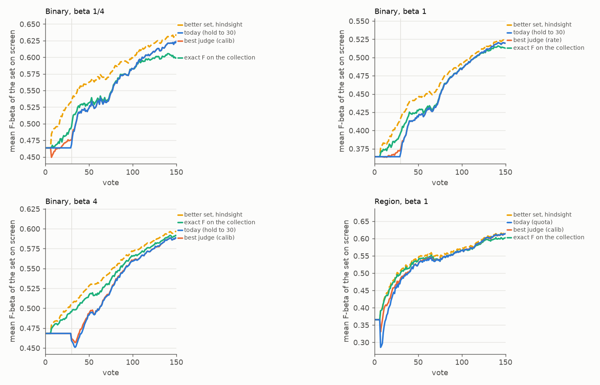
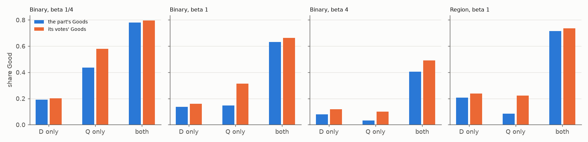
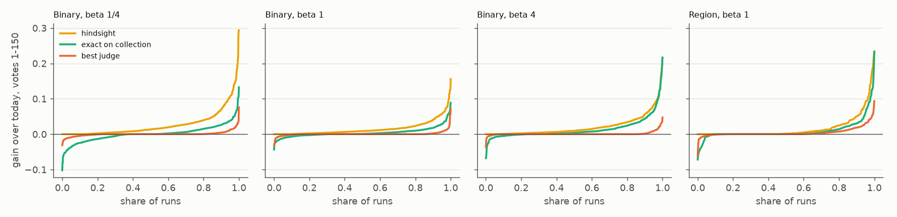

# A judge that reads the votes where the two sets disagree: no gain on Binary, +0.005 on Region (#4816)

**2026-10-13.** Since #4736 a typed-query session on the Binary path keeps the typed query's set on screen until
30 votes, then shows the head's. Region hands over at the quota, because every fixed hold lost there. A per-run
choice made with hindsight would earn far more than either (+0.027 / +0.016 / +0.021 over votes 1-150 on Binary
at beta ¼, 1 and 4; +0.017 on Region). #4736 found that judges which read every vote never beat the fixed count.
This issue priced a judge that reads only the votes where the two sets **disagree**: the share of Goods among
the votes in the head's set alone (D only) and in the query's set alone (Q only), turned into each set's expected
F-beta by the parts' sizes over the voting collection.

- **Binary: no judge beats the 30-vote hold.** At every preset the best judge, with its parameters chosen on one
  half of the classes and scored on the other, is within 0.001 of today over votes 1-150 (table 1). Used in place
  of the hold, it loses 0.004-0.007. **Keep the hold.**
- **Region: a judge wins where no fixed count did.** `calib:extend` keeps the query's set past the quota while
  its estimate says the query's set is better. It gains **+0.023 ± 0.006 over votes 1-25** and **+0.005 ± 0.001
  over 1-150**, in both seeds, both class halves and all three bands. It is not built: it needs the app to
  record, at every vote, where the voted media sat in the two sets and the head's posterior for it. That is the
  owner's call (Region).

No app change here. The PR carries the harness instrumentation, the pricing script and this report.

The ceiling cannot be reached through the voting collection, and the votes misstate it, as follows.

1. **The bound.** A judge that knew each set's exact F-beta on the voting collection, the voted media at their
   labels included, would capture **4% / 28% / 64%** of the hindsight gain over votes 1-150 (beta ¼ / 1 / 4).
   The voting half and the withheld half are two samples of the same corpus, each with a few dozen positives
   of the target. So a set's F-beta differs between the halves by sampling noise, and a choice made with
   hindsight on the withheld half picks up that noise. Judged on the unvoted media alone, the bound is
   **negative** over 1-150 at every preset. The head finds positives and the user votes them, so late in a
   session the head's set holds a handful of unvoted media and the query's set holds the positives the head
   missed.
2. **The votes overstate their part's share of Goods, most where the part is large.** In Q only the votes
   are 1.3, 2.1 and 3 times as rich as the part (beta ¼, 1, 4). Autopilot asks from the top of the head's
   ranking in every phase, so the votes in Q only are the query's media the head ranks just below its own
   line. In D only, the part the issue suspected, the votes are 1.05-1.5 times the part. That part is small
   (a median of 1-23 unvoted media), so its votes are close to all of it.
3. **No practical estimator carries information beyond "the head is usually better".** Each judge's call
   agrees with the withheld truth about as often as "always the head" does (within 0.02), or less (table 4).

## Table 1: every rule against today

Paired per run against today (the 30-vote hold), SE clustered on the 48 classes, every run in every average
(#4631). COCO Better's Binary opening, 720 sessions a preset. A judge family's row is its best parameters chosen
on one half of the classes and scored on the other, both ways.

| | beta ¼ 1-50 | beta ¼ 1-150 | beta 1 1-50 | beta 1 1-150 | beta 4 1-50 | beta 4 1-150 |
|---|---|---|---|---|---|---|
| better set at every vote, with hindsight | +0.039 | +0.027 | +0.027 | +0.016 | +0.030 | +0.021 |
| best single hand-over vote, with hindsight | +0.034 | +0.023 | +0.024 | +0.014 | +0.028 | +0.020 |
| **exact F-beta on the voting collection (a bound)** | **+0.011** | **+0.001** | **+0.013** | **+0.004** | **+0.023** | **+0.014** |
| exact F-beta on the unvoted media only | +0.016 | -0.004 | +0.015 | -0.009 | +0.023 | -0.001 |
| **best judge (cross-fitted)** | **+0.001** | **+0.0004** | **+0.001** | **+0.0004** | **+0.002** | **+0.0009** |
| fixed hold to 40 votes | -0.007 | -0.002 | -0.005 | -0.002 | +0.002 | +0.0008 |
| hand-over at the quota (before #4736) | -0.012 | -0.004 | -0.019 | -0.006 | -0.028 | -0.009 |

The best judges are `calib:shorten`, `rate:shorten` and `calib:extend` at beta ¼, 1 and 4: a judge that may
only hand over earlier than 30 votes, or only later. A free judge (`switch`, `once`) loses at every preset,
-0.0003 to -0.007 over votes 1-150, and #4736's vote judge (`pv`) loses up to -0.027. Counting only the votes
cast past the quota (as #4736 did), or only those past the opening, changes nothing. The best judge is then
+0.0009 / +0.0003 / +0.0008 over votes 1-150. SEs and every family are in [tables.md](tables.md).
The bound counts the voted media at their labels, in the part this click's sets put them. Counting them in the
part they sat in when picked does worse over votes 1-150 (-0.009 / -0.003 / +0.011), and so does leaving them
out (the row below it). On Region the same families are priced against today's hand-over at the quota
(below).



*Figure 1. Mean F-beta of the set on screen at every vote, over all 720 runs. Blue: today, the query's set to
vote 30 (grey rule), then the head's. Orange: the best judge, cross-fitted, which stays on today's line. Green:
the exact F-beta on the voting collection, which no judge can see. Yellow, dashed: the better of the two sets
at each vote, with hindsight. Region (bottom right): today hands over at the quota, where the
head's first set is worse than the query's for a few votes; the judge (orange) keeps the query's set there.*

## What the judge reads, and why it cannot work

At every click a trained head scored the pool, the harness records how the head's set D and the typed query's Q
split the unvoted media of the voting collection: D only, Q only, both and neither. It records the positives in
each part, which only a check may read, and where each pick sat in the two sets at the click before it. A
judge estimates each part's share of Goods from the votes that fell in it, shrunk toward a prior. The parts'
sizes and the voted media then give each set's expected F-beta. Three families were priced:

- **rate:** the votes' share of Goods per part, shrunk with 0-10 pseudo-votes toward 1/2 or the head's own
  posterior for the part. Q only may be shrunk by half for its position bias.
- **calib:** the head's posterior summed over each part, scaled by how that part's votes came out against
  what the head predicted for them, capped at the part's size. This was meant to read a pick's position
  through the head's own scores.
- **pv:** #4736's judge, each set's F-beta on the votes themselves.

Each family was priced over the unvoted media, over the whole collection (voted media at their labels, in this
click's sets) and over the whole collection with the voted media in the part they sat in when picked. P came
from the parts or from the class model. Each family ran in four modes:

- switch back and forth;
- hand over once;
- only extend the hold;
- only shorten it.

Each mode had a margin, a minimum of 0, 3 or 6 votes in the disagreement before the judge acts, and a
fallback before then (today's hold, or the head from the quota).

### The votes misstate their parts

| | votes a run | their Goods | the part's Goods | part size (median) |
|---|---|---|---|---|
| beta ¼, D only | 50 | 0.20 | 0.19 | 1 |
| beta ¼, **Q only** | 6 | **0.58** | **0.44** | 14 |
| beta 1, D only | 47 | 0.16 | 0.14 | 6 |
| beta 1, **Q only** | 10 | **0.31** | **0.15** | 28 |
| beta 4, D only | 36 | 0.12 | 0.08 | 23 |
| beta 4, **Q only** | 16 | **0.10** | **0.03** | 164 |
| beta 1, both | 20 | 0.66 | 0.63 | 6 |
| beta 1, neither | 57 | 0.04 | 0.002 | 11,386 |

"The part's Goods" is the part's true share at the click before each vote, averaged over the votes. The votes
in D only come mostly after Autopilot's stop (48-71%, walking the top of the head's ranking, where the part is
often a single medium). The rest are Hard picks (18-24%) and prompted checks (11-26%). The votes in Q only are
spread across four sources:

- the opening's Good phase, from the top of the text sort (about 30%);
- after the stop (about 28%);
- prompted checks (about 27%);
- Hard (5-19%).

Leaving out the opening does not remove the bias. The votes past it are 1.4, 2.3 and 4 times as rich as Q only
at beta ¼, 1 and 4.



*Figure 2. The share of Goods among the votes in each part (orange) against the part's own share (blue). Votes
in Q only and in neither come off the top of the part: the head's ranking, or the text sort in the opening. So
they overstate it.*

### Literal examples: the judge shows the worse set

Beta 1, the `rate` judge (3 pseudo-votes toward the head's posterior, P from the class model, unvoted media).
"Exact on collection" is the bound's own estimate. Every run here is one where the judge picks the set that
is worse on the withheld half.

| run | vote | withheld F head / query | unvoted D, Q, both | votes D only (Good) | votes Q only (Good) | true Goods D only / Q only | judge's F head / query | exact on collection |
|---|---|---|---|---|---|---|---|---|
| stop sign@large s4 | 40 | **0.91** / 0.28 | 24, 233, 24 | 2 (0) | 6 (4) | 0 / 4 | 0.28 / **0.65** | **0.94** / 0.32 |
| stop sign@large s3 | 40 | **0.85** / 0.28 | 12, 240, 12 | 0 | 2 (2) | 0 / 12 | 0.18 / **0.60** | **0.79** / 0.31 |
| traffic light@large s3 | 100 | **0.90** / 0.23 | 1, 243, 1 | 7 (0) | 9 (5) | 0 / 7 | 0.01 / **0.59** | **0.91** / 0.28 |
| surfboard@large s2 | 20 | 0.20 / **0.83** | 10, 52, 10 | 3 (0) | 0 | 0 / 23 | **0.65** / 0.22 | 0.58 / **0.79** |
| kite@large s1 | 20 | 0.21 / **0.71** | 6, 20, 5 | 4 (2) | 0 | 1 / 13 | **0.66** / 0.26 | 0.48 / **0.67** |

- **The first three** are #4736's worst classes for the hold. The head's set lies inside the query's. The
  query's extra media hold 4-12 positives among 210-240. The head asked about the few of them it ranks
  highest, and 4 of 6, 2 of 2 and 5 of 9 were Goods, so the judge credits Q only with a share it does not
  have.
- **The last two** have no votes in Q only at all. The judge falls back on the head's own posterior, which
  thinks Q only is empty.

More cases at beta 1 and 4 are in [examples.md](examples.md).



*Figure 3. Every run's gain over today across votes 1-150, sorted. The bound (green) loses in 37%, 30% and 24% of
the runs (beta ¼, 1, 4): there the voting half and the withheld half disagree about which set is better. The judge
(orange) changes few runs.*

### Table 4: the judges' calls against the truth

How often an estimate's sign (head minus query) matches the withheld truth, over every run and every vote from
the quota to 150.

| | beta ¼ | beta 1 | beta 4 |
|---|---|---|---|
| "always the head" (the head is better this often) | 0.73 | 0.74 | 0.67 |
| exact on the voting collection | 0.69 | 0.80 | 0.83 |
| `rate`, unvoted media, prior 1/2 | 0.54 | 0.41 | 0.40 |
| `rate`, whole collection, prior the head's posterior | 0.66 | 0.68 | 0.51 |
| `calib` (says "head" 91-97% of the time) | 0.65 | 0.75 | 0.69 |
| `pv` (#4736) | 0.45 | 0.48 | 0.50 |

## Region

Region (DINOv3 patches opened on SigLIP's text sort, max_patch), beta 1, 144 cells × 2 seeds, against today's
hand-over at the quota (#4736 found every fixed hold loses here):

| | votes 1-25 | votes 1-50 | votes 1-150 |
|---|---|---|---|
| better set at every vote, with hindsight | +0.048 ± 0.010 | +0.035 ± 0.008 | +0.017 ± 0.004 |
| exact F-beta on the voting collection (a bound) | +0.044 ± 0.010 | +0.030 ± 0.008 | +0.009 ± 0.003 |
| **`calib:extend`, cross-fitted** | **+0.023 ± 0.006** | **+0.013 ± 0.003** | **+0.005 ± 0.001** |
| `rate:extend`, cross-fitted | +0.019 ± 0.006 | +0.010 ± 0.004 | +0.002 ± 0.002 |
| `pv` (#4736), cross-fitted | +0.002 ± 0.002 | +0.002 ± 0.002 | +0.0007 ± 0.0008 |
| fixed hold to 20 votes | +0.003 ± 0.011 | +0.002 ± 0.005 | +0.001 ± 0.002 |
| fixed hold to 40 votes | -0.016 ± 0.015 | -0.041 ± 0.013 | -0.014 ± 0.004 |

`calib:extend` gains in 43% of runs and loses in 17%. Over votes 1-25 / 1-150 it gains:

| | votes 1-25 | votes 1-150 |
|---|---|---|
| seed 0 | +0.025 | +0.006 |
| seed 1 | +0.021 | +0.003 |
| class half 0 | +0.030 | +0.006 |
| class half 1 | +0.016 | +0.003 |
| large | +0.042 | +0.009 |
| medium | +0.015 | +0.003 |
| small | +0.011 | +0.003 |

Both halves choose 1-3 pseudo-votes over the unvoted media with no margin. On Region `extend` and `switch` are
the same rule, since today shows the head from the quota.

**What it reads.** For each part of the unvoted media, the judge takes the head's class-model posterior summed
over the part. It scales that by how the part's votes came out against what the head predicted for them (Goods
+ ½ over the head's posterior summed over those votes + ½, with 1-3 pseudo-votes), capped at the part's size.
The parts then give each set's expected F-beta, P their sum. It shows the query's set while that set's
estimate is the higher.

**Why it works on Region and not on Binary.** On Region the head's first sets are bloated: at votes 10-20 the
head keeps 195-520 unvoted media against the query's 44-98. Every vote in D only came back Bad (up to 12 of
them), so the judge holds the tighter query set, and the withheld half agrees (head 0.09-0.40 against query 0.54-0.85,
[examples_region.md](examples_region.md)). It errs when the head's own posterior rates its bloated set highly
and no vote has yet fallen in D only (skateboard@medium s0 at vote 10: the judge's F 0.87 / 0.35, withheld
0.24 / 0.87). On Binary the 30-vote hold already covers those votes, and past them the judge adds nothing.

**A build would need** the app to record, at each vote, whether the voted media was in the head's set and the
query's at the click before it, and the head's posterior for it. The app re-derives neither later. Find, Test,
the Train view and Autopilot's screen would then show the query's set past the quota on a patch space while the
judge says so, as #4736's hold does on Binary.

## What was run

- **The instrumentation** (`CALIB_SET_OVERLAP=1`, `vtscore/eval/arms_set_overlap.py`) adds two things:
  - a side frame, `task_NNNN__overlap.csv`. At every click a trained head scored the pool on a typed-query
    run, it records the parts' sizes among the unvoted media, the positives in each part (a check's input
    only), the head's class model's expected positives in each part, and the voted Goods and Bads in each
    part;
  - five pick-log columns: `picked_in_head`, `picked_in_query`, `picked_head_rank`, `picked_part_rank` and
    `picked_head_posterior`, read at the click before the pick and NaN when off.

  Q's cut is `text_sort_threshold` at the run's beta over the cell's evaluable media. That is exactly the text
  baseline's `text_line_cut_<b>`, so Q is the set #4736 priced. Nothing picks or moves a line, so the session
  is the app's.
- **The sessions are today's app.** Frozen worktree at `d8dc7d0b5` (dev `64a5fe004`, with #4736's hold and
  #4798's gate), COCO Better's Binary opening, 144 cells × 5 seeds, 150 votes, at each preset:
  `state-of-the-app/2026-10-13-overlap4816-b{025,1,4}`, with line counts on as well. Region: 144 cells × 2 seeds
at beta 1, `2026-10-13-overlap4816region-b1`, as V100 packs (32 GB a cell; a smoke cell peaked at 24.6 GB).
- **Smoke checks.** Five smoke runs (four cells, all three presets) picked identically, click for click, to #4798's arm
  `2026-10-12-cut4798goods-b*`, which runs the same rule as dev; the hold changes no pick. The head's F-beta
  was identical at every common click, and Q's cut equalled the text baseline's to six decimals. The first
  smoke drew Q's cut over all 24,504 media, wrong-band images included; it was fixed (`d8dc7d0b5`) before the
  full run.
- **Dev moved after the runs.** #4836 (merged later the same day) makes Autopilot check the line before Done,
  and the harness's default arm with it. That changes the picks from a run's first all-green on. In these
  sessions that is a median of vote 58-68 on Binary and 60 on Region, and before vote 50 in 10-31% of runs.
  So the votes 1-25 results are untouched, votes 1-50 mostly so, and the 1-150 numbers come from 64a5fe004's
  sessions. A Region build would be re-priced on its own sessions.
- **Every run is in every average.** All 720 cells a preset have rows: the 18 a preset #4736 lost now write the
  query tier's rows from vote 1 (#4758). Today is the session's own untagged row at each vote. The query's
  F-beta is the session's own query rows, which never move within a run.

## Reproduce

```bash
# sessions (from a frozen worktree)
bash scripts/experiments/state_of_app/overlap_4816.sh dirs
bash scripts/experiments/state_of_app/overlap_4816.sh launch 0.25   # and 1, 4
OV4816_PATH=region CALIB_MEM=32G CALIB_PACK_JOBS=4 bash scripts/experiments/state_of_app/overlap_4816.sh pack 1
# pricing (~2 min a preset)
J=scripts/experiments/state_of_app/judge_4816.py
python $J extract --cells <run>/results/cells --beta 1 --out b1.npz        # --region for Region
python $J price --arm b025=b025.npz --arm b1=b1.npz --arm b4=b4.npz --arm region_b1=region_b1.npz --out priced
python $J tables --priced priced --out tables.md
python $J figures --arm "b025=b025.npz::Binary, beta 1/4" ... --priced priced --out .
python $J examples --npz b1.npz --votes 20 40 100 --n 3 --wrong
```
