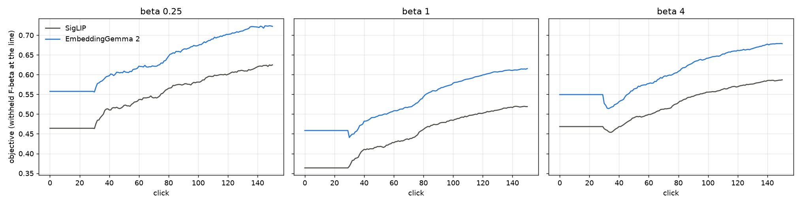
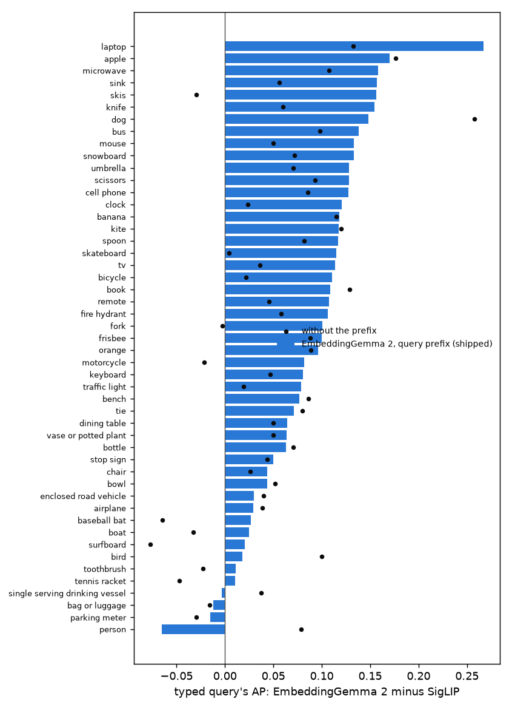
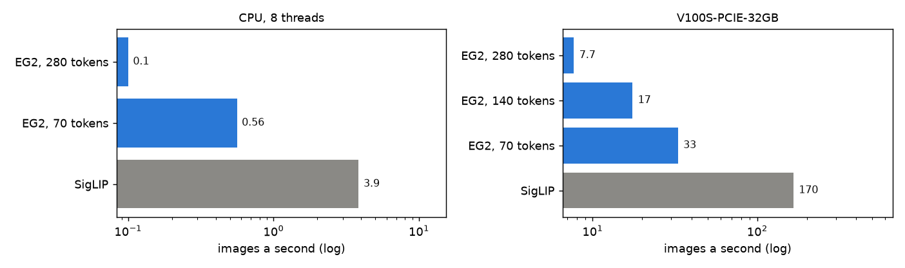
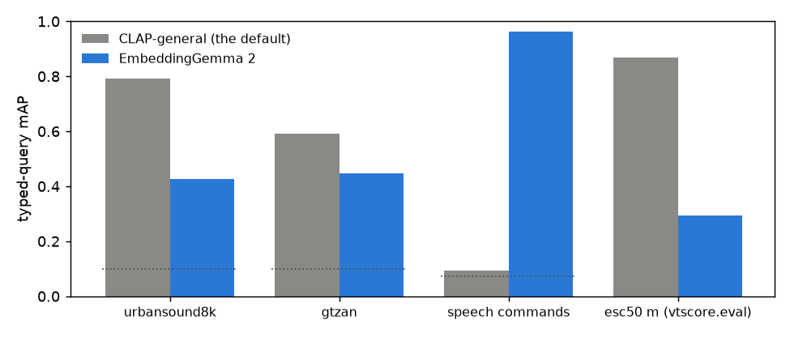

# EmbeddingGemma 2 beats SigLIP on every photo benchmark we run, at 11–38× the embedding time (#4837)

**2026-10-13.** Google's EmbeddingGemma 2 (`google/embeddinggemma-2`, 740M parameters, Apache 2.0) maps text,
images and audio into one 768-d space. #4837 asked for it as a new image **and** audio embedder, a test against
SigLIP on our image benchmarks, and its runtime beside SigLIP's. Both halves ship in this PR as selectable
embedders, `embeddinggemma2` (images) and `embeddinggemma2_audio`; neither is a default.

**On COCO Better's Binary path it wins by about 11 SE at every balance.** Each EmbeddingGemma 2 session is paired
with the SigLIP session of the same class, size band, seed and split (720 pairs a preset, 4,320 sessions). The
session mean (the withheld F-beta at the app's line, averaged over votes 1–150):

| preset | SigLIP | EmbeddingGemma 2 | difference (SE over 49 classes) |
|---|---|---|---|
| β ¼ | 0.55 | 0.64 | **+0.091 ± 0.010** |
| β 1 | 0.45 | 0.53 | **+0.088 ± 0.008** |
| β 4 | 0.52 | 0.60 | **+0.082 ± 0.008** |

It is ahead from the typed query (click 0) to the full-label ceiling, at every click (Figure 1). At β 1, 47 of
49 classes gain; the largest are dog, sink, laptop and microwave (+0.19 each).

**Small and medium targets gain most:** +0.09 to +0.12 a session, against +0.04 to +0.06 on large ones (β 1:
small 0.21 → 0.31, medium 0.42 → 0.54, large 0.69 → 0.75).

**It also leads on the four other image sets `vtscore.eval` has:**
- Visual Genome, multi-label scenes: typed-query mAP 0.54 → 0.58, learned F1 0.33 → 0.37.
- Enrico, app screenshots: typed-query mAP 0.23 → 0.33.
- Caltech-101 and Caltech-256: tied near the ceiling.

**The cost is embedding time.** On the V100S that built SigLIP's pile cell, EmbeddingGemma 2 embedded COCO
Better's 24,504 images in **3,258 s against SigLIP's 288 s (11×)**. With decode taken out of the picture, the
model runs at 7.7 images a second against SigLIP's 166 (22×). On 8 CPU threads it takes **10 s an image, 38×
SigLIP**. A 24k-image collection would take about 68 hours on a laptop-class CPU, against SigLIP's 1.8. Each
image enters the model as 280 vision tokens (2,520 patches); the model card's smaller budgets of 140 and 70
tokens run 2.3× and 4.3× faster, at a quality nobody has measured here yet (#4848). A typed query costs 42 ms
on the GPU (SigLIP 6 ms) and 112 ms on the CPU (SigLIP 144 ms).

**The audio half is a different instrument from CLAP.** On environmental sound and music it loses badly to the
default, CLAP-general:
- ESC-50 typed-query mAP 0.29 against 0.87.
- UrbanSound8K 0.43 against 0.79.
- GTZAN genres 0.45 against 0.59.

On **spoken words** it finds what CLAP cannot: asked for `someone saying "yes"` across 14 Speech Commands words,
it scores mAP **0.96** where CLAP-general is at chance (0.09, chance 0.07). It is a speech-content search, not a
sound search.

**Recommended: ship both as selectable embedders, and do not change either default yet.**
- **The quality gain is real and broad:** about 11 SE at every preset, 47 of 49 classes, every size band, and the
  four other image sets.
- **It cannot run in the app today.** It needs transformers ≥ 5.18, and with the GRID venvs' torch 2.6 that
  release cannot load any Hugging Face model on a host without a GPU (#4838, a venv upgrade under way).
- **The default is the owner's call.** On a CPU-only install every image costs 10 s. Settle that on #4848's
  budget curve rather than on the 280-token cost.

## Figure 1: the objective at every click



The mean over all 720 runs at each click, filled as `by_click.py` fills it: each run shows its own typed query's
set until the app shows its detector at vote 30 (#4736), then the detector's.
- **EmbeddingGemma 2 starts higher.** Its typed query alone, cut at its own line, beats SigLIP's by +0.09 at β ¼
  and β 1 and +0.08 at β 4.
- **The gap holds to vote 150.**
- **Hand-over dip:** at the hand-over (vote 30) EmbeddingGemma 2 dips more than SigLIP at β 1 and β 4
  (0.46 → 0.44, 0.55 → 0.51). Its typed query is strong enough that the young head starts below it. The 30-vote
  hold was tuned on SigLIP; if EmbeddingGemma 2 became the default, the hold length would be worth re-checking.

## The paired sessions, in full

`compare.csv` (all presets), `by_band.csv`, `by_class.csv`; differences are EmbeddingGemma 2 minus SigLIP with
the SE over the 49 classes.

| | β ¼ | β 1 | β 4 |
|---|---|---|---|
| session mean, votes 1–150 | +0.091 ± 0.010 | +0.088 ± 0.008 | +0.082 ± 0.008 |
| session mean, votes 1–50 | +0.091 ± 0.013 | +0.086 ± 0.009 | +0.074 ± 0.009 |
| typed query at its own line (click 0) | 0.46 → 0.56 | 0.36 → 0.46 | 0.47 → 0.55 |
| typed query's AP | 0.42 → 0.50 | same | same |
| final AP | 0.55 → 0.64 | 0.55 → 0.64 | 0.54 → 0.64 |
| full-label ceiling's AP | 0.55 → 0.64 | same | same |
| runs that never trained a detector | 0 / 0 | 0 / 0 | 0 / 0 |

**The ceiling moves as much as the session does (+0.090 AP).** With every label in hand, a head in EmbeddingGemma
2's space ranks the withheld half better than one in SigLIP's. The gain is the space's, not just a better first
sort.

By size band, the session mean at β 1 (the other presets in `by_band.csv` look the same):

| band | SigLIP | EmbeddingGemma 2 | difference |
|---|---|---|---|
| small | 0.21 | 0.31 | +0.091 ± 0.010 |
| medium | 0.42 | 0.54 | +0.113 ± 0.012 |
| large | 0.69 | 0.75 | +0.060 ± 0.007 |

**Where it does not help.**
- **A cup or glass** (single-serving drinking vessel) loses −0.030 at β 1. Its typed query is weaker at the
  small band.
- **Person** loses −0.009 at β 1, though its final AP rises from 0.54 to 0.75. Its typed query collapses under
  the model's search prefix (next section), and the session spends its opening on it.
- **Bottle** is level (+0.001).

## Click 0: the typed query



**Typed-query AP over the 720 cell-seeds: 0.50 against SigLIP's 0.42, +0.085 ± 0.009.**
- 45 of 49 classes gain. Laptop gains most: AP 0.27 → 0.53.
- By band: small 0.16 → 0.23, medium 0.38 → 0.50, large 0.70 → 0.76.
- The query side takes the model card's retrieval prefix, `task: search result | query: <text>`. Without it the
  mean is 0.47, so **the prefix earns +0.035 on average**.
- It is not a gain everywhere. On `a person` the prefixed query scores **0.033** against 0.18 without it and
  SigLIP's 0.098: on large persons, 0.04 against SigLIP's 0.26. Dog would gain more without the prefix; skis and
  motorcycle need it.
- **#4850** asks why `a person` collapses and whether another prompt wins over all classes.

## Runtime



`timing.csv`; `scripts/experiments/embeddinggemma2/timing.py` runs both shipped embedders' `embed_media_bulk` on the same 512 COCO Better JPEGs,
held in memory so neither pays the network read, with the arms interleaved over three repeats (spread under 2%).

| | images/s, V100S | vs SigLIP | images/s, CPU (8 threads) | vs SigLIP |
|---|---|---|---|---|
| SigLIP (batch 128 / 32) | 166 | 1× | 3.9 | 1× |
| EmbeddingGemma 2, 280 tokens (shipped, batch 8) | 7.7 | 22× slower | 0.10 | 38× slower |
| EmbeddingGemma 2, 140 tokens | 17 | 9.5× slower | – | – |
| EmbeddingGemma 2, 70 tokens | 33 | 5.0× slower | 0.56 | 6.9× slower |

- **The whole pile build** (`build_pile.py`, the same node and card for both cells) takes 3,258 s against 288 s.
  SigLIP's build is bound by decode and I/O, not by its model, which is why it is 11× and not 22×.
- **The time is the forward pass.** The image processor runs at 88 images a second.
- **Batch size:** EmbeddingGemma 2's default embed batch is 8, not the shared 32. A batch of 32 peaked at 33 GB
  on a V100 for no throughput a batch of 8 (3.7 GB) does not already reach. `VTSEARCH_EMBED_BATCH_SIZE` still
  overrides it.
- **Precision:** the model runs in fp32 by default, and in bf16 when `VTSEARCH_EMBED_PRECISION` asks for it. It
  never runs in fp16, because the model card warns its activations overflow there. bf16 matches fp32 to cosine
  0.9998, but on a V100 it is slower (4.0 against 6.6 images a second), because the V100 has no bf16 units.
- **Model load:** 4–6 s from a warm cache on either card or CPU.

## The other image sets

`image_evals.csv`; `python -m vtscore.eval --mode both`, one split each (seed 42), each embedder building its own
copy of the demo dataset.

| set | text-sort mAP, SigLIP → EG2 | learned-sort F1, SigLIP → EG2 |
|---|---|---|
| Caltech-101 (m) | 0.990 → 0.997 | 0.946 → 0.959 |
| Caltech-256 (a) | 0.995 → 0.995 | 0.993 → 0.996 |
| Visual Genome (m), multi-label scenes | 0.542 → **0.581** | 0.334 → **0.374** |
| Enrico (m), app screenshots | 0.235 → **0.326** | 0.327 → 0.341 |

These are one split each, with no SE. They agree in direction with the paired sessions, and the domain gains
(scenes, screenshots) are where SigLIP is weakest.

## The audio half



`audio.csv`.
- **The sets:** ESC-50 through `vtscore.eval` (medium, text and learned sort). UrbanSound8K, GTZAN and Speech
  Commands through `scripts/experiments/embeddinggemma2/audio_zeroshot.py`: 30 clips a class, seeded,
  scored by typed-query mAP, zero-shot top-1 and clip-to-clip 1-NN.
- **The baseline:** CLAP-general, the default audio embedder.

| set | typed-query mAP, CLAP-general → EG2 | clip 1-NN, CLAP-general → EG2 |
|---|---|---|
| ESC-50 (environmental) | 0.87 → 0.29 (learned F1 0.74 → 0.23) | – |
| UrbanSound8K (urban) | 0.79 → 0.43 | 0.87 → 0.73 |
| GTZAN (music genre) | 0.59 → 0.45 | 0.82 → 0.56 |
| Speech Commands (14 spoken words) | 0.09 → **0.96** (chance 0.07) | 0.12 → **0.96** |

Gemma's audio encoder comes from a speech model, and it shows. `embeddinggemma2_audio` is the only embedder in
the app that can search a collection by **what is said** in it. That is the reason to ship it, beside CLAP rather
than in its place.

## How it was measured

- **The embedders.**
  - **No separate heads.** The model has no separate image and text heads. Every input runs through the text
    backbone: a typed query, an image's 280 soft tokens between its delimiters, or 25 audio tokens a second.
    The vector is the masked mean of the last hidden state, L2-normalised. That is the checkpoint's own
    sentence-transformers recipe (`Pooling(mean, include_prompt)` → `Normalize`), reproduced on plain
    `transformers`. Against sentence-transformers 6.1 it agrees to cosine **1.0000** on images, audio and
    prefixed queries.
  - **One encoder each.** Each half loads only the encoder it needs: the image half 440M parameters, the audio
    half 570M.
  - **Audio input** is decoded to 16 kHz mono and embedded from its first 30 s, zero-padded to 1 s.
  - **Code:** `vtscore/media/_embeddinggemma2.py`, `vtscore/media/image/embedder_embeddinggemma2.py`,
    `vtscore/media/audio/embedder_embeddinggemma2_audio.py`.
- **The environment.**
  - **Patched transformers overlay:** EmbeddingGemma 2 needs transformers ≥ 5.18. Both arms ran on the app venv
    with transformers 5.19 installed ahead of it (`--target` overlay on `PYTHONPATH`), so the library is not a
    difference between them.
  - **#4838:** with torch 2.6, transformers 5.18+ raises while importing any model on a host with no GPU, which
    includes every cpu-partition cell. The overlay wraps that call in a try/except.
  - **SigLIP is unmoved by the newer transformers.** Its vectors under 5.19 match its pile cell (built under
    5.12.1) to 1 − cos ≤ 1.2e-7, on both GPU and CPU.
- **The grid.**
  - **Layout:** one SotA grid holds both embedders (`SOTA_EMBEDDERS=siglip,embeddinggemma2`,
    `scripts/experiments/state_of_app/eg2_4837.sh`). It has the same 144 cells for both (49 classes × three size
    bands; three classes lack a band), five seeds and the shipped defaults. Each preset ran 1,440 sessions,
    cpu-partition arrays, at commit `a9bd37108`.
  - **Pairing:** each embedder opens on its own typed query and learns in its own space, as the app would run it.
    Every cell's first row records `seed_mode=text` and its own `seed_embedder`. Pairs share a cell, seed and
    split.
  - **Analysis:** `analyze.py --path binary|eg2` and `eg2_compare_4837.py`.
- **The pile cell.** `coco_better__embeddinggemma2.pkl` was built on rack7n04's V100S, the card SigLIP's cell was
  built on, at `ad09f793f`, with transformers 5.19. It holds 24,504 medias at 768-d, and `build_pile.py --verify`
  passes. Re-embedding 256 of its images under #4838's torch 2.14 on the same node matches it to 1 − cos
  ≤ 1.2e-7, with the same top-10 neighbours. That is close but not bit-identical, so a rebuild would carry a new
  fingerprint; the cell stays valid across the venv upgrade.

## Reproduce

```bash
# pile cell (GPU), then the timing (needs transformers >= 5.18 on PYTHONPATH until #4838 lands)
python scripts/experiments/pile/build_pile.py --datasets coco_better --embedders embeddinggemma2
python scripts/experiments/embeddinggemma2/timing.py --n 512 --reps 3 --out timing.jsonl
# the paired grid (from a frozen worktree)
cd scripts/experiments/state_of_app
bash eg2_4837.sh prepare && bash eg2_4837.sh dirs
for b in 0.25 1 4; do bash eg2_4837.sh launch $b; done        # 1,440 sessions a preset
for b in 0.25 1 4; do bash eg2_4837.sh analyze $b; done
python eg2_compare_4837.py --run 0.25=<b025> --run 1=<b1> --run 4=<b4> --out <this dir>
python eg2_figures_4837.py --study <study dir> --grid <grid> --out <this dir>
```

The side measurements' scripts are in `scripts/experiments/embeddinggemma2/`: `timing.py`, `audio_zeroshot.py`
(UrbanSound8K, GTZAN, Speech Commands) and `text_baseline_prefix.py` (the typed query without its prefix). The
raw runs are on the GRID under `state-of-the-app/2026-10-13-eg2-4837-{grid,b025,b1,b4}`, and the timing and eval
outputs under `eg2-4837/`, both in the owner's `/expscratch`.

## Follow-ups

- **#4838:** transformers ≥ 5.18 with torch 2.6 breaks every Hugging Face embedder on a GPU-less host. This
  blocks EmbeddingGemma 2 in the app; the venv upgrade is under way.
- **#4848:** EmbeddingGemma 2 at 140 and 70 vision tokens, paired on this bench. It is the speed/quality curve a
  default decision needs.
- **#4849:** open the Region path on EmbeddingGemma 2's typed query (`embeddinggemma2+dinov3_patch`). The
  typed-query gain alone is +0.085 AP.
- **#4850:** the search prefix and `a person`.
