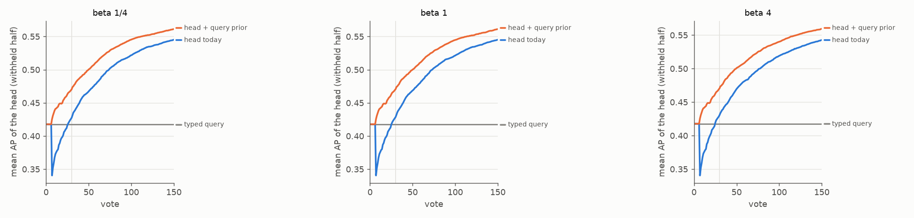
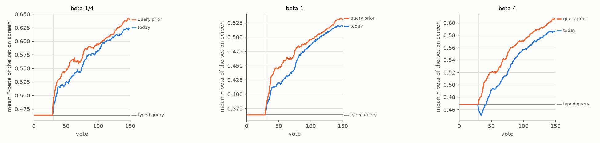
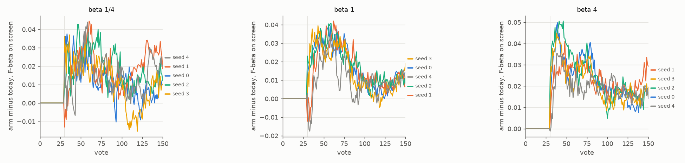
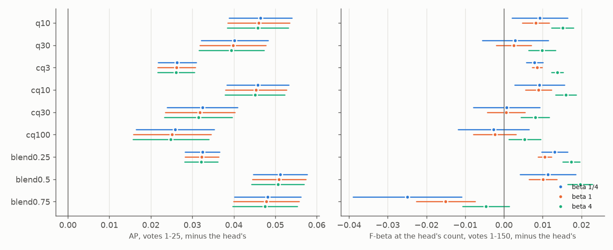

# The first detector's dip, and a head started from the typed query (#4384)

**2026-10-13.** #4384 found that the first trained head ranks worse than the typed query it replaces: on the
2026-09-30 review, mean AP on the withheld half fell from 0.42 (the text sort) to 0.26 at vote 4 and came back
only at vote 43. It asked for four arms. Work since has settled two, and half built a third:

| #4384's arm | where it stands |
|---|---|
| 1. serve the text sort until the head earns it | **shipped**: #4605 found the app already shows the text sort through the opening, and #4736 holds the typed query's set on screen and in Find until 30 labels on the Binary path. "Until the head earns it" was priced twice and never beat the fixed count (#4736's judges, #4816's disagreement judge). |
| 2. blend early | **priced here**: a fixed blend in the shadow, and a blend the head learns (the arm) |
| 3. interleave Bads into the walk | **moot**: the photo opening has had no text walk since #4742 (`g3@top,b4@mid`, Hard from vote 8) |
| 4. warm-start the head from the text direction | **half built**: #4785 starts the head from the Goods' centroid, not from the query. **Priced here.** |

**The dip is still there on today's app, behind the hold.** Today's head has mean AP 0.34 at its first fit
(vote 7) against the typed query's 0.42, and passes it only at vote 25-26 (Figure 1). Its set passes the
query's at vote 27, 29 and 42 at beta ¼, 1 and 4. The hold keeps that head off the screen to 30 labels, but
Autopilot asks the head's Hard questions from vote 8, and from vote 30 the head is all the app has.

**A head started from the typed query does not dip, and the app gains at every preset.** The arm adds the
typed query's own direction as a second cheap feature of the head's SVM, beside the Goods' centroid. At its
first fit it ranks as well as the text sort (AP 0.43), and it stays ahead of today's head at every vote. Its
set passes the query's at vote 8, 11 and 28. Paired per run, 720 runs a preset, SEs clustered on the 48 classes:

| arm (scale 10) minus today | beta ¼ | beta 1 | beta 4 |
|---|---|---|---|
| **the objective, votes 1-150** (the set on screen; area under the curve) | **+0.013 ± 0.004** | **+0.013 ± 0.003** | **+0.018 ± 0.003** |
| the five seeds, votes 1-150 | +0.010 to +0.016 | +0.008 to +0.015 | +0.016 to +0.020 |
| the objective, votes 1-25 / 1-50 / 51-150 | 0 / +0.008 / +0.015 | 0 / +0.009 / +0.015 | 0 / +0.014 / +0.021 |
| the head's set, votes 1-25 (behind the hold) | +0.038 ± 0.006 | +0.036 ± 0.005 | +0.042 ± 0.004 |
| AP of the set on screen, votes 1-150 | +0.020 ± 0.002 | +0.020 ± 0.002 | +0.020 ± 0.002 |
| Goods in hand at vote 25 | -0.9 ± 0.2 (of 7.8) | -1.1 ± 0.2 (of 8.0) | -1.2 ± 0.3 (of 8.1) |
| Goods in hand at vote 150 | -0.6 ± 0.5 (of 29) | -0.8 ± 0.5 (of 29) | -0.4 ± 0.4 (of 28) |

For scale: #4736's hold, the last change to this stretch of the session, was worth +0.004 / +0.006 / +0.009.

*Figure 1. Mean AP on the withheld half of the trained head at every vote it is drawn, against the typed
query's sort (grey); before a run's first head, the typed query's. Blue: today's head, started from the
Goods' centroid. Orange: started from the typed query as well. The grey rule is the hold's 30 labels.*

*Figure 2. The objective: mean F-beta, on the withheld half, of the set the app shows at every vote. Both
arms show the typed query's set until 30 labels (#4736). From there the arm's head is ahead at every vote and
every preset. At beta 4 today's head starts below the query it replaces; the arm's does not.*

## Findings

- **It costs a few Goods early, and fewer late; a smaller scale costs none.** At vote 25 the arm has found
  about one Good fewer (of 8). The loss is in the Hard picks, not the prompted checks: Goods outside the
  checks by vote 50 fall from 7.7 to 5.0 at beta 1, while the checks find 7.5 against 5.2. By vote 150 the gap
  is 0.4-0.8 of 28-29 Goods, under two SEs at each preset. It sits in the large-instance classes (beta 1:
  -2.2 of 40 Goods; small and medium: 0.0 and -0.1). There the arm reaches Done earlier: its head settles
  sooner, and the first Done vote's median moves from 68/71/82 to 56/60/68. **At scale 3** (priced at every
  preset on 2026-10-14, the owner's call before the build):

  | scale 3 | beta ¼ | beta 1 | beta 4 |
  |---|---|---|---|
  | objective 1-150, minus today | +0.010 ± 0.002 | +0.010 ± 0.001 | +0.011 ± 0.001 |
  | the five seeds | +0.008 to +0.014 | +0.009 to +0.011 | +0.009 to +0.014 |
  | Goods at vote 25 / 150, minus today | -0.1 / -0.0 ± 0.2 | -0.2 / -0.1 ± 0.2 | -0.2 / +0.2 ± 0.2 |
  | objective 1-150, minus scale 10 | -0.002 ± 0.003 | -0.002 ± 0.002 | **-0.007 ± 0.002** (every seed) |
  | AP of the set on screen 1-150, minus scale 10 | -0.008 ± 0.002 | -0.008 ± 0.002 | -0.007 ± 0.002 |
  | Goods at vote 150, minus scale 10 | +0.6 ± 0.3 | +0.7 ± 0.4 | +0.6 ± 0.4 |

  So the scale trades ranking for Goods. Scale 3 gains at every preset and loses no Goods. Scale 10 ranks
  better everywhere (AP +0.008), ties scale 3 on the objective at beta ¼ and 1, and beats it at beta 4
  (+0.007), at the price of about 0.6 Goods by vote 150.
- **The hold no longer matters under the arm.** The arm's head over votes 1-25 is as good as the typed
  query's set (0.476 against 0.464 at beta ¼, 0.364 against 0.364 at beta 1, 0.462 against 0.468 at beta 4).
  Re-priced offline (the hold changes no pick), every hold from 0 to 30 labels is within 0.003 of 30 at every
  preset: shortest best at beta ¼ (+0.003 for none), 10-20 at beta 1 (+0.001), 25-30 at beta 4.
- **The query's direction is the prior; the centroid adds nothing beside it.** The shadow refits candidate
  heads on today's own votes (open loop; Figure 4). The query alone (`q10`) and the query beside the centroid
  (`cq10`) rank alike: AP +0.046 over votes 1-25 and +0.021 over 1-150 against today's head, and +0.018 /
  +0.009 on the F-beta of the app's own count, at beta 1. Larger scales hold the head to the query too long
  (F-beta over 1-150: `cq30` +0.001, `cq100` -0.002). A fixed blend of the two scores, half each, ranks a little
  better early (+0.051 AP over 1-25). A blend weighted to the query loses late (`blend0.75` -0.008 AP over
  1-150), because it never lets the labels outvote the query. The learned prior does.
- **It helps most where the typed query is weak.** 42 of 49 classes gain. The largest gains are classes
  whose typed query ranks poorly: chair +0.071 (query AP 0.06), fork +0.047, sink +0.043, a cup or glass
  +0.040, dining table +0.040 (`examples.md`). Three Goods of a chair say less than the word does.
- **Where it loses, COCO Better's size bands are the reason.** Stop sign (-0.030) and traffic light (-0.021)
  lose, and their arm's head is worse even over votes 1-25 (-0.07 and -0.06). The typed query cannot say
  *large*. Of the 100 images "a stop sign" ranks first, 55 are large stop signs and 26 are medium ones: a
  `stop sign@large` cell counts those as negatives. For `stop sign@medium` it is 26 positives and 55 large
  stop signs. For `traffic light@medium`, 18 and 63. The prior holds the head to "any stop sign" while the
  labels try to learn the band. A user who types "a stop sign" wants stop signs, so these losses are the
  bench's, not the user's. Runs to check: `stop sign@medium` seeds 3 and 1 at beta ¼ (-0.20, -0.13, the
  arm's two worst stop-sign runs), `stop sign@large` seed 0 and `traffic light@medium` seed 0 at beta 1
  (-0.10 each). Not explained by the bands: `laptop@large` seed 0 (-0.16 at beta ¼, -0.10 at beta 1).
  The images the query ranks first among the negatives include 369438, 66263 and 327105
  (`stop sign@medium`, negatives for `@large`) and 488403, 184037 and 71850 (`traffic light@large`,
  negatives for `@medium`). For chair, fork and sink the query's top negatives are other classes (86 of
  chair's top 100), so the prior and the labels pull the same way.

*Figure 3. The arm minus today, F-beta of the set on screen, each seed's mean over its 144 runs. Zero until
the hold ends at 30 labels, positive in every seed at beta 4 and in nearly every vote at beta ¼ and 1.*

*Figure 4. The shadow: candidate heads refitted on today's votes, against today's head, with two clustered
SEs, beta 1. Left: AP over votes 1-25. Right: the F-beta of the app's own count (what today's line keeps),
over votes 1-150. `qS`: the query's feature at scale S, no centroid; `cqS`: beside the centroid;
`blendA`: today's head and the query's score, each divided by its spread, A on the query.*

## The arm

**The fit.** The shipped head is a linear SVM fitted on the votes plus one extra feature: ten times each
vector's dot with the unit Goods' centroid (#4785, `vtscore/training/svm_prior.py`). The L2 penalty then
costs 1/100 as much along the centroid as along any other direction, so the head starts at the centroid
and leaves it as far as the labels pay for. The arm adds a second such feature, the dot with the typed
query's unit embedding at scale S, and folds both back into the one `Linear(D, 1)`: `svm_prior.QUERY_PRIOR`,
the eval knob `CALIB_QUERY_PRIOR=S`. Every fit takes it: the picks, the calibration folds, the line and
Test. The query's feature spreads about a third as widely over SigLIP's images as the centroid's (0.022
against 0.061 on COCO Better), so a scale buys less on the query than the same scale on the centroid.

**Single-vector typed-query runs only.** A Region run learns in DINOv3's patch space, where SigLIP's query
has no direction. An example opening and a face crop have no query. The harness refuses the arm on such a
cell.

## What was run

- **Sessions.** COCO Better's Binary opening: SigLIP, the app's `g3@top,b4@mid` opening and #4736's hold.
  144 cells × 5 seeds = 720 runs at each preset (beta ¼, 1 and 4), 150 votes, no ceiling, on the grid #4743
  priced (`2026-10-08-b1`). From frozen `8a61e8e5e` (dev `cb7108dc0` plus the instrument), launcher
  `scripts/experiments/state_of_app/queryprior_4384.sh`:
  - the control, today's app with the shadow on: `state-of-the-app/2026-10-13-qp4384ctl-b{025,1,4}`;
  - the arm at scale 10: `2026-10-13-qp4384arm10-b{025,1,4}`;
  - the arm at scale 3: `2026-10-13-qp4384arm3-b1` (2026-10-13) and `-b025`, `-b4` (2026-10-14, see the venv
    below).
- **The shadow** (`CALIB_QUERY_PRIOR_SHADOW=1`, `vtscore/eval/arms_query_prior.py`) records, at every vote a
  trained head is drawn, where the withheld positives sit under candidate heads refitted on the control's
  own votes (`task_NNNN__queryprior.csv`). It is open loop: the votes are today's, so it prices ranking only.
  AP and the F-beta of any top K follow from the ranks.
- **Scores.** The objective is the F-beta, at the run's beta, of the set the app shows, on the withheld half.
  The single number is its mean over votes 1-150, the area under the curve. Every run is in every average
  (#4631). Differences are paired per run, with SEs clustered on the 48 classes.
- **Analysis**: `scripts/experiments/state_of_app/queryprior_4384.py` (`extract`, `shadow`, `pair`,
  `figures`, `examples`). Tables: `pair.md` (every preset), `pair_s3.md` (scale 3 against today and against scale 10, every preset), `shadow.md`,
  `examples.md`; per class `per_class.csv`.
- **The venv.** Every session of 2026-10-13 ran on torch 2.6.0 and transformers 5.17. The app venv moved to
  torch 2.14.1 and transformers 5.19 overnight (#4838), so scale 3 at beta ¼ and 4 ran on the new one. Before
  pairing it with the old control, 18 cells were re-run on the new venv. The control's six cells at beta ¼
  and at beta 4 were identical click for click and row for row. Scale 3's six at beta 1 picked identically,
  with F-beta, precision, recall and the count kept identical (thresholds within 1e-6, from the query's
  embedding). Only the tagged `pooled_sim_oracle_*` and `pooled_bagfit_*` diagnostics, which no number here
  reads, moved.

**Checks.**
- **The shadow does not touch the session.** Two cells run with the shadow on and off picked identically
  click for click and wrote identical rows.
- **Its candidates are the heads they claim to be.** The shadow's `head` is the run's own head: AP within
  0.0011, and the F-beta at the app's count equal at every vote of all 2,160 runs. Under the arm, the run's
  own head equals the shadow's `cq10` exactly (the smoke).
- **The hold is rebuilt exactly.** The hold at 30, rebuilt offline from the head's rows and the typed
  query's set, equals the rows the app shows in every run of both arms.
- **The typed query's set is the same in both arms**, to the last digit in every run.

## Not done here

- **The build** is #4859: the owner chose scale 10 (2026-10-14). A typed-query detector on its query's
  own single-vector space fits every head from its query too, and the harness's default arm follows.
- **#4384's three pools** (0.44%, 0.1%, 5%): priced at the three presets instead, as every review since
  #4448.
- **The hold** can be revisited once the build lands: under the arm it is worth nothing either way.
