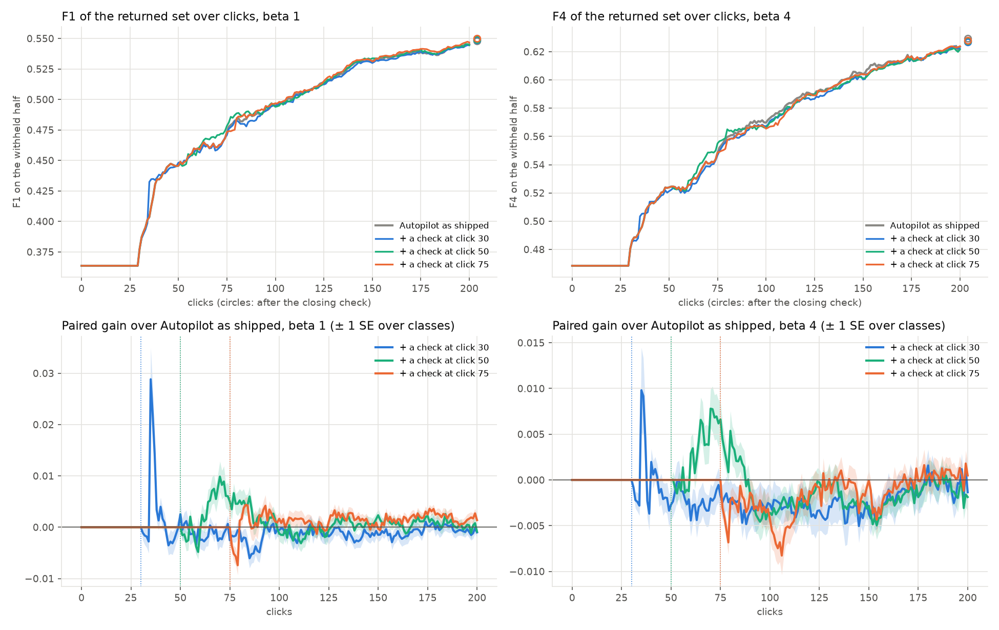

# An early check in every session, priced against Autopilot as shipped (issue #4664)

**Status (2026-10-15): Binary Photo at beta 1 and 4, 5 seeds, priced; nothing to ship.**

**Checking every session at click 30, 50 or 75 does not help.** The session went on to click 200 after the check.
The area under the F-beta curve moved by less than 0.002 in every arm, at both presets:

| paired gain in mean F-beta, per click | clicks 0–50 | 0–150 | 0–200 | after the closing check |
|---|---|---|---|---|
| beta 1, check at 30 | +0.0011 (± 0.0005) | −0.0006 (± 0.0005) | −0.0006 (± 0.0005) | +0.0005 (± 0.0013) |
| beta 1, check at 50 | 0 | +0.0008 (± 0.0004) | +0.0008 (± 0.0003) | +0.0011 (± 0.0016) |
| beta 1, check at 75 | 0 | +0.0005 (± 0.0002) | +0.0008 (± 0.0003) | +0.0021 (± 0.0010) |
| beta 4, check at 30 | +0.0000 (± 0.0004) | −0.0019 (± 0.0010) | −0.0017 (± 0.0008) | −0.0026 (± 0.0018) |
| beta 4, check at 50 | 0 | −0.0002 (± 0.0005) | −0.0006 (± 0.0005) | −0.0018 (± 0.0019) |
| beta 4, check at 75 | 0 | −0.0013 (± 0.0004) | −0.0010 (± 0.0004) | −0.0016 (± 0.0016) |

The skip-if-just-checked variant does no better: every area is within ±0.0004.

**Why it fails: #4482's premise no longer holds on today's app.** #4482 found the check where the user stops worth
+0.052 at click 50, against +0.010 for the same number of further Autopilot clicks. Run the same way on these
sessions (arm c50), the check is worth about what Autopilot's clicks are:

| the check where the user stops, at click 50 | the check | the same number of further Autopilot clicks |
|---|---|---|
| #4482, 2026-10-08 app, beta 1 | +0.052 | +0.010 |
| today, beta 1 (20 picks) | **+0.026** (± 0.004) | +0.022 (± 0.004) |
| today, beta 4 (28 picks) | **+0.039** (± 0.003) | +0.037 (± 0.004) |

Two things changed since #4482:
- **Autopilot's own clicks got better.** At click 50, F1 is 0.45 today against 0.41 then, and 20 further clicks
  add twice as much.
- **The app already checks early.** The opening ends at a median vote of 7. The weak-separation check prompts in
  70–72% of sessions, first at a median vote of 17–18, and that first check runs to a median vote of 42–48. In
  86% of sessions a check was running at vote 50, or had ended in the 25 votes before it.

## The question

#4482 found that the check pays most early: its ~20 uniform band picks at click 50 were worth 5× the same
number of Autopilot clicks. But its check arms stopped at the check. This issue asks whether Autopilot should
check every session early, around click 50, with the session going on after it. It reads the objective at
every click to 200 against Autopilot as shipped, at beta 1 and at beta 4, where the check starts from the top
128 instead of 32. It also asks how the check changes the clicks after it.

## What was run

| | |
|---|---|
| arms | **a0**: today's app (its own checks: weak separation, again after 25 votes while weak, and before Done). **e30 / e50 / e75**: the same, with every session checked at 30 / 50 / 75 votes (`early_check`). **c50**: today's app stopping at click 50, so its closing check is the check where the user stops (#4482's c50) |
| early check | once a run, at the first step from N votes past the opening. A prompted check already running then, or one whose rounds reached vote N, is that session's check (*absorbed*). Otherwise Autopilot prompts one, however recently another ended. Its picks are clicks (phase `prompt`, `check_kind` `early`), and the session goes on after it |
| cooldown variant | skip where a check ended in the last 25 votes, as the check before Done is skipped. It needs no run of its own, because the arm and control are identical until the early check. It is the arm's run where the check started 25+ votes after the control's last check ended, and the control's run elsewhere (`e30c / e50c / e75c` in the tables) |
| pairing | the same cell and seed in every arm. All 4,320 pairs were checked pick by pick, and each departs from the control only at its early check, or never. Every pack ran on AMD nodes: a smoke run with the control on Intel showed float drift flipping a check pick at vote 124 |
| code | dev at b87f991ac plus the arm (cc30eeb65; c50 from 319c16135, launcher only), from frozen worktrees |
| bench | `coco_better`, 144 class@band cells × 5 seeds, SigLIP whole-image (Binary Photo), on the 2026-10-08 grid #4743 priced |
| presets | beta 1 and beta 4 |
| clicks | 200, then the closing check; c50 stops at 50. 7,200 runs (720 per arm and preset), all completed |
| objective | F-beta, at the run's beta, of the withheld half above the line the app shows. Until 30 labels a typed-query detector shows its query's own set (#4736's hold), so every arm's curve is flat to click 30 |

Gains are paired per run, and ± is one SE over classes. "Area" is the trapezoid under F-beta over the clicks
named, divided by their span: the owner's single number for a step.

## Result



*Top: mean F-beta of the returned set over clicks (the circles are after the closing check). Bottom: each arm's
paired gain over a0, with the click it checks at dotted.*

| paired gain over a0 | clicks 51–100 | 101–150 | 151–200 | at the click its check closes |
|---|---|---|---|---|
| beta 1, check at 30 | −0.0016 (± 0.0008) | −0.0013 (± 0.0011) | −0.0007 (± 0.0010) | −0.0013 (± 0.0046) |
| beta 1, check at 50 | +0.0027 (± 0.0008) | −0.0002 (± 0.0008) | +0.0007 (± 0.0007) | +0.0136 (± 0.0036) |
| beta 1, check at 75 | +0.0004 (± 0.0004) | +0.0012 (± 0.0006) | +0.0018 (± 0.0006) | +0.0055 (± 0.0026) |
| beta 4, check at 30 | −0.0025 (± 0.0014) | −0.0031 (± 0.0016) | −0.0012 (± 0.0012) | −0.0095 (± 0.0038) |
| beta 4, check at 50 | +0.0014 (± 0.0010) | −0.0021 (± 0.0009) | −0.0016 (± 0.0011) | +0.0071 (± 0.0035) |
| beta 4, check at 75 | −0.0015 (± 0.0004) | −0.0022 (± 0.0010) | −0.0003 (± 0.0009) | −0.0107 (± 0.0031) |

- **At beta 1 a check at 50 lifts the curve briefly.** The gain is +0.014 where its check closes (click ~72) and
  +0.003 over clicks 51–100. A "0" area over clicks 0–50 is exact: those arms are the control until click 50. By click 100 a0 has caught up.
- **At beta 4 no check helps for long.** Its 30 picks start from the top 128. Where they end, the check at 50 is
  +0.007 and is behind a0 by click 100. At 30 and 75, a0's 30 Autopilot clicks did better (−0.010 and −0.011).
- **The check at 30 spikes at click 35, +0.029 at beta 1.** That is its first round, five picks cast at once
  just after the hold ends: they lift F to where a0 is at click 37. a0 matches it by click 38, and the check's
  next rounds cost a little.
- **Per run** the gains centre on zero, and every seed shows the same shape
  ([per-seed curves and session histogram](figures/early_per_run.webp)). Most sessions that move do so by less
  than ±0.02 over clicks 1–150.

### Where the early check runs

| per session | check at 30 | check at 50 | check at 75 |
|---|---|---|---|
| absorbed: a check running at vote N (beta 1 / 4) | 48% / 49% | 43% / 49% | 29% / 28% |
| fired, a check ended under 25 votes before | – | 43% / 37% | 41% / 40% |
| fired, none in the 25 votes before (the cooldown variant runs only here) | 52% / 51% | 14% / 14% | 30% / 32% |
| its picks (beta 1 / 4) | 22 / 30 | 22 / 31 | 21 / 30 |
| its picks that are Goods (beta 1 / 4) | 36% / 27% | 28% / 22% | 27% / 21% |

At 30 no session had finished a check. The weak check can start from vote 10 and has a median length of 25 votes,
so where it fired it is still running. A check at 50 or 75 fires in more sessions than it reaches unchecked. The sessions that had not
checked recently by vote 50 are mostly the ones still in a long Good opening, and their F at click 50 is 0.06.

Split by that context, the gain over clicks 1–150 is never above +0.002
(`tables/early_splits.csv`).
- **Beta 1:** +0.0018 (± 0.0008) for a check at 50 in sessions that had just checked, and +0.0007 (± 0.0016) in
  the rest.
- **By band:** every arm is within ±0.004, on large, medium and small targets.

### How it changes the clicks after it

| per session, 200 clicks | a0 (beta 1 / 4) | check at 30 | check at 50 | check at 75 |
|---|---|---|---|---|
| clicks spent on checks | 51 / 58 | 52 / 59 | 56 / 68 | 61 / 70 |
| weak-separation check clicks | 42 / 46 | 39 / 41 | 36 / 43 | 38 / 38 |
| the check before Done's clicks | 8.6 / 11 | 1.3 / 2.5 | 7.6 / 9.5 | 8.1 / 11 |
| median click Done is reached | 60 / 68 | 60 / 68 | **75 / 89** | 60 / 68 |
| Goods by click 200 | 30.3 / 29.7 | 30.2 / 29.4 | 30.8 / 30.0 | **32.3 / 31.5** |

- **The early check takes the place of some of the app's own checks.**
  - At 30, nearly all its clicks come out of the check before Done, which is skipped when it falls within 25
    votes of the early check. Net, 1 more click of checking.
  - At 50 and 75, a third to a half come out of later weak checks. Net, 5–12 more clicks.
- **A check at 50 holds Done back** by 15–20 clicks. It is running when the lights would first go green (a0
  reaches Done at a median click of 60–68). The share of runs reaching Done is unchanged, 92–93%.
- **A check at 75 finds about 2 more Goods** by click 200 at both presets. The detector's ranking does not
  change: AP at 200 is within ±0.002 in every arm.

### Examples

The sessions the early check moved most (`tables/early_examples.csv`; class@band, seed):
- **Helped:** `mouse@small` seed 2, beta 1. a0 never prompted a weak check; e50's check at 50–75 found 12 Goods;
  F1 at click 100 is 0.57 against a0's 0.28; +0.06 over clicks 1–150.
- **Hurt:** `sink@small` seed 0, beta 4. a0's weak check came at 53. e30's check at 30–60 found no Goods; F4 at
  click 100 is 0.18 against 0.52; −0.20 over clicks 1–150. The same class at seed 4 is the worst case at 50,
  −0.15. Small, rare targets are where a check's picks are most often all Bads.
- **Both ways:** `book@small` seed 3, beta 4, is +0.10 with a check at 30. `laptop@medium` seed 1, beta 4, is
  −0.10 with a check at 50 (F4 at 100: 0.23 against 0.61). The tails are symmetric, and the mean sits on zero.

## What it means

- **Don't add a check to every session**, at any of these clicks, with or without the cooldown. Today's app
  already checks early in most sessions, and a check's picks are now worth about what Autopilot's are.
- **The check at a stop is not a lever either.** At click 50 the check where the user stops adds +0.026 at
  beta 1, and 20 more Autopilot clicks add +0.022. Offering the check when the user leaves the Train view would
  only matter as a way to get more clicks out of a user who is stopping, and any 20 more clicks would do about
  as well.
- **This prices one commit, b87f991ac.** Dev has since shipped #4864's nearest split rounding (#4904) and moved
  the labels line. Those change sessions, but nothing here suggests they change the check's worth relative to
  Autopilot's picks.

## Reproduce

```bash
# from a frozen worktree at cc30eeb65 (c50: 319c16135), on a compute node, gridenv sourced
S=scripts/experiments/state_of_app/early_check_4664.sh
bash $S dirs
# per arm (a0 e30 e50 e75 c50) and beta (1 4): cpu packs of 8 cells, 1 thread each, pinned to one CPU vendor
SBATCH_CONSTRAINT=amd CALIB_PACK_PAR=8 CALIB_PACK_MEM=12G bash $S cpack e50 1 <cell indices>
python scripts/experiments/state_of_app/early_check_4664.py --root /expscratch/$USER/state-of-the-app \
    --seeds 5 --baseline <text_baseline-count-binary10.csv> --out <dir> --docs docs/experiments/2026-10-14-early-check-4664/tables
```

Run dirs: `/expscratch/sgreenberg/state-of-the-app/2026-10-14-early4664-{a0,e30,e50,e75,c50}-b{1,4}`. The click-0
baseline is #4599's `text_baseline-count-binary10.csv`.
