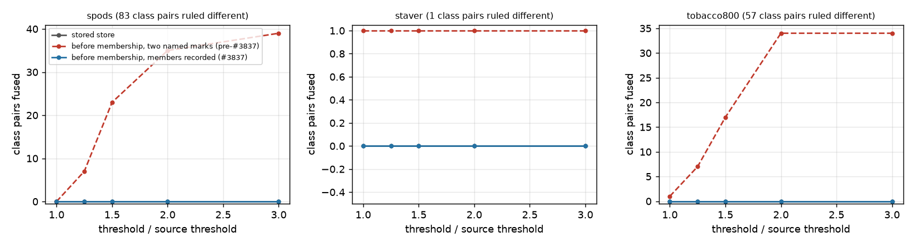
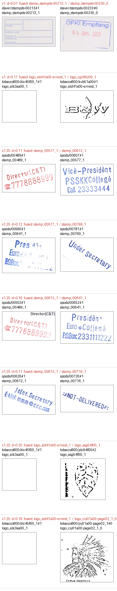

# A FullMarks separation now holds two classes apart, not two marks (#3837)

**Verdict.** On the real corpus (2,880 marks; 141 class pairs ruled different
across SPODS, StaVer and Tobacco800), a separation written the old way leaks.
"The old way" means two named marks, recorded before the membership pass.
Ruled-different classes fuse in a re-cluster: **2 pairs already at today's
thresholds** (StaVer 1/1, Tobacco800 1/57), and **39/83 SPODS and 34/57
Tobacco800 pairs** once the threshold is 2–3× looser. This change makes such
a separation also record both classes' members. With them it holds **all 141
pairs at every threshold tried**.

The live store is not at risk today: it breaches **0** pairs at every scale.
Every class it separates has since been through the membership pass, so each
class is a must-link star and its one named mark carries the whole class. The
new `single_linkage` gives **exactly** dev's partition whenever only pair
constraints exist (30/30 runs on the real distances).

## The defect

A `different` verdict on two classes is stored as one representative mark per
side. `single_linkage` merges in increasing distance order. So if any edge
between the two classes is cheaper than the edges that would first reach the
two representatives, the classes fuse first. The constraint then holds apart
only the two marks it names, while `cluster_report.json` still counts it as
applied.

After the membership pass this is sound: a verified class is recorded as a
must-link star and forms one group before any distance is considered. Before
it, it is not, and the `merge` slate runs before membership by design.

The issue proposed two ways out:

- **Emit the full cross-product.** 900 rows for two 30-instance classes.
  It also breaks `supersede`: a later `same` verdict drops the one row whose
  anchors match and leaves 899 rows contradicting it.
- **Group-level conflict tags.** Seeded on only the two named marks, these are
  *exactly* what the old `forbidden` set already did. Tags only help if every
  member of each class carries one, and before membership nothing on disk
  says who the members are.

## The change

- **`apply_confusable`** writes `left_members` / `right_members` on a
  separation whose class is not membership-verified. These are every
  `[page_id, mark_index]` the class holds at that moment. The row says
  `"pins": "members"`. A verified side writes no members, because its star
  already pins it, and a row with both sides verified still says
  `"pins": "classes"`.
- **`single_linkage`** takes `separations`: sets of rows per side. Each group
  carries, per separation, a bit for each side it holds. A union is refused
  when the two groups together would hold both sides. A `cannot_link` pair is
  the one-row-a-side case, so the old behaviour is a special case of the new.
- **Named marks are hard; recorded members are soft.** A must-link that joins
  the two named marks still refuses the build, as before. A recorded member is
  a presumption about a mark nobody has looked at one by one. Where a later
  human must-link puts it in a group with the other side, the must-link wins
  for that group. Examples are a membership rejection that a completeness pass
  later accepts into the other class, or two presumed members joined by hand.
  Without this rule, every separation written before membership would become
  a build-breaking contradiction the moment a later pass moved one of its
  members.
- **`load_adjudications`** returns such a side as a `Side(anchor, members)`,
  and **`resolve_separations`** turns it into rows. `resolve_pairs` refuses a
  `Side` outright, because reading only its anchor is exactly the bug.

## How it was measured

`scripts/experiments/fullmarks/separation_check.py` forgets every identity,
as a rebuild does. It re-describes every logo and stamp of each clustered
source with the build's descriptor (`phash`), then re-clusters at the source's
own threshold × {1, 1.25, 1.5, 2, 3}, under three versions of the store:

| arm | adjudications replayed |
|---|---|
| `stored` | the live `adjudications.json` |
| `before_named` | the store as it stood before membership: rows noted `membership:` or `completeness:` dropped, every class-level separation naming only its two marks (pre-#3837) |
| `before_members` | the same rows dropped, every class-level separation carrying both classes' members (this change) |

A class-level separation is a row naming both classes, as the confusable and
merge passes write. It is **breached** when any re-clustered group holds a mark
of each of its two classes, with classes taken from today's manifest. The larger
scales stand in for the rebuilds a separation exists to survive: a loosened
threshold, a new descriptor, or new pages that bridge two classes.

The overturned Tobacco800 row (#4866) is skipped in every arm, because without
that skip every Tobacco800 arm refuses to build (see "The live store" below).

## Results

Class pairs fused, out of the pairs ruled different:

| source (pairs) | arm | ×1 | ×1.25 | ×1.5 | ×2 | ×3 |
|---|---|---:|---:|---:|---:|---:|
| SPODS (83) | before, two named marks | 0 | 7 | 23 | 35 | 39 |
| | before, members recorded | 0 | 0 | 0 | 0 | 0 |
| | stored | 0 | 0 | 0 | 0 | 0 |
| StaVer (1) | before, two named marks | 1 | 1 | 1 | 1 | 1 |
| | before, members recorded | 0 | 0 | 0 | 0 | 0 |
| | stored | 0 | 0 | 0 | 0 | 0 |
| Tobacco800 (57) | before, two named marks | 1 | 7 | 17 | 34 | 34 |
| | before, members recorded | 0 | 0 | 0 | 0 | 0 |
| | stored | 0 | 0 | 0 | 0 | 0 |



*Read each panel as one source. The red dashed line is the pre-#3837 form, the
blue line is this change, and the grey `stored` line sits under the blue at 0.
The x axis is the threshold relative to the source's own, not an absolute
distance, so the panels do not share a scale. A breach counts a pair once,
whether one mark wandered across or both classes merged whole (the
`*_in_group` columns of `breaches.csv` say which).*

Holding the classes apart costs almost no structure. At SPODS ×1.25 the
members arm has 484 groups to the named-marks arm's 479. Its largest group is
126 marks against 154, the difference being the classes the old form fused.

## What fused, literally



*Each row is one bridging edge: the two crops whose closeness first connected
the two classes named in red, at the smallest scale where it happens. A
bridge's own crops can belong to a third class, because single linkage chains.*

- **StaVer, at today's threshold:** `stampds-00213#1` (a form stamp, "Projekt /
  Anmerkung…") and `stampds-00232#0` ("DFKI Empfang 04. Jan. 2011") sit at
  **0.0078**, two bits of 256. They are plainly different marks, so the label
  is right. The descriptor cannot see faint, rectangular stamps, and the
  separation is the only thing keeping 18/20 and 7/8 of the two classes apart.
- **Tobacco800, at today's threshold and at ×1.25:** every breach runs through
  `tobacco800/dic45f00_1#1`. That is a `logo_alk3aa00_1` box whose crop is
  **entirely white** (every pixel 255). It is the only blank crop among all
  2,880 marks. A blank crop hashes like every faint one, so it bridges
  unrelated logos. It also accounts for 13/17 Tobacco800 breaches at ×1.5 and
  19/34 at ×2. Its class is not on the roster, so no evaluated label depends on
  it, but it is a hub in every Tobacco800 re-cluster.
- **SPODS, at ×1.25:** five blue/red stamp classes fall into one 154-mark group
  through four edges at 0.10–0.13. These are `stamp_00577_1`, `00612_1`,
  `00641_1` (27–29 of 32 each), `00716_1` and `00769_1` (one mark each). Each
  pair in the sheet is two visibly different stamps. These are not label
  errors; the 256-bit hash stops separating busy round stamps just past 0.10,
  which the README's sweep already shows.

## The live store

- **A Tobacco800 rebuild refuses today**, in every arm, with "rows 4 and 28 are
  adjudicated both same and different". The store still holds the 2026-09-13
  separation of `logo_afm90c00-first_1_0` / `logo_bad45f00_1` next to the
  owner's 2026-09-14 merge that overturned it. The merge was written with a
  bare page id, so `supersede` never matched the two. Filed as #4866; SPODS
  and StaVer replay clean.
- **43 rows say `"pins": "marks"`**, the pre-#3837 kind. All 43 now have both
  classes membership-verified, so in practice they pin classes. The `stored`
  arm's zero breaches is that fact, measured.
- No row in the live store carries members yet. The soft-member rule is
  exercised by the tests, not by this run.

## What this does not show

- The `before_members` arm records **today's** memberships, which have been
  verified. A real snapshot taken at the merge slate would carry whatever the
  clustering proposed then, strays included. The soft rule handles a stray a
  later pass moves; a stray nobody moves stays held on its recorded side.
- `phash` only. `siglip` was not run, though a descriptor change is one of the
  rebuilds this guards against.
- A breach is a count of class pairs, not of mislabelled marks. One wandering
  `logo_cgr96c00_1` mark is the whole Tobacco800 breach at ×1.

## Reproduce

```bash
python scripts/experiments/fullmarks/separation_check.py \
    --out /expscratch/sgreenberg/fullmarks/separation-check-3837 \
    --skip-pair 'tobacco800/afm90c00-first_1#0,tobacco800/bad45f00#1'
```

About 5 minutes on 4 CPUs, most of it hashing crops (cached under `--cache`).
Run off dev `d3df2d38b` plus this change, against the live corpus as of
2026-10-14 (v5.0 roster). `separations.csv` and `breaches.csv` here are that
run's output, and both figures are drawn from them by the same script.
