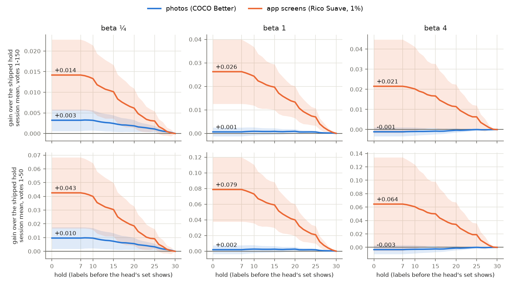
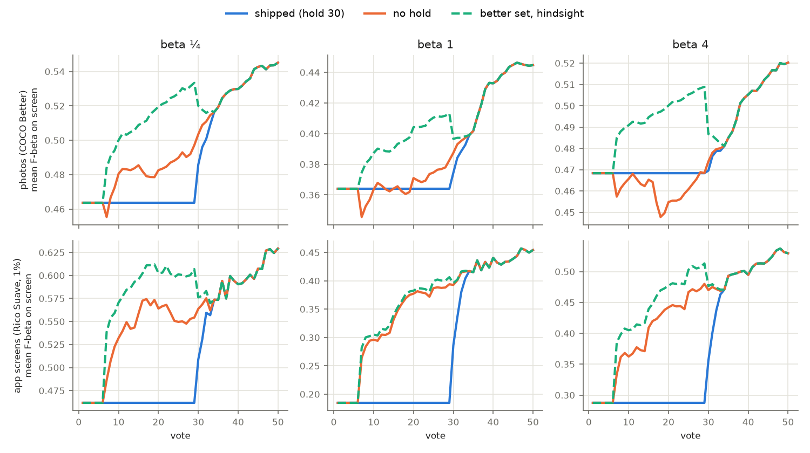
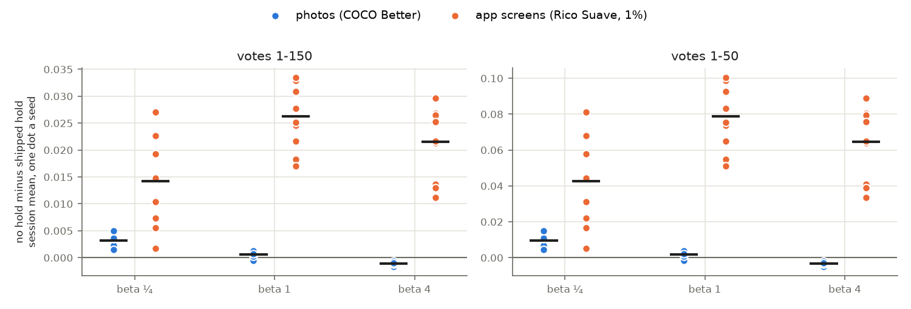

# The typed query's hold is now worth nothing on photos and costs app screens (#4876)

**2026-10-14.** #4736 shipped a hold: on a single-vector space (the Binary path), a typed-query detector keeps
giving its query's own set past the label quota until its labels number 30. It was priced on COCO Better photos
before #4859's typed-query prior, where it was worth +0.004 / +0.006 / +0.009 over votes 1-150 (beta ¼ / 1 / 4).
Two reads since said the trade had moved: about zero on photos (#4853), and a cost on Rico Suave's app screens
(#4875). This study prices it again on one build (today's dev), at every count from 0 to 30, on both.

**Answer: drop the hold.** On photos every count from 0 to 30 lands within 0.003 of every other. Over votes 1-150,
no hold minus the shipped hold is **+0.003 / +0.001 / −0.001**. On app screens the best count is 0 at every
preset, and no hold beats the shipped hold by **+0.014 / +0.026 / +0.021** over votes 1-150 and by +0.043 / +0.079 /
+0.064 over votes 1-50, in every seed. The issue's rule was "if off wins or ties on photos and wins on screens,
drop the hold", and that is what happened. The −0.001 at beta 4 on photos is the one cell that leans the other
way. It is a twentieth of what the hold costs screens at that preset, and its SE (clustered on the class) covers
zero.

No hold minus the shipped hold (30 labels), session mean, mean ± SE clustered on the class (48 photo classes,
11 screen classes). Positive means dropping the hold helps.

| | beta ¼ | beta 1 | beta 4 |
|---|---|---|---|
| **photos, votes 1-150** (720 sessions a preset) | **+0.003 ± 0.001** | **+0.001 ± 0.001** | **−0.001 ± 0.001** |
| photos, votes 1-50 | +0.010 ± 0.004 | +0.002 ± 0.003 | −0.003 ± 0.003 |
| photos, votes 1-25 | +0.013 ± 0.006 | +0.000 ± 0.004 | −0.007 ± 0.005 |
| photos, the five seeds, votes 1-150 | +0.002 to +0.005 | −0.001 to +0.001 | −0.002 to −0.001 |
| photos, the best count and its gain over 30 (1-150) | 8, +0.003 | 20, +0.001 | 25, +0.000 |
| **app screens at 1%, votes 1-150** (110 sessions a preset) | **+0.014 ± 0.004** | **+0.026 ± 0.007** | **+0.021 ± 0.012** |
| app screens at 1%, votes 1-50 | +0.043 ± 0.013 | +0.079 ± 0.021 | +0.064 ± 0.035 |
| app screens at 1%, the ten seeds, votes 1-150 | +0.002 to +0.027 | +0.017 to +0.034 | +0.011 to +0.030 |
| app screens at 1%, sessions better / tied / worse with no hold (1-50) | 65% / 11% / 25% | 77% / 11% / 12% | 66% / 8% / 25% |

*Figure 1. The session mean at each hold count minus the shipped hold (30 labels), with two clustered SEs shaded.
Top: votes 1-150. Bottom: votes 1-50. Blue: photos (COCO Better, Binary). Orange: app screens (Rico Suave at a
common 1% prevalence). A count of 7 or less is the same as 0, because the hold starts at the label quota (3 Goods
and 4 Bads). Every count lies within 0.003 of every other on photos. On screens every label held costs.*

*Figure 2. Mean F-beta of the set on screen at votes 1-50. Blue: the shipped hold, flat at the typed query's set
until about vote 30. Orange: no hold, the head's set from the quota. Green, dashed: whichever of the two is better
in that session at that vote, chosen with hindsight. Top: photos. With #4859's prior the head's set now passes the
query's at vote 8 at beta ¼, vote 11 at beta 1 (it stays ahead from vote 20) and vote 28 at beta 4.
Bottom: app screens. The head's set beats the typed query's from the
quota on.*

*Figure 3. The gain from dropping the hold, one dot a seed (5 for photos, 10 for screens), with the mean as a black
bar. Every photo seed lies within ±0.005 over votes 1-150. Every screen seed gains.*

## Why the two datasets disagree

**Photos.** #4736 was priced when the head's set passed the typed query's around votes 27 / 28 / 45. #4859's prior
(the typed query's direction as the SVM's starting point, scale 10) made the early head much better: it now
passes the query at votes 8 / 11 / 28, and at beta 1 stays ahead from vote 20 (Figure 2, top). At beta ¼ the head's set is the better one
almost from the quota, so the hold only costs (+0.003 for dropping it). At beta 1 the two sets trade places
until about vote 20, and the hold's gains and losses net to +0.001. At beta 4 the head still trails until about
vote 28, so the hold still earns over votes 1-25 (+0.007 for keeping it). Spread over votes 1-150, that is
0.001.

**App screens.** The typed query is weak on screens: its F-beta at vote 1 is 0.18 against 0.36 on photos (beta 1).
The head passes it at the quota itself (Figure 2, bottom), so every vote held shows the worse set. By class at beta
1 over votes 1-50, dropping the hold gains: settings +0.24, cart +0.13, chat +0.12, search +0.09, map +0.09. Only
browser loses (−0.008), and browser fails even at the full-label ceiling (#4875).

## Literal examples

Sessions are named by preset, class and seed (the cell file is `task_NNNN.csv` in the run directories below). The
gain is over votes 1-50.

| run | typed query's F-beta | shipped hold | no hold | what happens |
|---|---|---|---|---|
| photos, beta ¼, person@large, seed 2 | 0.00 | 0.38 | 0.72 | The query's display line keeps one image, and it is not a large person (precision 0). The head at vote 8 returns three, all right. |
| photos, beta 1, person@large, seed 3 | 0.07 | 0.33 | 0.55 | The same class at beta 1: the hold keeps a nearly empty set until vote 30. |
| photos, beta 1, stop sign@large, seed 2 | 0.32 | 0.56 | 0.72 | |
| photos, beta 1, surfboard@medium, seed 1 | 0.81 | 0.77 | 0.61 | The query is strong and the 7-label head is not. This is the case the hold was built for. |
| photos, beta 1, tennis racket@medium, seed 2 | 0.81 | 0.78 | 0.65 | |
| photos, beta 4, keyboard@medium, seed 2 | 0.61 | 0.50 | 0.33 | |
| screens, beta 1, settings, seed 7 | 0.22 | 0.43 | 0.70 | |
| screens, beta 4, settings, seed 1 | 0.00 | 0.36 | 0.82 | The query's beta-4 line returns nothing on settings. |
| screens, beta 1, player, seed 9 | 0.44 | 0.47 | 0.42 | The worst screen session for dropping the hold at beta 1. |

Across photo classes, the typed query's own F-beta correlates only weakly with the gain from dropping the hold
(−0.3 / −0.3 / 0.0). That is the closest thing to a signal here, and the app cannot see it anyway: it needs the
withheld truth.

## Is there a signal the app could use instead?

Not one worth building. The table below bounds any judge with hindsight, as the gain over the shipped hold over
votes 1-150 on photos:

| | beta ¼ | beta 1 | beta 4 |
|---|---|---|---|
| no hold | +0.003 | +0.001 | −0.001 |
| the better of hold and no hold, chosen per session | +0.007 | +0.004 | +0.004 |
| the better set at every vote | +0.008 | +0.005 | +0.005 |

A per-session judge could add at most +0.004 / +0.003 / +0.005 over simply dropping the hold, and only with
perfect foresight. Every judge priced so far landed nowhere near that. #4736 tried the votes judge, d' and the
Goods count, and #4816 tried set disagreement; none of them beat a fixed count. On screens, no hold already takes
0.026 of the 0.028 that the per-vote bound allows (beta 1). No follow-up is filed.

## Natural prevalence on screens (a side read)

At each class's natural share of the pool (1% for cart up to 36% for settings), no hold minus hold is +0.031 /
+0.032 / +0.005 over votes 1-150. The exception is beta 4, where login loses 0.37 and sign-up 0.31 over votes 1-50.
Those classes are 20% and 8% of the pool, and at beta 4 returning nearly everything scores well, which the typed
query's broad set does. At the common 1% the same two classes move −0.012 and −0.064. This is the prevalence
artifact #4875 described, not a reason to hold.

## What was run

**The price is exact offline, and one session set prices every count.** The hold changes what Find returns,
never what Autopilot asks. The harness trains the head and picks with it at every vote, held or not. A held click
writes the typed query's set as its untagged row and keeps the head's own row tagged `hold:head`
(`QUERY_HOLD_HEAD_TAG`, `voting_iterations.py`). The weak-separation check reads the head's line either way:
`details["find_line"]` in the harness, and `heldRanking` in the app's sort runner, the head's ranking kept behind
the text sort. So hold *h* is the shipped session with the head's row shown at every vote whose labels number *h*
or more. The issue expected a check inside the hold to need a run; it does not, and the runs below show it.

- **Photos:** #4874's SigLIP arm, `state-of-the-app/2026-10-14-s2l-4874-b{025,1,4}` (cells 0-143 of each seed's
  288). That is 144 cells × 5 seeds, 150 votes, and the shipped hold, run from `e8bdf3e14`, which carries #4859.
  Dev has changed since in two ways. #4356's grouped split (`_split_media_ids`) is draw-for-draw the same for a
  dataset with no `split_group`. #4864's `_split_train_counts` refactor draws the same counts in the same order.
  83 sessions a preset never hold. At beta 1, 65 of them first train at 30 labels or later, and 18 never
  train by vote 150.
- **App screens:** #4356's runs at a common 1% prevalence, `rico-suave/runs/2026-10-14-p001-b{025,1,4}`. That is
  11 classes × 10 seeds, split by app, from `1c430aeec` (with #4859). The natural-prevalence side read is
  `2026-10-14-b{025,1,4}`, from the same commit.
- **Analyzer:** `scripts/experiments/state_of_app/hold_4876.py`. `extract` builds every count's curve per
  session, and `price` gives the tables, with SEs clustered on the class (the bands and seeds of a class share a
  cluster). `figures` draws the three figures, and `check` compares a run at another hold with the offline price.
  The full tables are in `measurements/summary.md` and `measurements/holds.csv`.
- **Invariants the price rests on**, checked on every session: one `hold:head` row a held vote, none at 30 labels
  or more, and every one matched to a shown row (0 violations in 2,820 sessions).

## Checks

- **Screens, hold 0 run against the offline price:** #4875's `CALIB_QUERY_HOLD=0` runs
  (`rico-suave/runs/2026-10-14-p001-hold0-b*`, 330 sessions) picked the same images as the shipped runs, click for
  click, in 330 of 330 sessions. Their curves equal the offline price at hold 0 to within 3 × 10⁻⁶, which is CSV
  rounding.
- **Today's dev at other holds (queued):** photo cells from #4874's grid (seeds 1 and 3, every fourth SigLIP cell,
  72 a preset) at `CALIB_QUERY_HOLD=0` and `15` (`state-of-the-app/2026-10-14-hold4876-h{0,15}-b*`), and every Rico
  Suave session at 15 (`rico-suave/runs/2026-10-14-p001-hold15-b*`), from the frozen dev tree `564ba13de`
  (`hold_4876.sh`). Each must pick what the shipped session picked and show what the offline price says
  (`hold_4876.py check`). *Pending: the arrays queue behind #4878's in the CPU cap; the result lands in
  this PR.*

## Recommendation

Set the hold to 0, which hands over to the head's set at the label quota as before #4736. That gains +0.003 /
+0.001 / −0.001 on photos and +0.014 / +0.026 / +0.021 on app screens over votes 1-150. The build is a separate
change: `label_quota.QUERY_HOLD_LABELS`, the server's `query_hold` mark on the learned sort, the sort runner's
`heldRanking`, and the docs that describe the hold.
