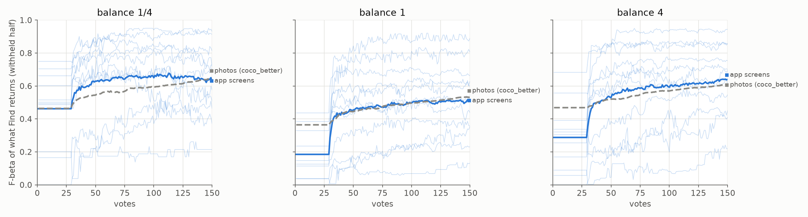
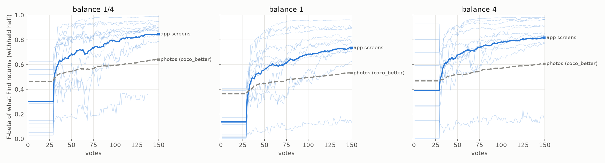

# On app screens, votes work as well as on photos; the typed query is what is weaker, and holding it for 30 labels costs (#4356)

**2026-10-14.** The first run of the born-digital benchmark's genre track, **Rico Suave v0**: Android
app screens by what the screen is for (settings, login, map, chat...). Each session is one class.
It opens on the class's typed text sort, votes through Autopilot for 150 votes, and is scored on what
Find returns from the withheld half, split by app so an app's screens are never on both sides. The
sessions run the State of the App's pins at the three balance presets, with 11 classes and 10 seeds.
They are read against the latest `coco_better` Binary Photo sessions by the same code.

**Votes work on app screens.** At a common 1% prevalence (the fair comparison, below), the pooled
session mean F-beta is **0.61 / 0.42 / 0.52** at balance 1/4, 1 and 4, against photos'
**0.56 / 0.46 / 0.54**. From vote 30 on, the two curves lie on top of each other (Figure 1). By vote
150 the app's detector ranks the withheld half at AP **0.61**, against **0.63** for the full-label
ceiling. Clicks get the app almost all the way to what labelling every screen would.

**The typed query is the weak part.** At vote 1, before any vote, the typed query's own line scores
F-beta **0.18** at balance 1 on screens, against **0.36** on photos. The text tower places
"a map screen" or "a media player screen" reasonably (0.44, 0.38). It barely places the genres whose
look is mostly text and form fields: "an onboarding or tutorial screen" scores 0.00, "a sign-up
screen" 0.04, "a login screen" 0.13.

**So the app's hold on the typed query costs here.** Since #4736, Find keeps showing the typed
query's set until 30 labels. On photos that was a small gain, and with today's head start (#4384,
#4859) it is neutral (−0.002 over votes 1–50 at balance 1). On screens, the head is better than the
query long before 30 labels. Holding the query costs **0.079** F-beta over votes 1–50 at
balance 1 (0.026 over 1–150). A run with the hold off measured this session for session, and 77% of
sessions do better without it.



*Figure 1. Mean F-beta of what Find returns on the withheld half at every vote, at each balance
preset, every class thinned to 1% prevalence. Thick blue: the 11 Rico Suave classes pooled (110
sessions per preset). Faint blue: each class alone. Grey dashed: `coco_better` Binary Photo (720
sessions per preset). The flat stretch to vote 30 is the typed query's hold.*

## What Rico Suave v0 is

- **The pool.** Rico's original release has 66,261 screens, each with its view hierarchy. A screen
  is a positive for one of the owner's 12 classes when two signals agree. The first is the
  developer's Activity name (`LoginActivity`). The second is at least 2 of its ~5 Screen2Words crowd
  summaries. Nothing else is in the pool, so a negative is always another class's agreed screen.
  After byte-identical copies collapse, that is **3,141 screens**: settings 1,157, login 633,
  onboarding 353, sign-up 247, map 191, search 176, chat 122, gallery 94, player 85, browser 48,
  cart 33 and splash 2. Splash stays in the pool but is not run as a target.
- **Multi-label screens are not negatives.** 369 screens' captions also say a second class, mostly
  login/sign-up, map/search and login/onboarding. They are not scored for that second class.
- **Split by app.** Each screen's split group is the union of the app Rico was exploring and the app
  in the foreground. That catches the system browser or gallery opened from another app. There are
  1,944 groups and the largest holds 148 screens. `_split_media_ids` keeps a group whole; it is a
  property of the dataset, and other datasets split exactly as before.
- **v0 is the agreed set only.** The screens where the two signals disagree are in the owner's
  review queues, one per class. The queues hold 3,285 screens, counting 20 hidden agreed controls per
  class, and 79 have votes so far, all in browser's queue; Iconic's 377 sheets have 15. A class's
  reviewed screens join when its whole queue is answered. Votes arrive in the app's ranked order,
  so a part-answered queue is its easy end.

## The numbers

Every run is scored at every vote. The session mean is the mean of F-beta over votes 1–150, the
owner's single number (#4668), and the short session is votes 1–50. "Return everything" is the
F-beta of returning the whole withheld half, the floor a detector has to clear. The full-label
ceiling's rows carry AP only.

### At a common 1% prevalence

`CALIB_TARGET_PREVALENCE=0.01` thins each class's positives to 1% of its cell before the split,
which leaves 8–17 withheld positives per session. Photos run at 0.4%.

| preset | | session mean (1–150) | short (1–50) | at vote 1 | at 150 | AP at 150 | ceiling AP | return everything |
|---|---|---|---|---|---|---|---|---|
| 1/4 | app screens | 0.61 | 0.52 | 0.46 | 0.63 | 0.61 | 0.63 | 0.01 |
| 1/4 | photos | 0.56 | 0.49 | 0.46 | 0.64 | 0.56 | — | 0.00 |
| 1 | app screens | 0.42 | 0.28 | 0.18 | 0.51 | 0.61 | 0.63 | 0.02 |
| 1 | photos | 0.46 | 0.39 | 0.36 | 0.53 | 0.56 | — | 0.01 |
| 4 | app screens | 0.52 | 0.37 | 0.29 | 0.64 | 0.60 | 0.63 | 0.14 |
| 4 | photos | 0.54 | 0.48 | 0.47 | 0.61 | 0.56 | — | 0.07 |

Per class at balance 1, sorted by session mean:

| class | at vote 1 (typed query) | session mean (1–150) | at 150 | AP at 150 | ceiling AP | withheld positives |
|---|---|---|---|---|---|---|
| cart | 0.15 | 0.71 | 0.89 | 0.93 | 0.95 | 17 |
| settings | 0.23 | 0.67 | 0.81 | 0.91 | 0.90 | 8 |
| map | 0.44 | 0.64 | 0.66 | 0.82 | 0.82 | 16 |
| player | 0.38 | 0.56 | 0.63 | 0.70 | 0.71 | 15 |
| chat | 0.11 | 0.48 | 0.60 | 0.71 | 0.71 | 15 |
| gallery | 0.33 | 0.46 | 0.52 | 0.64 | 0.64 | 13 |
| search | 0.19 | 0.41 | 0.44 | 0.60 | 0.63 | 14 |
| login | 0.13 | 0.31 | 0.36 | 0.48 | 0.48 | 12 |
| sign-up | 0.04 | 0.18 | 0.35 | 0.37 | 0.43 | 14 |
| onboarding | 0.00 | 0.16 | 0.23 | 0.29 | 0.32 | 12 |
| browser | 0.04 | 0.07 | 0.13 | 0.26 | 0.30 | 15 |

Two groups of classes stand out:

- **Browser fails even with every label.** Its ceiling is AP 0.30. An in-app browser screen shows an
  arbitrary web page, and the browser chrome is a thin strip, so the class is not visual. 37 of its
  48 screens are the one system browser.
- **Login, sign-up and onboarding confuse one another.** Their ceilings are 0.48, 0.43 and 0.32.
  These are the classes whose captions most often say a second one: a welcome screen with sign-in
  buttons is all three. Their disagreements are owed a human, and the review queues hold them.

### At the pool's own prevalence

Unthinned, a class's share of the pool runs from 1.1% (cart) to 36% (settings). That makes F-beta
easier, so these numbers are not comparable with photos, which run at 0.4%.

| preset | session mean (1–150) | at vote 1 | at 150 | AP at 150 | ceiling AP | return everything | photos' session mean |
|---|---|---|---|---|---|---|---|
| 1/4 | 0.67 | 0.30 | 0.85 | 0.84 | 0.86 | 0.10 | 0.56 |
| 1 | 0.54 | 0.14 | 0.73 | 0.84 | 0.86 | 0.15 | 0.46 |
| 4 | 0.67 | 0.39 | 0.82 | 0.83 | 0.86 | 0.49 | 0.54 |

At balance 4, returning everything beats the app for settings (0.91 against 0.74), login (0.82
against 0.79) and onboarding (0.69 against 0.51). A third of the pool is settings, so a line that
returns a few hundred screens is still too tight for a recall-weighted balance. Settings ranks at AP
0.995 here: an agreed settings screen is a prototypical one, and the hard ones are in the review
queue.



*Figure 2. As Figure 1, unthinned: each class at its own share of the pool (1.1%–36%), against
photos at 0.4%.*

## The typed query's hold

The hold changes what Find shows, never what Autopilot picks. So it can be priced two ways. Offline,
the head's own rows at the held votes (tagged `hold:head`) are swapped in. Or a run sets
`CALIB_QUERY_HOLD=0`. On these 330 sessions the two agree to 2×10⁻⁷, so the hold changed no pick
here. The weak-separation check reads the held ranking, so a session where it did would differ.

Showing the trained head from the label quota, minus the app, at 1% prevalence, paired session for
session:

| preset | app (1–50) | no hold − app (1–50) | no hold − app (1–150) | sessions better / same / worse |
|---|---|---|---|---|
| 1/4 | 0.52 | +0.043 ± 0.009 | +0.014 ± 0.003 | 64% / 12% / 25% |
| 1 | 0.28 | **+0.079 ± 0.008** | **+0.026 ± 0.003** | 77% / 11% / 12% |
| 4 | 0.37 | +0.064 ± 0.012 | +0.021 ± 0.004 | 66% / 8% / 25% |

Per class at balance 1, over votes 1–50, the gain is largest where the head overtakes the query
early. It is +0.24 for settings, +0.13 for cart, +0.12 for chat, and +0.09 for both search and map.
It is smallest for gallery and sign-up (+0.02), and browser loses 0.008: no head does well there, so
neither does showing one sooner. At each class's own prevalence, priced offline, the gain is +0.094,
+0.097 and +0.014 over votes 1–50.

**On photos, the same price is about zero today.** On the `coco_better` sessions above it is +0.010,
+0.002 and −0.003 over votes 1–50 at the three presets. #4736 chose the hold on photos at
+0.026/+0.037/+0.050 over votes 1–25, before #4384's head prior removed the early head's dip. With the
prior shipped, the hold buys photos at most 0.01 and costs app screens 0.04–0.08 over the first 50
votes. The photo sessions predate #4859's typed-query head start, so the two prices are from
neighbouring builds. Re-pricing the hold on one build is a follow-up for the hold itself, not for
this benchmark.

## Caveats

- **v0 is the agreed set.** Both signals vouch for every screen, which selects prototypical screens.
  The disagreements, presumably the harder ones, join after review, and the numbers will move. The
  20 hidden controls per class measure the agreed set's precision. Browser's are 13 Good of 15 so
  far, and they were voted in text-sort order, so that is not a random sample.
- **The photo reference is the 2026-10-13 build.** It is `coco_better` Binary Photo with #4384's
  head prior at scale 10 (`state-of-the-app/2026-10-13-qp4384arm10-b*`, 5 seeds), the nearest run to
  today's app. #4859's typed-query head start came after it. Rico Suave ran on today's dev
  (d3df2d38b, which has #4859, plus this branch).
- **1% leaves few positives.** At 8–17 withheld positives a session, a single class's numbers are
  noisy; the pooled ones average 110 sessions.
- **One embedder.** Only SigLIP was built and run, as on Binary Photo.

## Reproduce

```bash
# the cell (V100, ~5 min)
VTS_BUILD_ARGS="--embedders siglip" bash scripts/experiments/pile/launch_pile.sh rico_suave
# the sessions, per preset (110 cells, ~2.5 min each)
RICO_BETA=1 bash scripts/experiments/rico_suave/launch.sh prepare
RICO_BETA=1 bash scripts/experiments/rico_suave/launch.sh cells
RICO_PREVALENCE=0.01 RICO_BETA=1 bash scripts/experiments/rico_suave/launch.sh prepare   # then cells
RICO_PREVALENCE=0.01 RICO_QUERY_HOLD=0 RICO_BETA=1 bash scripts/experiments/rico_suave/launch.sh cells  # grid symlinked
# the read
python scripts/experiments/rico_suave/analyze.py --run b1=<run> ... --ref b1=<state-of-the-app run> ... --out <dir>
python scripts/experiments/rico_suave/figures.py --curves <dir>/curves.csv --out <dir>
python scripts/experiments/rico_suave/pair.py --control <ctl>/runs.csv --arm <arm>/runs.csv --label "no hold" --out <dir>
```

Run directories are under `/expscratch/sgreenberg/rico-suave/runs/2026-10-14-*`. The tables above
are in `measurements/`.
