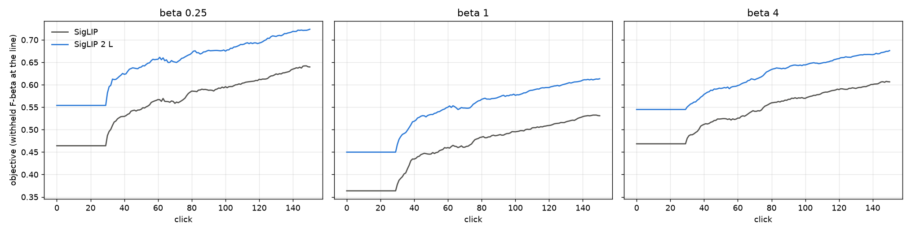
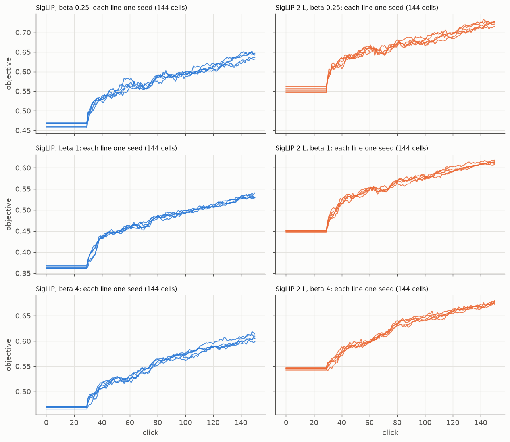
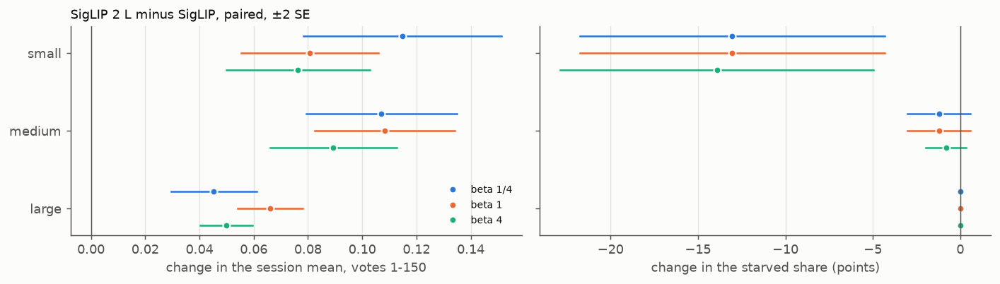
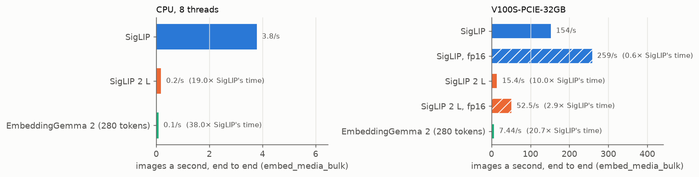

# SigLIP 2 L gives EmbeddingGemma 2's gain at half its embedding time, and 2.9× SigLIP's at fp16 (#4874)

**2026-10-14.** `siglip2_l` (SigLIP 2 SO400M at 384 px, 1152-d) is already one of the app's image embedders.
#4216 (#4873) found that a small-object hunt starves because the typed query's sort never reaches the positives.
Offline, `siglip2_l`'s sort reached them almost as well as EmbeddingGemma 2's, which the owner had ruled out for
images as too slow (#4837). This study runs `siglip2_l`'s sessions against SigLIP's and times both.

**On COCO Better's Binary path it gains about as much as EmbeddingGemma 2 did.** Each `siglip2_l` session is
paired with the SigLIP session of the same class, size band, seed and split, in one grid from one commit (720
pairs a preset, 4,320 sessions). The session mean is the withheld F-beta at the app's line, averaged over votes
1–150:

| preset | SigLIP | SigLIP 2 L | difference (SE over 49 classes) | EmbeddingGemma 2, #4837 (separate grid) |
|---|---:|---:|---:|---:|
| β ¼ | 0.56 | 0.65 | **+0.089 ± 0.011** | +0.091 ± 0.010 |
| β 1 | 0.46 | 0.54 | **+0.085 ± 0.009** | +0.088 ± 0.008 |
| β 4 | 0.54 | 0.61 | **+0.072 ± 0.008** | +0.082 ± 0.008 |

- **It leads at every click, at every seed and preset** (Figures 1 and 2).
- **At β 1, 48 of 49 classes gain.** The one loss is −0.002. Across the presets, the largest loss is −0.038
  (tennis racket, β ¼).
- **Small and medium gain most.** At β 1, small goes 0.22 → 0.30 (+0.081 ± 0.013), medium 0.44 → 0.55
  (+0.11 ± 0.013), and large 0.70 → 0.77 (+0.066 ± 0.006).
- **It un-starves small objects as EmbeddingGemma 2 did.** The share of `@small` runs that find fewer than 3
  positives by vote 150 goes **20% → 7%** (−13 ± 4.4 points; −14 at β 4), against EmbeddingGemma 2's 19% → 4%.
  #4216's offline reach screen predicted 30% → 11% before #4731's exit, which today's sessions have.
- **The space itself is better**, not only the opening:
  - the typed query alone: AP +0.083 ± 0.010;
  - the full-label ceiling: AP 0.56 → 0.64 (+0.077 ± 0.006); by band, small 0.31 → 0.38, medium 0.53 → 0.64,
    large 0.84 → 0.88.

**The cost is half EmbeddingGemma 2's, and a third of that again at half precision.** End to end
(`embed_media_bulk`, 512 COCO Better images, interleaved repeats, the V100S #4837 timed on):

| | V100S, images/s | × SigLIP's time | 8 CPU threads, images/s | × SigLIP's time |
|---|---:|---:|---:|---:|
| SigLIP | 154 | 1× | 3.8 | 1× |
| **SigLIP 2 L** | 15 | **10×** | 0.20 | 19× |
| **SigLIP 2 L, fp16** | 52 | **2.9×** | — | — |
| EmbeddingGemma 2 (280 tokens) | 7.4 | 21× | 0.10 | 38× |

- **For COCO Better's 24,504 images** on a V100S, that is about 2.7 min for SigLIP, 27 min for SigLIP 2 L, and
  8 min for SigLIP 2 L at fp16. On 8 CPU threads it is 1.8 h against 34 h.
- **Half precision barely moves the vectors.** `VTSEARCH_EMBED_PRECISION=fp16` stays within 1 − cos 6e-5 of the
  fp32 pile cell. These sessions ran on the fp32 vectors; no session was run at fp16.
- **A typed query costs 12 ms on the GPU, against SigLIP's 6.** On CPU it is 0.58 s, against 0.14 s.

**Recommendation:** SigLIP 2 L is the photo embedder to use wherever a GPU embeds the collection, at fp16. There
it buys EmbeddingGemma 2's quality at 2.9× SigLIP's embedding time. On a CPU-only install it is 19× SigLIP's time,
so SigLIP stays the CPU choice. Changing a default is the owner's call; nothing in the app changes here.

## The question

#4874, from #4216: *does the premium text tower un-starve small objects, and at what embedding time?* #4216
showed that the share of small-object hunts that starve is set by the typed query's sort, the first thing
Autopilot walks. Rebuilt offline, `siglip2_l`'s sort leaves 11% of `@small` runs short of 3 positives in its top
150, against SigLIP's 30% (−18 ± 5 points). EmbeddingGemma 2 sits at 9%. The sessions and the clock were
unmeasured.

## How it was run

- **One paired grid** (`s2l_4874.sh`, #4837's `eg2_4837.sh` with the arm swapped): `SOTA_EMBEDDERS=siglip,
  siglip2_l` on `coco_better`. It ran all 144 cells (49 classes × the bands they have), 5 seeds and
  beta ¼, 1 and 4, on shipped defaults, so the embedder is the only difference.
  - **Each arm opens on its own typed query** (its own text tower ranks the corpus) and learns in its own space,
    as the app would run it. Each run records `seed_embedder`.
  - **The commit:** a frozen worktree at e8bdf3e14, which is dev 2805890e8 plus this study's launcher.
  - **The runs:** 4,320 sessions on the cpu partition, 2026-10-14 11:12–13:46, with 0 failed. A `siglip2_l`
    session takes a median of about 5 min and peaks at 1.3–2.3 GB, about what a SigLIP session does.
- **The pile cell holds.** `coco_better__siglip2_l.pkl` was built on 2026-09-26. Re-embedding 512 of its images
  under today's venv (transformers 5.19, torch 2.14) matches it to 1 − cos ≤ 1.2e-7, on the V100S and on CPU.
- **Analysis:** `analyze.py --path binary|s2l` per preset (each arm's own text baseline), then `eg2_compare_4837.py
  --arm siglip2_l`. The compare script is shared with #4837: it takes `--arm`, and EmbeddingGemma 2 stays the
  default. The session mean uses `by_click.py`'s fill: the typed query's set until the app shows a detector, and
  the last value carried. The SE is over the 49 classes, because a class's bands and seeds are not independent
  draws.
- **The starved share** is #4216's: fewer than 3 positives found by vote 150 (`goods_150` in the analyzer's
  `cells.csv`).
- **Timing** (`s2l_timing_4874.py`, #4837's `timing.py` with SigLIP 2 L added):
  - `embed_media_bulk` on the same 512 in-memory JPEGs, with the arms interleaved over 3 repeats (2 on CPU, on
    64 images, at #4837's CPU settings);
  - on rack7n04's V100S, where #4837 timed;
  - SigLIP at batch 128 as #4837 timed it, every other embedder at its own default (SigLIP 2 L 32,
    EmbeddingGemma 2 8);
  - a second V100S job on the same node at `VTSEARCH_EMBED_PRECISION=fp16`.

## Results



*Figure 1. The objective (withheld F-beta at the app's line) over clicks, averaged over the 720 sessions of each
arm at each preset. Flat to vote 30: the typed query's set is on screen until the 30-vote hold ends (#4736). Each
arm's click 0 is its own typed query.*



*Figure 2. The same, one line per seed (each the mean of its 144 cells). The five seeds sit within about 0.01 of
each other, so the gap is not a mean carried by a few runs.*



*Figure 3. SigLIP 2 L minus SigLIP by size band, paired, ±2 SE over classes. Left: the session mean. Right: the
starved share in points (`@small`, then medium; large never starves).*

| preset | band | SigLIP | SigLIP 2 L | session mean, Δ | votes 1–50, Δ | starved `@small`, points |
|---|---|---:|---:|---:|---:|---:|
| β ¼ | small | 0.28 | 0.39 | **+0.12 ± 0.018** | **+0.10 ± 0.017** | 20% → 7%, **−13 ± 4.4** |
| | medium | 0.58 | 0.68 | **+0.11 ± 0.014** | **+0.12 ± 0.018** | 1.2% → 0 |
| | large | 0.81 | 0.86 | **+0.045 ± 0.008** | **+0.059 ± 0.013** | 0 |
| β 1 | small | 0.22 | 0.30 | **+0.081 ± 0.013** | **+0.069 ± 0.013** | 20% → 7%, **−13 ± 4.4** |
| | medium | 0.44 | 0.55 | **+0.11 ± 0.013** | **+0.11 ± 0.015** | 1.2% → 0 |
| | large | 0.70 | 0.77 | **+0.066 ± 0.006** | **+0.080 ± 0.011** | 0 |
| β 4 | small | 0.29 | 0.37 | **+0.076 ± 0.013** | **+0.066 ± 0.013** | 21% → 7%, **−14 ± 4.5** |
| | medium | 0.53 | 0.62 | **+0.089 ± 0.012** | **+0.095 ± 0.014** | 0.8% → 0 |
| | large | 0.78 | 0.83 | **+0.050 ± 0.005** | **+0.059 ± 0.007** | 0 |

- **After the spot check:** +0.083 ± 0.010, +0.079 ± 0.007 and +0.068 ± 0.006 at β ¼, 1 and 4.
- **Every session trains a detector on both arms.** Overall, 6.8% of sessions starve on SigLIP and 2.2% on
  SigLIP 2 L.
- **The per-class table** (`by_class.csv`): the biggest gains at β 1 are dog (+0.26), frisbee (+0.23),
  snowboard (+0.21) and parking meter (+0.20). The hardest classes stay hard: chair 0.08 → 0.11, bowl
  0.10 → 0.13 and spoon 0.15 → 0.20.
- **This SigLIP control starves 20% of `@small` runs.** #4216's 2026-10-13 runs starved 18.7% on the same
  seeds. Dev moved between the two, which is why this grid re-ran SigLIP rather than reuse an older control.



*Figure 4. Images a second end to end, per embedder, median of the repeats. Hatched: `VTSEARCH_EMBED_PRECISION=
fp16`. The multiples are of SigLIP's fp32 time on the same device. SigLIP's own fp16 speed-up (1.7× here) is
larger than `docs/DEPLOYMENT.md`'s 0.99×, which was measured end to end with decode overlapped on another node.*

## What this does not license

- **EmbeddingGemma 2 is in a separate grid**, #4837's, from an earlier commit and venv. The side-by-side numbers
  above are not paired: they say the two gains are about the same size, not which is larger.
- **No session ran at fp16.** The fp16 vectors are within 1 − cos 6e-5 of the ones these sessions used, so a
  difference is unlikely. But a dataset embedded at fp16 is not interchangeable with one embedded at fp32
  (`docs/DEPLOYMENT.md`), so a switch re-embeds a collection whole.
- **One bench.** COCO Better photos. #4837's other image sets were not re-run for SigLIP 2 L.
- **The CPU figure is 64 images.** It agrees with #4837's for SigLIP (3.8 against 3.9 images/s) and for
  EmbeddingGemma 2 (0.10).

## Reproduce

```bash
# from a frozen worktree of the branch, with gridenv.sh and pile_env.sh sourced
cd scripts/experiments/state_of_app
bash s2l_4874.sh prepare && bash s2l_4874.sh dirs
for b in 0.25 1 4; do bash s2l_4874.sh launch $b; done          # 1,440 sessions a preset
for b in 0.25 1 4; do bash s2l_4874.sh analyze $b; done         # ~18 min, 6 GB each
python eg2_compare_4837.py --arm siglip2_l --run 0.25=<b025> --run 1=<b1> --run 4=<b4> --out <this dir>
VTS_REPO=<worktree> python s2l_timing_4874.py --out timing.jsonl                      # a V100S node
VTSEARCH_EMBED_PRECISION=fp16 VTS_REPO=<worktree> python s2l_timing_4874.py --embedders siglip,siglip2_l --out timing.jsonl
python s2l_figures_4874.py --report <this dir> --timing timing.jsonl --run 0.25=<b025> --run 1=<b1> --run 4=<b4>
```

The raw runs are in the owner's `/expscratch`, under `state-of-the-app/2026-10-14-s2l-4874-{grid,b025,b1,b4}`,
and the timing and logs under `s2l-4874/`.

## Files

- `compare.csv`, `by_band.csv`, `by_class.csv`, `objective_by_click.csv`: the paired comparison per preset, band
  and class, and the curves. `starved_*` / `d_starved` are #4216's starved share.
- `timing.csv`: images a second per embedder, device and precision, with each pile cell's 1 − cos against a
  re-embed.
- `figures/`: Figures 1–4.
