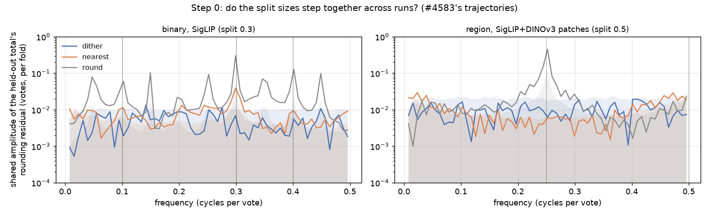
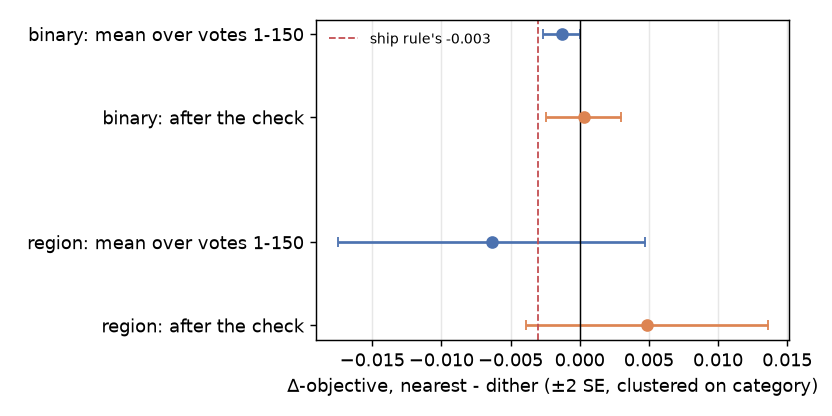
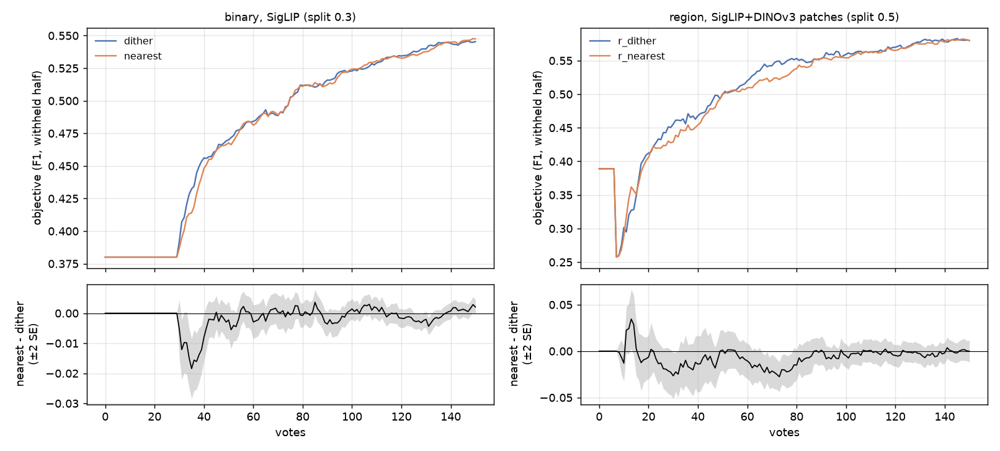
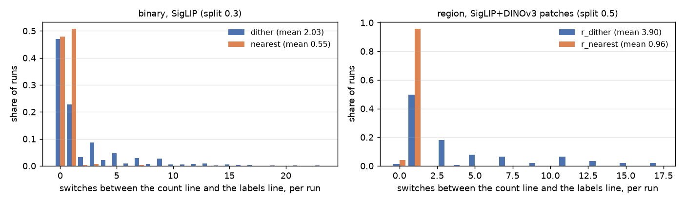
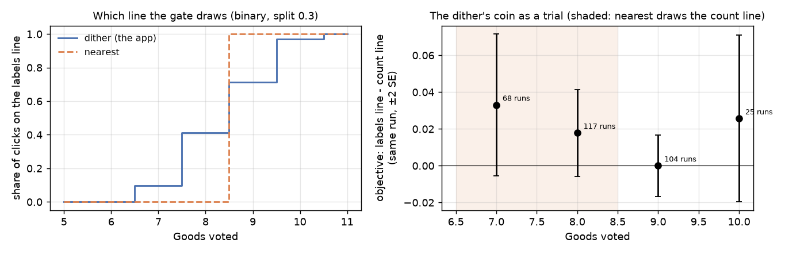
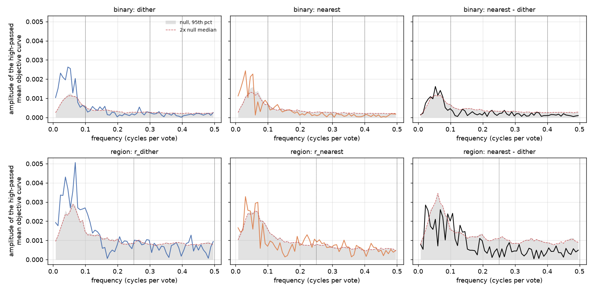

# Rounding the calibration split to the nearest vote instead of dithering it (issue #4864)

**No pre-registered branch fires, so the call is the owner's. `nearest` does what the issue wanted: the labels line
switches on once and stays on.** Runs switch between the count line and the labels line 0.56 times instead of 2.0
(binary) and 0.96 instead of 3.9 (region), and no run flips back and forth, where 30% and 49% of the dither's runs
do. On the binary path it passes the ship rule: the objective is unchanged over a session (−0.0013 ± 0.0007 over
votes 1–150, +0.0003 ± 0.0014 after the check) and no ripple clears 2× noise. The region path did not resolve:
−0.0064 ± 0.0056 over votes and +0.0049 ± 0.0044 after the check, too noisy to pass or to fail. The cost that
does resolve is local and has a known cause. On a single-vector space `nearest` puts the gate's edge at 9 Goods, and
read as a randomized trial, the dither's own coin says the labels line is already the better line at 7–8 Goods
(+0.023 ± 0.012). So `nearest` loses 0.009 ± 0.003 in the votes just after the first detector shows. The
recommendation is a deterministic rule with its edge at 7 Goods, not `nearest` as it stands.

## What was run

| | |
|---|---|
| arms | `dither` (the app) and `nearest` (`CALIB_SPLIT_ROUNDING=nearest`, #4869), all four on one frozen commit (dev 3add2e55c plus the launcher, e61fedcb7) |
| binary | `coco_better`, SigLIP, 144 class@band cells × 5 seeds, 150 votes, pool at 1%, beta 1, typed-query opening: #4583's bench. 2 × 720 runs, none lost |
| region | `siglip+dinov3_patch`, max-patch, beta 1, #4219's 72 classes × 2 seeds, on #4583's region prepare. 2 × 144 runs, none lost |
| recorder | `CALIB_LINE_COUNTS=1`: the class model's held-out Goods (`model_n_pos`, the gate's input) at every shown click, so each arm's line switches are counted, not inferred |
| size | preflight passed `--resolve-delta 0.003 --sigma 0.035` on binary (#4583's line-only σ) and `0.0045 / 0.026` on region (#4583's region pair) |

Launcher `scripts/experiments/calibration/launch_split_rounding_4864.sh`; step 0 `split_cadence_4864.py`; analyzer
`analyze_split_rounding_4864.py`, which reuses #4583's per-arm tables so both readings are #4583's; figures
`figures_4864.py`; planted-answer selftest `selftest_split_rounding_4864.py`. Each arm read its `split_rounding`,
split fraction and beta back off its own rows. On all 62,674 clicks where binary `nearest` drew a held-out class
model, `model_n_pos` is exactly 2 × round(0.3 × Goods), so the arm reached the live folds.

The region grid resolved less than it was sized for. #4583's region pair had a per-run SD of 0.026 for the paired
objective over votes 1–150; here it is 0.067, so the grid's 2 SE floor is 0.011, not 0.0045.

## Step 0: do `nearest`'s split sizes step together across runs?

This step needs no new run. Every shown vote of #4583's shipped arms was replayed through three sizing rules:
- the app's `dither`;
- `nearest`;
- `round()`, the rule before #3288, kept as the coherent reference.

For each held-out count, the rounding residual (held out − fraction × count) was averaged over runs at each vote. A
cadence the runs share survives that average, and a run-by-run cadence cancels. Each amplitude is tested against a
null that flips the sign of every run of a category at random.



*The held-out total's shared rounding residual at each frequency, per rule. Shading is the sign-flip null's 95th
percentile, and dotted lines mark the split's own frequencies. `round()` (grey) spikes at every one of them,
because the eval's one-vote-per-step clock phase-locks it across runs, as in #3286. The figure is about split
sizes, not quality.*

| shared amplitude of the held-out total, votes per fold | binary (0.3 split), at 0.3 / vote | region (0.5 split), at 0.5 / vote |
|---|---|---|
| `round()`, the reference | 0.31 (16× noise) | 0.046 (4×); 0.50 at 0.25 / vote (10×) |
| `dither`, the app | 0.008 (1.6×, p = 0.20) | 0.009 (1.1×) |
| `nearest` | **0.037 (5.8×, p < 0.001)** | 0.002 (0.2×); 0.007 at 0.25 / vote (3.1×, p = 0.04) |

- **On a single-vector space `nearest` does share a cadence, and it lives in the Bads.** The issue predicted it. On
  a rare class almost every vote is a Bad, so `round(0.3 · Bads)` steps every 10⁄3 votes in near lock-step across
  runs. The cadence is an eighth of `round()`'s, because each run's Goods offset its phase. The Goods alone carry
  almost none (0.003).
- **On the patch space it shares almost none** (0.2× at 0.5 / vote, and 1.4% of `round()`'s at 0.25).
- **Replayed on the A/B's own rows the picture holds, but weaker.** It reaches 2.6–3.7× at 0.1 / vote. The recorded
  split sizes of the `nearest` runs agree (3.8× at 0.1 / vote, p < 0.001).

Step 1 therefore looked for a ripple at 0.3, 0.1 and 0.4 cycles a vote on the binary path, and at 0.5 and 0.25 on
the region path.

## Result

### (1) The objective



*Paired on (category, seed), ±2 SE clustered on category. The dashed line is the ship rule's −0.003.*

| nearest − dither | binary (720 runs) | region (144 runs) |
|---|---|---|
| objective, mean over votes 1–150 | −0.0013 ± 0.0007 | −0.0064 ± 0.0056 |
| objective, after the check | +0.0003 ± 0.0014 | +0.0049 ± 0.0044 |
| AP, mean over votes 1–150 | −0.0003 ± 0.0005 | −0.0011 ± 0.0017 |
| returned set after the check | +0.5 ± 1.3 items | −1.7 ± 3.7 items |
| objective, votes 31–100 | **−0.0026 ± 0.0013** | −0.011 ± 0.007 |
| objective, votes 31–45 (post hoc) | **−0.0094 ± 0.0033** | −0.014 ± 0.012 |
| objective inside the band (7–11 Goods; 4–6 on region) | −0.0003 ± 0.0067 | +0.014 ± 0.010 |

Bold is more than 2 SE from zero. The votes 31–45 window was chosen after seeing the curves; it is where the binary
paired difference dips.



*Top: the mean objective, F1 of the withheld half above the line the app holds, at each vote. Bottom: the paired
difference ±2 SE. The binary dip at votes 30–45 is where the first detector shows (the typed-query hold ends near
vote 30) and the two rules draw different lines at 7–8 Goods. On the region path the first detector shows at vote
~7, and the difference stays inside its noise.*

### (3) The band: what `nearest` buys



*How often each run's line switches between the head's count line and the labels line, over the clicks where the
app shows a trained detector. Each switch is read off the recorded class model at that click.*

| per run | binary dither | binary nearest | region dither | region nearest |
|---|---|---|---|---|
| switches between the count line and the labels line | 2.0 | **0.56** | 3.9 | **0.96** |
| runs that switch twice or more | 30% | 1.3% | 49% | **0%** |
| the same, held-out class models only | 30% | **0%** | | |
| most switches in one run | 23 | 7 | | |

`nearest`'s held-out Goods never fall as the Goods grow, so its gate opens once: at 9 Goods on a single-vector
space and at 5 on the patch space. It stays open after that.

Its few repeat switches on the binary path come from another path entirely. When the folds' held-out Goods do not
outscore the held-out Bads, `fit_labels_line` falls back to the head's in-sample scores of every vote. That model's
`n_pos` is all the Goods, so it passes the 6-Goods gate from 6 Goods on. The fallback fires on 1.9% of shown clicks,
equally in both arms, and the split has nothing to do with it.

### What the labels line is worth inside the band: the coin as a trial

Inside the band the dither's coin, not the run, decides which line a click draws. So at one count of Goods, a run's
clicks on either line differ only by the coin, which makes it a randomized trial of the two lines that the app
runs by itself.



| Goods | dither's share of clicks on the labels line | labels line − count line, same run | runs |
|---|---|---|---|
| 7 | 0.10 | +0.033 ± 0.019 | 68 |
| 8 | 0.41 | +0.018 ± 0.012 | 117 |
| **7–8, each run once** | 0.25 | **+0.023 ± 0.012** | 155 |
| 9 | 0.71 | +0.000 ± 0.008 | 104 |
| 10 | 0.97 | +0.026 ± 0.023 | 25 |

- **At 7–8 Goods the labels line already beats the count line.** That labels line is drawn from 3 held-out Goods
  per fold.
- **`nearest` never draws it there.** It holds out 2 Goods per fold at those counts, so it always draws the count
  line, which is the votes 31–45 loss.
- **From 9 Goods `nearest` draws the labels line on every click.** The dither still draws the count line on three
  clicks in ten at 9 Goods, so `nearest` makes the loss back, and over a session the two arms tie.

The region path points the same way from the other side. At a 0.5 split `nearest`'s edge (5 Goods) comes earlier
than the dither's, and its band objective reads +0.014 ± 0.010 (unresolved).

### (2) Ripple



*Each arm's mean objective curve, and the paired difference, high-passed by a centred 20-vote mean (which keeps
every tested frequency whole). Shading is the sign-flip null's 95th percentile, the dashed line is twice its median
(the ship rule's bar), and dotted lines mark the frequencies step 0 named. Both arms' curves rise above the null
below 0.1 / vote; that is the shared shape of the first detector's arrival, and it is not a split cadence.*

| amplitude ÷ the null's median (p) | 0.3 / vote | 0.1 / vote | 0.4 / vote | 0.5 / vote | 0.25 / vote |
|---|---|---|---|---|---|
| binary `nearest` | 1.1 (0.44) | 1.8 (0.11) | 1.5 (0.19) | | |
| binary `dither` | 2.0 (0.07) | 1.6 (0.21) | 0.4 (0.90) | | |
| binary, paired difference | 0.7 | 1.4 | 1.1 | | |
| region `r_nearest` | | | | 2.2 (0.14) | 2.0 (0.05) |
| region `r_dither` | | | | 2.9 (0.04) | 2.1 (0.04) |
| region, paired difference | | | | 1.7 (0.25) | 0.6 (0.77) |

- **Binary.** The `nearest` runs' split sizes share a cadence, so the instrument has something to see. It does not
  reach the objective: `nearest`'s curve sits at the noise floor at every tested frequency, and the dither's curve
  comes as close to the bar as `nearest`'s does.
- **Region.** `r_nearest` crosses the literal 2× bar at both frequencies. So does `r_dither`, by more, although step
  0 found no shared cadence in either arm's region split sizes, and the paired difference stays under the bar. On 72
  categories, structure the two arms share reaches 2× by itself, so the bar does not separate the arms there.

## Decision

The issue pre-registered three branches:

- **Ship `nearest`** if, on both paths and at both readings, (1) is no worse than −0.003 and (2) shows no periodic
  component above 2× noise. Binary passes. Region does not: its votes 1–150 reading is −0.0064, and its curve
  crosses the 2× bar, as the app's own curve does.
- **Keep the dither** if (1) is worse than −0.003 by more than 2 SE on either path. Neither path is: region's
  −0.0064 is 0.6 SE past −0.003.
- **Owner's call** if quality ties but (2) shows a ripple. The quality tie holds on binary and is unresolved on
  region.

None of the three fires cleanly, so the call goes to the owner. The recommendation, from what the run showed:

- **Not `nearest` as it stands.** On a single-vector space its edge at 9 Goods is two Goods late. It holds the count
  line where the labels line is already the better one, and that costs a visible 0.009 just after hand-over, the
  moment a user first sees a detector.
- **A deterministic rule with its edge at 7 Goods.** For example, hold out ⌈0.3 × Goods⌉ Goods per fold: that gives
  3 per fold, and the labels line, from 7 Goods on, which is exactly the class model the coin trial priced. The
  Bads can keep the dither, which removes the only shared cadence step 0 found (the Bads') at no cost. The edge on
  the patch space is unchanged (⌈0.5 × 5⌉ = 3, at 5 Goods). That arm needs its own A/B, as `nearest` did.

## What follows

- The owner's call above. A follow-up arm, if wanted, reuses this launcher with one new rule in
  `arms_split_rounding.py`.
- `_dithered_count`'s docstring was already corrected in #4869. The app is unchanged by this study.
- The Lay of the Land figure keeps its striped band until a deterministic rule ships.
- Two side findings:
  - **The in-sample fallback passes the thin-model gate on all the Goods.** A class model built from in-sample
    scores counts every Good toward `HEAD_COUNT_GOODS`. It fires on 1.9% of shown clicks, and on 0.1% with 6 or
    more Goods, so it is minor.
  - **A cell's variant rows report a detector on screen 25 votes early.** A script that reads raw cell files
    replays votes no user sees (`scripts/experiments/lessons/2026-10-14-variant-rows-say-trained-early.md`).

## Reproducing

```bash
cd scripts/experiments/calibration
source ../../../gridenv.sh                      # preflight's python needs the venv
bash launch_split_rounding_4864.sh arms         # binary dither + nearest, from a frozen run worktree (VTS_REPO)
bash launch_split_rounding_4864.sh region       # region r_dither + r_nearest
python split_cadence_4864.py --grid binary=/expscratch/$USER/calsplit-4583/f03k2_b1/results/cells:0.3 \
  --grid region=/expscratch/$USER/calsplit-4583/region/r_f05_b1/results/cells:0.5 --out STEP0
python analyze_split_rounding_4864.py --base /expscratch/$USER/splitround-4864 \
  --baseline /expscratch/$USER/progression-4184-h0.01/text_baseline.csv --out OUT
python figures_4864.py --step0 STEP0 --data OUT --out OUT/figures
python selftest_split_rounding_4864.py          # planted answers
```

`tables/` holds what this report quotes:
- `paired.csv`: every read, window and size band.
- `ripple.csv` and `spectra.csv`: the ripple tests and the full periodograms.
- `switches.csv.gz`: each run's switches.
- `coin.csv`: the coin trial.
- `curves.csv` and `delta_curves.csv`: the objective per vote, and the paired difference.
- `decomposition.json`: the recorded split sizes' cadence.
- `provenance.json`
- step 0's `step0_cadence.json`, `step0_spectra.csv.gz` and `step0_p_labels_by_goods.csv`.

Results root: `/expscratch/sgreenberg/splitround-4864`.
