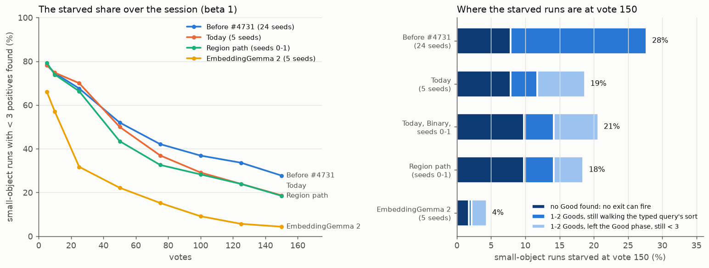
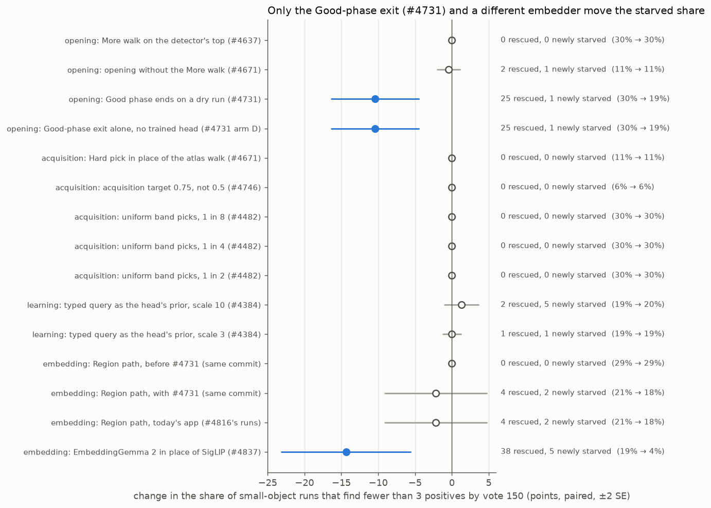
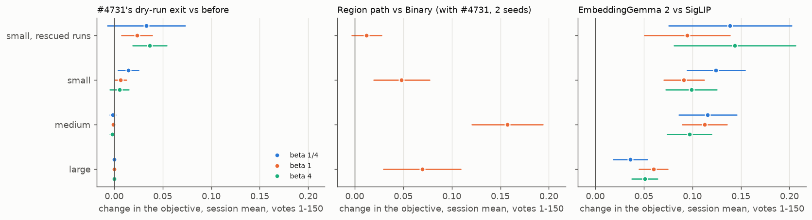
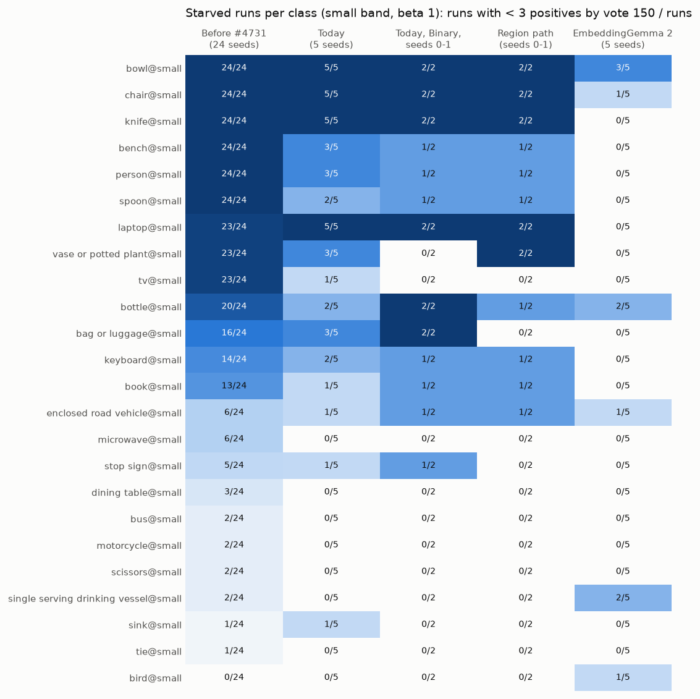
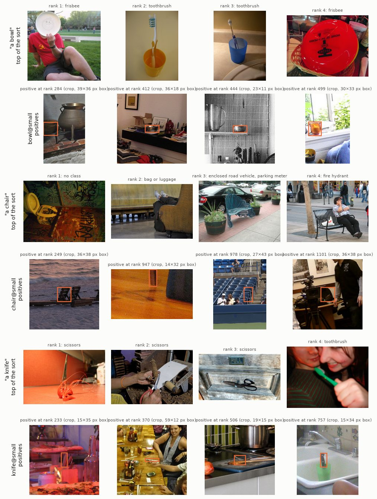
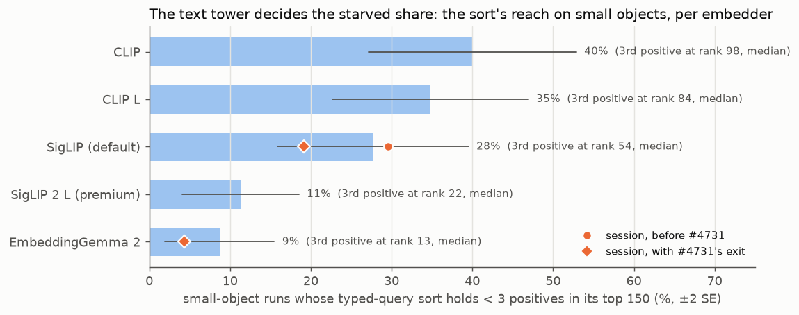

# Small-object hunts starve because they never leave the Good phase: #4731's exit was the one opening fix, and the rest is the text tower (#4216)

**2026-10-14. A re-read of 74 finished run sets from 13 studies; no new sessions.** A run is
*starved* if it finds fewer than 3 positives in 150 votes. On `coco_better` at natural prevalence,
**27.7% of `@small` runs starved before #4731** (SotA 2026-10-08, 24 seeds, 1,104 runs); medium was
1.0% and large 0. That matches #4160's 28%.

- **The mechanism.** Autopilot's Good phase walks the top of the typed query's sort until it holds 3
  Goods. Before #4731, every starved run was still in that phase at vote 150: all 306 in the 24-seed
  SotA. Rebuilt offline, the sort predicts every run's fate (3,456 of 3,456 runs, all bands). Every
  starved run found exactly the positives in its sort's top 150 (318 of 318).
- **Anything that acts after the Good phase cannot move it.** The acquisition target, uniform band
  picks, the Hard pick in place of the atlas walk, and the More walk's source all starve **the same
  runs, with identical harvests at every checkpoint**. Before #4731 the Region path did too, because
  it opens on the same SigLIP sort.
- **#4731's dry-run exit (shipped 2026-10-09) is the one opening rule that moved it.** The exit ends
  the Good phase after 16 misses in a row with a Good in hand. It takes the `@small` share from 30% to
  19% (**−10.4 ± 3.0 points**, paired; 25 runs rescued, 1 newly starved) and moves no other band. It
  adds +0.015 / +0.007 / +0.005 to the small band's objective at beta 1/4, 1 and 4, and no band loses
  more than 0.002.
- **Today 18.7% of `@small` runs still starve** (2026-10-13, 5 seeds). The 43 runs split three ways:
  - 18 found no Good at all, so no exit can fire;
  - 9 hold 1 or 2 Goods and are still walking the sort;
  - 16 took the exit and the trained head still found fewer than 3.
- **What is left is the text tower.** EmbeddingGemma 2 in place of SigLIP takes today's 19% to 4%
  (**−14 ± 4 points**; 38 rescued, 5 newly starved) and lifts the small band's objective by +0.09 to
  +0.12. The owner ruled it out for images on speed (#4837). Offline, **the shipped premium embedder
  `siglip2_l` reaches small objects almost as well**: its sort leaves 11% of `@small` runs short of
  3 positives in its top 150, against SigLIP's 30% on the same cells and seeds (**−18 ± 5 points**).
  EmbeddingGemma 2 leaves 9% (−21 ± 5.5). CLIP and CLIP L are worse than SigLIP. #4874 runs
  `siglip2_l`'s sessions and times its embedding.
- **Region on today's app is not resolvable on 2 seeds:** 21% → 18% (−2.2 ± 3.5 points; 4 rescued,
  2 newly starved). Its small-band gain (+0.048 ± 0.014) comes from runs that were already fed.

**Nothing ships from this issue.** The opening fix it asked for already shipped as #4731. No
acquisition rule can reach a run that never leaves the Good phase. What remains is the typed query's
sort on small objects: an embedder question (#4874 for `siglip2_l`), and #4217's for Region.

## The question

#4216, from #4160: on `coco_better` with SigLIP binary, *28% of `<class>@small` runs find fewer than
3 positives in 150 clicks*, and that harvest is the whole small-trained deficit. **Which opening or
acquisition arm moves the under-3 share on the `@small` cells without costing the other bands?** The
issue named the acquisition offset, the text-sort opening against a mixed opening, and region voting.

#4222's dry-stop grid answered the opening half on 2026-09-29: five openings starved exactly the same
cells (paired difference 0, SE 0). One sharper acquisition cut (#4295) left `@small` AP flat. This
re-read covers every arm run since then on the same bench, plus the embedding arms.

## How it was read

- **No new runs.** `scan_found.py` reads the positives found by vote 150 (`n_good`) from every main
  cell file of 74 finished run sets. These are the State of the App runs from 2026-10-05, 10-06 and
  10-08, and the arms of #4637, #4482, #4671, #4731, #4746, #4384, #4798, #4816 and #4837.
  - The end-of-run check and skyline rows are not votes and are dropped.
  - Before #4736's harness, a run wrote no row until its first Good. Those 814 rowless files are runs
    that never found a Good: they count as 0, mapped to their cells by task index. The rule is checked
    against every file that has rows.
- **Pairing.** Every contrast pairs the same (category, seed) on the same grid, from one commit, as
  each study ran it. Standard errors are clustered on class (46 classes at `@small`). Points are
  percentage points of the `@small` runs.
- **Two pools.** #4746 and #4671 ran on #4671's prepare, a 1% pool (4,300 images). There the starved
  share is 6% and 11%. Every other set is at natural prevalence (about 0.44%, 11,600 images).
- **The objective** is F-beta of the set the app shows, as a session mean over votes 1–150 (the
  owner's single number). It comes from each study's own priced per-run tables:
  - #4743's `runs_*.npz` for #4731 and the Region pair;
  - #4837's `analysis-*/curves.csv` for EmbeddingGemma 2.

  They reproduce those studies' headlines: #4731 +0.0042 / +0.0017 / +0.0010 over all runs, and
  EmbeddingGemma 2 +0.091 on the small band at beta 1.
- **The offline sort** (`reach.py`) rebuilds each embedder's typed-query sort with the harness's own
  pieces, as `text_baseline.py` does: the cell's query text, `evaluable_pool`, the `whole_image`
  scorer and the seed's split. For each run it counts the positives in the voting half's top 150. It
  needs no session, so it also screens embedders that have never been run on this bench.

## Why opening and acquisition arms cannot move it



*Figure 1. Left: the share of `@small` runs (beta 1) with fewer than 3 positives found by each vote.
The arms are not paired with each other: the 24-seed SotA, today's 5 seeds, Region's 2 seeds, and
EmbeddingGemma 2's 5 seeds. Right: at vote 150, where each starved run is. "Today, Binary, seeds
0–1" is the Binary run paired with the Region bar beneath it.*

The Good phase is the opening's first step: walk the typed query's sort from the top until 3 Goods.
Every later phase is downstream of it. That includes the Bad phase, the walk, Hard and New picks, the
acquisition target, the head, and the line.

- **Before #4731, a run that never reached 3 Goods never left it.** All 306 starved runs in the
  24-seed SotA were still in the Good phase at vote 150. Every fed run had left it.
- **So a starved run votes exactly the sort's top 150.** Rebuilt offline, the SigLIP sort predicts
  every run's fate in that SotA (3,456 of 3,456 runs, all bands, no misses either way). For all 318
  starved runs, the positives found equal the positives in the sort's top 150.
- **So every arm that acts later sees the identical trajectory** on the runs that starve. The table
  below confirms it: every such arm starves the same runs, and their harvests match the control's at
  votes 5, 10, 25 … 150.

The positives are there: a starved cell's voting half holds about 50, as #4222 found. They sit below
the sort's top 150, outranked by look-alikes (Figure 5).

## Every arm, paired



*Figure 2. Each arm against its own control on the same cells, seeds and commit, at beta 1. Beta 1/4
and 4 differ from these rows by a run or two (`paired.csv`): the Good phase does not read the preset.
Filled: more than 2 SE from zero. The percentages are the control's and the arm's starved share. Rows
at 6% and 11% are on the 1% pool.*

| arm (beta 1) | runs | control → arm | change, points | rescued / newly starved |
|---|---:|---:|---:|---:|
| **Good phase ends on a dry run** (#4731) | 230 | 30% → 19% | **−10.4 ± 3.0** | 25 / 1 |
| the same exit, no trained head (#4731 arm D) | 230 | 30% → 19% | **−10.4 ± 3.0** | 25 / 1 |
| opening without the More walk (#4671; 1% pool) | 230 | 11% → 11% | −0.4 ± 0.8 | 2 / 1 |
| More walk on the detector's top (#4637) | 230 | 30% → 30% | 0, identical | 0 / 0 |
| acquisition target 0.75, not 0.5 (#4746; 1% pool) | 230 | 6% → 6% | 0, identical | 0 / 0 |
| Hard pick in place of the atlas walk (#4671; 1% pool) | 230 | 11% → 11% | 0, identical | 0 / 0 |
| uniform band picks, 1 in 8 / 4 / 2 (#4482) | 230 each | 30% → 30% | 0, identical | 0 / 0 |
| typed query as the head's prior, scale 10 (#4384) | 230 | 19% → 20% | +1.3 ± 1.1 | 2 / 5 |
| typed query as the head's prior, scale 3 (#4384) | 230 | 19% → 19% | 0.0 ± 0.6 | 1 / 1 |
| Region path, before #4731 (same commit) | 92 | 29% → 29% | 0, identical | 0 / 0 |
| Region path, with #4731 (same commit; 2 seeds) | 92 | 21% → 18% | −2.2 ± 3.5 | 4 / 2 |
| Region path, today (#4816's runs; 2 seeds) | 92 | 21% → 18% | −2.2 ± 3.5 | 4 / 2 |
| **EmbeddingGemma 2 in place of SigLIP** (#4837) | 230 | 19% → 4% | **−14 ± 4** | 38 / 5 |

"Identical" means more than a zero mean: every control-starved run is starved in the arm too, with the
same harvest at every checkpoint. The medium band moves by at most 1.2 points under any arm, and none
of those moves is resolvable. The large band never starves.

- **#4731 is the only opening rule that moved it, and it shipped on 2026-10-09** (#4741; re-priced on
  today's opening by #4743). Arm D gives the same rescue with the centroid in place of the trained
  head, so the rescue is the exit's alone. On COCO the head adds little to the objective either: the
  exit alone gained +0.0033, against +0.0038 with the head (#4731's report).
- **The query prior (#4384) leans the wrong way at scale 10** (2 rescued, 5 newly starved; not
  resolvable). It finds slightly fewer Goods overall, as #4384's own report says.
- **On today's app, an acquisition rule can reach at most the 16 starved runs that took the exit**,
  7% of `@small` runs. The acquisition target was priced before #4731, when no starved run reached Hard.
  #4746 also found the dial weak in principle: at 1% prevalence, 0.75 and 0.5 pick within about 2
  items of each other at the 99.9th percentile.

## What moving it pays, by band



*Figure 3. Paired change in the objective (F-beta of the shown set, mean over votes 1–150), ±2 SE.
"Small, rescued runs" are the runs the arm took from starved to fed. Region is beta 1 only, on 2
seeds. One x scale for all three panels.*

| contrast | band | beta 1/4 | beta 1 | beta 4 |
|---|---|---:|---:|---:|
| #4731's exit | small | **+0.015 ± 0.005** | **+0.007 ± 0.003** | +0.005 ± 0.005 |
| | small, the 25 rescued runs | +0.033 ± 0.020 | **+0.024 ± 0.008** | **+0.037 ± 0.009** |
| | medium | −0.001 ± 0.001 | −0.001 ± 0.001 | −0.002 ± 0.001 |
| | large | identical | identical | identical |
| EmbeddingGemma 2 | small | **+0.12 ± 0.015** | **+0.091 ± 0.010** | **+0.099 ± 0.013** |
| | small, the ~38 rescued runs | **+0.14 ± 0.03** | **+0.094 ± 0.022** | **+0.14 ± 0.03** |
| | medium | **+0.12 ± 0.015** | **+0.11 ± 0.012** | **+0.097 ± 0.011** |
| | large | **+0.036 ± 0.009** | **+0.060 ± 0.007** | **+0.051 ± 0.007** |
| Region, with #4731 (2 seeds) | small | | **+0.048 ± 0.014** | |
| | small, the 4 rescued runs | | +0.012 ± 0.008 | |
| | medium | | **+0.16 ± 0.02** | |
| | large | | **+0.069 ± 0.020** | |

- **A rescued run gains little on the objective at first.** #4731's rescued runs gain +0.02 to +0.04
  over the session, but +0.08 to +0.12 by vote 150: they find their third Good late.
- **Region's small-band gain is in runs that already had 3 Goods.** The runs fed in both paths gain
  +0.062 ± 0.017, while its 4 rescued runs gain +0.012. Region learns small objects better, but it
  does not find them sooner: it opens on the same SigLIP sort.

## Where today's starved runs are



*Figure 4. Starved runs over runs, per `@small` class, at beta 1. The columns are not paired with
each other. "Today, Binary, seeds 0–1" and "Region path" are paired.*

- **Six classes starved in every one of 24 seeds before #4731:** bowl, chair, knife, bench, person
  and spoon. Laptop, vase or potted plant and tv starved in 23.
- **Today bowl, chair, knife and laptop still starve in 5 of 5.** Since the exit, bench and person
  starve in 3 of 5, spoon in 2 and tv in 1.
- **EmbeddingGemma 2 frees knife and laptop; bowl stays at 3 of 5.**



*Figure 5. Seed 0, SigLIP. For each class, the top row is the first four images the Good phase
shows, all Bad. The bottom row is the four best-ranked positives in the voting half: a crop 5 boxes
wide around the labelled box, at the image's own pixels, with the box's size in pixels.*

- **The sort's top is look-alikes, not scenes.** "A bowl" gets frisbees and toothbrush cups. "A
  knife" gets scissors. "A chair" gets a toilet and benches.
- **The positives are real, and tiny.** The boxes run 23×11 to 39×36 px for the bowls, 19×15 to
  59×12 px for the knives, and 27×43 to 36×38 px for the beach and stadium chairs, in photos about
  640 px wide. One chair box (14×32 px,
  rank 947) is too blurred to read.
- **The first positive sits at rank 233 to 284**, past what 150 votes can reach. The labels hold up,
  so the starvation is not an annotation artifact: these are objects a whole-image vector barely
  encodes.

## The text tower decides it



*Figure 6. Offline: the share of `@small` runs whose typed-query sort holds fewer than 3 positives in
its top 150. This is the starved share before #4731's exit (SigLIP 24 seeds, the rest 5 seeds; ±2 SE,
clustered on class). The orange markers are the sessions that exist; the exit brings each one below
its bar.*

| embedder | `@small` short of 3 in the top 150 | paired against SigLIP (seeds 0–4) | reached / lost | median rank of the 3rd positive | medium |
|---|---:|---:|---:|---:|---:|
| SigLIP (default) | 28% (24 seeds; 30% on seeds 0–4) | | | 54 | 1% |
| **SigLIP 2 L (`siglip2_l`, premium)** | 11% | **−18 ± 5** | 48 / 6 | 22 | 0% (−0.4 ± 0.4) |
| **EmbeddingGemma 2** | 9% | **−21 ± 5.5** | 52 / 4 | 13 | 1% (0.0 ± 1.0) |
| CLIP L | 35% | +5 ± 4.5 | 13 / 25 | 84 | 7% (+6 ± 3) |
| CLIP | 40% | **+10 ± 5** | 13 / 37 | 98 | 9% (**+8 ± 3**) |

- **The offline sort is the session's opening, exactly.** On SigLIP it predicts every run before
  #4731, as above. With the exit, the sessions sit below it: SigLIP 30% → 19%, and EmbeddingGemma 2
  9% → 4%.
- **`siglip2_l` reaches small objects almost as well as EmbeddingGemma 2**, and it is already an image
  embedder the app ships. Its sessions have never been run on this bench, so its objective and its
  embedding time against SigLIP's are unmeasured here. #4874 measures both.
- **CLIP is worse than SigLIP**, at small and at medium, and CLIP L leans the same way.

## What this does not license

- **Region at today's app is 2 seeds.** −2.2 ± 3.5 points cannot tell "no effect" from a 5-point
  rescue. #4217 owns region voting on small objects, and running Region is the owner's call.
- **The reach screen is the opening, not the session.** It says where an embedder's typed query
  leaves the Good phase. It does not say how that embedder's head learns afterwards, and
  EmbeddingGemma 2's objective gain (+0.09) is mostly in runs that were never starved. Nor does it
  price the embedder's time.
- **Two pools.** Rows at 6% and 11% (#4746, #4671) are on the 1% pool. There the zero-effect result
  holds for the same reason, but the share is not comparable with the natural-prevalence rows.
- **#4731's figures here are its #4743 re-price**, read as #4743 priced them. This study re-prices
  nothing.

## Reproduce

```bash
cd scripts/experiments/starved_4216     # from a worktree on the GRID
bash run.sh scan        # 74 run dirs (run_dirs.txt) -> /expscratch/$USER/starved-4216/scan (32 CPUs, ~3 min)
bash run.sh analyze     # starved.py + cost.py -> .../analysis (runs.csv, paired.csv, cost.csv, ...)
bash run.sh reach       # reach.py: each embedder's typed-query sort, offline (~6 min, CPU)
bash run.sh figures     # figures.py -> this directory
```

The run sets are in the owner's `/expscratch`, under `state-of-the-app/` and the study directories
`acqtarget-4746/` and `autopilot-4671/`. The #4731 objective is read from
`good-dry-4731/priced-4743/`.

## Files

- `paired.csv`: every contrast, every band and preset. It holds the starved share of arm and control,
  the change and its SE, rescued and newly starved runs, and identical harvests.
- `cost.csv`: the objective by contrast, preset, band and run fate.
- `classes.csv`, `mechanism.csv`, `harvest.csv`: the per-class counts, where the starved runs are at
  vote 150, and the starved share by vote.
- `share_by_arm.csv`: the starved share and median positives found, for every run set read.
- `reach_by_band.csv`, `reach_paired.csv`: the offline typed-query reach per embedder, and against
  SigLIP.
- `tables.md`: the tables above, generated.
- `figures/`: Figures 1–6.

This study simulated no user, so it carries no viewer of its own. Every run set it reads has its
quality-over-clicks figures and viewer in its own study's report.
