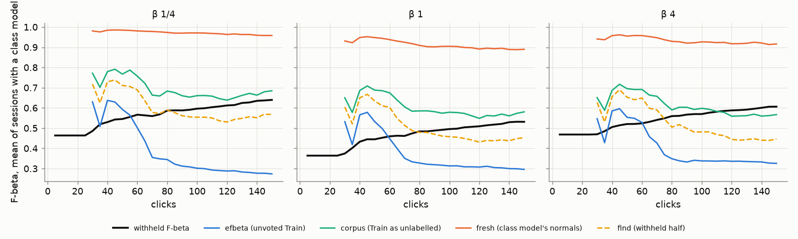
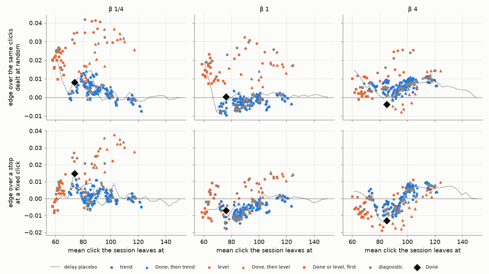
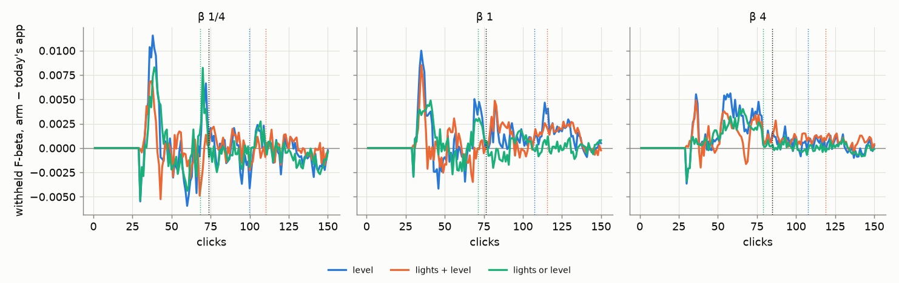

# A stop that reads the objective (#4878)

**2026-10-14.** Two parts:
- **The pricing:** 2,160 new sessions of today's app, with the labels line's own reading of itself recorded
  at every click, and 246 stop rules a preset priced on them offline against Autopilot's Done.
- **The A/B:** the three level rules the owner chose, run in the phase machine on 6,480 more sessions.

## The answer

- **"Stop when it stops rising" does not work on any reading the app has.** Every reading the labels line
  gives of its own F-beta grows *more pessimistic* as a session goes on, while the withheld F-beta rises
  ([figure](#why-a-trend-rule-cannot-work)). A trend rule on them is a timer. None beats the placebo that
  waits a fixed number of clicks after the class model first cuts the line.
- **The same reading works as a level.** Take `line_efbeta`, the expected F-beta at the line's own cut over
  the corpus's unvoted items at the session's beta. Stopping once it reaches 0.5 gives each session the
  clicks that pay there, better than Done does and better than the placebo. Chosen on seeds 0–1 and read on
  seeds 2–4, its edge over a stop at a fixed click is:

  | preset | best level rule | its edge | Done's edge |
  |---|---|---|---|
  | β 1/4 | `efbeta:level:0.5` | +0.024 ± 0.009 | +0.016 |
  | β 1 | `efbeta:level:0.3` | +0.013 ± 0.008 | −0.006 |
  | β 4 | `efbeta:level:0.7` | +0.004 ± 0.007 | −0.014 |

- **Done is a click counter.** Its stops do no better than the same stops dealt to the sessions at random
  (+0.008, +0.000, −0.004 ± 0.003–0.005). At β 1 and 4 it is slightly worse than every session stopping at
  Done's own mean click.
- **The catch: a level rule never tells half the sessions to stop.** It fires in 51–55% of them: 81–85% of
  large objects, 46–51% of medium, 25–28% of small. On large objects it is a plain improvement on Done at
  every preset: it stops earlier on average (click 52–57 against Done's 55–68) and leaves a higher F-beta
  (0.84 against 0.83, 0.73 against 0.72, 0.80 against 0.79). Elsewhere its edge comes from keeping the
  sessions it never stops clicking to 150, where Done would have let them go at 63–113.

- **In the app's phase machine ([the A/B](#the-ab-in-the-apps-phase-machine)), no stop rule changes the
  session.** Over 720 sessions per arm and preset, the mean F-beta over clicks 1–150 moves by at most +0.001.
  On the stop itself, `level` is the best of the three. Sessions leave with +0.04 to +0.05 more F-beta than
  at today's Done, and its stops go where they pay at every preset. But it tells only 43–49% of sessions to
  stop. `lights or level` is today's Done 5–6 clicks sooner. `lights + level` is dominated by `level`.

The owner chose `lights or level` for the app ([what shipped](#what-shipped)). A cap so that no session goes
unstopped is #4903.

## Data

- **Sessions:** today's app (branch `claude/stop-signal-4878` at `471602f79`, dev `829270a49` plus the
  recorded columns), on the Binary Photo opening.
  - **Grid:** the review grid #4743 priced (`2026-10-08-b1`): COCO Better, 49 classes in three size bands,
    144 cells.
  - **Size:** 5 seeds at β 1/4, 1 and 4, 720 sessions per preset, 150 clicks each. `SOTA_PASS=trajectory`:
    no ceiling.
  - **Launcher:** [`stop_signal_4878.sh`](../../../scripts/experiments/state_of_app/stop_signal_4878.sh).
  - **A first launch was cancelled at 7 minutes** to add `line_efbeta_corpus` and `find_efbeta`. Its partial
    cells were deleted before the relaunch.
- **What is recorded** (every base row, at the row's beta; `docs/EVAL.md` has the definitions):

  | column | what it is | app-side? |
  |---|---|---|
  | `line_efbeta` | the line's expected F-beta at its cut over the Train corpus's unvoted items | yes |
  | `line_efbeta_corpus` | the same class model's line on the Train corpus read as unlabelled | yes |
  | `line_efbeta_fresh` | the class model's own normals on a fresh corpus | yes |
  | `line_separation` | the labels' d′ | yes |
  | `find_efbeta` | Find's line on the withheld half, from that half's scores alone | no: a diagnostic |

  Recording them costs about 0.13 s a click (the extra corpus fit), roughly 3% of a session.
- **Pricing:** [`stop_signal_4878.py`](../../../scripts/experiments/state_of_app/stop_signal_4878.py), `read`
  then `report`. Every table here is in [`rules.csv`](rules.csv), [`held_out.csv`](held_out.csv),
  [`by_band.csv`](by_band.csv), [`fixed_stop.csv`](fixed_stop.csv) and
  [`signals_over_clicks.csv`](signals_over_clicks.csv). The pricing functions are tested in
  `tests_lib/meta/test_stop_signal_4878.py`.

## How a rule is judged

A stop rule changes what the app *tells* the user, not what Autopilot picks, so every rule is read off the same
sessions:

- **Where it fires.** A session *leaves* at the rule's first firing click, or at 150 if it never fires.
- **What the session had then.** The withheld F-beta at leave, at the preset's beta.
- **Why that alone cannot decide.** A rule that stops later always leaves a higher F-beta. So each rule is
  judged by two edges, each paired within session with its SE over the 49 class means:
  - **over a fixed click:** its F-beta at leave, minus every session stopping at the rule's own mean leave
    click. "Is it better than telling everyone to click N times?"
  - **over its stops dealt at random:** its F-beta at leave, minus each session's F-beta averaged over every
    session's leave click. The two spend exactly the same clicks, in total and in distribution, so this asks
    only whether the rule gives the clicks to the sessions they help.

The rules (246 a preset: 176 on the four readings the app has, 44 on the diagnostic, 25 placebos, and Done):

- **trend:** the reading's running best, or its mean over the last W clicks against the W before, has risen
  by at most E. W is 10, 20 or 30; E is 0 to 0.02 (d′: 0 to 0.1).
- **level:** the reading has reached T.
- **Done, then …:** each of the above, but only from Done on.
- **delay placebo:** a fixed N clicks after the class model first cuts the line (N from 0 to 120). It reads
  no signal; when a session gets its class model already says how hard it is.

Every rule starts reading when the class model first cuts. Before that the head's count line serves (#4786),
and its class model is too thin to read.

With 246 rules a preset the best edge is biased upwards, so the headline rule of each family is **chosen on
seeds 0–1 and read on seeds 2–4** (`held_out.csv`).

## Why a trend rule cannot work



*The mean over the sessions that have a class model at that click (from about click 30). Each preset is
scored at its own beta.*

The withheld F-beta (black) rises through the session. Every reading the line gives of itself falls after
click 40–60. `line_efbeta` (blue) falls furthest: the votes take the corpus's positives, so the line keeps a
median of 2, 10 and 24 unvoted items at click 80 (β 1/4, 1, 4) and 1, 1 and 4 by click 150. The fresh-corpus readings fall too, including `find_efbeta` (dashed),
which is read on the very corpus the truth is scored on.

The labels line's own documentation names the reason. The votes are not a random sample: Autopilot picks Bads
near the line. As they accumulate, the class model's Bad component creeps up toward its Good one: the labels'
d′ falls from about 3.9 at click 40 to about 2.0 by click 100, at every preset (`signals_over_clicks.csv`). So
the model grows more pessimistic about its own cut just as the detector improves. A rule that waits for a reading to stop rising
fires when the bias overtakes the improvement. That point is set by the session's timing, not by the
detector's.

The readings still tell sessions apart. Across sessions at clicks 50, 100 and 150, `line_efbeta_corpus`
correlates 0.61–0.80 with the withheld F-beta, with a bias of −0.13 to +0.05. That is what a level rule uses.

## The rules, priced



*One point per rule. Top: over its own stops dealt at random. Bottom: over a stop at a fixed click. The dotted
line is the delay placebo. Grey points read `find_efbeta`, which the app cannot.*

**Trend rules** (blue) never beat the placebo on the top row. Their best edges over random dealing are
+0.014 / +0.003 / +0.011, against the placebo's +0.024 / +0.019 / +0.015. The best **level rules** (orange) sit well above
it at every preset. **Done** (diamond) sits at zero on the top row.

Held out (chosen on seeds 0–1, read on seeds 2–4):

| preset | family | rule | fires | mean leave | F-beta at leave | edge over a fixed click | edge over random dealing |
|---|---|---|---|---|---|---|---|
| β 1/4 | Done | `done` | 89% | 74 | 0.58 | +0.016 ± 0.008 | +0.009 ± 0.005 |
| | placebo | `delay:0` | 88% | 60 | 0.57 | −0.001 ± 0.009 | +0.024 ± 0.008 |
| | level | `efbeta:level:0.5` | 56% | 88 | 0.61 | +0.024 ± 0.009 | +0.040 ± 0.006 |
| | diagnostic | `find:level:0.7` | 64% | 81 | 0.61 | +0.024 ± 0.010 | +0.043 ± 0.007 |
| β 1 | Done | `done` | 89% | 77 | 0.47 | −0.006 ± 0.005 | +0.001 ± 0.004 |
| | placebo | `delay:0` | 88% | 60 | 0.45 | −0.006 ± 0.006 | +0.019 ± 0.005 |
| | level | `efbeta:level:0.3` | 55% | 89 | 0.50 | +0.013 ± 0.008 | +0.032 ± 0.005 |
| | diagnostic | `find:level:0.7` | 54% | 90 | 0.50 | +0.011 ± 0.008 | +0.029 ± 0.006 |
| β 4 | Done | `done` | 88% | 86 | 0.55 | −0.014 ± 0.005 | −0.004 ± 0.004 |
| | placebo | `delay:0` | 87% | 61 | 0.53 | +0.004 ± 0.006 | +0.015 ± 0.005 |
| | level | `efbeta:level:0.7` | 50% | 96 | 0.58 | +0.004 ± 0.007 | +0.025 ± 0.005 |
| | diagnostic | `find:level:0.9` | 45% | 101 | 0.58 | +0.008 ± 0.006 | +0.024 ± 0.005 |

The level rule on the app's own reading does as well as the same rule on the withheld half. A better
estimate of the truth would buy little; the reading's level already carries what it can.

One threshold serves every preset: `efbeta:level:0.5` reads +0.041 / +0.031 / +0.025 over random dealing and
+0.025 / +0.012 / +0.003 over a fixed click (`by_band.csv`).

### By band (`efbeta:level:0.5` beside Done)

| preset | band | Done: fires, mean leave, F-beta | level: fires, mean leave, F-beta | level's edge over random dealing |
|---|---|---|---|---|
| β 1/4 | large | 100%, 55, 0.83 | 85%, 52, 0.84 | +0.046 ± 0.011 |
| | medium | 98%, 63, 0.58 | 51%, 94, 0.64 | +0.044 ± 0.009 |
| | small | 69%, 105, 0.32 | 28%, 123, 0.35 | +0.021 ± 0.008 |
| β 1 | large | 100%, 59, 0.72 | 81%, 56, 0.73 | +0.067 ± 0.009 |
| | medium | 98%, 66, 0.44 | 46%, 99, 0.49 | +0.025 ± 0.007 |
| | small | 68%, 106, 0.25 | 25%, 126, 0.27 | +0.010 ± 0.005 |
| β 4 | large | 100%, 68, 0.79 | 81%, 57, 0.80 | +0.044 ± 0.010 |
| | medium | 97%, 76, 0.52 | 47%, 99, 0.56 | +0.012 ± 0.008 |
| | small | 66%, 113, 0.32 | 27%, 125, 0.35 | +0.016 ± 0.006 |

On large objects the level rule stops sooner than Done and leaves a higher F-beta, at every preset. On
medium and small objects it mostly does not stop: those sessions click on, and gain. Within every band the
rule's clicks go where they pay better than at random, so it is not only sorting easy classes from hard ones.

### Done or the level rule, whichever comes first

A gentler change keeps Done for every session it stops, and lets the level rule end a session sooner. That is
`done|efbeta:level:0.5`, over all 720 sessions a preset (`by_band.csv`):

| preset | rule | fires | mean leave | F-beta at leave | edge over a fixed click | edge over random dealing |
|---|---|---|---|---|---|---|
| β 1/4 | Done | 89% | 74 | 0.58 | +0.015 ± 0.007 | +0.008 ± 0.005 |
| | Done or level | 90% | 63 | 0.575 | +0.007 ± 0.008 | +0.026 ± 0.007 |
| β 1 | Done | 89% | 76 | 0.47 | −0.007 ± 0.005 | +0.000 ± 0.003 |
| | Done or level | 89% | 65 | 0.468 | +0.005 ± 0.006 | +0.021 ± 0.005 |
| β 4 | Done | 88% | 85 | 0.55 | −0.013 ± 0.005 | −0.004 ± 0.004 |
| | Done or level | 89% | 69 | 0.539 | −0.002 ± 0.006 | +0.011 ± 0.005 |

It stops a session 11, 12 and 16 clicks sooner than Done does, on average, for 0.005, 0.003 and 0.009 of mean
F-beta. It spends its clicks better than Done at every preset (the last column), and at β 1 and 4 it beats a
fixed click where Done loses to one.

It also beats the placebo at the same mean click, by interpolating the dotted line:
- **over random dealing:** +0.026, +0.021 and +0.011, against the placebo's +0.014, +0.007 and +0.006;
- **over a fixed click:** +0.007, +0.005 and −0.002, against the placebo's +0.000, −0.006 and +0.001.

So the level reading adds to Done at β 1/4 and β 1, and little at β 4.

## The A/B in the app's phase machine

The owner asked for all three level rules to be A/B'd in the phase machine. A rule changes what Autopilot
picks as well as what the app says: the atlas walk ends at the stop, and the check before Done runs there.

**How the arms run.**
- **The knob:** each arm is `AutopilotFlow(stop_rule=)`: `level` (Done on the level alone), `lights+level`
  (both), `lights|level` (either), each at `line_efbeta` ≥ 0.5 from the first click the class model cuts.
- **The phase it reads:** the flow hands `next_phase` the lights that make it decide that way, as #4359's
  Smart gate does, so the ported phase machine is untouched. A session with every light green that the rule
  does not stop reads Hard; Done's pick is Hard's.
- **The sessions:** 720 per arm and preset, the same cells and seeds as the sessions above, which serve as
  the control.
- **The paired control is valid:** 12 control cells re-run at the arms' commit matched the stored control on
  every pick and phase. Three of them differed in thresholds at the 6th decimal, #4110's run-to-run float
  noise.
- **Where they ran:** seeds 0–1 on the cpu partition, seeds 2–4 as V100 packs with the GPU hidden.
- **The reader:** [`stop_ab_4878.py`](../../../scripts/experiments/state_of_app/stop_ab_4878.py). Tables in
  [`ab/ab.csv`](ab/ab.csv) and [`ab/over_clicks.csv`](ab/over_clicks.csv).



*The mean paired difference from today's app at each click. Dotted lines are each arm's mean stop click; the
black one is today's Done. The arms differ only by noise: no stop rule changes what a session reaches.*

| preset | rule | session mean F-beta, arm − today | fires | mean stop click | F-beta at stop | gain from stop to 150 | edge over a fixed click | edge over random dealing |
|---|---|---|---|---|---|---|---|---|
| β 1/4 | today (lights) | — | 89% | 74 | 0.580 | +0.060 | +0.015 ± 0.007 | +0.008 ± 0.005 |
| | level | +0.000 ± 0.001 | 49% | 100 | 0.633 | +0.006 | +0.041 ± 0.007 | +0.042 ± 0.005 |
| | lights + level | +0.000 ± 0.000 | 43% | 110 | 0.634 | +0.006 | +0.030 ± 0.006 | +0.029 ± 0.004 |
| | lights or level | −0.000 ± 0.000 | 89% | 68 | 0.583 | +0.056 | +0.017 ± 0.006 | +0.022 ± 0.005 |
| β 1 | today (lights) | — | 89% | 76 | 0.471 | +0.060 | −0.007 ± 0.005 | +0.000 ± 0.003 |
| | level | +0.001 ± 0.000 | 43% | 107 | 0.516 | +0.015 | +0.015 ± 0.006 | +0.023 ± 0.004 |
| | lights + level | +0.001 ± 0.000 | 39% | 116 | 0.519 | +0.012 | +0.011 ± 0.005 | +0.016 ± 0.003 |
| | lights or level | +0.000 ± 0.000 | 89% | 71 | 0.472 | +0.060 | +0.005 ± 0.005 | +0.008 ± 0.004 |
| β 4 | today (lights) | — | 88% | 85 | 0.548 | +0.058 | −0.013 ± 0.005 | −0.004 ± 0.004 |
| | level | +0.001 ± 0.000 | 46% | 108 | 0.587 | +0.020 | +0.009 ± 0.005 | +0.016 ± 0.004 |
| | lights + level | +0.001 ± 0.000 | 39% | 119 | 0.594 | +0.013 | +0.004 ± 0.005 | +0.013 ± 0.003 |
| | lights or level | +0.000 ± 0.000 | 89% | 79 | 0.545 | +0.061 | −0.013 ± 0.005 | −0.001 ± 0.004 |

*A session the rule never stops leaves at 150, so its mean stop click counts 150. Gains are means; SEs
are over the 49 class means.*

**No arm changes the session.** Mean F-beta over clicks 1–150 moves by at most +0.001, at every preset. A stop
rule here changes what the app tells the user, and the session reaches the same detectors either way.

**`level` is the better stop.**
- **At the stop:** a session leaves with +0.053, +0.045 and +0.039 more F-beta than at today's Done, and
  little is left after it (+0.006 to +0.020, against today's +0.06).
- **Where its stops go:** best of the three at every preset, on both edges.
- **The price:** it tells only 43–49% of sessions to stop. Its median stop is the horizon, and the sessions it
  stops, it stops later: mean click 100–108, against 74–85 today.

The live arm fires less often and later than the offline pricing predicted (51–55% at click 89–93). The
check before Done now runs at the level's first fire, and Done waits for it. When the check ends, the level
must hold again.

**`lights + level` is dominated by `level`.** It stops later still, for the same F-beta, and spends its clicks
less well.

**`lights or level` is today's Done, a few clicks sooner.** At β 1/4 and β 1 it stops 5–6 clicks sooner for
the same F-beta, and its stops go where they pay a little better (+0.022 and +0.008, against today's +0.008
and +0.000). At β 4 it is today's Done.

## What shipped

The owner chose **`lights or level`** (2026-10-15). It keeps today's Done for every session the lights stop,
and lets the line end a session sooner when it already expects the level. It ships in the same PR as this
report:

- **Library:** `stop_level_reading` / `stop_level_met` in `vtscore.training.thresholds.labels_line`, at
  `STOP_LEVEL` 0.5.
- **API:** `/api/labeling-status` carries the reading as `level`.
- **Frontend:** `checkPhaseTransition` reads `level.met` beside the lights.
- **Panel and Toasty:** they quote the expected F-beta when the level, not the lights, said Done.
- **Harness:** its default stop rule follows the app (`lights|level`, reading the same function).

A session the rule never stops still never stops: about 11% by click 150. The owner's ruling is that no
session may go unstopped, with "some rule, or 200 clicks" as the worst case. That is #4903: stop rules at
wider widths, and a click cap priced on them.

## What this leaves open

- **The level rule's threshold was learned on one corpus.** COCO Better's 11.6k-image Train pool at about 1%
  prevalence. `line_efbeta` counts the unvoted corpus, so it would read differently on a 200k-item corpus,
  where the votes take a far smaller share of the positives.
- **"Never stops" is a horizon artefact.** A session the rule never stops leaves at 150 here, the eval's
  horizon (`eval-horizon-not-user-horizon`). In the app it would click on until the user is bored.
- **Done keeps its other job.** Done also hands the session to the export step and runs the check before it.
  A level rule would change what the panel says, not those.

## Reproduce

```bash
cd scripts/experiments/state_of_app
bash stop_signal_4878.sh dirs
for b in 0.25 1 4; do CALIB_CPUS=1 CALIB_CONC=60 bash stop_signal_4878.sh launch $b; done   # ~2 h at 180 wide
S=/expscratch/sgreenberg/state-of-the-app/2026-10-14-stop4878
python stop_signal_4878.py read --cells 0.25=$S-b025/results/cells --cells 1=$S-b1/results/cells \
    --cells 4=$S-b4/results/cells --work /expscratch/$USER/stop-4878/work
python stop_signal_4878.py report --work /expscratch/$USER/stop-4878/work \
    --out ../../../docs/experiments/2026-10-14-stop-signal-4878
```
