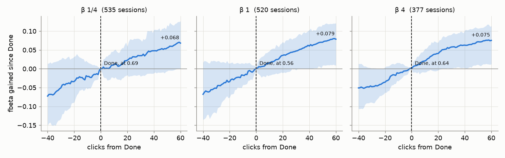
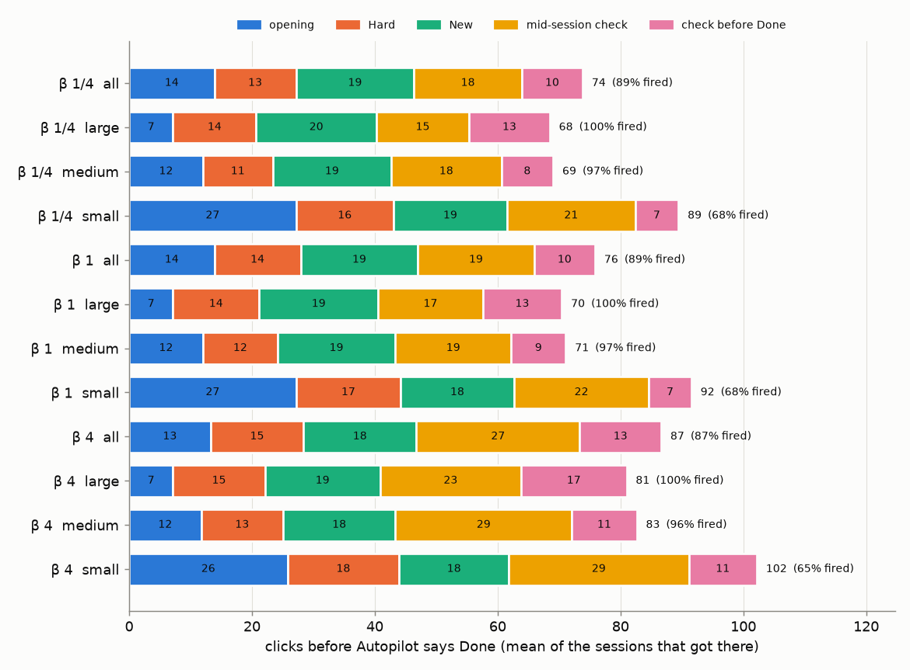

# Are Autopilot's stopping rules any good? (#3560)

**2026-10-14.** A reading of 2,160 simulated sessions on today's app, no new runs. It answers the three
questions the stopping-rules plan (since retired; see [`docs/EVAL.md`](../../EVAL.md#stopping-point-and-stopping-cost-issue-3560)) left open:

1. Is the stop near the session's own best?
2. Which light holds the session, and is it the right one?
3. Do the rules flap because the rule is noisy, or because the detector is?

## The answer

- **Done fires mid-climb.** 87–89% of sessions reach Done, at a Kaplan–Meier median click of 71, 75 and 87
  at β 1/4, 1 and 4. F-beta keeps rising through Done at nearly the rate it rose before it
  ([figure](#what-comes-after-done)). By click 150 it is up **+0.077 ± 0.009, +0.077 ± 0.007 and
  +0.059 ± 0.005**. The median session stops 0.08–0.10 below its own best, and 21–39 clicks before it
  first reaches that best.
- **Smart decides when Hard ends, and Hard is short** (13–15 clicks). Smart is not green on 85–99% of
  Hard's clicks. Hard last ended waiting on Smart alone in 53–63% of sessions, and on Smart with Stable
  still warming up in 25–36%. It ended on Stable alone in 0–5%, except at β 4 (21%). When Stable is not
  green in Hard, it is usually not measuring yet: 75–99% of those clicks have fewer than five retrains of
  history.
- **Span never fails.** New is the atlas walk that turns Span green: 18–19 clicks, and Span never lapses
  once green. The 2026-10-08 review called Span "the binding light". That was a counting error, fixed here
  ([below](#the-counting-error-this-fixes)).
- **Most clicks before Done do not wait on a light.** Of the 74–87 clicks before Done:
  - the opening takes 13–14;
  - Hard 13–15;
  - New 18–19;
  - the mid-session check 18–27;
  - the check before Done 10–13.

  The two checks are 38–46% of the total.
- **Smart flaps, and its flaps say nothing about the F-beta still to come.**
  - **Before the stop:** Smart lapses from green 0.9–1.0 times a session.
  - **After the stop:** it breaks Done in 27–30% of sessions.
  - **Stable** lapses 0.0–0.3 times a session, and **Span** never.
  - **No signal:** sessions whose Done Smart breaks gain no more after the stop than sessions it leaves
    alone. Within class the difference is +0.009 to +0.020, ± 0.012 to 0.014, which this sample cannot
    resolve.

**Is Done a good stop?** Judged by the objective, no. It fires while F-beta is still climbing at full
rate. The light that times it, Smart, reads FPR + FNR at a cut no user sees (#4243) and never reads beta.
Its flaps carry no information about what is still to come. A stop rule in the objective's own units is
filed as [#4878](https://github.com/samggreenberg/VTSearch/issues/4878).

## Data

- **Sessions:** the SigLIP arm (the control) of #4837's A/B, run 2026-10-13 at `1946d8dbc`. That app has
  every change through #4820 (cut total), including #4731 (the Good walk runs dry), #4740 (no More walk)
  and the check before Done. Since then, only #4861 (the typed query as an SVM prior) has changed the
  detector.
- **Grid:** COCO Better, 49 classes in three size bands (144 cells), 5 seeds, at β 1/4, 1 and 4. That is
  720 sessions per preset. Every session runs 150 clicks on the default arm, with the mid-session check and
  the check before Done.
- **Read and reduced by:**
  [`scripts/experiments/state_of_app/stop_rules_3560.py`](../../../scripts/experiments/state_of_app/stop_rules_3560.py)
  (`read`, then `report`), over
  [`stopping.py`](../../../scripts/experiments/calibration/stopping.py).
- **Files:** every table here is in [`tables.md`](tables.md), [`stages.csv`](stages.csv),
  [`margins.csv`](margins.csv), [`smart_lapses.csv`](smart_lapses.csv) and
  [`around_stop.csv`](around_stop.csv).
- **Caveat:** the A/B ran under the transformers 5.19 overlay (#4838). SigLIP's vectors there match the
  pile's (1 − cos ≤ 1.2e-7).

A session's **stop** is the first click at which Autopilot reports Done: all three lights green, and the
check before Done closed. The simulated user clicks on to 150 either way. That is what says whether
stopping was right.

## Where the app said stop

`fired` comes first because every later column describes only the sessions that fired. The KM median
counts the sessions that never fired as censored at click 150. Δ is F-beta at click 150 minus at the stop,
paired within session (median).

| preset | sessions | fired | stop click (KM) | stop click, median of fired [IQR] | F-beta at stop | at click 150 | Δ (median) | short of own best | clicks past own best |
|---|---|---|---|---|---|---|---|---|---|
| β 1/4 | 720 | 89% | 71 | 67 [57–83] | 0.72 | 0.85 | +0.03 | 0.10 | −21 |
| β 1 | 720 | 89% | 75 | 71 [59–86] | 0.47 | 0.64 | +0.05 | 0.09 | −39 |
| β 4 | 720 | 87% | 87 | 82 [67–100] | 0.64 | 0.72 | +0.04 | 0.08 | −28 |

The mean gains, with SEs over the 49 class means, are +0.077 ± 0.009, +0.077 ± 0.007 and +0.059 ± 0.005.
They are larger than the medians because a minority of sessions gain a lot after the stop.

**By band, it is the small objects that do not get there.** Large objects fire in 100% of sessions,
medium in 96–97%, small in 65–68%. Where small objects do fire, they fire later (median click 85–100).
Every band gains after the stop. Medium objects gain the most (median +0.06 to +0.07), and also stop
furthest below their own best (0.10–0.15).

## What comes after Done



*The y-axis is F-beta at each click minus F-beta at Done, paired within session: the mean, with the
inter-quartile band. Each panel holds only the sessions whose stop has 40 clicks before it and 60 after
inside the 150. That keeps one population across the whole x-axis, so the right edge is not the late
stoppers dropping out. The cost is that it drops the earliest and latest stoppers: 377–535 of 629–640
fired sessions remain. The level at Done is printed by the line. Each preset is scored at its own beta,
so do not compare levels across panels.*

There is no knee at Done. The 40 clicks before it raised F-beta by 0.05–0.07, and the 60 after it raise
it by another 0.07–0.08. Autopilot's lights turn green on a detector still improving at full rate.

## Where the clicks before Done went



*Means over the sessions that reached Done, so the stretches add up to the mean stop click (right).
Read the fire rate first: small objects reach Done in only two thirds of sessions.*

| preset | stop click (mean) | opening | Hard | New | mid-session check | check before Done | F-beta at Hard's end | at stop | Δ (paired, mean ± SE) |
|---|---|---|---|---|---|---|---|---|---|
| β 1/4 | 74 | 14 | 13 | 19 | 18 | 10 | 0.66 | 0.72 | +0.036 ± 0.008 |
| β 1 | 76 | 14 | 14 | 19 | 19 | 10 | 0.44 | 0.47 | +0.031 ± 0.005 |
| β 4 | 87 | 13 | 15 | 18 | 27 | 13 | 0.59 | 0.64 | +0.032 ± 0.005 |

Each stretch waits on something different:

- **The opening** waits on its targets.
- **Hard** waits on Smart and Stable.
- **New** waits on Span. It is the walk that fills Span.
- **The two checks** are band walks whose rounds are clicks. Their length is the walk's, not a light's.

From Hard's last end to Done is 30–34 clicks (mean): New, the check before Done, and any check prompted
in between. Over those clicks F-beta rises +0.031 to +0.036, about 0.001 a click. A click after Done
buys about the same: +0.059 to +0.077 over a median of 68–83 clicks.

One session, literally: apple@medium at β 1, seed 0.

1. The opening takes clicks 1–7, then Hard runs 3 clicks.
2. A weak separation prompts a check at click 10, which runs four rounds to click 30.
3. Hard runs 5 more clicks.
4. New walks the atlas for 20 clicks, to click 55, where all three lights are green.
5. The check before Done runs six rounds, to click 85.
6. Done comes at click 86, at F-beta 0.51. Smart had lapsed three times on the way.

That session ends at 0.64, its own best, at click 150.

## Which light held the session

| preset | Smart not green, of Hard's clicks | Stable not green | both | Hard last ended on: Smart / Stable / both | Stable's not-green Hard clicks: warm-up / avg / max / falling |
|---|---|---|---|---|---|
| β 1/4 | 99% | 65% | 65% | 63% / 0% / 36% | 99% / 0% / 1% / 0% |
| β 1 | 94% | 69% | 64% | 59% / 5% / 35% | 90% / 1% / 9% / 0% |
| β 4 | 85% | 76% | 61% | 53% / 21% / 25% | 75% / 9% / 16% / 0% |

**Smart is the binding rule in Hard at every preset.** Stable rarely holds anything alone. Most of its
not-green time in Hard is warm-up: fewer than five labels of a class, or fewer than five retrains of
history. Hard is short, so Stable is often still warming up when Smart first goes green.

**Stable's own gates bite mainly at β 4.** There, one Hard click in four that Stable holds is a measured gate:
the window average (9%) or one bad step (16%). This is #4359's observation, measured. The β 4 line sits
deeper, so more items cross it per retrain.

How close each gate came, over the Hard clicks it held (Span over New's). The margin is the median, and
the bracket is the share of those clicks the gate was green at:

| preset | Smart slope | Smart t | Stable avg | Stable max | Span nodes |
|---|---|---|---|---|---|
| β 1/4 | −0.046 [1%] | −1.9 [1%] | +0.005 [100%] | +0.009 [99%] | −17 [0%] |
| β 1 | −0.041 [13%] | −1.8 [14%] | +0.005 [97%] | +0.009 [80%] | −17 [0%] |
| β 4 | −0.022 [30%] | −1.2 [32%] | +0.004 [84%] | +0.003 [55%] | −17 [0%] |

**Smart's gates** are well short of green while they hold Hard, because the error cost is still falling.
Smart going green is what ends Hard, 13–15 clicks in.

**Span's −17** is the walk still to go, read on average halfway through it. It is not a gate failing.

## Does the rule flap, and does a flap mean anything?

| preset | Smart lapses before the stop, per session | Stable | Span | Done broken by Smart after the stop | gain after the stop: broken / kept | within class, broken − kept |
|---|---|---|---|---|---|---|
| β 1/4 | 0.9 | 0.0 | 0.0 | 30% | +0.072 / +0.079 | +0.019 ± 0.014 (41 classes) |
| β 1 | 0.9 | 0.1 | 0.0 | 28% | +0.076 / +0.077 | +0.020 ± 0.013 (41 classes) |
| β 4 | 1.0 | 0.3 | 0.0 | 27% | +0.057 / +0.060 | +0.009 ± 0.012 (39 classes) |

**Span cannot flap.** Its level only grows.

**Stable barely flaps** below β 4. At β 4 it lapses 0.3 times a session, from the same deeper-line crossings
as above.

**Smart is the light that flaps.** It sends New back to Hard about once a session before the stop, and
after the stop it breaks Done in 27–30% of sessions. #3832 asked whether a flap is the rule's noise or the
detector's change. The useful test here is whether a flap tells the user anything. If Smart broke Done
because the detector was moving again, the sessions it broke would have more F-beta still to come. They
gain the same as the sessions it left alone, within class and within noise. So the flaps are noise in the
objective's units, whatever they mean about FPR + FNR at Inclusion 0.

## The counting error this fixes

The 2026-10-08 review ([its stopping section](../2026-10-08-state-of-the-app-binary-photo/REPORT.md)) said
"Span is the binding light: it is not green on every held click of every session, and its margin sits at
−35 nodes". Both numbers counted every click before the stop, opening and Hard included.

Autopilot walks the atlas only in New, which it enters once Smart and Stable are green. So Span is never
green before New, by construction, and a not-green count over every held click names it binding in every
session there is.

`stopping.py` now reads each light in the stretch that waits on it:

- Smart and Stable over Hard's clicks, and Span's margin over New's.
- `stopping_points` splits the clicks before the stop by stretch (`clicks_*`, which add up to the stop),
  and names the light Hard last waited on (`hard_exit_light`).
- It counts each light's lapses before the stop (`lapses_*`) and what broke Done after it
  (`done_lapses_*`).
- `stage_table` and a rewritten `binding_note` report them. `blocked_span` is gone, because it would be 1
  by construction.
- The margin table pools its shares over clicks rather than taking a median of per-session shares, and
  separates Stable's warm-up from its gates. The 10-08 table put "Stable avg green on 100% of held clicks"
  beside "avg blocks Stable 75% of the time": each was a median over a different subset of sessions.

The State of the App analyzer prints the stage table and the new note in every review's stopping block.

**Re-read on the 10-08 review's cells** (24 seeds, the app before #4740 and before the check before Done),
the same structure holds:

- Smart was the last light green before New in 60–70% of sessions, Stable in 23–37%, both in 3–7%.
- New was a 17–18-click walk.
- Smart lapsed 0.8–0.9 times a session before the stop, Stable 0.1–0.2, Span never.

The 10-08 report carries a correction note pointing here.

## Follow-up

- [#4878](https://github.com/samggreenberg/VTSearch/issues/4878): a stop rule in the objective's units.
  The labels line computes the expected F-beta at the session's beta on every retrain (what
  `labels_line.corpus_cut` maximises). Record it per step, then price "stop when it stops rising" against
  Done, at each preset, on the questions above: fire rate, stop click, F-beta at the stop, and gain after
  it.

## Reproduce

```bash
S=/expscratch/sgreenberg/state-of-the-app/2026-10-13-eg2-4837
cd scripts/experiments/state_of_app
python stop_rules_3560.py read --cells 0.25=$S-b025/results/cells --cells 1=$S-b1/results/cells \
    --cells 4=$S-b4/results/cells --embedder siglip --work /expscratch/$USER/stop-3560/work-1013   # ~3 min, 8 CPUs
python stop_rules_3560.py report --work /expscratch/$USER/stop-3560/work-1013 \
    --out ../../../docs/experiments/2026-10-14-stopping-rules-3560
```
