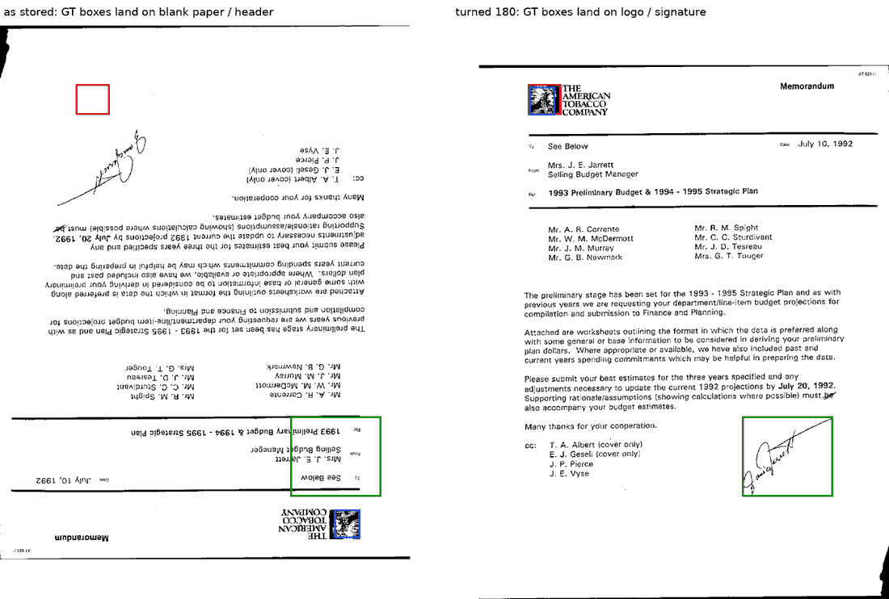

# A Tobacco800 page whose ground truth is upside down (#4871)

**Verdict.** The all-white logo box on `tobacco800/dic45f00_1` was not a
missing logo. Tobacco800's XML for that page was drawn on the page turned the
right way up, and the TIF is stored upside down. Turned 180 degrees, the box
sits exactly on the American Tobacco Company eagle. The completeness pass had
already boxed that eagle a second time, as mark 2, because the source box was
empty. The page's boxes are now turned at the source and the second box is
folded into the first.

With the blank box gone, Tobacco800's pre-membership named-marks arm breaches
**0 of 57** ruled-different pairs at ×1 and ×1.25, down from 1 and 7. Every
other arm and source is unchanged.

## What was wrong



*Left: the TIF as stored, with the XML's logo box (red) and signature box
(green). The red box holds no ink at all (every pixel is 255), and the green
one sits on the memo header. The blue box is mark 2, the eagle the completeness
pass added. Right: the same page turned 180 degrees, with the XML's boxes
unchanged. They land on the eagle and on Mrs. Jarrett's signature.*

- The TIF's Orientation tag is 1 ("normal"), so no reader turns it. The XML's
  page size matches the image (1200 × 1575), so nothing else is off either.
- Both of the page's zones are in the turned frame, not just the logo. The
  signature zone was wrong too, but signatures are recorded and never queried,
  so only the logo showed up.


*Red: the XML's logo box, turned (92 × 84). Blue: the completeness box (71 ×
78), which clips about a fifth off the icon's right edge. The source box is the
better of the two, so it is the one kept.*

## Only this page

`turned_gt_audit.py` compares the dark share of every GEDI zone with the dark
share at its 180-degree image. It flags a logo zone that is at most 1% dark
where it is and at least 3% dark turned.

| | count |
|---|---:|
| GEDI zones | 1,342 on 860 pages |
| logo zones | 432 |
| flagged | **1** (`dic45f00_1`, 0.0% dark as stored, 55% turned) |
| next emptiest logo zone | `alk3aa00`, 5.6% as stored and 1.8% turned: a faint logo, correctly placed |

Signature zones are measured but not flagged. A signature is a few strokes, so
182 of 910 signature boxes have more ink turned than in place, and 25 have more
than twice as much, because the turned box lands on body text. That is noise,
not a signal.

## The change

- **`sources/tobacco800.py`** has a `TURNED_180` table of page stems and a
  `turn_180` helper. `build_pages` turns those pages' boxes, so a rebuild reads
  `dic45f00_1` right: signature `[154, 282, 249, 220]`, logo
  `[900, 1330, 92, 84]`.
- **`audit_to_corrections.py --turn-pages`** brings a corpus built before a
  page joined the table into line. It is dry unless given `--apply`. Each
  shipped box gets its turned box in place, guarded on the old box, so no
  index moves. Where a turned source mark holds at least half of a hand-added
  mark of the same kind, it is one instance boxed twice and is folded:
  - the added mark's class moves onto the source mark;
  - every adjudication naming the added mark (as an endpoint or in recorded
    members) is re-pointed, and its note says so;
  - the `added_marks.json` row is dropped, and the mark leaves the page.

  It reports instead of writing when the fold would:
  - renumber a later mark;
  - overwrite a class someone ruled on;
  - make two rows name one pair.

The owner chose this over two alternatives on 2026-10-14. Retiring mark 1 in
place would have kept the clipped box and the wrong signature box. A box
override alone would have left two marks on one eagle.

**Applied to the live store on 2026-10-14**, after a rehearsal on a copy. The
backup is `corpus/backup-pre4871-20261014/`. The edit is exactly:

| file | change |
|---|---|
| `corpus.jsonl` | `dic45f00_1`: marks 0 and 1 turned; mark 1 now `logo_afm90c00-first_1_0`; mark 2 gone. The other 199,854 records are byte-identical and in the same order |
| `adjudications.json` | the one row naming mark 2: `afm90c00-first_1#0 same dic45f00_1#2` now names `#1`, note extended. The other 2,296 rows are byte-identical |
| `added_marks.json` | the eagle's row dropped |

A second run prints "every turned page is already turned". No page's labels
change: `dic45f00_1` is still a member of `logo_afm90c00-first_1_0`, and
`logo_alk3aa00_1` was a singleton that was never admitted to `classes.json`,
so no cell needs a relabel.

## Re-clustered

`separation_check.py` on the repaired store. Tobacco800 class pairs fused, of
57 ruled different:

| arm | ×1 | ×1.25 | ×1.5 | ×2 | ×3 |
|---|---:|---:|---:|---:|---:|
| before, two named marks: #3837 run | 1 | 7 | 17 | 34 | 34 |
| before, two named marks: **now** | **0** | **0** | 5 | 23 | 23 |
| before, members recorded | 0 | 0 | 0 | 0 | 0 |
| stored | 0 | 0 | 0 | 0 | 0 |

- SPODS and StaVer rows are identical to #3837's.
- The ×1 and ×1.25 breaches all ran through this box, so they are gone. The
  issue's table showed it as the first bridge for 13 of the 17 breaches at ×1.5
  and 19 of the 34 at ×2. Removing it does not subtract that many, because
  once one bridge is gone single linkage finds the next.
- **What is left has no hub.** At ×1.5 the five breaches cross at 0.23–0.24,
  and no mark bridges more than two of them. That is the 256-bit hash's limit
  on busy logos, the same story as SPODS at ×1.25.
- The blank box also chained groups where it breached nothing. The `stored`
  arm at ×1.25 has 43 groups instead of 38.

`separations.csv` here is this run's.

## What this does not cover

- **Signature-only pages are not audited.** 448 of the 860 annotated pages
  carry only signature zones, and the audit cannot tell one of those that is
  turned. That leaves signature boxes only, which are never queried, and a
  page with no logo zone has no logo for a turned frame to hide.
- **#4866 still refuses every Tobacco800 rebuild**, so this run skips that
  pair, as #3837's did. A real rebuild of the page is pinned by the tests
  (`TestATurnedTobacco800Page`), not by a build.

## Reproduce

```bash
python scripts/experiments/fullmarks/turned_gt_audit.py --out turned_gt_audit.csv
python scripts/experiments/fullmarks/audit_to_corrections.py --turn-pages            # dry run
python scripts/experiments/fullmarks/separation_check.py \
    --out /expscratch/sgreenberg/fullmarks/separation-check-4871 \
    --skip-pair 'tobacco800/afm90c00-first_1#0,tobacco800/bad45f00#1'
```

The audit took 9 s on one CPU. The separation check took 27 s on four CPUs,
reusing #3837's SPODS and StaVer descriptors, so only Tobacco800 was hashed;
cold, it is about 5 minutes. Outputs are in
`/expscratch/sgreenberg/fullmarks/flip-audit-4871/` and
`/expscratch/sgreenberg/fullmarks/separation-check-4871/`.
