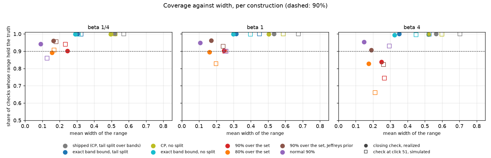
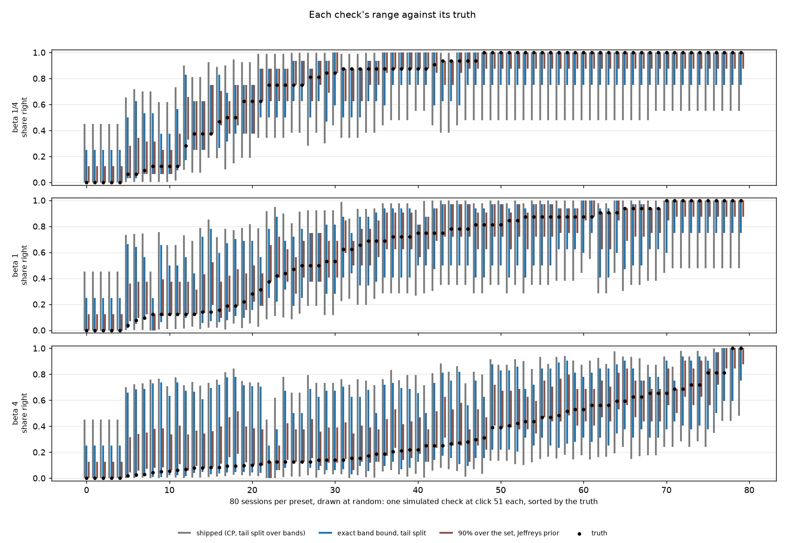

# The spot check's precision range, re-priced (issue #4483)

**Status (2026-10-15): priced on existing runs (Binary Photo, every preset, 5 seeds); no new runs. Which range the
check shows is the owner's call (below).**

**The range is wide mostly because of how each band's bound is computed, not because of the union split.** After a
check, the state line reads "likely X–Y% right" for the set the check audited. Each band of that set gets 5 random
picks, and the shipped range bounds each band as if those picks came from an endless list (Clopper-Pearson), then
splits the tails over the bands (#4272). But a band has a known size, and the top bands are tiny. A band of 8
with 4 of 5 right holds 4 to 7 right items, not "34–99%". The exact bound for a band of known size (hypergeometric)
keeps every promise the shipped range makes and is never wider on any check. Its median width is 0.55–0.76 of the
shipped range's:

| what the state line reads | shipped | exact band bound |
|---|---|---|
| top 8, 0 of 5 right | 0–45% | 0–25% |
| top 8, 1 of 5 right | 1–66% | 12–50% |
| top 8, 4 of 5 right | 34–99% | 50–88% |
| top 8, 5 of 5 right | 55–100% | 75–100% |
| top 16, 5 + 5 of 10 right | 48–100% | 75–100% |
| top 32, 5 + 4 + 3 of 15 right | 24–98% | 38–91% (44–91% without the split) |

**Dropping the union split is safe now, and buys a little more.** The split existed because, under the precision
floor, the same labels decided a pass and drew its range: a plain range sat above the truth 11% of the time after a
first pass (#4272). Today the check is advisory, and the walk that picks the audited set no longer biases its range
measurably: without the split, the shipped construction held the truth in 99.2–100% of 3,568 real checks. With exact
band bounds and no split, every regime held the truth in at least 98.9% of checks, at a further 0.01–0.08 off the
width (it matters only when the set spans several bands, mostly at beta 4).

**A "plain 90%" interval over the set is narrower again, but it overclaims.** The narrowest constructions (90% over
the whole set, under either prior, or a normal interval) are 0.09–0.29 wide. But they held the truth in only 72–96%
of checks. The two 90% intervals over the set miss on the bad side: the range sits above the truth, saying the set
is better than it is, worst at beta 4 (72–84% held). The normal interval misses both ways and is uneven across
presets (85–95%). A range the user cannot trust is worse than a wide one, so this report does not recommend them.

**Even the best honest range stays 0.3–0.5 wide during a session.** That is what 9–18 random picks can say about
a set of 16–64 items. Making it tighter means more picks per band, which costs clicks. #4909 just removed the checks'
repeat because their clicks no longer paid.

## Coverage against width

Share of checks whose range held the truth, and the range's mean width. "Check at click 51" is the shipped walk run
on each session's ranking at click 51 (simulated, 20 draws a session); the check before Done runs at a median click
of 57–63 (#4909). "Closing check" is the real check every run ends with, at click 400.

| construction | beta 1/4, click 51 | beta 1, click 51 | beta 4, click 51 | beta 1/4, closing | beta 1, closing | beta 4, closing |
|---|---|---|---|---|---|---|
| **shipped**: Clopper-Pearson per band, tails split over the bands | 100% / 0.57 | 100% / 0.68 | 100% / 0.70 | 100% / 0.52 | 100% / 0.53 | 100% / 0.56 |
| **exact band bound**, tails split | 100% / 0.32 | 100% / 0.45 | 100% / 0.53 | 100% / 0.30 | 100% / 0.32 | 100% / 0.35 |
| **exact band bound**, no split | 100% / 0.31 | 100% / 0.40 | 99.6% / 0.45 | 99.9% / 0.29 | 99.9% / 0.30 | 99.4% / 0.32 |
| 90% over the set, uniform prior | 94% / 0.23 | 90% / 0.25 | 75% / 0.27 | 90% / 0.25 | 90% / 0.25 | 84% / 0.25 |
| 90% over the set, Jeffreys prior | 96% / 0.18 | 93% / 0.24 | 82% / 0.26 | 96% / 0.16 | 96% / 0.17 | 91% / 0.19 |
| normal 90% | 86% / 0.13 | 90% / 0.26 | 93% / 0.29 | 94% / 0.09 | 95% / 0.11 | 95% / 0.15 |

The same order holds at clicks 25 and 100 and at the 200-click closing check (`tables/summary.csv`). Mean width at
clicks 25 / 51 / 100:

| | beta 1/4 | beta 1 | beta 4 |
|---|---|---|---|
| shipped | 0.60 / 0.57 / 0.62 | 0.67 / 0.68 / 0.63 | 0.70 / 0.70 / 0.66 |
| exact band bound, tails split | 0.36 / 0.32 / 0.37 | 0.47 / 0.45 / 0.39 | 0.54 / 0.53 / 0.46 |
| exact band bound, no split | 0.33 / 0.31 / 0.35 | 0.41 / 0.40 / 0.36 | 0.46 / 0.45 / 0.40 |

On each check the exact band bound is never wider than the shipped range. Per check, its median width is 0.55 of the
shipped range's on a single band (most closing checks, and beta 1/4) and 0.67 / 0.76 at beta 1 / 4 during a session;
without the split, 0.58 / 0.63.



Per check, at click 51: shipped (grey), exact band bound with the split (blue), and Jeffreys 90% (brown), against
the truth (dot). At beta 4 the brown bars sit above low truths, which is the overclaim:



## The line's own kept set

The issue also asked about a range on the set the line keeps rather than the set the walk ended on (since #4452
they differ, which #4914 just re-worded the state line around). The same picks can bound it: a band inside the kept
set counts whole, the band the line cuts counts the picks that fell above the line, and any part no pick reached is
0–100%. With exact band bounds and no split it held the truth in at least 99.7% of simulated checks, at a mean width
of 0.35–0.49:

| kept-set range at clicks 25 / 51 / 100 | beta 1/4 | beta 1 | beta 4 |
|---|---|---|---|
| shipped construction | 0.64 / 0.58 / 0.54 | 0.72 / 0.65 / 0.57 | 0.72 / 0.70 / 0.63 |
| exact band bound, no split | 0.38 / 0.35 / 0.36 | 0.46 / 0.36 / 0.36 | 0.49 / 0.42 / 0.39 |
| median kept count | 15 / 9 / 2 | 34 / 17 / 8 | 99 / 28 / 20 |

So it is viable. It describes the line's count as the check started; the line then moves as the check's votes
retrain the model, as the audited set's range does today.

## Literal checks

Real closing checks (click 400), bands as size : picks : right : truly right (`tables/examples.csv`):

| check | bands | truth | shipped | exact, split | exact, no split | Jeffreys 90% |
|---|---|---|---|---|---|---|
| tie@medium, seed 2, beta 1 | 8:5:0:1 | 12% | 0–45% | 0–25% | 0–25% | 0–12% |
| bicycle@large, seed 2, beta 1 | 8:5:4:7 | 88% | 34–99% | 50–88% | 50–88% | 62–88% |
| toothbrush@medium, seed 1, beta 1 | 8:5:3:5 | 62% | 19–92% | 38–75% | 38–75% | 38–75% |
| toothbrush@large, seed 0, beta 4 | 8:5:5:8; 8:5:5:8; 16:5:1:4 | 62% | 22–87% | 34–81% | 41–78% | 50–75% |
| book@medium, seed 0, beta 1 | 8:5:0:0; 8:5:1:1; 16:5:0:0; 32:5:1:2; 64:5:1:1; 128:5:1:2 | 2.3% | 0–77% | 2–73% | 2–61% | **10–40%** |
| bottle@large, seed 0, beta 1 | 8:5:1:1; 8:5:0:0; 16:5:0:0; 32:5:1:2; 64:5:1:1 | 3.1% | 0–74% | 2–67% | 2–57% | **8–37%** |

The last two are the Jeffreys range's typical miss. A band of 64 or 128 that is nearly empty still shows a right pick
now and then (5 picks among 2 positives in 128 catch one 8% of the time), and when it does, the walk's estimate rises
and it goes deeper. A 90% interval reads that pick as "about a fifth right" and excludes the truth. The exact bound
reads it as "at least 1 of 128".

## What was run

| | |
|---|---|
| closing checks | every run's end-of-session check, real picks: `2026-10-15-stop4903-b{025,1,4}` (#4903, 400 clicks, 3 × 718 checks) and `2026-10-15-repeat4909-r0-b{1,4}` (#4909's "once" arm, the app as shipped now, 200 clicks, 2 × 707). A check's rounds are its bands in order (5 picks a band). Its truth comes from the `last` rank frame, which is the ranking the check walked: the frame's unvoted count is the check's first round's plus 5 on every check |
| reproduction | the shipped construction rebuilt from those counts equals the harness's `range_lo` / `range_hi` on all 3,568 checks (`tables/realized_check.json`: 0 mismatches) |
| checks during a session | the shipped walk (`SpotCheck.start_balance`, its own draws) on each session's `step` rank frame at clicks 25, 51 and 100, 20 draws per frame, at the run's beta. The walk's count of positives is the frame's true unvoted count, because the mixture's is not logged. Doubling it moves widths by at most 0.03 and coverage by at most 0.02 (`simulated_npos2`). A frame is written only on an ordinary step, so a session inside a check round at click 51 has none: 855 of 2,160 sessions have a click-51 frame, against 1,875 at click 25 and 2,028 at click 100 |
| constructions | per band of size N with r of n picks right: Clopper-Pearson (shipped) or the exact hypergeometric bound, each tail at alpha / bands (alpha 0.05, the shipped split) or at alpha. Band bounds are size-weighted and summed, as shipped. The 90% intervals over the set convolve each band's posterior count under a uniform or Jeffreys (beta-binomial ½, ½) prior. The normal interval is stratified with the finite-population factor |
| code | `scripts/experiments/state_of_app/check_range_4483.py` at dev f54cefe5d (`realized`, `simulate`, `report`, `figures`); no app or harness change |
| compute | one 16-CPU job, about 5 minutes |

```
python scripts/experiments/state_of_app/check_range_4483.py realized s025=<sota>/2026-10-15-stop4903-b025 \
  s1=<sota>/2026-10-15-stop4903-b1 s4=<sota>/2026-10-15-stop4903-b4 \
  r1=<sota>/2026-10-15-repeat4909-r0-b1 r4=<sota>/2026-10-15-repeat4909-r0-b4 --out <out>
python scripts/experiments/state_of_app/check_range_4483.py simulate s025=... s1=... s4=... --out <out> --draws 20
python scripts/experiments/state_of_app/check_range_4483.py simulate s025=... s1=... s4=... --out <out> --draws 20 \
  --npos-scale 2 --tag _npos2
python scripts/experiments/state_of_app/check_range_4483.py report <out>
python scripts/experiments/state_of_app/check_range_4483.py figures <out> --docs docs/experiments/2026-10-15-check-range-4483 \
  --featured hg_union,bayes90j
```

## Decision (owner)

1. **How each band is bounded.** Recommended: the exact bound for a band of known size, without the union split.
   It is the narrowest construction that held the truth in at least 98.9% of checks in every regime. Keeping the
   split costs 0.01–0.08 of width for its formal guarantee. Shipping either one changes `likely_range` and
   `range_tail` in `spot_check.py`, and the recall range follows. The frontend draws `lo` / `hi` as it does now.
2. **Which set the range describes.** Today it is the set the walk audited. The line's kept set is also viable at
   about the same width, and it would let the state line put the range beside "N more kept".
