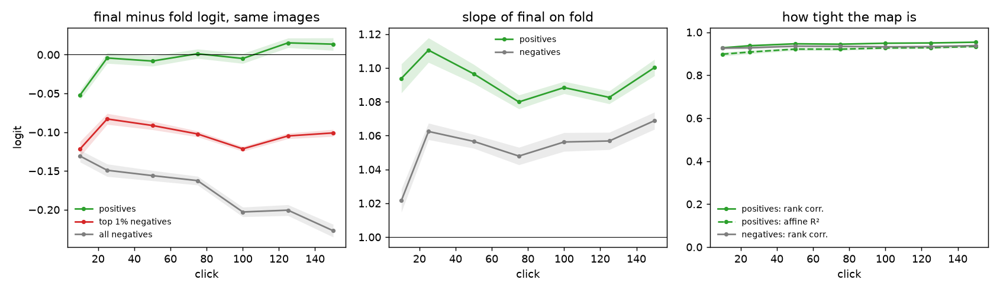
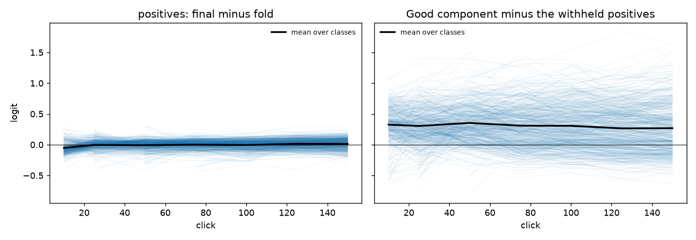
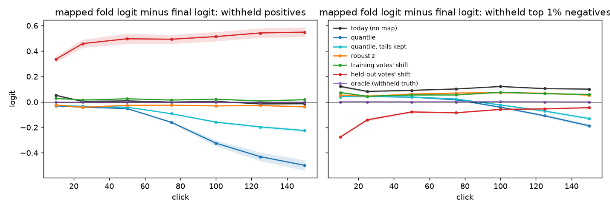
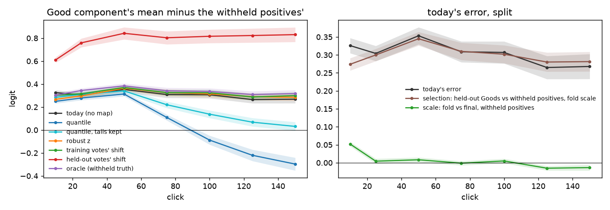
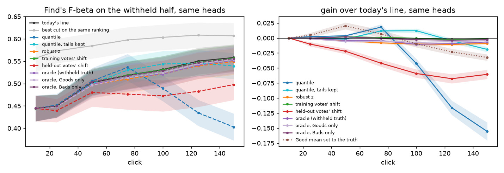
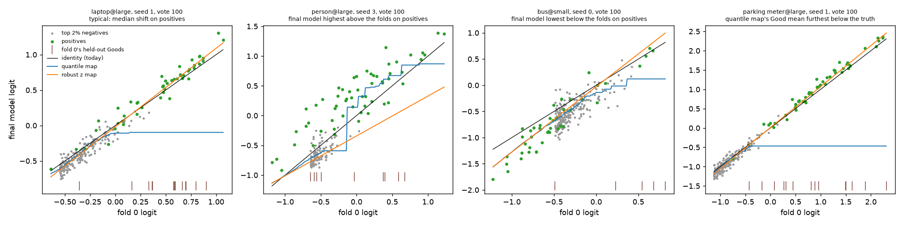
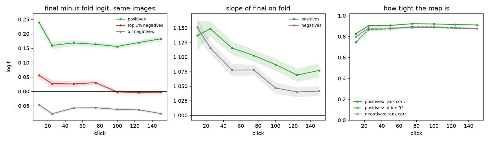
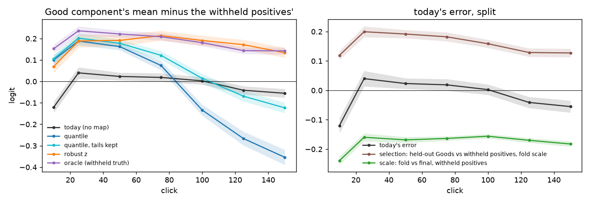

# The fold models already score positives on the final model's scale; the labels line's Good error is selection (issue #4936)

**Status (2026-10-16): measured on Binary Photo at beta 1, in 702 sessions of today's app. No correction recovers
the positives' map better than today's raw pooling, so by the issue's rule no A/B follows. Region Photo (seed 0,
139 sessions, below) is the other way round: there the fold models score positives 0.16 to 0.24 logit too low,
which cancels the selection error, so correcting the scale alone loses F-beta.**

**Scored side by side on the withheld half, which no model has seen, a calibration fold model and the final model
put the same positives at the same logit.** The final model's logit minus the fold model's is −0.01 to +0.02
(± 0.01) at every listed click from vote 25 to 150, and −0.05 at vote 10. The slope is 1.08 to 1.11 and the rank
correlation 0.93 to 0.95. The scales part on the negatives. The final model trains on every vote, and it scores the
negatives 0.13 to 0.23 lower than a fold model does, and the top 1% of the half, where the line cuts, 0.08 to 0.12
lower. So the map depends on the class. Every candidate fitted on the unvoted remainder, which is nearly all
negatives, carries the negatives' map onto the positives:

| at vote 150, the withheld positives | today (no map) | quantile | quantile, tails kept | robust z | training votes' shift | held-out votes' shift |
|---|---|---|---|---|---|---|
| mapped fold logit minus final logit | −0.01 | **−0.50** | **−0.22** | −0.04 | +0.02 | **+0.55** |

- **The Good component's error is selection, not scale.** At every click the labels line's Good component sits
  0.26 to 0.35 logit above the withheld positives' own mean. Split exactly, selection accounts for +0.27 to +0.35
  of that: the held-out Goods outscore random positives on the fold model's own scale. Scale accounts for −0.02
  to +0.05.
- **No scale map pays on the same heads.** Even the oracle, a per-class affine map fitted on the withheld half's
  own truth, moves Find's F-beta by −0.001 to −0.011 (± 0.002) from vote 25 on. The training votes' shift moves it
  by −0.003 to +0.002, and the robust z by 0.000 to −0.011. The scale is right already. Where it is not quite (a
  slope of 1.1 lifts the high-scoring held-out Goods a little), correcting it adds to the selection error instead
  of offsetting it, and the line, already too conservative (#4910), keeps a few images fewer.
- **#4910's result, explained.** The quantile transfer moves the Good component by the negatives' shift, then
  saturates. It crosses the truth near vote 90, which is where #4910 found it ahead (+0.018 at vote 75 here). By
  vote 150 it sits 0.30 below the truth and loses 0.156 F-beta (#4910: −0.152). #4910's "two mistakes that
  cancelled" are one mistake, selection, plus a negatives' map applied to positives.

What remains is #4937's question, the selection term. One reading for it: on the same heads, setting the Good
component's mean to the withheld positives' own mean gains +0.020 (± 0.006) at vote 50 and loses 0.010 to 0.032
from vote 100 on. So the Good mean alone does not explain the line's early conservatism.

## The question

The labels line (#4452) fits its class model on the calibration folds' held-out scores, each on its own fold
model's scale, and cuts on the final model's scores. #4910 priced carrying those scores across by quantile and
found it did not help. That did not show the scales agree: the quantile map is fitted on the unvoted remainder, so
it is a negatives' map. This study measures the fold-to-final relation directly, per class, on images no model has
seen. It judges every candidate correction against that relation offline, and an A/B follows only if one recovers
the positives' map.

## What was run

| | |
|---|---|
| sessions | today's app (the default arm), Binary Photo: `coco_better`, 144 class@band cells × 5 seeds, SigLIP whole-image, on the 2026-10-08 grid; beta 1; 150 clicks; trajectory pass |
| instrument | `CALIB_SAVE_FOLD_SCALES=1` (new, record only). At clicks 10, 25, 50, 75, 100, 125 and 150 the test-score snapshot also carries each live fold model's scores of the withheld half, every model's scores of the whole sim set with its truth and votes, and the vote behind each held-out score. A unit test pins that the session is unchanged and that every remainder haystack replays exactly |
| folds | the app's: 2 fold models, each trained on an independent stratified 70% of the votes and scoring the other 30% |
| replay check | the offline replay draws the run's own line: the class model and the Train cut match exactly, and Find's F-beta and the quantile shadow (fitted beside the line, drawing nothing) to 5e-7, at every step past the typed query's hold. Under the hold (< 30 labels) the run's row reports the query's own set, not the head's line; all 1,093 mismatches are there |
| coverage | 702 sessions. 18 small-band sessions found no Good in 150 votes, never trained a head, and leave no snapshot. A snapshot is the first ordinary step at or past a listed click; a session whose head first scores the withheld half late reads that one step for the largest listed click at or below it |
| line | at vote 10 every line is the head's count cut (fewer than 6 held-out Goods), so no map can move Find's F-beta there; at vote 25 72% of steps, at 50 27%, at 150 9% |
| compute | 640 cells in cpu packs, 80 in V100 packs with the GPU hidden, 18:02–18:55; `run_cells.py` pins the CPU kernels (#4110) |

Every ± is one SE over classes: a class's bands and seeds are averaged first, because they are not independent.
The withheld half holds a median of 50 positives per session (36 to 69).

The candidate maps, each carrying fold *k*'s logit onto the final model's scale:

| map | what it is | deployable |
|---|---|---|
| today (no map) | the logit as fold *k* scored it | the app |
| quantile | #4910's `quantile`: the quantile in fold *k*'s remainder, read off the final model's remainder | yes |
| quantile, tails kept | #4910's `quantile_tails` | yes |
| robust z | the owner's: the same number of MADs from the remainder's median | yes |
| training votes' shift | per class, the mean final-minus-fold logit over the votes fold *k* trained on (both models in-sample) | yes |
| held-out votes' shift | per class, the same over the votes fold *k* held out (the final model in-sample, the fold not) | yes |
| oracle | per class, the affine fit of final on fold over the withheld half's own positives (Goods) and top 2% negatives (Bads) | no: it reads the truth |

## The true map



*Left: the final model's logit minus fold *k*'s on the same withheld image, averaged over the folds. Middle: the
OLS slope of final on fold within each class. Right: rank correlation and affine R² within the class. Bands are
±1 SE over classes.*

| vote | snapshots | positives: final − fold | slope | rank corr. | all negatives | top 1% negatives | unvoted positives in the Train pool |
|---|---|---|---|---|---|---|---|
| 10 | 500 | −0.05 (± 0.01) | 1.09 | 0.93 | −0.13 (± 0.01) | −0.12 (± 0.01) | −0.06 (± 0.01) |
| 25 | 551 | −0.00 (± 0.01) | 1.11 | 0.94 | −0.15 (± 0.01) | −0.08 (± 0.01) | −0.02 (± 0.01) |
| 50 | 610 | −0.01 (± 0.01) | 1.10 | 0.95 | −0.16 (± 0.01) | −0.09 (± 0.01) | −0.03 (± 0.01) |
| 75 | 638 | +0.00 (± 0.01) | 1.08 | 0.94 | −0.16 (± 0.01) | −0.10 (± 0.00) | −0.03 (± 0.01) |
| 100 | 655 | −0.00 (± 0.01) | 1.09 | 0.95 | −0.20 (± 0.01) | −0.12 (± 0.00) | −0.06 (± 0.01) |
| 125 | 666 | +0.02 (± 0.01) | 1.08 | 0.95 | −0.20 (± 0.01) | −0.10 (± 0.00) | −0.05 (± 0.01) |
| 150 | 681 | +0.01 (± 0.01) | 1.10 | 0.95 | −0.23 (± 0.01) | −0.10 (± 0.00) | −0.07 (± 0.01) |

- **Close to the identity for positives, at every click.** The mean shift is within 0.02 of zero from vote 25 on.
  The slope of 1.08 to 1.11 means the final model spreads the positives about 10% wider around an unchanged mean.
  The map is tight and close to affine: rank correlation 0.93 to 0.95, affine R² 0.90 to 0.93.
- **Not the same map for the two classes.** The final model scores the negatives lower, by 0.13 at vote 10
  growing to 0.23 by vote 150, and their top by about 0.1 throughout. A fold model sees 70% of the Bads; the final
  model sees them all and pushes the bulk down further.
- **The Train pool's unvoted positives agree** with the withheld positives to within 0.08. They are the positives
  acquisition has not found yet, so the same map holds where the Train side's line cuts.

### Per session



*Each thin line is one session (class@band, seed); black is the mean over classes. Left: the positives' final −
fold shift. Right: today's Good component minus the withheld positives' mean.*

| vote | positives: final − fold, 10th / 50th / 90th percentile | share within ±0.1 | Good mean − truth, 10th / 50th / 90th | of which selection |
|---|---|---|---|---|
| 25 | −0.10 / +0.00 / +0.09 | 81% | −0.09 / +0.29 / +0.68 | −0.02 / +0.28 / +0.62 |
| 50 | −0.11 / +0.01 / +0.08 | 84% | −0.01 / +0.31 / +0.75 | +0.04 / +0.31 / +0.68 |
| 100 | −0.11 / +0.01 / +0.09 | 82% | −0.13 / +0.25 / +0.81 | −0.06 / +0.25 / +0.69 |
| 150 | −0.11 / +0.03 / +0.12 | 72% | −0.20 / +0.22 / +0.80 | −0.09 / +0.23 / +0.71 |

Single sessions stray from the identity by about ±0.1 logit. The Good component's error spreads over nearly a
logit, and the selection term carries that spread.

## The candidate maps on the withheld images



*Mapped fold logit minus final logit on the same withheld images, averaged over the folds. Zero is a map that
recovers the truth. The oracle is zero on its own fit by construction; it is drawn as the reference.*

| vote | today | quantile | tails kept | robust z | training votes' shift | held-out votes' shift |
|---|---|---|---|---|---|---|
| **withheld positives** | | | | | | |
| 25 | +0.00 (± 0.01) | −0.04 (± 0.00) | −0.03 (± 0.00) | −0.04 (± 0.00) | +0.02 (± 0.01) | +0.46 (± 0.03) |
| 50 | +0.01 (± 0.01) | −0.05 (± 0.00) | −0.04 (± 0.00) | −0.03 (± 0.00) | +0.02 (± 0.00) | +0.50 (± 0.04) |
| 100 | +0.00 (± 0.01) | −0.32 (± 0.02) | −0.16 (± 0.01) | −0.03 (± 0.00) | +0.02 (± 0.00) | +0.51 (± 0.04) |
| 150 | −0.01 (± 0.01) | −0.50 (± 0.04) | −0.22 (± 0.01) | −0.04 (± 0.01) | +0.02 (± 0.01) | +0.55 (± 0.04) |
| **withheld top 1% negatives** | | | | | | |
| 25 | +0.08 (± 0.01) | +0.04 (± 0.00) | +0.04 (± 0.00) | +0.05 (± 0.01) | +0.04 (± 0.01) | −0.14 (± 0.01) |
| 50 | +0.09 (± 0.01) | +0.04 (± 0.00) | +0.04 (± 0.00) | +0.06 (± 0.01) | +0.05 (± 0.01) | −0.08 (± 0.01) |
| 100 | +0.12 (± 0.00) | −0.04 (± 0.01) | −0.02 (± 0.01) | +0.07 (± 0.00) | +0.08 (± 0.01) | −0.06 (± 0.01) |
| 150 | +0.10 (± 0.00) | −0.19 (± 0.01) | −0.13 (± 0.01) | +0.05 (± 0.00) | +0.06 (± 0.01) | −0.04 (± 0.01) |

- **Today's raw pooling is the one map that is right for the positives**, within 0.02 at every click. Every
  remainder map pulls them down. The robust z pulls them by the bulk's shift, about 0.04. Both quantile maps add
  saturation as the Goods climb past the remainder's top, reaching −0.50 and −0.22 by vote 150.
- **For the negatives the remainder maps are closer than today's**: the top negatives sit about 0.1 too high on
  the final scale as pooled today. The quantile maps fix that until saturation overshoots it from vote 100.
- **The held-out votes' shift is the wrong label-aware map.** The final model trained on those votes, so its
  scores of the held-out Goods are inflated by about 0.5 logit; those of the held-out Bads deflate. **The training
  votes' shift** (both models in-sample) is the right label-aware estimate: +0.01 to +0.03 above the true positive
  shift on average, and correlated with it across snapshots (r 0.29 to 0.75; `tables/vote_estimates.csv`). It
  would be the deployable correction if one were ever needed. For the negatives it tracks nothing (r −0.02 to
  0.26).

## The Good component: selection, not scale



*Left: the Good component's mean (its held-out Goods, pooled over the folds, after each map) minus the withheld
positives' mean on the final scale. Right: today's error split exactly. Selection is the held-out Goods against
the withheld positives, both on the fold's scale; scale is the withheld positives, fold against final. The two sum
to today's error.*

| vote | today: Good mean − truth | of which selection | of which scale | quantile | tails kept | robust z | training votes' shift | oracle |
|---|---|---|---|---|---|---|---|---|
| 10 | +0.33 (± 0.02) | +0.27 (± 0.02) | +0.05 (± 0.01) | +0.25 | +0.28 | +0.27 | +0.30 | +0.30 |
| 25 | +0.30 (± 0.02) | +0.30 (± 0.02) | +0.00 (± 0.01) | +0.28 | +0.31 | +0.30 | +0.32 | +0.34 |
| 50 | +0.35 (± 0.02) | +0.35 (± 0.02) | +0.01 (± 0.01) | +0.31 | +0.34 | +0.36 | +0.37 | +0.38 |
| 75 | +0.31 (± 0.03) | +0.31 (± 0.02) | −0.00 (± 0.01) | +0.11 | +0.22 | +0.33 | +0.33 | +0.34 |
| 100 | +0.31 (± 0.03) | +0.30 (± 0.02) | +0.00 (± 0.01) | −0.09 | +0.14 | +0.31 | +0.32 | +0.34 |
| 125 | +0.26 (± 0.03) | +0.28 (± 0.03) | −0.02 (± 0.01) | −0.22 | +0.07 | +0.29 | +0.29 | +0.31 |
| 150 | +0.27 (± 0.03) | +0.28 (± 0.03) | −0.01 (± 0.01) | −0.30 | +0.03 | +0.28 | +0.30 | +0.32 |

The scale term is under 0.05 at every click; the selection term is a third of a logit throughout. A map that gets
the scale right, the oracle or the training votes' shift, leaves the Good component where today's line has it, or a
few hundredths higher. Only the quantile maps move it towards the truth. They do so by carrying the negatives' map
onto the Goods, and the plain quantile goes 0.30 past the truth by vote 150.

## On the same heads: Find's F-beta



*Each map refits the labels line on the same head and draws Find's line on the withheld half. Today's line is the
run's own. Left: F-beta (bands are ±1 SE over classes of the level). Right: each map's paired gain over today's
line. Vote 10 and most of vote 25 draw the head's count line, which no map reaches.*

| vote | today's line | best cut, same ranking | quantile | tails kept | robust z | training votes' shift | held-out votes' shift | oracle | oracle, Goods only | oracle, Bads only | Good mean set to the truth |
|---|---|---|---|---|---|---|---|---|---|---|---|
| 25 | 0.45 | 0.57 | +0.002 (± 0.001) | −0.000 (± 0.001) | −0.000 (± 0.001) | −0.000 (± 0.001) | −0.010 (± 0.004) | −0.001 (± 0.001) | −0.002 (± 0.001) | −0.000 (± 0.001) | +0.005 (± 0.004) |
| 50 | 0.50 | 0.59 | +0.004 (± 0.001) | −0.002 (± 0.002) | −0.005 (± 0.002) | +0.002 (± 0.001) | −0.022 (± 0.005) | −0.004 (± 0.002) | −0.006 (± 0.001) | +0.002 (± 0.002) | +0.020 (± 0.006) |
| 75 | 0.52 | 0.60 | +0.018 (± 0.005) | +0.012 (± 0.002) | −0.008 (± 0.002) | +0.001 (± 0.001) | −0.042 (± 0.006) | −0.004 (± 0.002) | −0.005 (± 0.001) | −0.001 (± 0.002) | +0.007 (± 0.006) |
| 100 | 0.53 | 0.60 | −0.042 (± 0.008) | +0.012 (± 0.004) | −0.010 (± 0.002) | −0.000 (± 0.001) | −0.059 (± 0.007) | −0.011 (± 0.002) | −0.007 (± 0.001) | −0.003 (± 0.001) | −0.010 (± 0.006) |
| 125 | 0.55 | 0.61 | −0.116 (± 0.012) | −0.004 (± 0.004) | −0.011 (± 0.002) | −0.003 (± 0.001) | −0.068 (± 0.008) | −0.009 (± 0.002) | −0.006 (± 0.002) | −0.004 (± 0.001) | −0.023 (± 0.005) |
| 150 | 0.56 | 0.61 | −0.156 (± 0.015) | −0.019 (± 0.004) | −0.009 (± 0.002) | −0.002 (± 0.001) | −0.061 (± 0.008) | −0.007 (± 0.002) | −0.004 (± 0.002) | −0.003 (± 0.001) | −0.032 (± 0.005) |

- **A correct scale buys nothing.** The oracle loses 0.004 to 0.011 from vote 50 on, and both of its halves lose
  too, the Goods-only half 0.002 to 0.007 and the Bads-only half up to 0.004 from vote 75. Each makes the line keep
  fewer images than today's, already too few (#4910). The Goods-only half lifts the held-out Goods by the
  positives' 1.1 slope, widening the selection error, and keeps a median of 1 image fewer. The Bads-only half,
  lowering the held-out Bads by about 0.1, keeps a mean of 2 to 4 fewer from vote 100 on. The training votes'
  shift is within ±0.003 of today's at every click.
- **The quantile maps' mid-session gains are the cancellation.** They come exactly where the plain quantile's Good
  component crosses the truth (votes 75 to 100), and they reverse once it overshoots.
- **The other presets read the same** on these heads (`tables/same_head_fbeta_b025.csv`, `_b4.csv`). At beta 4
  every map loses 0.001 to 0.008, except the held-out votes' shift (−0.03 to −0.10) and the quantile maps'
  mid-session bump. At beta 1/4 the training votes' shift gains +0.004 to +0.006 (± 0.002) at votes 50 to 100 and
  the oracle moves −0.011 to +0.003. The tails-kept quantile's
  +0.012 to +0.024 at votes 75 to 125 is #4910's beta-1/4 gain, the same cancellation at the precision preset. A
  session at another preset takes other picks, so these are same-head readings, not that preset's runs.

## By band

| band, vote | positives: final − fold | top negatives | Good mean − truth | selection | scale |
|---|---|---|---|---|---|
| large, 50 | +0.03 (± 0.01) | −0.08 (± 0.01) | +0.21 (± 0.03) | +0.24 (± 0.02) | −0.03 (± 0.01) |
| large, 150 | +0.08 (± 0.01) | −0.09 (± 0.01) | −0.02 (± 0.03) | +0.06 (± 0.02) | −0.08 (± 0.01) |
| medium, 50 | −0.02 (± 0.01) | −0.10 (± 0.01) | +0.42 (± 0.03) | +0.40 (± 0.03) | +0.02 (± 0.01) |
| medium, 150 | +0.00 (± 0.01) | −0.11 (± 0.00) | +0.33 (± 0.04) | +0.33 (± 0.03) | −0.00 (± 0.01) |
| small, 50 | −0.04 (± 0.02) | −0.10 (± 0.02) | +0.41 (± 0.06) | +0.37 (± 0.05) | +0.04 (± 0.02) |
| small, 150 | −0.06 (± 0.01) | −0.11 (± 0.01) | +0.56 (± 0.06) | +0.51 (± 0.05) | +0.06 (± 0.01) |

The bands lean in opposite directions, by under 0.1. Late in a session the final model scores large-band positives
0.08 higher than the folds do, and small-band positives 0.06 lower. The selection term dwarfs that wherever it
matters. It is largest on small bands, where the few Goods found are the easiest positives, and nearly gone on
large bands by vote 150, where the held-out Goods are a fair sample of the positives. Every click is in
`tables/by_band.csv`.

## Literal examples



*Each panel is one session at vote 100. Green: the withheld positives. Grey: the top 2% of the withheld negatives
by fold 0's score. Brown ticks along the bottom: fold 0's held-out Goods, on fold 0's scale. Black: the identity,
today's line. Blue: the quantile map. Orange: the robust z map. Picked by rule (`fold_scale_4936.py examples`):
the session with the median positives' shift, the two extremes, and the session where the quantile map put the
Good mean furthest below the truth.*

| session | seed | vote | picked as | positives: final − fold | top negatives | Good mean − truth, today | the same, quantile | F-beta today / quantile |
|---|---|---|---|---|---|---|---|---|
| laptop@large | 1 | 100 | median shift | +0.02 | −0.12 | +0.05 | −0.59 | 0.73 / 0.63 |
| person@large | 3 | 100 | final highest above the folds | +0.24 | −0.16 | −0.14 | −0.08 | 0.90 / 0.92 |
| bus@small | 0 | 100 | final lowest below the folds | −0.19 | −0.16 | +1.07 | +0.68 | 0.17 / 0.21 |
| parking meter@large | 1 | 100 | quantile furthest below the truth | +0.12 | −0.05 | −0.23 | −1.51 | 0.77 / 0.76 |

- `laptop@large` seed 1 is the common case. The positives lie on the identity, and the quantile map runs flat
  from the remainder's top (about −0.1) across every positive and held-out Good above it. That flat stretch is
  #4910's saturation.
- `bus@small` seed 0 is selection. The held-out Goods (ticks at −0.5 to +0.8) sit at the top of where the
  withheld positives score, so the Good component is 1.07 logit too high. The scale contributes 0.19 of that.
- `parking meter@large` seed 1 is a class the head separates well. Positives and negatives both lie on the
  identity, the quantile map clamps every positive to −0.47, and the Good mean lands 1.5 logit low.
- The same panels at vote 50 are in `figures/examples_vote50.png`.

## Region Photo: the fold models score positives too low, and that hides the selection error

The same measurement on Region Photo (DINOv3 patches, max-pooled, opened on SigLIP's text sort), seed 0, 144
cells at beta 1, from the same frozen tree. 13 cells ran 2026-10-15 19:41–20:02; the run then stopped for the
State of the App run (#4951), and the other 131 ran 2026-10-16 07:03–09:35. 139 sessions trained a head; 5
small-band sessions found no Good. Region has no typed-query hold, and the replay matches the run at every step
(Find's F-beta and the quantile shadow to 5e-7). The grouped calibration path does not name its held-out votes, so
the two vote shifts are blank here. Tables in `tables/region/`, figures in `figures/region/`.





| vote | positives: final − fold | slope | rank corr. | top 1% negatives | Good mean − truth, today | of which selection | of which scale |
|---|---|---|---|---|---|---|---|
| 10 | +0.24 (± 0.01) | 1.14 | 0.83 | +0.06 (± 0.01) | −0.12 (± 0.03) | +0.12 (± 0.02) | −0.24 (± 0.01) |
| 25 | +0.16 (± 0.01) | 1.15 | 0.90 | +0.03 (± 0.01) | +0.04 (± 0.03) | +0.20 (± 0.02) | −0.16 (± 0.01) |
| 50 | +0.17 (± 0.01) | 1.12 | 0.91 | +0.03 (± 0.01) | +0.02 (± 0.02) | +0.19 (± 0.01) | −0.17 (± 0.01) |
| 100 | +0.16 (± 0.01) | 1.09 | 0.92 | −0.00 (± 0.01) | +0.00 (± 0.02) | +0.16 (± 0.01) | −0.16 (± 0.01) |
| 150 | +0.18 (± 0.01) | 1.08 | 0.91 | −0.00 (± 0.01) | −0.06 (± 0.02) | +0.13 (± 0.01) | −0.18 (± 0.01) |

- **On patch scores the final model puts the positives higher than a fold model does**: +0.16 to +0.24 logit in
  the mean, in nearly every session (the 10th percentile is +0.07 to +0.09, and only 12% to 28% of snapshots fall
  within ±0.1). The negatives barely move (−0.05 to −0.08; the top 1% −0.00 to +0.06). So here the fold models'
  scale is wrong for the positives, the opposite of Binary. That is the direction #4910's Region reading pointed:
  its remainder map raised the Good component early.
- **The two errors cancel.** Selection lifts the Good component by +0.12 to +0.20, and the fold models' low scale
  pulls it down by −0.16 to −0.24. On average today's Good component lands within 0.06 of the withheld positives'
  mean from vote 25 on. That holds only on average. On large bands the scale wins and the Good component sits 0.08
  to 0.22 below the truth. On small bands selection wins and it sits 0.11 to 0.19 above. Medium is near zero
  (`tables/region/by_band.csv`).
- **Correcting the scale alone exposes the selection error, and it costs F-beta on the same heads:**

| vote | quantile | tails kept | robust z | oracle | oracle, Goods only | oracle, Bads only |
|---|---|---|---|---|---|---|
| map's bias on the withheld positives, vote 150 (today −0.18) | −0.42 | −0.22 | −0.02 | +0.00 | +0.00 | −0.18 |
| Find's F-beta gain, vote 25 | −0.015 (± 0.010) | −0.025 (± 0.011) | −0.043 (± 0.012) | −0.017 (± 0.011) | −0.002 (± 0.008) | −0.004 (± 0.004) |
| Find's F-beta gain, vote 50 | −0.040 (± 0.010) | −0.050 (± 0.010) | −0.078 (± 0.014) | −0.049 (± 0.010) | −0.035 (± 0.008) | −0.004 (± 0.004) |
| Find's F-beta gain, vote 100 | −0.008 (± 0.007) | +0.012 (± 0.005) | −0.068 (± 0.011) | −0.029 (± 0.007) | −0.028 (± 0.006) | +0.003 (± 0.003) |
| Find's F-beta gain, vote 150 | −0.179 (± 0.018) | −0.009 (± 0.006) | −0.050 (± 0.008) | −0.036 (± 0.007) | −0.035 (± 0.006) | −0.007 (± 0.003) |

  Today's line scores 0.57 / 0.61 / 0.61 / 0.65 at votes 25 / 50 / 100 / 150. The oracle and the robust z recover
  the positives' map (the robust z from vote 75 on, within ±0.02). Both then leave the Good component 0.13 to 0.24
  above the truth, and both lose: the oracle 0.017 to 0.049, the robust z 0.043 to 0.078. The other presets read
  the same on these heads. At beta 1/4 the oracle loses 0.017 to 0.053 and the robust z 0.050 to 0.104; at beta 4
  they lose 0.011 to 0.041 and 0.021 to 0.043 (`tables/region/same_head_fbeta_b025.csv`, `_b4.csv`).
- **Examples** (`figures/region/examples_vote100.png`). `tie@large` seed 0 at vote 100: the final model scores
  its positives 0.43 above fold 0, and the Good component sits 0.42 below the truth. `parking meter@small` seed 0:
  the final model scores its positives where fold 0 does (+0.01), and selection leaves the Good component 0.40
  above the truth.

**On Region, #4910's "two mistakes that cancel" is literal.** A scale correction pays only alongside a selection
correction, and neither pays alone. So no A/B follows here either. The issue's rule would A/B a correction that
recovers the positives' map, and on Region the robust z does. But on the same heads it loses at every preset
(0.02 to 0.10), and the oracle, which recovers the map exactly, loses too. #4910 found the same-head reading equal
to the closed loop to the third decimal, so a closed-loop A/B would price a loss already measured. The fix that
could pay is a joint one, and it belongs with #4937.

## What this leaves

- **No A/B, on either path.** The issue's rule was an A/B only of a correction that recovers the positives' map.
  On Binary, today's raw pooling already does, to 0.02 logit. The deployable candidates either carry the negatives' map onto the
  positives (both quantile maps, the robust z) or read in-sample scores (the held-out votes' shift). The training
  votes' shift is right, but it is a no-op: ±0.003 at beta 1.
- **The negatives' scale is a real gap that nothing measured here pays to close.** The held-out Bads sit about
  0.1 logit too high on the final scale. Closing it with the oracle's own map lowers Find's F-beta by 0.001 to
  0.004 from vote 75 on.
- **#4937 owns what is left: selection.** The Good component is a third of a logit above the positives the line
  has to find because the held-out Goods are the session's easy positives. It is largest on small bands.
  #4937 can read the same instrument. Setting the Good mean to the truth on the same heads gains +0.020
  (± 0.006) at vote 50 and loses from vote 100 on, so a fix there is more than moving the mean.
- **On Region the scale and selection errors cancel** (above). Any correction there has to move both, which makes
  Region the harder case for #4937: a selection fix alone would push the Good component 0.16 to 0.24 below the
  truth.
- The "No Mean Feat" slide's appendix note on the transfer (`slides/fragments/quantile-transfer.md`) still reads as
  #4910 left it; this study says why the transfer fails, and a line there can cite it when the deck is next touched.

## Provenance

| | |
|---|---|
| code | dev at ad02183a7 plus the instrument (4a2d2d1cf), every task imported from the frozen worktree `vts-4936-run` |
| harness | `simulate_voting_iterations(fold_scale_steps=)`, `_fold_scale_arrays`, `_keep_fold_sim`; `run_cells.py` `CALIB_SAVE_FOLD_SCALES` |
| launcher | `scripts/experiments/state_of_app/fold_scale_4936.sh` (`dirs`, `cpack`, `gpack`) |
| analysis | `scripts/experiments/state_of_app/fold_scale_4936.py` (`measure`, `report`, `examples`); its tables in `tables/`, its figures in `figures/` |
| results | Binary `/expscratch/sgreenberg/state-of-the-app/2026-10-15-fscale4936-binary-b1` (snapshots about 2.6 MB a cell), per-snapshot table `/expscratch/sgreenberg/fold-scale-4936/final/snapshots.csv.gz`; Region `/expscratch/sgreenberg/state-of-the-app/2026-10-15-fscale4936-region-b1`, table `/expscratch/sgreenberg/fold-scale-4936/region-final/snapshots.csv.gz` |
| Region's schedule | 13 cells 2026-10-15 19:41–20:02, then held for the State of the App run; the other 131 released 2026-10-16 07:03 by a job that waited for no `sota*` job for 15 minutes after 07:00. 4 V100 packs (24 cells each, the GPU hidden) and 9 cpu packs (4 cells, 2 threads each). The first 9 cpu packs, submitted by mistake without a hold at 20:04 on 10-15, ran under a minute before they were cancelled and wrote nothing |
| tests | `tests_lib/detectors/test_fold_scales.py`: the session unchanged, the arrays on exactly the snapshots `run_cells.py` keeps, each held-out score equal to its fold model's score of that vote in the sim pass, and the quantile transfer on the replayed haystacks equal to the run's own |

## Reproduce

```bash
# from a frozen worktree of the branch
bash scripts/experiments/state_of_app/fold_scale_4936.sh dirs
CALIB_PACK_JOBS=40 CALIB_PACK_PAR=8 CALIB_PACK_MEM=16G \
  bash scripts/experiments/state_of_app/fold_scale_4936.sh cpack binary 1      # or gpack, on V100 nodes
export VTSEARCH_DATA_DIR=/expscratch/$USER/vts-cache/datadir
R=/expscratch/$USER/state-of-the-app/2026-10-15-fscale4936-binary-b1/results
python scripts/experiments/state_of_app/fold_scale_4936.py measure --results $R --out <dir> --procs 32
python scripts/experiments/state_of_app/fold_scale_4936.py report --out <dir> \
  --docs docs/experiments/2026-10-15-fold-scale-4936/tables --figs docs/experiments/2026-10-15-fold-scale-4936/figures
# Region: gpack/cpack region 1 (CALIB_PACK_PAR=24 CALIB_PACK_MEM=480G on V100; CALIB_CPUS=2 CALIB_PACK_PAR=4
# CALIB_PACK_MEM=80G on cpu), then measure/report the region-b1 results into tables/region and figures/region
python scripts/experiments/state_of_app/fold_scale_4936.py examples --results $R --out <dir> --click 100 \
  --figs docs/experiments/2026-10-15-fold-scale-4936/figures
```
