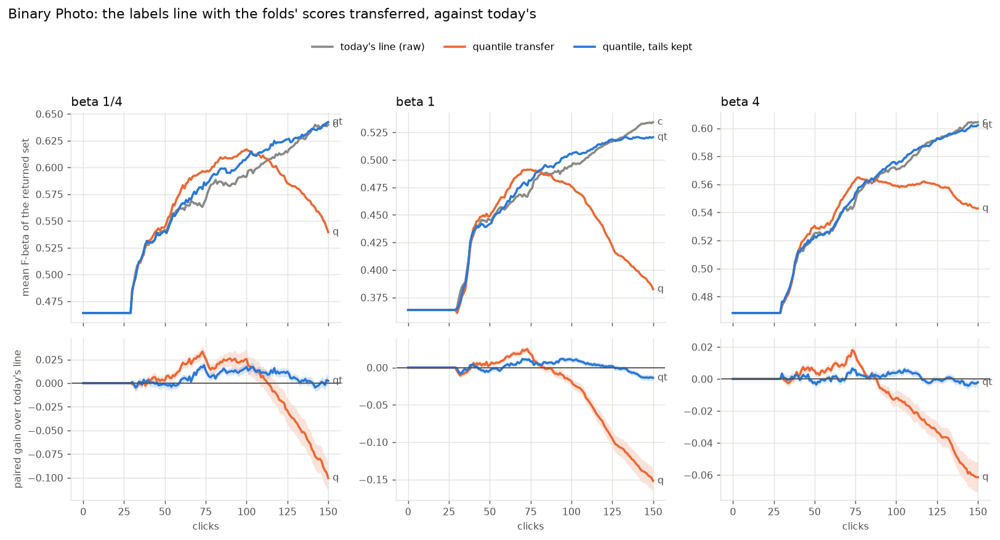
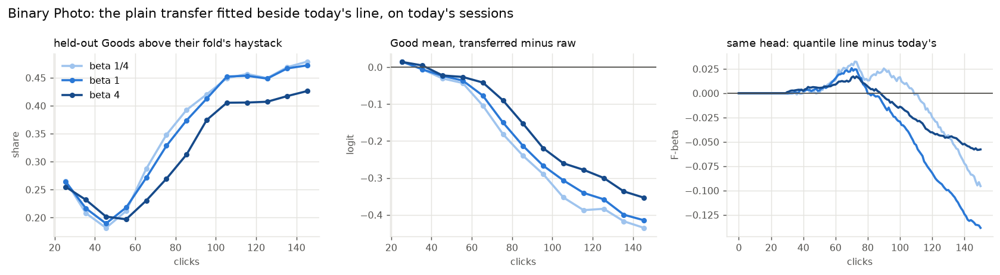
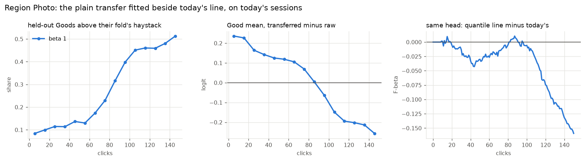

# The quantile transfer inside the labels line, priced (issue #4910)

**Status (2026-10-15): Binary Photo at beta 1/4, 1 and 4, 5 seeds, priced; nothing ships. The A/B cannot say
whether today's line is sound: it carries an error of its own, and the correction priced here partly offsets it at
some clicks and overshoots at others. Both errors are filed to be measured directly (#4936, #4937). Region Photo: a
same-head reading at beta 1 on one seed.**

**Carrying the calibration folds' held-out scores onto the final model's scale does not make the labels line
better calibrated.** By quantile, the way the fused cut carried its cut (the issue's arm), it loses F-beta at every
preset, heavily late in a session. With the tails kept past the haystack's ends it ties today's raw pooling at
beta 1 and 4 and gains a little at beta 1/4, because there it cuts deeper than today's very conservative line:

| paired gain over today's line, mean F-beta per click | votes 1–50 | 1–150 | 51–150 | at vote 150 |
|---|---|---|---|---|
| beta 1/4, quantile | +0.001 (± 0.001) | −0.004 (± 0.005) | −0.006 (± 0.008) | −0.100 (± 0.015) |
| beta 1/4, quantile, tails kept | −0.000 (± 0.001) | **+0.005** (± 0.002) | +0.008 (± 0.003) | +0.002 (± 0.006) |
| beta 1, quantile | −0.000 (± 0.001) | **−0.028** (± 0.004) | −0.042 (± 0.005) | −0.152 (± 0.016) |
| beta 1, quantile, tails kept | −0.001 (± 0.001) | +0.001 (± 0.002) | +0.002 (± 0.002) | −0.014 (± 0.004) |
| beta 4, quantile | +0.001 (± 0.001) | **−0.010** (± 0.002) | −0.016 (± 0.004) | −0.061 (± 0.009) |
| beta 4, quantile, tails kept | +0.000 (± 0.001) | +0.001 (± 0.001) | +0.001 (± 0.001) | −0.002 (± 0.002) |

720 sessions per arm and preset, paired by cell and seed; ± is one SE over classes. Today's line scores 0.560 /
0.459 / 0.541 over votes 1–150 at beta 1/4 / 1 / 4.

- **The cost is the line, not the session.** On the control's own heads (the transferred line fitted beside
  today's on every step, drawing nothing) the plain quantile scores −0.028 (± 0.004) over votes 1–150 at beta 1,
  the same as the closed loop's −0.028. The transfer also changes what acquisition, the weak check and Done read
  (the weak check's trigger flips on 23–26% of steps), but that moves almost nothing.
- **Why the plain transfer loses: the quantile saturates.** A held-out Good above every item of its fold's
  haystack maps to the final haystack's single top score. By votes 101–150, 41–46% of held-out Goods are there, so
  the Goods collapse onto one value, their mean drops 0.3–0.4 logit, and the line cuts deep: at beta 1 it keeps a
  median of 51 more withheld images than today's line on the same heads at votes 126–150.
- **Keeping the tails removes the saturation but not the drift.** The transferred line still keeps more as the
  session goes on. At vote 150 it returns a median of 23 / 50 / 119 images where today's line returns 16 / 40 / 78
  (beta 1/4 / 1 / 4): more recall, less precision. That pays at beta 1/4, where today's line is very conservative
  (precision 0.75, recall 0.34 at vote 150), costs at beta 1, and is a wash at beta 4, which weights recall.
- **The likely reason for the drift:** both haystacks are the unvoted remainder, nearly all negatives, so a
  quantile map says where the final model puts a *negative* of a given fold rank. The final model has trained on
  more Goods than any fold model and scores positives above that, so transferred Goods sit low on its scale and the
  line reads the top unvoted negatives as positives. The gap grows as labelling drains the positives from the
  remainder, as the drift does. This interpretation fits every reading here; no arm isolates it.

**A tie is not a clean bill of health.** Read against the truth on the withheld half (below), today's line has an
error of its own: early in a session its Good component sits too high, so it estimates under half the true
prevalence, underrates its own F-beta and keeps fewer images than the best cut would. The error fades by vote 150.
The transfer's correction runs the other way in time: small early, largest late, when today's line needs it least.
So the arms here mix two questions the A/B cannot separate: how far the fold models' scale really is from the final
model's for *positives* (#4936), and why today's line is conservative early (#4937). Both are filed to be measured
directly, scoring the withheld half, which no model has seen, with every fold model. The "No Mean Feat" slide's
appendix note now says the transfer was priced under the labels line too.

## The question

The labels line (#4452) fits its class model on the calibration folds' held-out scores, each fold model scoring
its own held-out votes on its own scale, and then cuts on the *final* model's scores of the corpus. Nothing maps one
scale onto the other: the mistake the "No Mean Feat" slide warns about. The rule the labels line replaced did map it
(the fused cut read each fold's cut as a quantile of that fold's haystack and realised it on the final model's,
`rank_transfer`), but that rule lost on the cut it carried, not on the transfer (#4184, #4582), and the transfer
was never priced under the labels line. #3115 had found the same scale correction helping region voting and costing
binary voting, so both modes are read.

## What was run

| | |
|---|---|
| arms | **c**: today's line (each fold's held-out scores pooled as scored), with the quantile line fitted beside it on the same head, drawing nothing (`labels_scale_shadow="quantile"`): the gate's same-head reading and the closed loop's control. **q**: fold *k*'s held-out scores carried onto the final model's scale by their quantile in fold *k*'s haystack (`labels_scale="quantile"`: `rank_transfer` applied to every held-out score), today's line beside it. **qt**: the same inside the haystack's range; past either end a score keeps its logit distance from that end (`labels_scale="quantile_tails"`), today's line beside it |
| haystacks | fold *k*'s model's scores of the unvoted Train pool and the final model's, under the same #3308 exclusion: the lists the fold-anchored cut is fitted on, taken before its fit (a fold whose fit fails is dropped from `FoldAnchoredCut.fold_haystacks` but not from the line's folds, so the cut's own list can misalign; these line up by construction) |
| what reads the transfer | the labels line's class model, so the line, Find's line on the withheld half, the weak check's separation and Done's level. The fold-anchored cut, the in-sample stand-in (one Good, or folds that rank the wrong way, #4899) and the head's count line (#4786) do not |
| bench | `coco_better`, 144 class@band cells × 5 seeds, SigLIP whole-image (Binary Photo), on the 2026-10-08 grid #4743 priced |
| presets | beta 1/4, 1 and 4, each scored at its own beta |
| clicks | 150, trajectory pass. 6,480 Binary runs, all completed and checked (gzip, rows) |
| pairing | the same cell and seed in every arm. All 4,320 arm-control pairs were checked pick by pick through the opening (Good, Bad, More on the typed query's sort), where no labels line is read: none departs there. An arm leaves the control at its first learned pick (vote 8), where acquisition first reads the line |
| CPU | beta 1/4 and 1 on V100 nodes with the GPU hidden, all on DGX-1s (Xeon E5-2698 v4); beta 4 on AMD cpu nodes. A first beta-1 qt pack landed on a Cascade Lake V100 node and drifted from c in 2 of 142 openings; it was rerun on a DGX-1 (Provenance) |
| objective | F-beta, at the run's beta, of the withheld half above the line the app shows: Find's line, the labels' class model with the prevalence re-estimated on the withheld half. Until 30 labels a typed-query detector shows its query's own set (#4736's hold), so every curve is flat to click 30 and the 1–50 window moves little |

Gains are paired per run; ± is one SE over classes (a class's bands and seeds are not independent).

## Result



*Top: mean F-beta of the returned set over clicks. Bottom: each arm's paired gain over today's line, ±1 SE.*

| paired gain over today's line | at click 50 | 100 | 150 |
|---|---|---|---|
| beta 1/4, quantile | +0.003 (± 0.004) | +0.026 (± 0.010) | −0.100 (± 0.015) |
| beta 1/4, tails kept | −0.001 (± 0.004) | +0.017 (± 0.004) | +0.002 (± 0.006) |
| beta 1, quantile | +0.003 (± 0.003) | −0.019 (± 0.007) | −0.152 (± 0.016) |
| beta 1, tails kept | −0.004 (± 0.004) | +0.011 (± 0.003) | −0.014 (± 0.004) |
| beta 4, quantile | +0.005 (± 0.002) | −0.012 (± 0.005) | −0.061 (± 0.009) |
| beta 4, tails kept | −0.002 (± 0.002) | +0.004 (± 0.002) | −0.002 (± 0.002) |

- **Mid-session the transfer is ahead.** Between clicks 55 and 110 the plain quantile gains up to +0.03 at beta
  1/4 and +0.02 at beta 1 and 4, on the same heads as well as in the closed loop; the tails variant up to +0.017.
- **Late the plain quantile collapses**, −0.10 / −0.15 / −0.06 at vote 150. The tails variant does not, but dips at
  beta 1 (−0.014 at vote 150).
- **The tails variant's beta-1/4 gain is broad but small** (`fold_transfer_4910_robust.py`). +0.005 over votes 1–150: every seed positive (+0.002 to
  +0.009), large and medium bands +0.007 / +0.006, small +0.002; 52% of sessions gain, 38% lose; trimming the 5%
  most extreme sessions at each end leaves +0.004. At beta 1 and 4 it is noise around zero (seeds −0.001 to +0.003).

## Why the plain transfer loses



*Read off arm c's sessions, where the transferred line was fitted beside today's on every step. Left: the share of
held-out Goods above their fold's whole haystack. Middle: the Good component's mean, transferred minus raw (median
per 10 clicks). Right: the transferred line's F-beta minus today's on the same head.*

| control's heads, beta 1 | clicks 26–50 | 51–100 | 101–150 |
|---|---|---|---|
| held-out Goods above their fold's haystack | 21% | 32% | 46% |
| held-out logit moved, median | 0.08 | 0.12 | 0.18 |
| Good mean, transferred − raw (logit, median) | −0.01 | −0.13 | −0.37 |
| Bad mean, transferred − raw | −0.08 | −0.13 | −0.21 |
| steps where the withheld set changes size | 35% | 69% | 84% |
| F-beta, transferred line − today's (mean over steps) | +0.003 | +0.004 | −0.108 |

The other presets read the same way (`tables/gate_by_click_binary.csv`): saturation reaches 41–46% by votes
101–150 at every preset and the Good mean falls 0.31–0.40 logit. Both class means fall, the Goods' faster, so the
classes sit closer and the line, which cuts where the Good component meets the corpus's bulk, reaches deeper.

## Keeping the tails: what it returns at vote 150

| at vote 150, means over 720 sessions | beta 1/4 c / qt | beta 1 c / qt | beta 4 c / qt |
|---|---|---|---|
| withheld images returned (median) | 16 / 23 | 40 / 50 | 78 / 119 |
| withheld images returned (mean) | 21 / 25 | 43 / 60 | 119 / 170 |
| precision (over non-empty sets) | 0.75 / 0.72 | 0.62 / 0.53 | 0.41 / 0.33 |
| recall | 0.34 / 0.40 | 0.50 / 0.56 | 0.64 / 0.68 |
| F-beta | 0.640 / 0.642 | 0.535 / 0.521 | 0.604 / 0.602 |

On its own heads the tails variant keeps a median of 0 / +1 / +3 more than today's line at votes 51–75 / 101–125 /
126–150 at beta 1/4, and +0 / +4 / +6 at beta 1 (`fold_transfer_4910_late.py`). Its worst sessions are easy
classes the line already had right: at beta 1, `frisbee@medium` seed 3 (56 withheld positives) returns 206 images at
precision 0.27 where today's line returns 53 at 0.91.

## The line, not the session

| plain quantile, votes 1–150 | beta 1/4 | beta 1 | beta 4 |
|---|---|---|---|
| same heads (control's sessions, transferred line drawing nothing) | −0.006 (± 0.005) | −0.028 (± 0.004) | −0.011 (± 0.003) |
| closed loop (the arm's own sessions) | −0.004 (± 0.005) | −0.028 (± 0.004) | −0.010 (± 0.002) |
| steps where the weak check's trigger (d' < 1.5) flips | 26% | 24% | 23% |

The closed loop adds nothing to the same-head reading: what the transfer does to acquisition, to when the weak
check comes due and to Done is a wash, and the whole effect is the line it draws.

## Today's line against the truth

All on the withheld half and in F-beta or counts (`tables/line_vs_truth_binary.csv`, `tables/set_size_vs_best_binary.csv`;
`fold_transfer_4910_truth.py`, `fold_transfer_4910_sizes.py`). The set-size rows read each withheld positive's rank
under the step's final model (the rank frames), so the F-beta at any set size is exact.

| today's line (c) | beta 1/4 | beta 1 | beta 4 |
|---|---|---|---|
| its set size ÷ the F-beta-best set size, median, at vote 50 / 100 / 150 | 0.83 / 0.75 / 0.89 | 0.76 / 0.84 / 0.95 | 0.48 / 0.75 / 0.81 |
| F-beta from keeping 1.41× as many, at vote 50 / 100 / 150 | −0.017 / −0.017 / −0.034 | +0.005 / −0.011 / −0.028 | +0.020 / +0.009 / +0.005 |
| its expected F-beta minus its actual, votes 31–50 / 51–100 / 101–150 | −0.08 / −0.11 / −0.13 | −0.03 / −0.08 / −0.13 | −0.06 / −0.13 / −0.20 |
| F-beta gap to the best cut, votes 31–50 / 51–100 / 101–150 | 0.13 / 0.11 / 0.09 | 0.09 / 0.07 / 0.06 | 0.10 / 0.07 / 0.06 |

| prevalence estimate ÷ the true prevalence, median | votes 31–50 | 51–100 | 101–150 |
|---|---|---|---|
| today's line | 0.36–0.42 | 0.56–0.58 | 0.87–0.95 |
| quantile | 0.36–0.41 | 0.76–0.93 | 1.6–2.2 |
| quantile, tails kept | 0.30–0.36 | 0.59–0.64 | 1.2–1.3 |

- **Today's line keeps too few, most early and most at beta 4**, where keeping more raises F-beta. At beta 1/4 the
  median set is also below the best size, but on average a 1.41× set loses: its F-beta peak is narrow.
- **It underrates itself**, increasingly over a session, and its prevalence estimate starts at under half the truth.
  All three point to a Good component placed above where the corpus's remaining positives score.
- **Neither transfer closes the gap to the best cut.** The plain quantile overshoots the prevalence 1.6–2.2× late; the
  tails variant lands its median set near the best size by vote 150 (+0.03 to +0.14 in log2) yet still trails
  today's line in F-beta at beta 1, so it is not a calibrated line either.

## Region Photo: the same-head reading

The owner put Binary first (2026-10-15), so Region Photo (DINOv3 patches, max-pooled, opened on SigLIP's text
sort) ran only arm c: one seed of 144 cells at beta 1, the transferred line fitted beside today's on every step and
drawing nothing. No Region closed loop was run. On Binary the same-head reading matched the closed loop to the third
decimal at beta 1, so it is the best stand-in available.



| control's heads, Region, beta 1 | clicks 1–25 | 26–50 | 51–100 | 101–150 |
|---|---|---|---|---|
| held-out Goods above their fold's haystack | 10% | 13% | 25% | 47% |
| Good mean, transferred − raw (logit, median) | +0.22 | +0.14 | +0.07 | −0.20 |
| Bad mean, transferred − raw | +0.01 | +0.01 | −0.01 | −0.06 |
| steps where the withheld set changes size | 34% | 70% | 80% | 90% |
| F-beta, transferred line − today's (mean over steps) | −0.008 | −0.030 | −0.014 | −0.104 |

Over votes 1–150 the transferred line scores **−0.037 (± 0.004)** against today's on the same heads; −0.014 (± 0.004)
over votes 1–50 and −0.049 (± 0.006) over 51–150. It loses on Region too, and earlier than on Binary, though the map
moves the other way early: on patch scores the final model puts the remainder's top items higher than the fold models
do, so the transfer first *raises* the Good component (+0.22 logit at clicks 1–25), and lowers it only once
saturation sets in (47% of held-out Goods past their fold's haystack by votes 101–150). #3115's region-voting win (in
cost, on `vg_scale_any`, before the labels line) does not carry over to today's line. A remainder-fitted map that
errs in opposite directions on the two paths is itself evidence for #4936: it is not the right correction, rather
than a right correction applied too strongly.

## Not priced: a z-score transfer

The owner asked (2026-10-15) whether every held-out score should be carried as "sigmas above the mean" rather than
by quantile: placed at the same robust z (median and MAD of each haystack's logits) on the final model's haystack.
It never saturates, and it estimates two numbers per fold rather than a curve. It is fitted on the same unvoted
remainder, though, so the class-blind map read above applies to it too. The owner chose to report the three arms
as they stand; the z-score map is one of the candidates #4936 judges offline against the true fold→final map,
before any A/B.

## What this leaves

Nothing ships: the plain quantile loses at every preset, and the tails variant's beta-1/4 gain is a deeper cut at
the precision preset, not a calibrated line. The owner's ruling (2026-10-15): "We made a pair of mistakes that
cancelled each other out!" isn't good news; both mistakes get issues, measured directly rather than hill-climbed:

- **#4936**: the fold models' scale against the final model's, per class, on the withheld half; every candidate map
  (none, quantile, quantile with tails, the owner's robust z-score, label-aware maps) judged offline against it.
- **#4937**: why today's line is conservative early: its Good component's error decomposed into selection (the
  held-out Goods are the session's easiest positives), scale, and the rest.

## Provenance

| | |
|---|---|
| code | dev at 6553a698f plus the arm (1cf7f233c; launcher and analysis f3d0f9628), every task from the frozen worktree `vts-4910-run`. The runs predate #4909 (merged the same day: the weak check prompts at most once a session); every arm ran the weak check as it was, again after 25 votes |
| harness | `simulate_voting_iterations(labels_scale=, labels_scale_shadow=)`, `CALIB_LABELS_SCALE` / `CALIB_LABELS_SCALE_SHADOW`; `labels_line.transfer_fold_orderings`. Unset is the app: the default arm draws today's line |
| launcher | `scripts/experiments/state_of_app/fold_transfer_4910.sh` (arms c, q, qt; paths binary and region; `gpack` runs a pack on a V100 node with the GPU hidden) |
| analysis | `scripts/experiments/state_of_app/fold_transfer_4910.py`; its tables in `tables/` (`closed_loop_*`, `curves_*`, `gate_*`, `gate_by_click_*`, `same_head_curve_*`, `saturation_*`). The set at vote 150 and the same head on an arm's own sessions: `fold_transfer_4910_late.py BETA`; by seed and band: `fold_transfer_4910_robust.py`; the opening pick check: `fold_transfer_4910_picks.py` |
| results | `/expscratch/sgreenberg/state-of-the-app/2026-10-15-xfer4910-{c,q,qt}-binary-b{025,1,4}` and `...-c-region-b1` |
| CPU model | the `intel` constraint mixes DGX-1 V100 nodes (E5-2698 v4, AVX2) and 10-GPU V100 nodes (Gold 5218R, AVX-512). qt's first beta-1 pack ran on the latter and its openings drifted from c's in 2 of 142 sessions (the Bad phase's GMM midpoint on the text sort); its 246 cells were set aside and the lane rerun on `dgx` |
| extra packs | to finish sooner, helper packs walked the unstarted cells of qt's beta-1/4 lane and of the Region lane in reverse; once a lane held every cell its leftover packs were cancelled and every cell checked (gzip, rows) |

## Reproduce

```bash
# from a frozen worktree of the branch; V100 packs need SBATCH_CONSTRAINT=dgx
bash scripts/experiments/state_of_app/fold_transfer_4910.sh dirs
SBATCH_CONSTRAINT=dgx CALIB_PACK_PAR=48 CALIB_PACK_MEM=72G \
  bash scripts/experiments/state_of_app/fold_transfer_4910.sh gpack c binary 1   # and q, qt; beta 0.25, 1, 4
python scripts/experiments/state_of_app/fold_transfer_4910.py --root /expscratch/$USER/state-of-the-app \
  --seeds 5 --path binary --baseline <text_baseline.csv> --out <dir> \
  --docs docs/experiments/2026-10-15-fold-transfer-4910/tables
```
