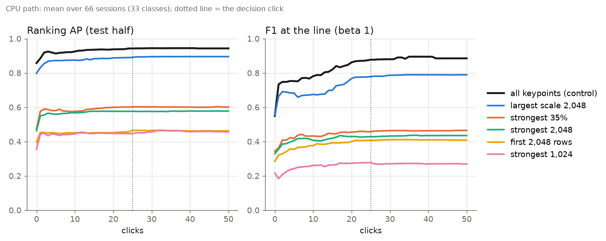
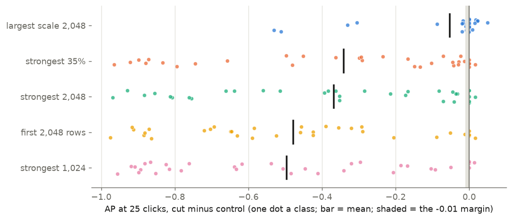

# Can a CPU Good verify each page on fewer keypoints? No: every cut loses far more than the margin (#4934)

**Verdict: nothing ships; the CPU path keeps every keypoint.** In a tier-`s` pilot on the CPU path (33 classes × 2 replicates, 50 clicks), every cut fails the pre-registered rule ([PLAN.md](PLAN.md)): at 25 clicks, the 95% lower bound must be ≥ −0.01 on both AP and F1 at the line. The four arms the owner chose lose **0.34-0.50 AP** and **0.42-0.60 F1**. The best cut, the 2,048 largest-scale keypoints (exploratory), loses **0.05 AP [−0.11, −0.01]** and **0.10 F1 [−0.18, −0.03]**. Each cut makes a Good's retrain 2.6-4.9× faster, but none comes near the margin. On that evidence the owner stopped before the tier-`m` decision run (2026-10-15). A CPU Good stays at ~4.5 s at 5k pages (after #4933).

## Results

Tier `s` (5k pages a pool), the app's CPU path: Stage 1 on the CPU, a 1,000-page shortlist. Paired by (class, replicate); each class's difference is averaged over its two replicates and bootstrapped over the 33 classes (95%).

| arm | AP @25 | F1 @25 | Δ AP @25 | Δ F1 @25 | retrain after a Good | rule |
|---|---:|---:|---:|---:|---:|---|
| **all keypoints (control)** | **0.94** | **0.88** | | | 6.5 s | |
| largest scale 2,048 (exploratory) | 0.89 | 0.78 | −0.053 [−0.11, −0.010] | −0.098 [−0.18, −0.028] | 2.1 s | FAIL |
| strongest 35% (same average work as 2,048) | 0.60 | 0.46 | −0.34 [−0.46, −0.23] | −0.42 [−0.54, −0.30] | 2.5 s | FAIL |
| strongest 2,048 | 0.58 | 0.43 | −0.37 [−0.48, −0.26] | −0.45 [−0.58, −0.32] | 2.1 s | FAIL |
| first 2,048 stored rows | 0.46 | 0.41 | −0.48 [−0.59, −0.37] | −0.47 [−0.59, −0.35] | 2.0 s | FAIL |
| strongest 1,024 | 0.45 | 0.28 | −0.50 [−0.61, −0.39] | −0.60 [−0.71, −0.49] | 1.3 s | FAIL |

- **Click 0 already shows the losses**, and the clicks never earn them back. Under the four chosen arms AP falls from 0.86 to 0.35-0.48 before any vote, and the gap holds to click 50. F-beta at 1/4 and at 4 tell the same story (`measurements/summary.md`).
- **Retrain times are from the pilot,** 18 tasks sharing two EPYC 7713 nodes. They are slower than `profile_retrain.py`'s 4.5 s Good on an idle node, but the ratios between arms hold.
- Three ucsf classes (`logo_bw_oval_emblem`, `logo_p_lorillard_crest`, `logo_rjr_script`) have no session at tier `s`: the harness skips a class without a positive in each half.



*The mean over 66 sessions per arm; a session that ended early holds its last state. The dotted line is the decision click. Read the gaps between lines, not the levels: the levels are tier `s`'s, where pools are a tenth of tier `m`'s.*



*One dot per class (both replicates averaged); the bar is the mean, and the shaded strip the −0.01 margin. The largest-scale cut leaves most classes within a few hundredths of the control, but four classes lose 0.3-0.5. Every other cut loses 0.8-0.97 on many stamp classes.*

## Why the cuts fail

- **The strongest responses are the wrong keypoints on a document.** Over 40 tier-s pages, a keypoint's response and its scale correlate at ρ ≈ −0.44. The strongest keypoints are small and high-contrast, which on a page means text strokes. A strength cut keeps the text and drops much of the mark. Over the pilot it beat the near-random first-rows cut (0.58 against 0.46 AP at 25 clicks), but it kept only 0.58 of the control's 0.94. In the smoke test's tobacco800 class it did worse than random.
- **A random third of a page keeps about a third of a mark's correspondences.** The first-rows arm is close to random by strength: of a page's 2,048 strongest keypoints, a median of 41% sit in its first 2,048 rows, against ~37% by chance. A page's score is its inlier count (`n / (n + 8)`), and the line needs 8-16 inliers, so a mark that kept a third of its matches falls under the gate. This is the likely reason, not a measured one. Many stamp classes lose 0.8-0.97 AP.
- **The largest scales keep a mark's structure but not a small mark.** Its losses sit in `ucsf/logo_bat_leaf` (−0.53), `spods/stamp_00737_1` (−0.51), `staver/stamp_stampds-00213_1` (−0.33) and `spods/stamp_00514_1` (−0.31). Even with them, its point estimates (−0.05 AP, −0.10 F1) are 5-10× the margin.

## What was not run, and why

- **The tier-`m` decision run.** The plan made it the owner's call after the pilot. Tier `m` keeps the same 1,000-page shortlist and adds ten times the distractors per pool, so no arm that loses 0.05-0.5 AP at tier `s` was expected to come within 0.01 there. The owner stopped (2026-10-15).
- **The tier-`m` strength order.** The job ran past its expected time and was cancelled once tier `m` was dropped. Tier `s`'s order is `strength-s.npz`.

## How the strength order was recovered

- Cached features store no response, and their rows are not in response order: OpenCV's `nfeatures` cap only partitions them.
- Today's OpenCV (5.0.0) re-detects the cached keypoints in the cached row order. On 40 tier-s pages the keypoint sets were identical and descriptors differed by at most 1 in an element.
- `strength_order.py` therefore re-detects each page (detect only) and attaches each response to its cached row: by position on the 73% of pages whose rows match in order, else by exact (x, y, size, angle) key. Every tier-s page matched ≥ 99.8% of its rows.
- Re-detecting at `nfeatures = K` keeps exactly the K strongest of the full detection (overlap 1.000 on 40 pages), so the strength arms are what a lower detection cap would give.

## Side finding

**On a CPU, the #4469 descriptor cache pins up to 4 GB of descriptor arrays.**
- **Mechanism:** a CPU "upload" is a `torch.from_numpy` view, which holds its array alive, so the cache's weak reference never expires. The only `release_device_descriptors()` call sits on the GPU path.
- **In the pilot:** each run's cuts accumulated there, and five 20 GB tasks were OOM-killed; they resumed at 40 GB. `sota_documents_arms.py` now releases the cache between runs.
- **In the app:** a CPU server keeps a dropped dataset's descriptors pinned until eviction. Filed as #4941.

## Reproduce

Code at `scripts/experiments/fullmarks/`:
- `strength_order.py`: per-page response order.
- `sota_documents.py`: `--keep-kp`, `--keep-kp-frac`, `--kp-order strength|scale|rows`, `--strength`.
- `sota_documents_arms.py`: arms in one process.
- `keypoint_cut_analyze.py` and `keypoint_cut_figures.py`.

The pilot ran from `2df78e937` (worktree `vts-4934-run`), 18 tasks of 2 classes each, 8 CPUs and the GPU hidden:

```bash
python strength_order.py <repo> s strength-s.npz 32
python sota_documents_arms.py --out <run dir> --classes <2 classes> --reps 1,2 \
  --arm all= \
  --arm strong2048="--keep-kp 2048 --kp-order strength --strength strength-s.npz" \
  --arm strong1024="--keep-kp 1024 --kp-order strength --strength strength-s.npz" \
  --arm rows2048="--keep-kp 2048 --kp-order rows" \
  --arm strongfrac035="--keep-kp-frac 0.35 --kp-order strength --strength strength-s.npz" \
  --arm scale2048="--keep-kp 2048 --kp-order scale" \
  -- --tier s --max-v 50 --matrix <votes-4162>/matrix-s --feature-cache <features>
python keypoint_cut_analyze.py <run dir> --out measurements
python keypoint_cut_figures.py measurements/steps.csv figures
```

`measurements/` holds `summary.md` (every readout at 0/10/25/50 clicks), `paired.csv` and `steps.csv` (every step of every session). The run directory is `/expscratch/sgreenberg/strongk-4934/pilot-s/`.
