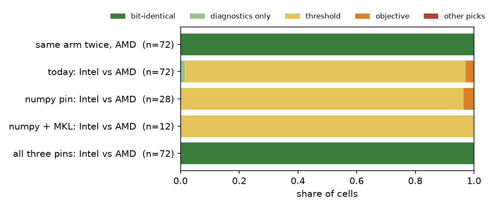
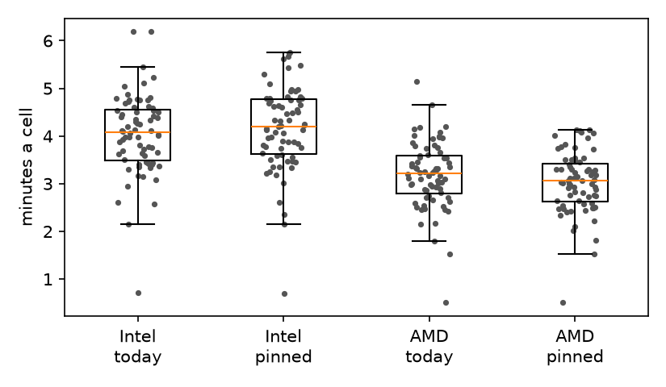

# The same cell on an Intel and an AMD node (#4110)

**2026-10-15.** #3840 ran one arm twice on one commit and 3 of 114 calibration cells came out different. This
finds out why, and makes a cell bit-identical on any node.

## The answer

- **It was the node, not the run.** Each of the 36 #3840 cells that differed anywhere had run on an AMD node
  in one run and an Intel node in the other, and so had the 3 whose cost moved. Of the 60 cells that ran on
  the same vendor both times, none differed at all, not even in a threshold's last digit
  ([table](#3840-by-node)).
- **Four libraries pick their kernels by CPU, and only one was pinned.** #4481's `OPENBLAS_CORETYPE=Haswell`
  covers OpenBLAS. On today's dev, across the GRID's five CPU models, three more still differ
  ([table](#which-kernels-differ)):
  - **numpy** runs float64 `exp` and `log` (the anchored EM) and `argsort` (tie order) on AVX-512 code. It
    does this on the Xeon Silver 4114, the Gold 5218R and the EPYC 9534, and not on the EPYC 7713 or the
    E5-2698 v4.
  - **torch's bundled MKL** gives three different answers for the head's scores: one on the E5-2698 v4, one
    on the two AVX-512 Xeons, one on the two EPYCs.
  - **torch's ATen** runs the text tower's other ops (LayerNorm, softmax, GELU) on AVX-512 or AVX2 kernels. A
    cell embeds its typed query live, so the opening's sort starts from a different vector on each kind of
    node.
- **With all three pinned, a cell is bit-identical across vendors: 72 of 72 cells.** The pins are
  `NPY_DISABLE_CPU_FEATURES="AVX512F AVX512_SKX"`, `MKL_CBWR=COMPATIBLE` and `ATEN_CPU_CAPABILITY=avx2`. Leave
  out the ATen pin, or the MKL and ATen pins, and every cell still differs (12 of 12, 28 of 28). Leave out
  the numpy pin, and an Intel cell's honest-oracle columns still move (28 of 28) ([cells](#the-cells-end-to-end)).
- **Today's drift moves the cut, and only rarely more.** Unpinned, an Intel and an AMD run of the same cell
  agreed in 0 of 72 cells, but not by much. In all 72 they picked the same item at every vote. In 69 only the
  printed cut moved, by a median 3 millionths at its largest, never far enough to change what is flagged. In
  2 it moved one item across, at one vote each. Every cell ended on the same F-beta. The same arm twice on one
  node type gave 72 of 72 cells bit-identical: on one kind of CPU the harness was already deterministic.
- **The pins cost a cell nothing measurable.** Cell for cell, a pinned cell took a median 3% longer than an
  unpinned one on the Xeons and 1% less on the EPYCs; the same arm run twice moved by as much. They are not
  free everywhere: `MKL_CBWR=COMPATIBLE` makes a CPU GEMM 2.4–3.5x slower. A cell's only GEMM-heavy CPU work
  is one typed query (+0.3–0.4 s), but a CPU embedding job would pay on every image. So the cell runner sets
  the MKL and ATen pins itself, and `gridenv.sh` sets only the numpy pin, for every GRID job
  ([what ships](#what-ships)).
- **A pinned cell is not an unpinned one.** The pins move a cell's last bits on every node, AMD included: all
  72 cells move on the EPYCs, and one of them, `snowboard@medium`, picks another item from vote 5 and ends
  0.10 apart in F-beta. A grid from before this change is a different baseline, so re-run the control rather
  than pair against it.

## Data

- **#3840's two runs:** `v_baseline` (job 678074) and `v_rep` (job 678076), seeds 0–1 of the #3585
  environments, dev `054c62d88`, from `/expscratch/sgreenberg/abres-3840/frames/steps.csv.gz`. Each task's
  node is from `sacct -o NodeList`, and its cell is from the task's log.
  [`cells_3840_by_node.csv`](cells_3840_by_node.csv) has all 114.
- **Per-op probes:** `scripts/experiments/node_determinism/probes/`, one process per (node, env variant), the
  pins read at import. They ran on seven nodes covering five CPU models: rack2n13 and rack4n06 (Xeon Silver
  4114), rack7n11 and rack8n09 (EPYC 7713), rack8n03 (Gold 5218R, a 10-GPU V100 node), rack10n04 (E5-2698 v4,
  a DGX-1) and rack4n01 (EPYC 9534, an L40S node). The probes run on the CPU only. Tables:
  [`ops_by_cpu.csv`](ops_by_cpu.csv), [`text.csv`](text.csv), [`cost.csv`](cost.csv).
- **Cells:** `scripts/experiments/node_determinism/launch_4110.sh`, today's app (frozen dev `cdf701a00`) on
  #4864's binary grid: `coco_better`, SigLIP, the user's pool at 1%, 150 votes, seed 0, every other class
  (72 cells an arm). The arms differ only in node type (`--constraint=intel|amd`) and env. Every task stamps
  its node, CPU model, numpy's AVX-512 targets, torch's capability and the pins (`logs/nodes.tsv`). Results:
  `/expscratch/sgreenberg/det-4110/<arm>/results`.
- **Pairing:** `analyze_4110.py` pairs two arms' cells by index and compares every printed value except the
  timing columns, in the steps file and every sidecar. Its verdicts: *trajectory* (some vote picked another
  item); *objective* (same picks, but a base row's F-beta, precision, recall, flagged count or cost differs);
  *threshold* (same objective, but a base row's printed cut differs); *diagnostics* (base rows agree, a
  variant row or a measurement column does not); *identical*.

## #3840 by node

| vendors, first run → repeat | cells | any threshold differs | cost differs |
|---|---|---|---|
| AMD → AMD | 16 | 0 | 0 |
| Intel → Intel | 44 | 0 | 0 |
| AMD → Intel | 35 | 26 | 2 |
| Intel → AMD | 19 | 10 | 1 |

The three cells whose cost moved:

| cell | first run | repeat | threshold first differs | largest cost gap |
|---|---|---|---|---|
| `caltech101_m`/`dinov3_patch`/whole `cougar_face` s0 | rack7n10 (AMD) | rack4n06 (Intel) | vote 31 | 0.005 |
| `coco_val`/`dinov3_patch`/whole `bed` s0 | rack2n10 (Intel) | rack7n10 (AMD) | vote 30 | 0.10 |
| `visual_genome_m`/`dinov3_patch`/`max_patch` `ball` s1 | rack7n10 (AMD) | rack4n04 (Intel) | vote 33 | 0.11 |

#3840 had pointed at something order- or node-dependent on the threshold path. It was the node, every time.

## Which kernels differ

How many different outputs the five CPU models gave for each op: 1 means they all agree.

| op | where a cell uses it | today | with the pin | the pin |
|---|---|---|---|---|
| numpy float64 `exp`, `log` | the anchored EM | **2** | 1 | `NPY_DISABLE_CPU_FEATURES="AVX512F AVX512_SKX"` |
| numpy `argsort` of tied values | the tie order of a sort | **2** | 1 | the same |
| numpy float32/64 matvec, GEMM (OpenBLAS) | the text sort's cosines | 1 | | #4481's `OPENBLAS_CORETYPE=Haswell` |
| numpy float32 `exp`/`log`, sums, `var`, `sort` | | 1 | | none needed |
| sklearn `LinearSVC` fit, `StandardScaler` | the head's fit | 1 | | none needed |
| torch `Linear(768, 1)`, `mv` (MKL) | the head's scores | **3** | 1 | `MKL_CBWR=COMPATIBLE` |
| torch square GEMM (MKL) | the text tower | **3** | 1 | the same |
| torch `exp` (MKL's VML) | | **3** | 1 | the same |
| torch `sigmoid`, column sums (ATen) | the head's scores | 1 | | none needed |
| SigLIP's text tower, 5 typed queries | the opening's query vector | **2** of 2 | 1 | `MKL_CBWR=COMPATIBLE` **and** `ATEN_CPU_CAPABILITY=avx2` |

The "today" groups split by instruction set, not by vendor. numpy's split is AVX-512 (Silver 4114, Gold 5218R,
EPYC 9534) against AVX2 (EPYC 7713, E5-2698 v4). MKL's is E5-2698 v4, then the two AVX-512 Xeons, then the two
EPYCs. The text tower ran on the Silver 4114 and the EPYC 7713 only. With the MKL pin alone its vectors still
differed in 5 of 5 queries, and so they did with the ATen pin alone; with both, 0 of 5.

Gentler MKL settings each fix half of torch. `MKL_CBWR=AVX` (or `SSE4_2`) makes the matvec agree and leaves
the GEMM different, and `MKL_CBWR=AVX2,STRICT` does the reverse. `MKL_ENABLE_INSTRUCTIONS=AVX2` fixes neither.

**An amplifier, for diagnostics only.** The honest oracle (`oracle_*_honest`, a measurement column) seeds its
resampling from a hash of the score array, so a change in any score's last bit redraws its folds. At vote 1 of
`airplane@large`, AMD without and with the MKL pin printed `oracle_threshold_honest` 0.527138 against 0.528021
and `oracle_cost_honest` 0.048 against 0.098. That is why it is the first column to differ in nearly every
pair below; it feeds no decision.

## The cells, end to end

| pair | question | cells | identical | diagnostics only | threshold | objective | other picks |
|---|---|---|---|---|---|---|---|
| `a_base` ~ `a_rep` | the same arm twice, AMD | 72 | **72** | 0 | 0 | 0 | 0 |
| `i_base` ~ `a_base` | today, Intel vs AMD | 72 | 0 | 1 | 69 | 2 | 0 |
| `i_npy` ~ `a_base` | the numpy pin only | 28 | 0 | 0 | 27 | 1 | 0 |
| `i_pin` ~ `a_pin` | the numpy and MKL pins | 12 | 0 | 0 | 12 | 0 | 0 |
| `i_full` ~ `a_full` | all three pins | 72 | **72** | 0 | 0 | 0 | 0 |
| `a_base` ~ `a_full` | what the pins move, AMD | 72 | 0 | 1 | 69 | 1 | 1 |
| `i_base` ~ `i_full` | what the pins move, Intel | 72 | 0 | 1 | 69 | 1 | 1 |
| `i_base` ~ `i_npy` | what the numpy pin moves, Intel | 28 | 0 | 28 | 0 | 0 | 0 |

`a_base` is also AMD with the numpy pin, which is a no-op on a CPU without AVX-512 (probed). `i_npy`,
`i_pin` and `a_pin` stopped short of 72 cells: their pending tasks were cancelled once the text probe showed
they could not come out identical. Per cell: [`pairs.csv`](pairs.csv), [`summary.json`](summary.json).

**Today, an Intel and an AMD run are the same sessions.** They pick the same item at every vote of all 72
cells, and their F-beta agrees at all but 2 of about 8,900 votes. The cut differs, in its last digits, at a
median 6 of 124 votes a cell. Its largest gap is 3 millionths in the median cell, 15 millionths at the 90th
percentile and 0.001 in the worst. For example, at vote 62 of `dining table@small` the Intel run cut at
0.474328 and the AMD run at 0.474330, with F-beta 0.114286 on both. In the 2 objective cells, one item fell on
the other side at one vote:

| cell | vote | Intel: cut, flagged, F-beta | AMD: cut, flagged, F-beta |
|---|---|---|---|
| `spoon@small` | 117 | 0.425115, 94, 0.181 | 0.424080, 95, 0.179 |
| `umbrella@small` | 149 | 0.400864, 70, 0.259 | 0.399953, 71, 0.256 |

Both cells end on the same F-beta. Across the 72 cells, the mean paired F-beta gap is 0.0000004 ± 0.0000003
a vote, and 0 at the last vote.

**A session can still part on a last bit, and one did.** Switching the pins on is itself a last-bit change,
and it sent one of 72 cells down another path on both node types. Both unpinned runs (Intel and AMD) took one
path and both pinned runs the other. In `snowboard@medium`, at vote 5, in the Bad phase, the two took items
389914 and 1403 in the opposite order:

| vote | phase | unpinned picks | pinned picks |
|---|---|---|---|
| 4 | bad | 43774 | 43774 |
| 5 | bad | **389914** | **1403** |
| 6 | bad | 1403 | 389914 |
| 7 | bad | 66761 | 66761 |
| 8 | hard | 49079 | 416072 |
| 9 | hard | 532220 (Good) | 146676 (Good) |

From vote 8 they are different sessions. Only 7% of later votes pick the same item, both find 54 Goods, and
F-beta ends at 0.59 unpinned and 0.70 pinned. Over all 72 cells the pins move F-beta by −0.0002 ± 0.0002 a
vote and −0.0014 at the last: noise, with no direction. #3840's three divergent cells look like this shape:
their thresholds first moved at votes 30–33, and their cost at votes 30–82. Today no Intel and AMD pair parted
within 150 votes. That is a different grid and commit, so the two rates do not compare.

## What the pins cost

| on one thread, min of 5 | Silver 4114 today | pinned | EPYC 7713 today | pinned |
|---|---|---|---|---|
| numpy `exp`, 1M float64 | 2.3 ms | 8.6 ms | 5.3 ms | 5.3 ms |
| anchored EM fit, 40k scores | 84 ms | 116 ms | 65 ms | 66 ms |
| head scores, 50k rows x 1152 | 24–39 ms | 31 ms | 9.0 ms | 9.0 ms |
| GEMM 2048 x 1152 x 1152 | 127 ms | 306–313 ms | 58 ms | 199–218 ms |
| ViT-B encoder layer, batch 8 | 606 ms | 1,350–1,370 ms | 262 ms | 860–940 ms |
| one typed query, SigLIP text tower | 384 ms | 754 ms | 218 ms | 500 ms |

Each row takes the pin that reaches it: the numpy rows the numpy pin, the head, GEMM and encoder rows
`MKL_CBWR=COMPATIBLE`, and the text tower all three. A range is two runs of the same probe.

Cell for cell, the pinned arm took a median 3% longer than the unpinned one on the Xeons (4.2 against 4.1
minutes) and 1% less on the EPYCs (3.1 against 3.2). The same arm run twice on the EPYCs moved by a median
1% and a mean 3%. The text query's extra 0.3–0.4 s and the EM's extra ~40% on the Xeons are lost in a cell's
3–4 minutes.

## What ships

- **Checked as it ships.** Two more arms ran the branch itself (`a9aced026`) with no pin exported, so
  `run_cells.py` set the pins: 6 cells a node type (`i_ship`, `a_ship`, every 24th class). Each matched the
  pinned arm of its node type bit for bit (6 of 6 on each), and Intel matched AMD (6 of 6). Every cell's log
  read `OPENBLAS_CORETYPE=Haswell NPY_DISABLE_CPU_FEATURES=AVX512F AVX512_SKX MKL_CBWR=COMPATIBLE
  ATEN_CPU_CAPABILITY=avx2`.
- **`run_cells.py` pins all four kernels before numpy and torch load**
  (`scripts/experiments/_expcommon.py`, `CPU_KERNEL_PINS` and `pin_cpu_kernels()`). It does so only when run
  as a script, so a test that imports the module keeps its own kernels. Each pin is a default, so an exported
  value wins, and `VTS_KERNEL_PINS=0` skips all four, to rerun a cell as it ran before. The pins apply on
  x86-64 only. Every cell's log now names its host, CPU and pins (`kernels: ...`).
- **`gridenv.sh` adds the numpy pin for every GRID job,** next to #4481's OpenBLAS pin. The MKL and ATen pins
  stay out of it because of their GEMM cost.
- **Not the app.** A user's session runs on one node, so a difference between nodes is one nobody sees, and
  pinning there would cost latency: the EM ~40% on an AVX-512 node, and any CPU embedding 2–3x.
- `tests_lib/meta/test_cpu_kernel_pins.py` checks the pin values and that `run_cells.py` sets them before
  numpy loads. It also checks that `gridenv.sh` agrees, and that the installed numpy still accepts the pin
  without a warning. A numpy that dropped either target would otherwise leave the pin half-applied in
  silence.
- The grid-experiments skill now says to pair only grids with the same pins. The 2026-10-04 lesson, which said
  to pin the vendor, points to the new one
  (`scripts/experiments/lessons/2026-10-15-four-libraries-pick-kernels-by-cpu.md`).

## What this does not cover

- **GPUs.** The pins are CPU-side. cuBLAS and cuDNN still differ by device (#3160), so a session that scores
  on a GPU is bit-identical only on one GPU model.
- **CPUs not probed.** Five models are on the GRID today. A new one is covered if it has AVX2 and its MKL path
  is the `COMPATIBLE` one, which is MKL's promise, but nothing here tested it.
- **#4910's opening picks.** #4910 saw 2 of 142 opening picks differ between V100 nodes with E5-2698 v4 and
  Gold 5218R CPUs, despite the OpenBLAS pin. Those two CPUs disagree on numpy's `exp`/`log` here, and the
  opening's cut is a GMM fit, so the numpy pin is the likely fix. It is not re-run here.
