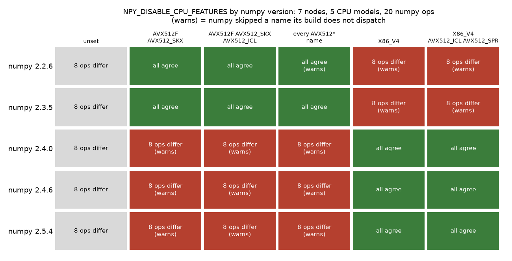
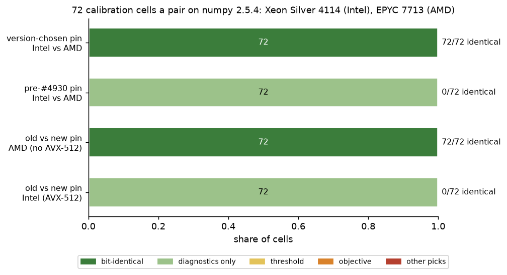

# #4110's numpy pin disables nothing on numpy 2.4 and later; the pin is now chosen by numpy's version (#4930)

**2026-10-15.** `NPY_DISABLE_CPU_FEATURES="AVX512F AVX512_SKX"` names dispatch targets that numpy 2.4 renamed.
On numpy 2.4.0 to 2.5.4, numpy skips both names with a hidden warning, and an AVX-512 node keeps its AVX-512
kernels: 8 of 20 probed numpy ops still differ across the GRID's five CPU models. `"X86_V4 AVX512_ICL
AVX512_SPR"` is the value from 2.4 on: all 20 agree on all 7 nodes. End to end on numpy 2.5.4, an Intel and an
AMD run of the same cell are bit-identical in 72 of 72 cells with the version-chosen pin, and in
0 of 72 with the old one. The GRID's venvs run numpy 2.2.6, where the old value is still right, so no
GRID run so far was affected.

## The answer

- **Which numpy does the GRID run?** 2.2.6, in both the app venv (`/expscratch/sgreenberg/vtsearch-venv`,
  which every `gridenv.sh` job uses) and the experiment `.venv`. `pyproject.toml` leaves numpy unpinned, and a
  fresh install resolves 2.5. The 2.4 boundary is exact: 2.3.5 takes the old names, 2.4.0 does not
  ([table](#which-value-works-on-which-numpy)).
- **numpy skips a name its build does not dispatch, not the whole variable.** It warns with an
  `ImportWarning` naming the skipped names, which Python hides by default, and applies the rest. The old value
  does nothing on numpy 2.4 only because neither of its names survived the rename.
- **The new value is complete.** From 2.4, `X86_V4` alone takes every probed op to agreement, and naming
  `AVX512_ICL` and `AVX512_SPR` as well turns those targets off too, so nothing above AVX2 reads as on. Before
  2.4, `AVX512F AVX512_SKX` was already complete, though `__cpu_features__` still reports `AVX512CD`,
  `AVX512_CLX`, `AVX512_CNL` and `AVX512_ICL` as on for an EPYC 9534. Those are the CPU's flags; no ufunc ran
  on them (`numpy.lib.introspect.opt_func_info()`), and every op agreed.
- **The cells agree again.** On numpy 2.5.4 with the version-chosen pin, an Intel (Silver 4114) and an AMD
  (EPYC 7713) run of the same cell are bit-identical in 72 of 72 cells: #4110's result, repeated on the new
  numpy. With the old value, 0 of 72 are. In this grid that drift stays in the honest-oracle columns, as
  numpy's part did in #4110: every cell picks the same items and prints the same cut and F-beta at every vote
  ([cells](#the-cells-on-numpy-254)). The corrected pin costs an Intel cell a paired median 5% of its wall
  time and an AMD cell nothing.
- **A second problem on numpy 2.5, in OpenBLAS, filed as #4938.** numpy 2.5 bundles OpenBLAS 0.3.34. On the
  EPYC 9534 (an L40S node) under `OPENBLAS_CORETYPE=Haswell`, which `app.py` and `gridenv.sh` set on every
  x86 machine (#4481), a float64 matrix product of n = 64 or more **segfaults**, and the float32 `X @ X.T`
  differs from every other CPU's. Neither happens on numpy 2.4.6 (OpenBLAS 0.3.31), on the other four CPU
  models, or without the core-type pin. It is a separate fix, and a GRID venv should not move to numpy 2.5
  before it lands.

## Data

- **Probes:** `scripts/experiments/node_determinism/probes/numpy_pins.sh` ran
  `probe_numpy_pins.py` once per (numpy, value) in a fresh process, numpy put first on `PYTHONPATH` from a
  `uv pip install --target` directory: numpy 2.2.6, 2.3.5, 2.4.0, 2.4.6 and 2.5.4, each under six values of
  `NPY_DISABLE_CPU_FEATURES`. The probes ran on #4110's seven nodes: rack2n13 and rack4n06 (Xeon Silver 4114),
  rack7n11 and rack8n09 (EPYC 7713), rack8n03 (Gold 5218R), rack10n04 (E5-2698 v4) and rack4n01 (EPYC 9534).
  Each records any warning numpy raised, the dispatch targets left on, the target each optimized ufunc runs,
  and a hash of 21 ops' outputs (#4110's float64 `exp`/`log`, the sorts, partitions and argsorts that
  x86-simd-sort dispatches, and one OpenBLAS op, a float32 matrix product). An op agrees when its hash is the
  same on all 7 nodes. `collate_numpy_pins.py` builds [`pins_by_numpy.csv`](pins_by_numpy.csv). The OpenBLAS
  op is counted apart (#4938), which leaves 20 numpy ops.
- **Cells:** #4110's launcher (`launch_4110.sh`) unchanged, from a frozen worktree at this branch's first
  commit (`c60ff99fc`), with numpy 2.5.4 put first on `PYTHONPATH`. It ran #4110's grid: `coco_better`,
  SigLIP, the user's pool at 1%, 150 votes, seed 0, every other class (72 cells an arm), on the cpu
  partition's Xeon Silver 4114 (AVX-512) and EPYC 7713 (AVX2) nodes:
  - `i_ship`, `a_ship`: Intel, AMD; nothing exported, so `run_cells.py` sets its own pins, numpy's now chosen
    by its version;
  - `i_full`, `a_full`: Intel, AMD; the pins exported by hand with the pre-#4930 numpy value
    (`PIN_NPY="AVX512F AVX512_SKX"`), which is what `run_cells.py` set on numpy 2.5 before this change.

  `analyze_4110.py` pairs them cell by cell, as in #4110: [`pairs.csv`](pairs.csv),
  [`summary.json`](summary.json). Every cell's log line names the pins and, new here, the targets numpy's
  ufuncs ran (`numpy_targets=`).

## Which value works on which numpy

*Each cell counts the probed numpy ops whose output differs between any two of the 7 nodes; "(warns)" means
numpy skipped a name. Unset (grey) is the drift the pin exists to remove. The figure counts disagreement, not
speed or correctness.*

| numpy | dispatch targets above the baseline | `AVX512F AVX512_SKX` | `X86_V4 AVX512_ICL AVX512_SPR` |
|---|---|---|---|
| 2.2.6 | SSSE3 ... AVX2, AVX512F, AVX512CD, AVX512_KNL/KNM, AVX512_SKX/CLX/CNL/ICL | all agree | warns, 8 differ |
| 2.3.5 | the same, plus AVX512_SPR | all agree | warns, 8 differ |
| 2.4.0, 2.4.6, 2.5.4 | X86_V3, X86_V4, AVX512_ICL, AVX512_SPR | **warns, 8 differ** | all agree |

The 8 ops that differ unpinned, or under the wrong generation's value, are #4110's: float64 `exp`, `log` and
`power`, `argsort` of tied float64 and float32 values and of int64, and float64 `partition` and `argpartition`.
They split AVX-512 (Silver 4114, Gold 5218R, EPYC 9534) from AVX2 (EPYC 7713, E5-2698 v4). The float16 sort and
int16 argsort, which numpy dispatches to `AVX512_ICL`/`AVX512_SPR`, agreed under every value, unset included. Per (numpy,
value), with the targets left on per CPU and the ufunc targets that ran: [`pins_by_numpy.csv`](pins_by_numpy.csv).

## The cells on numpy 2.5.4

*Each bar is one pair of arms over the same 72 cells. "Diagnostics only" means the base rows' picks, cut and
F-beta agree at every vote and a measurement column (the honest oracle) does not. The figure says whether two
runs are the same, not how good either is.*

| pair | question | cells | identical | diagnostics only | threshold | objective | other picks |
|---|---|---|---|---|---|---|---|
| `i_ship` ~ `a_ship` | version-chosen pin, Intel vs AMD | 72 | **72** | 0 | 0 | 0 | 0 |
| `i_full` ~ `a_full` | pre-#4930 pin, Intel vs AMD | 72 | 0 | 72 | 0 | 0 | 0 |
| `a_ship` ~ `a_full` | the two values, AMD | 72 | **72** | 0 | 0 | 0 | 0 |
| `i_ship` ~ `i_full` | the two values, Intel | 72 | 0 | 72 | 0 | 0 | 0 |

Every cell's log confirms what ran. All 144 `_ship` cells and the 72 `a_full` cells ran `numpy_targets=X86_V3`,
and all 72 `i_full` cells ran `X86_V3,X86_V4`: the old value was set and numpy disabled nothing.

**With the old value, the Intel and AMD cells differ from the first vote, but only in measurement columns.**
The first column to differ is `oracle_threshold_honest` (45 cells) or `oracle_cost_honest` (27), at vote 1,
with `regret_honest` after them. The honest oracle seeds its resampling from a hash of the score array, so any
last-bit change in a score redraws it (#4110). Besides those, one cell's cut-diagnostic sidecar differs
(`book@medium`, a variant row's F-beta by 0.0007). No cell picks another item, and no base row's cut or
F-beta moves. It is the shape #4110 measured for the numpy pin alone (`i_base` ~ `i_npy`: 28 of 28
diagnostics only). There, the cut stopped moving between nodes only once the MKL and ATen pins were added,
and every arm here sets both.

**On AMD the two values give the same cells**, because the EPYC 7713 has no AVX-512 kernel to turn off. On the
Xeon, the corrected pin is what moves a cell, and only in the same measurement columns.

**Cost.** Cell for cell, the version-chosen pin took a median 5% longer than the old value on the Xeon (IQR
4–7%, 72 cells), and 0.4% longer on the EPYC (IQR −0.5% to 1.1%). It turns off numpy's AVX-512 `exp`, `log`
and sorts on the Xeon, which the old value had silently left on. #4110 measured +3% for the same change on
numpy 2.2.6. `time_ratios` in [`summary.json`](summary.json).

## What ships

- `_expcommon.numpy_kernel_pin()` reads numpy's version from its package metadata, without importing numpy,
  and returns `"AVX512F AVX512_SKX"` before 2.4 and `"X86_V4 AVX512_ICL AVX512_SPR"` from 2.4.
  `cpu_kernel_pins()` replaces the `CPU_KERNEL_PINS` constant, and `pin_cpu_kernels()` defaults from it as
  before: an exported value still wins, and `VTS_KERNEL_PINS=0` still opts out.
- `gridenv.sh` takes its default from the same function. If it cannot read numpy's version it says so on
  stderr and leaves the variable unset, rather than guessing a value numpy might skip. Sourcing it takes
  0.18 s.
- A cell's `kernels:` line adds `numpy=<version> numpy_targets=<targets its ufuncs ran>`, so a pin numpy
  skipped shows in the log (`X86_V3,X86_V4` on a Xeon) rather than reading as set.
- `tests_lib/meta/test_cpu_kernel_pins.py` imports the installed numpy under its pin with `-W error`, and
  fails if any optimized ufunc runs above AVX2. It used to assert `not __cpu_features__["AVX512F"]`, which is
  the CPU's flag and stays on under a correct pin from numpy 2.4. It passes on numpy 2.2.6 and on 2.5.4, on a
  Silver 4114 and an EPYC 7713. On the Silver 4114 it fails for an incomplete value (`AVX512_ICL` on numpy
  2.2.6, `AVX512_ICL AVX512_SPR` on 2.5.4) and for the other generation's value (the warning). It checks `gridenv.sh` by sourcing a copy.
- One value naming both generations' targets would also work, since numpy skips only the unknown names. It
  would warn at every import, though, and that warning is the only sign of the next rename.

## Not covered

- **A stale exported value.** An exported `NPY_DISABLE_CPU_FEATURES` still wins, in `gridenv.sh` and
  `pin_cpu_kernels()` alike. A shell that sourced `gridenv.sh` on numpy 2.2.6 exports the old value, and a job
  it submits after the venv moves to numpy 2.4 or later keeps it. The `kernels:` line shows it; nothing
  stops it.
- **The GPU nodes' CPUs ran the probes, not cells.** The Gold 5218R, E5-2698 v4 and EPYC 9534 agree on every
  probed numpy op under the right value, but whole cells ran on the cpu partition only, as in #4110.
- **The ufunc check covers ufuncs.** numpy's sorts and partitions are not in `opt_func_info()`. They are in
  the probes, which ran once, here; the suite does not repeat them.
