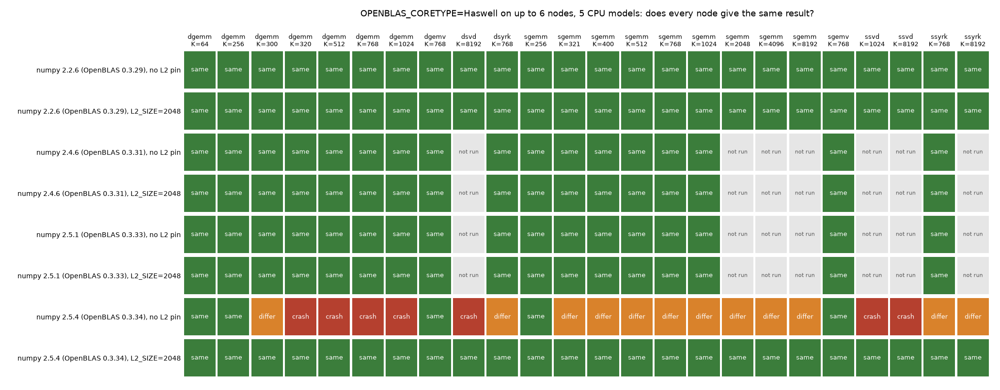

# numpy 2.5.2's OpenBLAS breaks the Haswell pin on Zen 4; `OPENBLAS_L2_SIZE=2048` restores it (#4938)

**2026-10-15.** numpy 2.5.2 and later bundle OpenBLAS 0.3.34, which re-tunes GEMM blocking on an AMD Zen 4/5
CPU even when `OPENBLAS_CORETYPE` forces another core (OpenMathLib/OpenBLAS#6021). Under the Haswell pin that
`app.py`, `gridenv.sh` and the cell runner set (#4481), the EPYC 9534 on the L40S nodes then **segfaults** in
a float64 matrix product with K of 320 or more and in float32 and float64 SVD, and returns different float32
GEMM and syrk results than the other four CPU models: 6 crashes and 11 disagreements in 24 probed ops. With
`OPENBLAS_L2_SIZE=2048` alongside the pin, nothing crashes and all 24 agree on every node, and the setting
changes no result of numpy 2.2.6, 2.4.6 or 2.5.1, or of scipy, on any node. The app's own test suite on that CPU segfaulted 11 times without the setting, all in the SVD that fits a document collection's Stage-1 projection, and 0 times with it. The GRID venvs run numpy 2.2.6 (OpenBLAS 0.3.29) and
scipy's 0.3.31.dev, so nothing on the GRID has crashed; the pin now ships with the L2 setting so that no
future numpy upgrade can.

## The answer

- **Cause (upstream's, confirmed here).** 0.3.34 added a block to `init_parameter()` (OpenMathLib/OpenBLAS#5868) that, on an
  AuthenticAMD host with a 1 MB L2, an L3 that is a multiple of 32 MB and AVX-512F, sets `dgemm_q=512` and
  `sgemm_q=512` for whatever core table is active, including one forced by `OPENBLAS_CORETYPE`. The Haswell
  float64 kernel packs 96 bytes per K step into a fixed stack buffer sized for its own `dgemm_q=256`, so a
  chunk of K above ~299 overruns its frame. A float32 K-chunk of 512 instead of 320 sums in another order.
  LAPACK's SVD crashes in both precisions (float32 from a 300 x 1024 matrix), though a plain float32 GEMM
  up to K = 8192 only disagrees, so "float64 only" undersells it.
  Upstream fixed it in OpenMathLib/OpenBLAS#6027 (merged 2026-09-13), which applies the block only to AVX-512 tables. No
  release has it: the newest `scipy-openblas` wheels (0.3.34.237, 2026-09-05) predate it.
- **Which numpy.** 2.5.0 and 2.5.1 bundle OpenBLAS 0.3.33, 2.5.2 and later 0.3.34. scipy 1.18.1, the newest,
  bundles 0.3.31.dev; torch uses MKL.
- **Which CPU.** Of the GRID's five models, only the EPYC 9534 (Zen 4, 1 MB L2, 32 MB L3 per CCD, AVX-512)
  meets the condition. The EPYC 7713 (Zen 3, 512 KB L2, no AVX-512) and the three Xeons do not. Outside the
  GRID, EPYC 9004/9005 and Ryzen 7000/9000 do.
- **The workaround.** The block requires an L2 of exactly 1024 KB, and `OPENBLAS_L2_SIZE` overrides the
  detected size. In 0.3.34 the Haswell table reads the L2 size nowhere else (its P and Q are compile-time
  constants in `kernel/setparam-ref.c`), and on 0.3.29 to 0.3.33 the setting changed no result, so reporting
  2048 KB only switches the block off. That is what upstream's fix does for a forced Haswell core, and what
  OpenMathLib/OpenBLAS#6021's reporter measured on a Genoa host.
- **The app's exposure.** Real. `vtscore.media.structural_tiles.fit_projection`, which fits a document
  collection's Stage-1 projection (a float32 SVD over 8,192-wide tile vectors), segfaults on the EPYC 9534
  under numpy 2.5.4. In the suite it took down 11 test workers, and pytest then gave up 10,720 tests in
  ([below](#the-apps-own-suite-on-the-epyc-9534)). A server on such a CPU would crash the first time it
  built a document collection's projection.

## Data

- **Probe:** `scripts/experiments/node_determinism/probes/openblas_l2.sh` runs `probe_blas_ops.py` once per
  (numpy, L2 setting, op) in a fresh process, so a crash names its op. It ran numpy 2.2.6 (the GRID venv's),
  2.4.6, 2.5.1 and 2.5.4, from `uv pip install --target` directories, under `OPENBLAS_CORETYPE=Haswell` and one
  thread. The ops are float64 GEMM at K = 64 to 1024, float32 GEMM at K = 256 to 1024, float32 and float64
  syrk (`X @ X.T`) and gemv, all at K = 768 where not stated. A second run sent float32 and float64 GEMMs
  through `scipy.linalg.blas` (the venv's scipy 1.18.1). A third, after the suite crashed in an SVD, ran
  numpy's float32 and float64 SVD and float32 GEMM and syrk at K = 1024 to 8192, on numpy 2.2.6 and 2.5.4
  and five nodes ([`ops_svd.csv`](ops_svd.csv)). Nodes: rack4n06 (Xeon Silver 4114), rack7n11 and
  rack8n09 (EPYC 7713), rack8n03 (Gold 5218R), rack10n04 (E5-2698 v4) and rack4n01 (EPYC 9534). rack2n13, the
  second Silver 4114, was full. `collate_openblas_l2.py` builds [`ops.csv`](ops.csv),
  [`ops_scipy.csv`](ops_scipy.csv) and the third CSV; `figures_4938.py` draws the figure from the first and
  third runs.
- **Suite:** the app's own test suite on rack4n01 with numpy 2.5.4, run twice from this branch:
  `OPENBLAS_L2_SIZE` exported empty (OpenBLAS detects the 1 MB L2; the block fires) and as `gridenv.sh` sets
  it. Script: `probes/suite_zen4.sh` (the run used a scratch copy of it, the same commands).

## Which ops crash or disagree

*Each cell is one op on 6 nodes under the Haswell pin: "same" when every node returned the same bits, "differ"
when one did not, "crash" when one segfaulted. Every "differ" and "crash" is the EPYC 9534. The figure does not
say which result is more accurate; the probed values are random.*

- **numpy 2.5.4 without the L2 setting:** float64 GEMM crashes at K = 320, 512, 768 and 1024 and differs at
  K = 300, and float32 and float64 SVD crash. Float32 GEMM differs at every K but 256, up to 8192, and every
  syrk differs. K = 256 agrees because a chunk of 256 is the same chunk under Q = 320 or 512. gemv, which does
  not use these blocking parameters, agrees.
- **numpy 2.5.4 with it:** nothing crashes, and all 24 ops agree on every node.
- **numpy 2.2.6, 2.4.6 and 2.5.1, with or without it:** every op agrees on every node, and the L2 setting
  changes no result on any node. Neither do scipy's float32 and float64 GEMMs (OpenBLAS 0.3.31.dev) at
  K = 320 to 1024. So the setting moves no GRID baseline.

## The app's own suite on the EPYC 9534

| arm | `OPENBLAS_L2_SIZE` | segfaults | tests run | passed | failed |
|---|---|---|---|---|---|
| bug | exported empty (detected: 1 MB) | **11** | 10,720, then pytest's internal error | 10,637 | 34 |
| fix | 2048 (`gridenv.sh`'s default) | **0** | 16,728, to the end | 16,646 | 26 |

- **Every segfault is the same call:** `np.linalg.svd` in `vtscore/media/structural_tiles.py:fit_projection`,
  reached from the `projection` fixture of `tests_lib/detectors/test_structural_stage1.py` (10) and from
  `test_structural_tiles.py` (1). Each one killed an xdist worker, and after the eleventh pytest stopped.
- **The 8 tests that failed only in the bug arm** are the Stage-1 tests whose worker crashed, plus pytest's
  internal error.
- **The 26 failures in the fix arm failed in the bug arm too**, so the numpy 2.5 overlay causes them, not the
  L2 setting. 11 are numba 0.61 refusing numpy 2.5 (8 UMAP projection, 3 audio decoding). The other 15 are
  audio tests (spectrogram conversion, silence clipping and trimming) whose cause on numpy 2.5 I did not
  chase. Run by ID on the GRID venv's numpy 2.2.6, all 18 that are not UMAP pass.

## What ships

- `app.py`, `gridenv.sh`, `_expcommon.cpu_kernel_pins()` (the cell runner) and `pile/fhibe_supply.py` set
  `OPENBLAS_L2_SIZE=2048` as a default whenever the core is Haswell (theirs or an exported one). An exported
  value wins, and an empty one lets OpenBLAS detect the cache. Under another core it is left alone, since an
  older core's P follows the L2 size.
- A cell's `kernels:` line names it with the other pins.
- Tests: the cell runner sets it only with Haswell, `gridenv.sh` agrees (sourced from a copy), and the app's
  prelude sets it after the core. `docs/DEPLOYMENT.md` lists it.
- **When to drop it:** once the numpy in use bundles an OpenBLAS with OpenMathLib/OpenBLAS#6027 (0.3.35, or a
  `scipy-openblas` build after 2026-09-13), the setting is redundant. It stays harmless, since a forced
  Haswell table then never reads the L2 size.

## Not covered

- **Speed.** The L2 setting restores the Haswell blocking that every other CPU runs, and the Zen 4 tuning
  that 0.3.34 meant for its own SkylakeX/Cooperlake tables is off under the pin either way, so this costs
  nothing against 0.3.33. It was not timed.
- **Other cores.** A forced `Zen` core crashes the same way (OpenMathLib/OpenBLAS#6021); the setting would
  cover it too, but the code applies it only with Haswell, the only core VTSearch forces.
