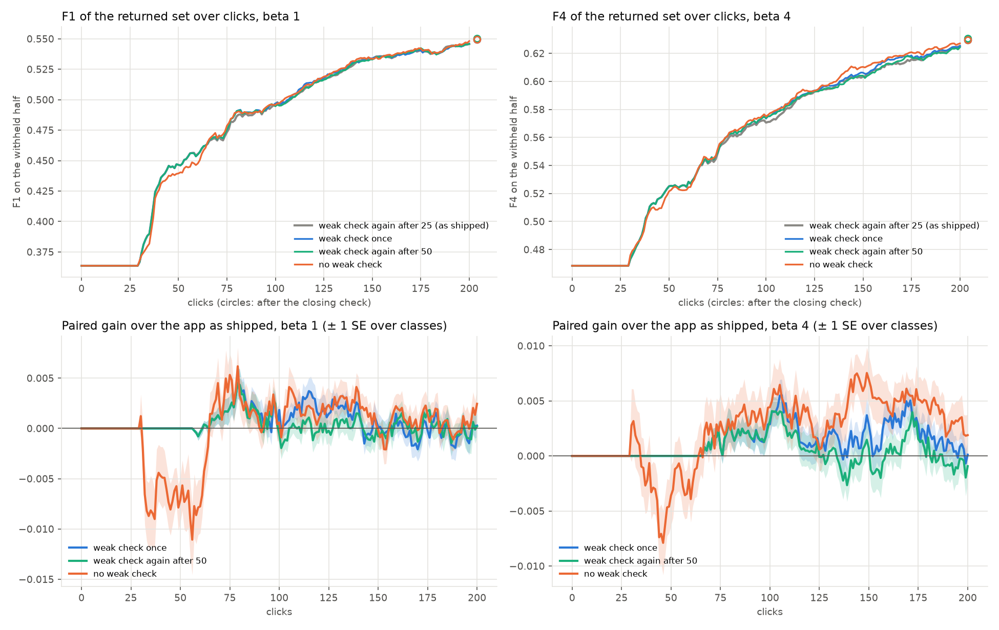
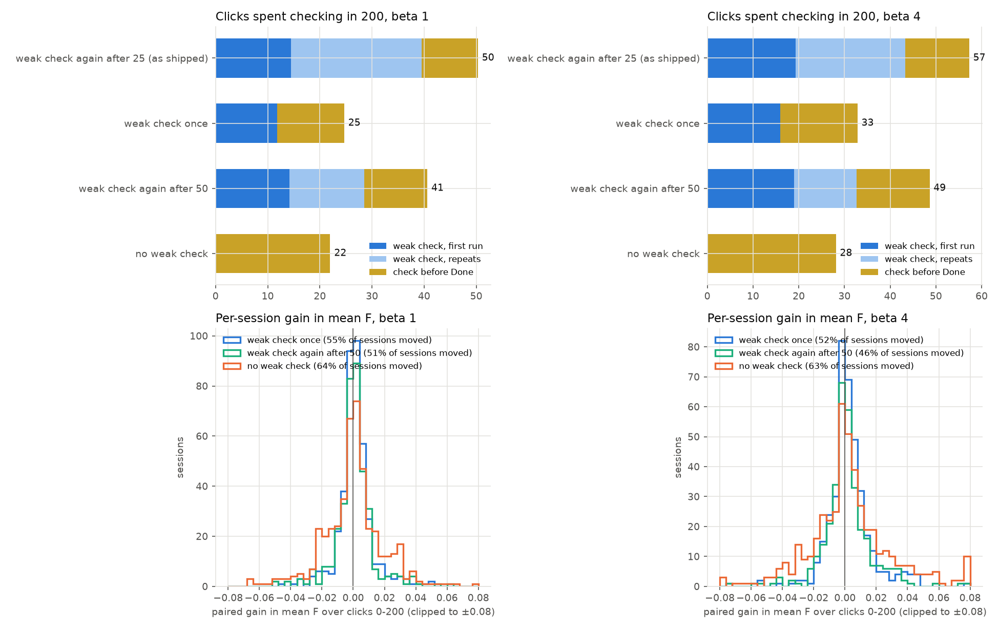

# The weak check's repeat, re-priced at today's head (issue #4909)

**Status (2026-10-15): Binary Photo at beta 1 and 4, 5 seeds, priced. The ship form is the owner's call.**

**The repeat no longer pays, and neither does the weak check itself, past click 75.** Every arm ran today's app to
click 200, then the closing check, and differed only in the weak-separation check:

| paired gain in mean F-beta over the app as shipped | clicks 0–50 | 0–150 | 0–200 | after the closing check |
|---|---|---|---|---|
| beta 1, weak check once | 0 | +0.0009 (± 0.0003) | +0.0006 (± 0.0003) | +0.0001 (± 0.0012) |
| beta 1, again after 50 | 0 | +0.0004 (± 0.0003) | +0.0003 (± 0.0003) | +0.0009 (± 0.0012) |
| beta 1, no weak check | −0.0025 (± 0.0007) | −0.0003 (± 0.0007) | −0.0001 (± 0.0006) | 0.0000 (± 0.0016) |
| beta 4, weak check once | 0 | +0.0011 (± 0.0004) | +0.0013 (± 0.0004) | −0.0001 (± 0.0013) |
| beta 4, again after 50 | 0 | +0.0006 (± 0.0004) | +0.0005 (± 0.0005) | +0.0012 (± 0.0014) |
| beta 4, no weak check | −0.0010 (± 0.0008) | +0.0016 (± 0.0009) | +0.0023 (± 0.0009) | −0.0002 (± 0.0014) |

The app as shipped scores 0.48 (beta 1) and 0.56 (beta 4) over clicks 0–200, and 0.55 / 0.63 after the closing
check. A "0" is exact: those arms are the shipped app until its first repeat.

**What the weak check costs is clicks.** Of 200, the shipped app spends 50 checking at beta 1 and 57 at beta 4:

| clicks spent checking in 200 | weak check, first run | its repeats | check before Done | total |
|---|---|---|---|---|
| beta 1, as shipped (again after 25) | 14 | 25 | 11 | **50** |
| beta 1, once | 12 | 0 | 13 | 25 |
| beta 1, again after 50 | 14 | 14 | 12 | 41 |
| beta 1, no weak check | 0 | 0 | 22 | **22** |
| beta 4, as shipped | 19 | 24 | 14 | **57** |
| beta 4, once | 16 | 0 | 17 | 33 |
| beta 4, again after 50 | 19 | 14 | 16 | 49 |
| beta 4, no weak check | 0 | 0 | 28 | **28** |

Without the weak check, the check before Done runs in 93% of sessions instead of 44–46%: today it is skipped when a
weak check ended in the last 25 votes.

**The weak check's one gain is early, at beta 1, in sessions that succeed anyway.** Over clicks 0–50 at beta 1 it
is worth +0.0025. Almost all of that sits in sessions whose F1 at click 200 is 0.5 or more, which it gets there
sooner; by click 75 the arm without it has caught up. Sessions that end below 0.2 get nothing from it (below).

## The question

#4664 found that a check's picks are now worth about what Autopilot's are: the check where the user stops at click
50 was +0.026 (beta 1) / +0.039 (beta 4), against +0.022 / +0.037 for the same number of further Autopilot clicks.
On the 10-08 app the check was worth 5× those clicks. Yet today's app spends a quarter of a session's clicks on
checks, most of them the weak check's repeat: "again after 25 votes while the labels separate weakly", chosen by
#4496 on the 10-05 app. Does the repeat still pay?

## What was run

| | |
|---|---|
| arms | **r25**: the app as shipped, the weak check again 25 votes after a check ends while the labels separate weakly. **r0**: the weak check once (`CALIB_WEAK_REPEAT=0`). **r50**: again after 50 (`CALIB_WEAK_REPEAT=50`). **nw**: no weak check (`CALIB_WEAK_MIN_T=100000`); the check before Done and the closing check stay |
| "once" | the existing knob's meaning: a weak check is due only while no check has ended in the session. Where the check before Done comes first (11–12% of sessions), r0 runs no weak check afterwards, and r25 may |
| pairing | the same cell and seed in every arm. All 4,320 pairs were checked pick by pick: each arm leaves r25 only at a weak check's pick (one arm starts a weak check there and the other does not), or never, and F agrees up to that pick. Every pack ran on AMD nodes |
| code | dev at 6553a698f plus the launcher (b5cdd719a, a frozen worktree); no app or harness change |
| bench | `coco_better`, 144 class@band cells × 5 seeds, SigLIP whole-image (Binary Photo), on the 2026-10-08 grid #4743 priced |
| presets | beta 1 and beta 4 |
| clicks | 200, then the closing check. 5,760 runs (720 per arm and preset), all completed |
| objective | F-beta, at the run's beta, of the withheld half above the line the app shows. Until 30 labels a typed-query detector shows its query's own set (#4736's hold), so every arm's curve is flat to click 30 |

Gains are paired per run, and ± is one SE over classes.

## Result



*Top: mean F-beta of the returned set over clicks (circles: after the closing check). Bottom: each arm's paired gain
over the app as shipped.*

- **Once, or again after 50, stays level with the shipped app or slightly ahead.** They leave it at a median click
  of 82–93, where its first repeat starts, in 46–56% of sessions. From there to click 200 they run between 0.002
  behind and 0.006 ahead, and the closing check evens them out.
- **No weak check trails early and leads late.** It leaves the shipped app at click 25–26, where the first weak
  check starts, in 63–65% of sessions. At beta 1 it is −0.007 at click 50 and ahead by click 75 (+0.005). At beta 4
  it is −0.004 at click 50, then +0.004 at click 100, +0.007 at 150 and +0.005 at 175.
- **Where the shipped app repeats most, dropping the repeat helps most.** In the 41% (beta 1) and 31% (beta 4) of
  sessions with three or more weak checks, once gains +0.0017 (± 0.0008) / +0.0037 (± 0.0010) over clicks 0–200,
  and no weak check +0.0011 (± 0.0017) / +0.0069 (± 0.0024).



*Top: the clicks each arm spends checking in 200. Bottom: each session's paired gain in mean F-beta over clicks
0–200, sessions that never left the shipped app omitted.*

### Who the weak check helps

The weak check fires in 65% (beta 1) and 63% (beta 4) of sessions. Weak separation does predict failure: these
sessions end far worse than the rest. But the check does not rescue the failures. Paired gain of no weak check over
the app as shipped, in the sessions where its weak check fired, by how the shipped session ends:

| F-beta at click 200, as shipped | sessions | clicks 0–50 | clicks 0–200 | F-beta at 50, as shipped / without |
|---|---|---|---|---|
| beta 1, below 0.2 | 111 | +0.0002 (± 0.0007) | +0.0033 (± 0.0018) | 0.06 / 0.06 |
| beta 1, 0.2 to 0.5 | 162 | −0.0010 (± 0.0015) | +0.0015 (± 0.0021) | 0.21 / 0.21 |
| beta 1, 0.5 or more | 194 | **−0.0086** (± 0.0024) | −0.0033 (± 0.0010) | 0.54 / 0.51 |
| beta 4, below 0.2 | 51 | −0.0007 (± 0.0013) | +0.0081 (± 0.0035) | 0.08 / 0.08 |
| beta 4, 0.2 to 0.5 | 141 | +0.0020 (± 0.0013) | +0.0053 (± 0.0029) | 0.20 / 0.21 |
| beta 4, 0.5 or more | 262 | −0.0037 (± 0.0021) | +0.0018 (± 0.0016) | 0.58 / 0.57 |

The eventual successes end level at click 200 (F1 0.70 both ways, F4 0.72 both ways). Sessions the weak check helped
most over clicks 0–50:

| session | F-beta at 50, as shipped / without | at 200, as shipped / without | weak checks run |
|---|---|---|---|
| laptop@large, seed 2, beta 1 | 0.79 / 0.61 | 0.78 / 0.78 | 2 |
| fork@large, seed 3, beta 1 | 0.43 / 0.04 | 0.61 / 0.66 | 4 |
| dog@medium, seed 1, beta 4 | 0.50 / 0.10 | 0.72 / 0.70 | 3 |
| spoon@large, seed 0, beta 4 | 0.58 / 0.31 | 0.50 / 0.64 | 2 |

Sessions where dropping the repeat moved most (once against as shipped, beta 1):

| session | clicks checking, as shipped / once | F1 at 200, as shipped / once |
|---|---|---|
| parking meter@small, seed 2 | 90 / 60 | 0.16 / 0.24 |
| umbrella@small, seed 0 | 80 / 40 | 0.12 / 0.31 |
| scissors@medium, seed 1 | 95 / 20 | 0.48 / 0.41 |
| sink@small, seed 4 | 60 / 40 | 0.41 / 0.34 |

### Done

| | Done by 200 | median click | F-beta where the user stops |
|---|---|---|---|
| beta 1, as shipped | 94% | 57 | 0.47 |
| beta 1, once / again after 50 | 94% | 57 | +0.0002 / −0.0003 |
| beta 1, no weak check | 94% | 59 | −0.0017 (± 0.0030) |
| beta 4, as shipped | 92% | 63 | 0.55 |
| beta 4, once / again after 50 | 93% | 63 | +0.0001 / +0.0002 |
| beta 4, no weak check | 93% | 66 | −0.0003 (± 0.0026) |

"Where the user stops" is Done, or click 200 without it. **Dropping the repeat does not bring Done sooner**: the
repeats mostly come after it (first repeat at a median click of 83–93, Done at 57–63). Dropping the weak check makes
Done 3.7 (± 0.6) clicks later at beta 1 and 2.7 (± 0.6) at beta 4, at the same F-beta: the check before Done now
runs where the weak check used to stand in for it. The clicks the repeat costs go to Autopilot after Done.
Goods found by 200 (30 / 29) and AP at click 200 are unchanged in every arm.

## What each ship form would change

- **No weak check.** Autopilot's steps run in order: good → bad → more (the opening), hard/new, then the Spot Check
  once before Done, then Done. Today the weak check is the only thing that enters the Spot Check out of turn
  (`runDueCheck` in `label-view.component.ts`, on the server's `check_due`), interrupting hard/new, and again
  after 25 votes. The Train tab's Check button would no longer light up with its due note. Face searches already
  run this way (#4799). #4508 (retrain during the opening so the weak check can fire there) would be moot.
- **Once.** The weak check still interrupts hard/new, once, at a median click of 25–26; `WEAK_CHECK_COOLDOWN`
  becomes "never again".

## Reproduce

```
scripts/experiments/state_of_app/weak_repeat_4909.sh dirs
SBATCH_CONSTRAINT=amd CALIB_PACK_PAR=8 CALIB_PACK_MEM=12G \
  scripts/experiments/state_of_app/weak_repeat_4909.sh cpack ARM BETA [IDX]   # ARM in r25 r0 r50 nw, BETA 1 or 4
python scripts/experiments/state_of_app/weak_repeat_4909.py --root <state-of-the-app> --seeds 5 \
  --baseline <text_baseline-count-binary10.csv> --out <dir> --docs docs/experiments/2026-10-15-weak-repeat-4909/tables
```

Tables: `tables/repeat_summary.csv` (every number above), `repeat_splits.csv` (by band, by the shipped app's weak
check count, by how it ends), `repeat_examples.csv`, `repeat_curves.csv`, `repeat_gains.csv`.
