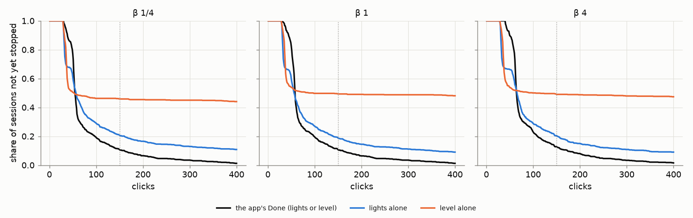
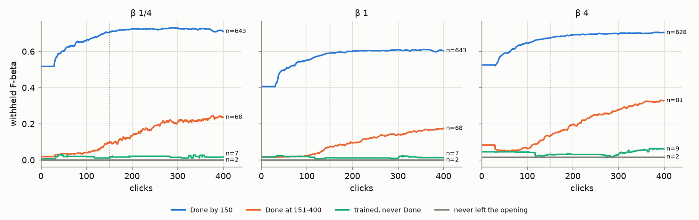
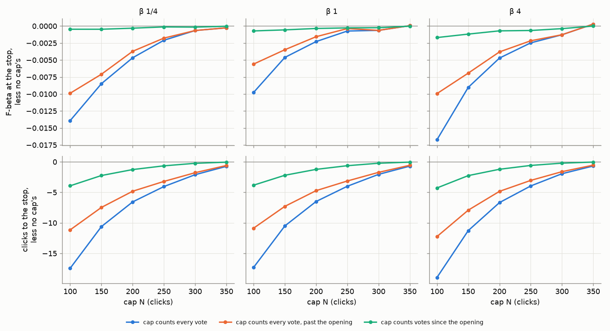

# Stop rules past the horizon, and a click cap (#4903)

**2026-10-15.** 2,160 sessions of today's app (Done once every light is green or the labels line expects an
F-beta of 0.5, #4878), run to 400 clicks instead of the eval's 150. The owner's ruling that started it: "We can't
NEVER stop the user; are we really going to make them label 10k images? ... Worst case, our stopping rules is
'Some algorithm or 200 clicks'."

## The answer

- **Done stops almost everyone, eventually.** It fires by click 150 in 87–89% of sessions, by 200 in 92–94%, by
  300 in 96–97%, and by 400 in 98.5–98.8%. 1.2–1.5% of sessions are still going at 400: every one a small or
  medium object at an F-beta near 0. 0.3% of all sessions never left the opening at all: they never found a Good.
- **The sessions Done misses are late starters, not slow learners.** 3.8% of sessions (12% of small objects) are
  still in the opening, walking the typed query's sort for their first Good, at click 150; 1.8% (5.6% of small)
  at click 200, every one with no Good yet. Once such a session finds its Goods it trains, climbs, and Done
  stops it a median 80–97 clicks later, against 46–56 for a session that leaves the opening by 150
  ([figure](#who-is-still-going)).
- **"Done, or 200 votes" costs little.** Against no cap (sessions run on to 400), it ends 6.0–6.7% of sessions
  early. The mean F-beta a session leaves with falls by 0.005, 0.002 and 0.005 at β 1/4, 1 and 4, and the mean
  session leaves 6.5–6.7 clicks sooner. Without a cap the sessions still going at 400 would go on, so the
  saving is a floor.
- **Nothing in the numbers moves N off 200.** The cost falls smoothly with N, with no knee: 0.005–0.009 F-beta
  at 150, 0.002–0.005 at 200, 0.001–0.002 at 250, 0.001 at 300.
- **The cap stops sessions polishing a turd.** At vote 200 the sessions it ends hold a median F-beta of
  0.00–0.04; left to their own Done (or click 400) they would reach a median 0.07–0.14, and 0–5% of them 0.5.
  The sessions Done stopped by 150 leave with a median 0.52–0.72. The text default is no floor under them: for
  these classes the typed query's own set scores 0.01–0.06, so the detector is below it in only 7–29% of them at
  the cap ([the capped sessions](#are-the-capped-sessions-worth-finishing)).
- **What the cap counts was the real choice, and the owner chose every vote, at 200.** Read only past the
  opening, it would never end a session still walking for its first Good (0.3% at 400, and in the app,
  forever). Counting every vote, such a session is told at 200 that Autopilot has stopped and offered a
  different sort ([what ships](#what-ships)).

## Data

- **Sessions:** `scripts/experiments/state_of_app/wider_stop_4903.sh`, the Binary Photo path, the grid #4743
  priced (`2026-10-08-b1`, 144 classes a seed), 5 seeds, 3 presets (β 1/4, 1, 4), `SOTA_MAX_STEPS=400`, no
  ceiling pass. Run dirs `/expscratch/sgreenberg/state-of-the-app/2026-10-15-stop4903-b{025,1,4}`, at commit
  9cb6652b0 (dev b8a310139 plus the launcher). About 15 minutes a session; 2,160 sessions, none failed.
- **Readings:** `wider_stop_4903.py read` reads, per session, the withheld F-beta at every click, the click the
  app's Done first fired (`phase == "done"`), and offline the click every light first read green (the lights
  alone) and the click the class model's `line_efbeta` first read 0.5 (the level alone). The offline two are
  where their condition first holds; past the app's first stop the session is the app's, not the one either
  rule alone would have run.
- **The first 150 clicks are a 150-click run.** 24 of the same cells run again at 150 clicks on the same commit
  (`stop4903h150-*`) match the 400-click sessions in every pick, phase, F-beta and Done click: the step budget
  is not read before it runs out.
- **They are not #4878's sessions.** Only 21–26% match #4878's `or` arm over clicks 1–150: dev took #4864
  (ship nearest) and #4899 (folds that rank the wrong way) after it ran, and some sessions part at click 10.
  This study's 150-click numbers are today's app.

## Where the rules stop



| preset | rule | by 150 | by 200 | by 300 | by 400 | KM median |
|---|---|---|---|---|---|---|
| β 1/4 | the app's Done (lights or level) | 89% | 94% | 97% | 99% | 55 |
| | lights alone | 79% | 84% | 87% | 89% | 57 |
| | level alone | 54% | 55% | 55% | 56% | 53 |
| β 1 | the app's Done | 89% | 94% | 97% | 99% | 59 |
| | lights alone | 81% | 86% | 89% | 91% | 57 |
| | level alone | 51% | 51% | 51% | 52% | 98 |
| β 4 | the app's Done | 87% | 92% | 97% | 99% | 65 |
| | lights alone | 80% | 85% | 89% | 91% | 66 |
| | level alone | 51% | 51% | 52% | 53% | 106 |

- **The level alone fires early or never.** Past click 150 it stops 1–2% more sessions: a class model that does
  not expect 0.5 by then rarely comes to.
- **The lights do the work past 150.** The app's Done keeps stopping sessions out to 400 because the lights
  keep firing on the late starters.
- **The check before Done is two populations.** 44–47% of sessions skip it (a weak-separation check ended in
  the last 25 votes, `done_check_due`); the rest take 21 (β 1/4), 26 (β 1) and 31 (β 4) clicks. The mean, 10–16
  clicks, is what a capped session's check is priced at below.

## Who is still going



| preset | Done by 150 | Done at 151–400 | trained, never Done | never left the opening |
|---|---|---|---|---|
| β 1/4 | 89% | 9.4% | 1.0% | 0.3% |
| β 1 | 89% | 9.4% | 1.0% | 0.3% |
| β 4 | 87% | 11% | 1.2% | 0.3% |

By band, every large-object session is Done by 150; medium ones by 400 but for one session in 245. Small objects
are the whole story: 64–69% Done by 150, 28–32% Done at 151–400, 2.6–3.5% never.

**The late group is the opening, not the lights.** The opening does not read the balance, so it is the same at
every preset: 12% of small-object sessions are still in it at click 150 and 5.6% at 200, none of them with a
single Good. Literal sessions at β 1:

- `chair@small`, seed 0: no Good in its first 200 clicks; leaves the opening at 265, Done at 360, F-beta 0.21 at
  400.
- `keyboard@small`, seed 0: leaves the opening at 152 with F-beta 0, reaches 0.25 at 200, Done at 230, 0.44 at
  300.
- `bowl@small`, seed 4, and `chair@small`, seed 1: no Good in 400 clicks. Their typed query's sort never
  surfaces one; no stop rule ever reads them.

The trained sessions never Done are flat near 0 (F-beta 0.013–0.061 at 400; 14–44% still gaining 0.01 over
their last 100 clicks).

## A click cap

Each rule, or a cap at N clicks, whichever comes first, scored as #4878 scored a rule, at the 400-click horizon:
the F-beta a session leaves with, the clicks it takes, and its two edges (over a stop at a fixed click at the
same mean leave, and over the same leave clicks dealt at random). Three ways to count the cap:

- **every vote:** a session at N votes stops wherever it is. A trained one stops after the check before Done;
  one still in the opening stops at N (it has no line to check).
- **every vote, past the opening** (what is built): the cap is read where the lights and the level are. A
  session that leaves the opening after N stops the moment it does; one that never leaves it is never capped.
- **votes since the opening:** N votes from the click the session leaves the opening, so a late starter gets
  the budget an early one does. A session that never leaves it is never capped, and one capped past 400 reads
  as leaving there.



The app's Done or N votes (every vote), against no cap:

| preset | N | sessions capped | F-beta at the stop | vs no cap | clicks to the stop | vs no cap | a capped session gives up |
|---|---|---|---|---|---|---|---|
| β 1/4 | none | – | 0.585 | | 82 | | |
| | 150 | 10% | 0.576 | −0.008 | 71 | −10.6 | 0.084 over 105 clicks |
| | **200** | **6.1%** | **0.580** | **−0.005** | **75** | **−6.6** | **0.076 over 107** |
| | 250 | 4.3% | 0.583 | −0.002 | 78 | −4.0 | 0.049 over 94 |
| | 300 | 3.1% | 0.584 | −0.001 | 80 | −2.1 | 0.022 over 69 |
| β 1 | none | – | 0.476 | | 84 | | |
| | 150 | 9.6% | 0.471 | −0.005 | 74 | −10.5 | 0.048 over 110 |
| | **200** | **6.0%** | **0.473** | **−0.002** | **78** | **−6.5** | **0.038 over 109** |
| | 250 | 4.3% | 0.475 | −0.001 | 80 | −4.0 | 0.017 over 93 |
| | 300 | 3.1% | 0.475 | −0.001 | 82 | −2.0 | 0.021 over 67 |
| β 4 | none | – | 0.559 | | 93 | | |
| | 150 | 11% | 0.550 | −0.009 | 82 | −11.3 | 0.086 over 107 |
| | **200** | **6.7%** | **0.554** | **−0.005** | **86** | **−6.7** | **0.071 over 100** |
| | 250 | 4.6% | 0.557 | −0.002 | 89 | −3.9 | 0.054 over 86 |
| | 300 | 3.1% | 0.558 | −0.001 | 91 | −1.9 | 0.042 over 64 |

The same at N = 200 by how the cap counts:

| preset | every vote | every vote, past the opening | votes since the opening |
|---|---|---|---|
| β 1/4 | −0.005, −6.6 clicks, none left | −0.004, −4.8 clicks, 0.3% never stopped | −0.000, −1.3 clicks, 0.6% still going at 400 |
| β 1 | −0.002, −6.5 clicks, none left | −0.002, −4.7 clicks, 0.3% never stopped | −0.000, −1.2 clicks, 0.6% still going at 400 |
| β 4 | −0.005, −6.7 clicks, none left | −0.004, −4.8 clicks, 0.3% never stopped | −0.001, −1.2 clicks, 0.7% still going at 400 |

- **A cap is a stop, not an improvement.** Done's stops beat the same stops dealt at random (+0.018, +0.007,
  +0.008 ± 0.004–0.006); a cap at 200 trims that to +0.014, +0.005, +0.005. The sessions it ends are the ones
  still gaining fastest per click, from the lowest F-beta. Its edge over a stop at a fixed click is near zero or
  negative at every N, as Done's own is without a cap (−0.002, −0.013, −0.010 ± 0.006–0.008).
- **"Every vote" is the only kind that ends every session.** The other two leave the sessions that never find a
  Good walking the typed query's sort: 0.3% at 400 here, and in the app until the collection runs out. Ending
  the ones still in the opening at 200 gives up the 0.10–0.18 F-beta they reach by 400 (46–62% of them pass 0.1
  by then; 15% never find a Good), and the late starters get 0–50 clicks of training where Done would have
  taken 80–97. Together that is 0.002–0.005 off the mean.
- **"Votes since the opening" is the gentlest, and it cannot be fully priced at a 400-click horizon:** the late
  starters it protects would run past 400.

### Are the capped sessions worth finishing?

The owner's question: a session the cap ends is left with what it has; if that is no worse than the text default
it started from, and more clicks would not have lifted it clear, the cap costs nothing however the F-beta moves.
Done or 200 votes (every vote), the sessions it ends (`capped.csv`):

| | β 1/4 | β 1 | β 4 |
|---|---|---|---|
| sessions capped | 44 (6.1%) | 43 (6.0%) | 48 (6.7%) |
| their text default (typed query's own set), mean F-beta | 0.018 | 0.014 | 0.056 |
| median F-beta at the cap | 0.00 | 0.02 | 0.04 |
| median F-beta at their own Done, or click 400 | 0.08 | 0.07 | 0.14 |
| would ever reach 0.3 / 0.5 | 25% / 5% | 0% / 0% | 17% / 2% |
| detector below the text default at the cap | 7% | 14% | 29% |
| ... still below it at their own Done, or 400 | 9% | 12% | 19% |
| F-beta given up, counting the better of detector and text | 0.077 | 0.039 | 0.065 |
| for scale: sessions Done by 150, median F-beta there | 0.72 | 0.52 | 0.64 |

- **They are turds either way.** A median of 0.00–0.04 at the cap becomes 0.07–0.14 with up to 200 more votes.
  Of the 135 capped sessions, 3 would ever have reached an F-beta of 0.5.
- **The text default does not rescue them, because it is worse.** Their classes are the ones the typed query
  cannot find (0.01–0.06), so the detector beats it at the cap in 71–93% of them, and crediting each session
  with the better of the two leaves the cost where it was: 0.0047, 0.0023 and 0.0043 F-beta a session over all
  sessions, against 0.0047, 0.0023 and 0.0047 raw.
- **So the 0.002–0.005 the cap costs is the turd getting a little shinier.** It is real in the units the eval
  counts, and buys nothing a user would keep.

## What ships

The owner chose (2026-10-15): **the cap counts every vote, at N = 200.**

- **App:** `STOP_CAP_VOTES = 200` (`AutopilotStateService`).
  - Past the opening, `checkPhaseTransition` opens Done's branch at that many votes as it does on every light
    green or the level met: the check before Done, then Done. A detector re-entered with that many votes runs
    no check. The panel and Toasty (`autopilot-done-cap`) say "You have cast 200 votes, as many as Autopilot
    asks for" when the cap is what said Done.
  - In the opening (`cappedInOpening`), the panel says **Autopilot has stopped**, with the Goods it found of the
    ones it needs, and the **Update Sort Example?** prompt comes up once more. The phase is unchanged, so a user
    who votes on keeps walking the same sort, and one whose Goods turn up goes to the check before Done and Done
    at once.
- **Harness:** `STOP_CAP = 200` (`vtscore/eval/autopilot_flow.py`): `stop_lights(at_cap=)` says stop under every
  rule, `AutopilotFlow(stop_cap=)`, `simulate_voting_iterations(stop_cap=)`, `CALIB_STOP_CAP` (`none` is no
  cap), and a preflight row for a non-default cap. The opening's stop is display only in the app, so the phase
  machine has nothing to port; `capped_in_opening` reads it for a reader. The eval-app sync mirror watches
  `STOP_CAP` with the phase machine. The cap never binds inside the eval's 150 clicks.

## Reproduce

```bash
# from a frozen worktree of this branch
bash scripts/experiments/state_of_app/wider_stop_4903.sh dirs
for b in 0.25 1 4; do bash scripts/experiments/state_of_app/wider_stop_4903.sh launch $b; done
python scripts/experiments/state_of_app/wider_stop_4903.py read \
  --cells 0.25=<root>/2026-10-15-stop4903-b025/results/cells \
  --cells 1=<root>/2026-10-15-stop4903-b1/results/cells \
  --cells 4=<root>/2026-10-15-stop4903-b4/results/cells --work <work>
python scripts/experiments/state_of_app/wider_stop_4903.py report --work <work> \
  --out docs/experiments/2026-10-15-wider-stop-4903
```
