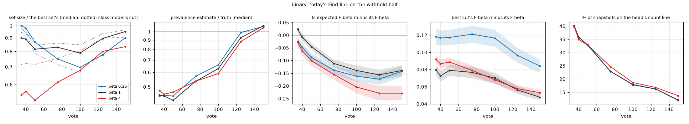
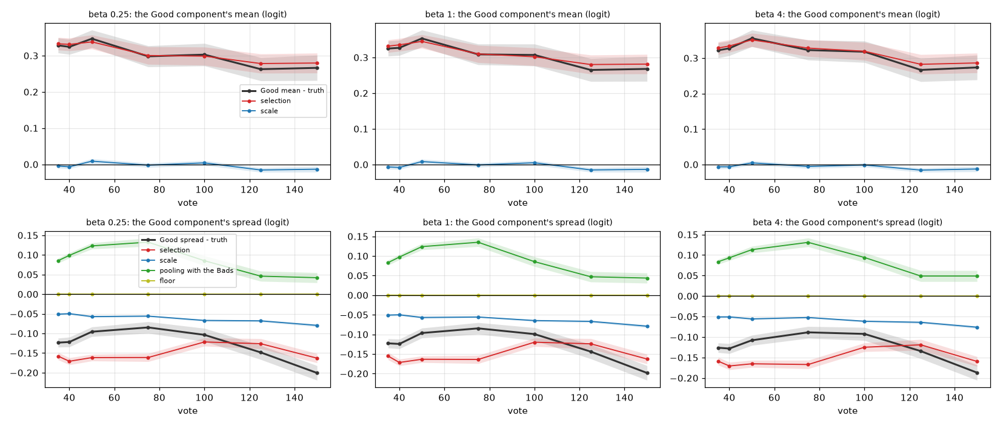
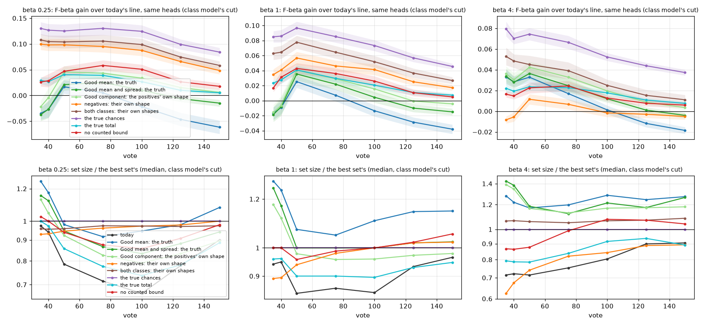
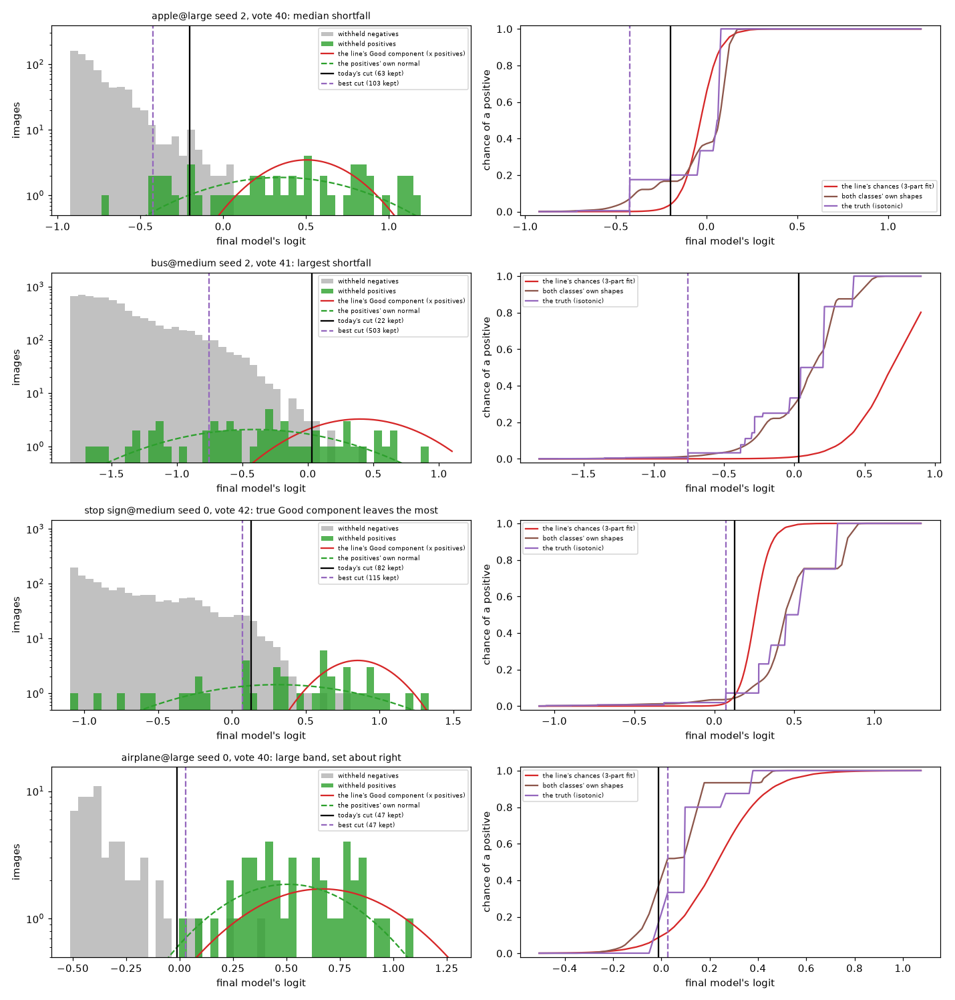
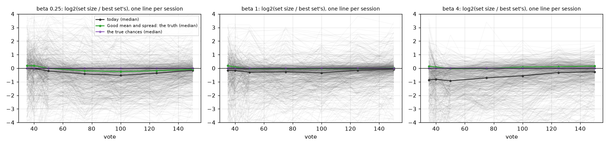

# The labels line's early shortfall has two sources: the head's count line, and chances that underrate the positives at the line (issue #4937)

**Status (2026-10-16): measured on Binary Photo at all three presets, 702 sessions each, at nine clicks from vote 10
to 150, plus Region Photo (seed 0, beta 1). A diagnosis, not a fix. No A/B: every reading is Find's line on the
withheld half, redrawn on the same heads with one piece swapped for what the withheld half's own truth says it should
be. The fixes are filed as their own issues: #5039 (the head's count line) and #5040 (the chances).**

**Early in a session, today's Find line keeps too few images for two separate reasons. The Good component's
selection error, which the issue set out to price, is one part of the second.**

1. **The head's count line.** At votes 35 to 50, a third of sessions (33% to 40%) hold fewer than 6 held-out Goods (a
   median of 2 to 4). Their line is the head's count of what stands out (#4786), not the class model's cut. That
   count keeps a median 0.14 to 0.18 of the F-beta-best set at beta 4, 0.57 to 0.64 at beta 1, and too many at beta
   1/4 (1.1 to 1.7). It is most of the early shortfall at beta 4. At beta 1 before vote 50 it is the whole shortfall:
   the class model's own cut keeps 0.94 to 0.95 of the best set there. It fades as sessions reach 6 held-out Goods,
   to 12% to 14% of snapshots by vote 150.
2. **On the class model's cut, the chances underrate the positives at the line.** At the edge of the best set, the
   3-part fit's chance of a positive is 0.15 where the truth is 0.38 (beta 1, vote 50). The true chances would close
   the whole gap to the best cut: +0.13 at beta 1/4, +0.07 to +0.10 at beta 1 and +0.05 to +0.08 at beta 4, through
   vote 100. Two errors feed them, in proportions that depend on the preset:
   - **The Good component describes the easy positives (selection).** At votes 35 to 50 its mean sits 0.30 logit
     above the withheld positives' own: selection +0.32, scale −0.02. Its spread is 0.09 to 0.13 narrower (0.32
     against 0.45 at vote 35): selection −0.17, scale −0.04, pooling with the Bads +0.09, the floor 0. So it thins
     out exactly where the hard positives sit. This is the class model's shortfall at beta 4. With the positives'
     true mean and spread the median set goes from 0.72 of the best to 1.4 at vote 40 (it overshoots), and F-beta
     gains +0.03.
   - **The negatives' side puts too much negative weight at the line.** With the withheld negatives' own shape, the
     chances recover +0.10 of beta 1/4's +0.13 and about half of beta 1's. At beta 4 they recover nothing.
3. **The low prevalence estimate is the counted bound.** At votes 35 to 50 it reads 0.42 to 0.48 of the truth. The
   2-part EM alone reads 1.2 to 1.3 times the truth. The bound binds in 73% to 79% of snapshots, and it is computed
   from the over-high Good component. Removing it moves Find's F-beta by only +0.01 to +0.06, because the cut reads
   the chances' own sum wherever that exceeds the estimate.
4. **The expected F-beta's error is the chances, and it is a late error, not an early one.** Their sum over the kept
   images falls short of the positives kept. It is −0.03 to +0.02 at vote 35 and grows to −0.14 to −0.23 by vote 150.

| (vote 40 / 100 / 150) | beta 1/4 | beta 1 | beta 4 |
|---|---|---|---|
| set size ÷ best set's, all snapshots (median) | 0.98 / 0.70 / 0.90 | 0.89 / 0.79 / 0.95 | 0.57 / 0.68 / 0.83 |
| on the head's count line: share; its set ÷ best (vote 40) | 35%; 1.17 | 36%; 0.57 | 35%; 0.14 |
| class model's cut: set ÷ best (median) | 0.94 / 0.67 / 0.90 | 0.95 / 0.85 / 0.97 | 0.72 / 0.80 / 0.90 |
| its F-beta gap to the best cut (= the true chances' gain) | +0.13 / +0.12 / +0.08 | +0.09 / +0.07 / +0.05 | +0.07 / +0.05 / +0.04 |
| … recovered by the Good component's true mean and spread | −0.03 / +0.01 / −0.02 | −0.01 / +0.00 / −0.02 | +0.03 / +0.01 / −0.00 |
| … recovered by the negatives' own shape | +0.10 / +0.09 / +0.05 | +0.04 / +0.04 / +0.02 | −0.01 / −0.00 / −0.01 |
| … recovered by both classes' own shapes | +0.10 / +0.10 / +0.06 | +0.06 / +0.05 / +0.03 | +0.05 / +0.03 / +0.01 |

## The question

The labels line (#4452) cuts where the expected F-beta of the kept set peaks. That expectation needs two things. The
first is each image's chance of being a positive, from a 3-part fit of the corpus: the labels' Good and Bad
components, both normals with one spread, and a normal for the corpus's bulk. The second is the total number of
positives, from a 2-part EM capped at twice a counted bound. While the class model holds fewer than 6 held-out Goods,
the head's count line (#4786) serves instead. #4910 found today's line keeps too few early, estimates under half the
prevalence and underrates its own F-beta. #4936 showed the Good component's mean sits a third of a logit too high
from selection, not scale. But #4936 also found that setting that mean to the truth gains only +0.02 at vote 50 and
loses late. This study takes the line apart piece by piece on the withheld half to find the rest.

## What was run

| | |
|---|---|
| sessions | today's app (dev 73c887c27), Binary Photo: `coco_better`, 144 class@band cells × 5 seeds, SigLIP whole-image, on the 2026-10-08 grid, at beta 1/4, 1 and 4; 150 clicks; trajectory pass |
| instrument | #4936's `CALIB_SAVE_FOLD_SCALES=1` (record only), snapshots at clicks 10, 25, 35, 40, 50, 75, 100, 125, 150 (35 and 40 added for the early window) |
| Region Photo | #4936's own run (seed 0, beta 1, 139 sessions with a head), measured the same way |
| replay | `early_line_4937.py` rebuilds Find's line on the withheld half (`fit_labels_line(...).on_corpus(withheld scores)`) piece by piece. Its threshold, prevalence and expected F-beta match the library's to the last bit on all 18,956 snapshots |
| reproduction | the beta-1 sessions reproduce #4936's run of 2026-10-15 exactly: 0 differences in F-beta, set size and Good mean over the 4,713 snapshots both runs share |
| coverage | 702 sessions per preset (18 small-band sessions found no Good in 150 votes). Binary's votes 10 and 25 sit under the typed query's hold (fewer than 30 labels: Find shows the query's set), so Binary is read from vote 35 |
| compute | 2,160 cells 2026-10-16 10:10–11:30, in cpu packs and V100 packs with the GPU hidden; the measurement two jobs of about 6 minutes on 64 CPUs |

Every ± is one SE over classes: a class's bands and seeds are averaged first, because they are not independent.
Set sizes are medians of the ratio to the best set's size on the same ranking ("the best cut"). The best cut is
what any line on this head could reach.

**The swaps.** Each is Find's line redrawn on the same head with one piece replaced; everything else is today's.

| swap | what replaces what |
|---|---|
| Good mean: selection out | the Good mean becomes the withheld positives' mean on the fold models' own scale (selection removed, scale as today) |
| Good mean: the truth | the Good mean becomes the withheld positives' mean on the final scale (#4936's "Good mean set to the truth") |
| Good spread: the truth | the Good component's spread becomes the withheld positives' (the Bad component keeps today's) |
| Good mean and spread: the truth | both of the above |
| the positives' own shape | the Good component becomes a kernel density of the withheld positives' logits |
| the negatives' own shape | the chances are refitted with the Good component as today and the negatives as a kernel density of the withheld negatives; only the share is fitted, and the chances are made non-decreasing in the score, as a single cut needs |
| both classes' own shapes | the same with both classes' kernel densities |
| the true chances | each image's chance is the truth's isotonic fit on its logit. With them the line is the best cut, smoothed: the ceiling every other swap is read against |
| the true total | today's chances, the withheld half's true number of positives |
| no counted bound | the 2-part EM's prevalence, uncapped |
| 2-part chances | the chances from the 2-part fit (Good against the bulk, no Bad component) |
| no spread floor | the class model's pooled spread without #4492's corpus floor |
| no head-count line | the class model's cut where the head's count line serves today |
| no head-count line, Good component true | the same, with the Good component's mean and spread the withheld positives' |

## The symptom



*Left to right, over votes, at each preset: the set size against the best set's (dotted: the class model's cut
alone); the prevalence estimate against the truth; the expected F-beta minus the F-beta; the best cut's F-beta minus
today's; the share of snapshots on the head's count line. Bands are ±1 SE over classes.*

| preset, vote | head's count line | set ÷ best, all | class model's cut | head's count line | prevalence ÷ truth | expected F − F | best cut's F − F | F |
|---|---|---|---|---|---|---|---|---|
| beta 1/4, 35 | 40% | 1.00 | 0.97 | 1.12 | 0.44 | −0.02 (± 0.01) | +0.12 (± 0.01) | 0.57 |
| beta 1/4, 50 | 33% | 0.87 | 0.79 | 1.67 | 0.45 | −0.09 (± 0.02) | +0.12 (± 0.01) | 0.59 |
| beta 1/4, 100 | 18% | 0.70 | 0.67 | 1.00 | 0.66 | −0.16 (± 0.02) | +0.12 (± 0.01) | 0.62 |
| beta 1/4, 150 | 12% | 0.90 | 0.90 | 1.00 | 1.07 | −0.14 (± 0.02) | +0.08 (± 0.01) | 0.66 |
| beta 1, 35 | 40% | 0.90 | 0.94 | 0.64 | 0.45 | +0.02 (± 0.01) | +0.08 (± 0.01) | 0.46 |
| beta 1, 50 | 33% | 0.82 | 0.84 | 0.60 | 0.42 | −0.04 (± 0.01) | +0.08 (± 0.01) | 0.48 |
| beta 1, 100 | 18% | 0.79 | 0.85 | 0.34 | 0.63 | −0.14 (± 0.02) | +0.07 (± 0.01) | 0.52 |
| beta 1, 150 | 12% | 0.95 | 0.97 | 0.49 | 1.08 | −0.14 (± 0.02) | +0.05 (± 0.00) | 0.55 |
| beta 4, 35 | 40% | 0.55 | 0.71 | 0.18 | 0.48 | −0.03 (± 0.02) | +0.09 (± 0.00) | 0.53 |
| beta 4, 50 | 33% | 0.52 | 0.71 | 0.16 | 0.47 | −0.10 (± 0.02) | +0.09 (± 0.01) | 0.55 |
| beta 4, 100 | 19% | 0.68 | 0.80 | 0.10 | 0.59 | −0.20 (± 0.02) | +0.07 (± 0.00) | 0.59 |
| beta 4, 150 | 14% | 0.83 | 0.90 | 0.09 | 1.05 | −0.23 (± 0.03) | +0.05 (± 0.00) | 0.62 |

These are close to the issue's own readings of #4910's control sessions (set ÷ best of 0.83, 0.76 and 0.48 at vote
50 against 0.87, 0.82 and 0.52 here). Two things they add:

- **"Early" means different clicks at different presets.** At beta 4 the line is furthest short at votes 35 to 50 and
  recovers steadily. At beta 1 it is short from vote 35 to 100. At beta 1/4 it is about right at votes 35 to 40,
  then falls short from vote 50 to a low of 0.70 at vote 100.
- **The expected F-beta's error is small early** (−0.03 to +0.02 at vote 35) and grows through the session. The
  prevalence error is the reverse, largest early. They are separate errors (below).

Every click, the two lines apart, is in `tables/binary/symptom.csv`.

## The head's count line

| preset, vote | snapshots on it | held-out Goods (median) | its set ÷ best | best cut's F − F | the class model's cut instead | its set ÷ best | … with the Good component true |
|---|---|---|---|---|---|---|---|
| beta 1/4, 40 | 231 of 659 | 2 | 1.17 | +0.11 (± 0.01) | −0.005 (± 0.011) | 0.60 | −0.041 (± 0.010) |
| beta 1/4, 100 | 123 of 686 | 4 | 1.00 | +0.12 (± 0.02) | +0.006 (± 0.015) | 0.40 | −0.023 (± 0.018) |
| beta 1, 40 | 236 of 659 | 2 | 0.57 | +0.05 (± 0.00) | −0.022 (± 0.009) | 0.34 | −0.021 (± 0.008) |
| beta 1, 100 | 122 of 686 | 4 | 0.34 | +0.06 (± 0.01) | −0.007 (± 0.007) | 0.27 | −0.006 (± 0.007) |
| beta 4, 40 | 230 of 659 | 2 | 0.14 | +0.11 (± 0.01) | −0.004 (± 0.010) | 0.21 | +0.033 (± 0.007) |
| beta 4, 100 | 128 of 686 | 3 | 0.10 | +0.14 (± 0.01) | +0.027 (± 0.010) | 0.17 | +0.037 (± 0.010) |

- **Its count does not scale with beta the way the best set does.** It keeps 1.2 times the best set at beta 1/4, 0.57
  at beta 1 and 0.14 at beta 4 (vote 40). The count is `beta ** 0.708` times what stands out in the head's scores
  (#4786), a factor of 2.7 between beta 1 and beta 4. The best set grows far more than that on these sessions.
- **The class model's cut would not do better there early**: it keeps even fewer (0.21 to 0.60 of the best) and
  gains nothing before vote 100 (it loses 0.02 at beta 1, votes 40 to 50). At beta 4 from vote 100 on it gains +0.03
  to +0.04. These sessions hold 2 to 4 held-out Goods. With the positives' true mean and spread the class model's
  cut gains +0.03 to +0.05 at beta 4 and ties or loses at the other two presets, so the head-count gate is not hiding
  a sound class model.
- **This is thin evidence, the issue's third candidate, in a form the issue did not name.** The spread floor never
  binds (below). The counted bound shapes the prevalence estimate, not the cut. What binds early is the gate.

Sessions on the head's count line at vote 40, at the 10th, 50th and 90th percentile of the set ratio
(`tables/binary/head_count_examples.csv`; every click in `tables/binary/head_count.csv`):

| preset | percentile | session | seed | vote | held-out Goods | kept / best | F / best cut's | the class model's cut instead: kept, F |
|---|---|---|---|---|---|---|---|---|
| beta 4 | 10 | remote@small | 2 | 40 | 2 | 5 / 1,008 | 0.04 / 0.18 | 11,436, 0.08 |
| beta 4 | 50 | bag or luggage@medium | 1 | 40 | 2 | 66 / 476 | 0.15 / 0.34 | 50, 0.16 |
| beta 4 | 90 | remote@medium | 2 | 40 | 4 | 151 / 186 | 0.45 / 0.47 | 21, 0.19 |
| beta 1 | 10 | bicycle@small | 0 | 44 | 2 | 7 / 235 | 0.00 / 0.04 | 115, 0.02 |
| beta 1 | 50 | cell phone@small | 3 | 42 | 4 | 7 / 13 | 0.11 / 0.20 | 30, 0.18 |
| beta 1 | 90 | knife@medium | 1 | 41 | 2 | 28 / 12 | 0.11 / 0.14 | 3, 0.08 |
| beta 1/4 | 10 | bench@small | 4 | 41 | 2 | 6 / 117 | 0.00 / 0.04 | 2, 0.00 |
| beta 1/4 | 50 | bag or luggage@small | 3 | 40 | 1 | 6 / 5 | 0.11 / 0.12 | 1, 0.00 |
| beta 1/4 | 90 | parking meter@small | 1 | 40 | 2 | 22 / 4 | 0.17 / 0.44 | 4, 0.44 |

These are weak heads: even the best cut scores 0.04 to 0.47. The head's count keeps 5 to 151 images at beta 4 where
the best set is 186 to 1,008. The class model's cut with 2 held-out Goods swings from 21 to 11,436 at the same preset,
which is why the gate is there.

## The class model's cut: the Good component's error, split



*Top: the Good component's mean minus the withheld positives' mean on the final scale, split exactly into selection
(the held-out Goods against the withheld positives, both on the fold models' scale) and scale (the withheld positives,
fold against final). Bottom: the same for the spread, split into the corpus floor, the pooling with the Bads, selection
and scale.*

| preset, vote | mean: Good − truth | selection | scale | spread: Good − truth | pooling with the Bads | selection | scale | floor | Good spread / positives' spread |
|---|---|---|---|---|---|---|---|---|---|
| beta 1, 35 | +0.30 (± 0.02) | +0.32 (± 0.02) | −0.02 (± 0.00) | −0.13 (± 0.02) | +0.09 (± 0.01) | −0.17 (± 0.01) | −0.04 (± 0.00) | 0 | 0.32 / 0.45 |
| beta 1, 50 | +0.30 (± 0.02) | +0.32 (± 0.02) | −0.02 (± 0.00) | −0.09 (± 0.02) | +0.14 (± 0.01) | −0.18 (± 0.01) | −0.05 (± 0.00) | 0 | 0.41 / 0.50 |
| beta 1, 100 | +0.26 (± 0.03) | +0.27 (± 0.02) | −0.01 (± 0.01) | −0.10 (± 0.02) | +0.08 (± 0.01) | −0.13 (± 0.01) | −0.06 (± 0.00) | 0 | 0.51 / 0.61 |
| beta 1, 150 | +0.23 (± 0.03) | +0.26 (± 0.03) | −0.02 (± 0.01) | −0.21 (± 0.02) | +0.03 (± 0.01) | −0.17 (± 0.01) | −0.08 (± 0.00) | 0 | 0.48 / 0.69 |

The other presets read the same to ±0.03 (`tables/binary/good.csv`): the Good component's error hardly depends on
the preset. Over the session, at every preset:

- **The mean is selection.** +0.32 at votes 35 to 50, +0.25 by vote 150; scale −0.01 to −0.03 throughout (#4936).
- **The spread is too narrow, and that is selection too.** The held-out Goods are bunched: 0.17 to 0.19 logit
  narrower than the positives at votes 35 to 50, 0.12 to 0.17 later. Scale adds −0.04 to −0.08: the final model
  spreads the positives about 10% wider (#4936's slope of 1.1). Pooling with the Bads widens the spread by +0.08 to
  +0.14 through vote 100 and +0.03 later, which makes up for part of it. The corpus floor (#4492) never binds.
- **The error does not fade.** The mean's error shrinks by a fifth over the session; the spread's error doubles
  late. The Good component alone cannot explain why the shortfall eases by vote 150. The head's count line's
  falling share does (above), along with large bands, where selection falls from +0.25 at vote 35 to +0.06 by vote
  150 and the class model's set reaches 0.98 of the best (`tables/binary/by_band.csv`). On small bands it grows to
  +0.51.

## The class model's cut: each piece swapped for the truth



*Top: each swap's F-beta gain over today's line on the same heads, on the snapshots where the class model draws the
line. Bottom: each swap's median set size against the best set's. "The true chances" is the best cut, smoothed: the
ceiling.*

F-beta gain over today's line, class model's cut only (every swap and click: `tables/binary/ladder.csv`):

| preset, vote | Good mean: the truth | Good mean and spread: the truth | the positives' own shape | the negatives' own shape | both classes' own shapes | **the true chances** | the true total | no counted bound | 2-part chances |
|---|---|---|---|---|---|---|---|---|---|
| beta 1/4, 40 | −0.027 (± 0.016) | −0.027 (± 0.017) | −0.004 (± 0.019) | +0.098 (± 0.011) | +0.105 (± 0.012) | **+0.127 (± 0.012)** | +0.027 (± 0.009) | +0.029 (± 0.013) | −0.086 (± 0.015) |
| beta 1/4, 100 | −0.022 (± 0.014) | +0.010 (± 0.008) | +0.034 (± 0.008) | +0.087 (± 0.011) | +0.099 (± 0.012) | **+0.124 (± 0.012)** | +0.027 (± 0.006) | +0.051 (± 0.009) | −0.092 (± 0.011) |
| beta 1/4, 150 | −0.062 (± 0.013) | −0.015 (± 0.007) | +0.006 (± 0.006) | +0.048 (± 0.007) | +0.058 (± 0.008) | **+0.084 (± 0.008)** | +0.005 (± 0.003) | +0.018 (± 0.006) | −0.132 (± 0.010) |
| beta 1, 40 | −0.009 (± 0.009) | −0.008 (± 0.012) | −0.006 (± 0.013) | +0.041 (± 0.008) | +0.064 (± 0.009) | **+0.086 (± 0.008)** | +0.028 (± 0.005) | +0.031 (± 0.008) | −0.018 (± 0.007) |
| beta 1, 50 | +0.025 (± 0.008) | +0.035 (± 0.009) | +0.041 (± 0.009) | +0.057 (± 0.008) | +0.078 (± 0.009) | **+0.097 (± 0.009)** | +0.041 (± 0.006) | +0.043 (± 0.007) | −0.020 (± 0.008) |
| beta 1, 100 | −0.014 (± 0.008) | +0.004 (± 0.007) | +0.016 (± 0.006) | +0.041 (± 0.007) | +0.052 (± 0.008) | **+0.073 (± 0.007)** | +0.021 (± 0.005) | +0.026 (± 0.006) | −0.041 (± 0.006) |
| beta 1, 150 | −0.038 (± 0.006) | −0.015 (± 0.004) | −0.004 (± 0.004) | +0.017 (± 0.004) | +0.027 (± 0.005) | **+0.045 (± 0.004)** | +0.007 (± 0.003) | +0.005 (± 0.003) | −0.058 (± 0.006) |
| beta 4, 40 | +0.028 (± 0.005) | +0.028 (± 0.006) | +0.030 (± 0.007) | −0.006 (± 0.005) | +0.048 (± 0.006) | **+0.070 (± 0.005)** | +0.019 (± 0.002) | +0.015 (± 0.003) | +0.026 (± 0.005) |
| beta 4, 100 | +0.001 (± 0.004) | +0.012 (± 0.004) | +0.020 (± 0.003) | −0.002 (± 0.004) | +0.025 (± 0.006) | **+0.052 (± 0.004)** | +0.018 (± 0.002) | +0.013 (± 0.003) | +0.013 (± 0.004) |
| beta 4, 150 | −0.019 (± 0.003) | −0.004 (± 0.003) | +0.003 (± 0.002) | −0.005 (± 0.003) | +0.011 (± 0.005) | **+0.037 (± 0.003)** | +0.008 (± 0.002) | +0.006 (± 0.003) | +0.005 (± 0.003) |

Median set size ÷ best, class model's cut (`tables/binary/sizes.csv`, which also gives each swap's mean |log2| of the
ratio, its spread over sessions):

| preset, vote | today | Good mean and spread: the truth | the negatives' own shape | both classes' own shapes | the true total | no counted bound |
|---|---|---|---|---|---|---|
| beta 1/4, 40 / 100 | 0.94 / 0.67 | 1.12 / 0.83 | 0.93 / 0.97 | 0.96 / 0.97 | 0.97 / 0.74 | 1.00 / 0.86 |
| beta 1, 40 / 100 | 0.95 / 0.85 | 1.17 / 1.00 | 0.89 / 1.00 | 1.00 / 1.00 | 0.96 / 0.90 | 1.00 / 1.00 |
| beta 4, 40 / 100 | 0.72 / 0.80 | 1.38 / 1.21 | 0.67 / 0.84 | 1.07 / 1.07 | 0.79 / 0.91 | 0.86 / 1.08 |

- **The chances are the whole gap.** With the true chances the line is the best cut (gain = gap); with the true total
  and today's chances it gains a quarter of that or less.
- **At beta 4 the shortfall is the Good component.** Its true mean and spread move the median set from 0.72 to 1.38
  (vote 40) and gain +0.028; the positives' own shape gains as much; the negatives' shape does nothing. A recall cut
  sits deep in the positives' lower tail, which the Good component, drawn from the easy positives, leaves empty.
- **At beta 1/4 it is the negatives' side.** Their own shape recovers +0.10 of +0.13, and moves the median set from
  0.67 to 0.97 at vote 100; the Good component's truth recovers nothing early. A precision cut sits in the negatives'
  upper tail, where the 3-part fit's Bad component (a normal at the held-out Bads' mean, near the line, with the
  Goods' spread) and the bulk's normal put too much weight.
- **At beta 1 it is both.** Either side alone brings the median set to the best by vote 50 to 100, but the
  negatives' side carries more of the F-beta (+0.04 to +0.06 against −0.02 to +0.04), and both shapes together reach
  +0.05 to +0.08 of +0.07 to +0.10.
- **The Good mean alone overshoots late** at every preset (−0.02 to −0.06 at vote 150), as #4936 found at beta 1: the
  line then keeps 1.1 to 1.3 times the best set.
- **The Bad component is not the error to remove.** The 2-part chances, which drop it, lose 0.02 to 0.13 at beta 1/4
  and beta 1. Its shape is the error, not its presence.

## The prevalence estimate: the counted bound

| preset, vote | today ÷ truth | 2-part EM alone ÷ truth | bound binds | Good mean and spread true ÷ truth |
|---|---|---|---|---|
| beta 1, 35 | 0.45 | 1.23 | 73% | 1.42 |
| beta 1, 50 | 0.42 | 1.34 | 79% | 1.42 |
| beta 1, 100 | 0.63 | 1.54 | 72% | 1.30 |
| beta 1, 150 | 1.08 | 1.58 | 54% | 1.27 |

The other presets read within 0.05 (`tables/binary/prevalence.csv`; it is the class model's estimate, whichever
line serves). The 2-part EM over-reads by a quarter to a half throughout. The counted bound caps it at twice the
fewest positives any cut could hold (`R / S1`), and `S1` comes from the Good component. A Good component 0.3 logit
too high and too narrow puts too large a share of positives above every high cut, so the bound comes out too low. It
binds in three quarters of snapshots early, and the estimate lands at 0.42 to 0.48 of the truth. With the true Good
component the bound loosens and the estimate reads the EM's 1.3 to 1.4. The cut barely notices either way. It counts
the larger of this total and the chances' own sum (`corpus_cut`), and the chances' sum is 0.66 to 0.82 of the
positives early. Removing the bound gains +0.01 to +0.06 at votes 40 to 100, the true total about as much.

## The expected F-beta

| preset, vote | chances' sum ÷ positives | chance at the best set's edge: line / truth | expected F − F | of which the total | of which the chances |
|---|---|---|---|---|---|
| beta 1/4, 40 | 0.81 | 0.69 / 0.79 | −0.06 (± 0.02) | +0.02 (± 0.00) | −0.08 (± 0.02) |
| beta 1/4, 100 | 0.46 | 0.31 / 0.75 | −0.21 (± 0.03) | +0.01 (± 0.00) | −0.21 (± 0.02) |
| beta 1, 40 | 0.82 | 0.27 / 0.39 | −0.01 (± 0.02) | +0.03 (± 0.01) | −0.04 (± 0.02) |
| beta 1, 100 | 0.45 | 0.08 / 0.36 | −0.18 (± 0.02) | +0.01 (± 0.01) | −0.19 (± 0.02) |
| beta 4, 40 | 0.81 | 0.00 / 0.05 | −0.06 (± 0.03) | +0.02 (± 0.02) | −0.09 (± 0.03) |
| beta 4, 100 | 0.47 | 0.01 / 0.05 | −0.25 (± 0.03) | +0.02 (± 0.01) | −0.27 (± 0.03) |

*Class model's cut only. The split is exact: the line's expected F-beta at its own set, with its total replaced by
the truth (the total's part), against the F-beta that set scores (the chances' part: their sum over the kept images
against the positives kept).*

The line's chances underrate the positives near the line from the first trained votes, and the underrating grows to
vote 100. Their sum falls from about 0.8 of the positives at vote 40 to under half at vote 100 at every preset. By
vote 100 the line puts the chance at the best set's edge at a fifth to two fifths of the truth (0.08 against 0.36 at
beta 1). That is why the expected F-beta falls further below the F-beta through the session, and why the class
model's cut at beta 1/4 drifts from 0.94 of the best set to 0.67. The low total works the other way (+0.01 to
+0.07), so the "underrates its own F-beta" in the issue is the chances, not the prevalence. It is the same error that
makes the cut short, seen from the other side.

## Literal examples

Sessions picked by rule at vote 40 (`early_line_4937.py examples`): the median shortfall among class-model sessions
that keep too few, the largest, the one where the true Good component leaves the most to the true chances, and a
large-band session whose set is about right.



*Each row is one session. Left: the withheld half's top on a log count scale, positives green, negatives grey; the
line's Good component (red) and the positives' own normal (green dashes), both scaled to the positives' count; today's
cut (black) and the best cut (purple dashes). Right: each image's chance of a positive under the line's 3-part fit
(red), under both classes' own shapes (brown) and the truth (purple).*

| preset | session | seed | vote | kept / best | F today / best | Good mean − truth (selection) | Good spread / positives' | chance at edge: line / truth | F with: true Good / both shapes / true chances |
|---|---|---|---|---|---|---|---|---|---|
| beta 4 | bus@medium | 2 | 41 | 22 / 503 | 0.29 / 0.52 | +0.81 (+0.82) | 0.42 / 0.66 | 0.00 / 0.02 | 0.51 / 0.50 / 0.52 |
| beta 4 | apple@large | 2 | 40 | 63 / 103 | 0.83 / 0.92 | +0.16 (+0.27) | 0.27 / 0.50 | 0.00 / 0.09 | 0.91 / 0.91 / 0.92 |
| beta 1 | boat@medium | 2 | 43 | 23 / 33 | 0.53 / 0.68 | +0.56 (+0.56) | 0.49 / 0.72 | 0.19 / 0.51 | 0.68 / 0.66 / 0.68 |
| beta 1 | snowboard@small | 2 | 40 | 12 / 94 | 0.25 / 0.59 | +0.20 (+0.25) | 0.50 / 0.29 | 0.01 / 0.30 | 0.58 / 0.58 / 0.59 |
| beta 1/4 | person@large | 0 | 40 | 19 / 34 | 0.91 / 0.97 | +0.28 (+0.22) | 0.26 / 0.34 | 0.20 / 0.75 | 0.95 / 0.97 / 0.97 |
| beta 1/4 | mouse@medium | 1 | 40 | 1 / 32 | 0.00 / 0.73 | +0.37 (+0.26) | 0.45 / 0.52 | 0.01 / 0.61 | 0.00 / 0.71 / 0.73 |

- `bus@medium` seed 2 (beta 4) is selection at its plainest. The session's Goods are its easiest positives, and the
  line's Good component centres at +0.4 logit where the positives centre at −0.5. The line gives every positive below
  0 a chance near zero and keeps 22 images where the best set is 503. With the positives' true normal it scores
  0.51 against the best cut's 0.52.
- `mouse@medium` seed 1 (beta 1/4) is the negatives' side. The Good component is only 0.37 too high, and its true
  mean and spread do not help (F 0.00). The 3-part fit reads the images between 0 and 0.75 logit, where the truth
  says 0.6 to 0.8 are positives, as Bads, so the line keeps one image. With both classes' own shapes it scores 0.71
  against the best cut's 0.73.
- `snowboard@small` seed 2 (beta 1): the line's chances never pass 0.15, even at the top of the ranking. The Bad
  component and the bulk take the whole top of the corpus.
- The large-band sessions (`airplane@large`, `fire hydrant@large`, `bag or luggage@large`) cut where the best cut
  does, although their Good components sit 0.16 to 0.47 too high.
- The same panels at the other presets: `figures/binary/examples_b1_vote40.png`, `examples_b025_vote40.png`.

Head's count line sessions at vote 40, at the 10th, 50th and 90th percentile of the set ratio, are in
`tables/binary/head_count_examples.csv`.

## Per session



*One thin line per session (all snapshots, both lines); the medians of today, the true Good component and the true
chances on top.*

Single sessions stray far from the medians: the mean |log2| of today's set ratio on the class model's cut is 0.5
to 0.9, a typical session off by a factor of 1.4 to 1.9 either way. The true chances bring that to 0.01 to 0.15. The
true Good component (0.6 to 1.0) and both shapes (0.2 to 0.5) leave much of it. That is the gap between a swap that
fixes the median set and one that recovers the F-beta (`tables/binary/sizes.csv`).

## Region Photo

Region (DINOv3 patches, max-pooled; seed 0, beta 1, 139 sessions; `tables/region/`, `figures/region/`) does not keep
too few early. Its line keeps 1.06 of the best set at vote 25 and 0.85 to 0.96 later. Its head's count line
over-keeps (1.4 to 3.2 times the best set through vote 100), and #4936 found its Good mean right on average, because scale and
selection cancel there. The chances underrate the edge the same way, though: 0.18 against 0.39 at vote 50. The true
chances gain +0.065 to +0.095 from vote 25 to 100. The negatives' own shape recovers +0.036 to +0.053 of that, both
shapes +0.049 to +0.074, and the Good component's true mean and spread +0.016 to +0.025.

## What this leaves

- **The head's count line's count does not follow beta** (#4786's `beta ** 0.708`). It is a third of early snapshots
  and keeps 0.14 of the best set at beta 4, 0.57 at beta 1, 1.2 at beta 1/4. On Region at beta 1 it keeps 1.4 to 3.2.
  A count that tracked the best set, or a gate that hands over sooner, is the cheapest fix in reach: #5039, to be
  priced in F-beta at every preset.
- **The class model's chances.** The ceiling is +0.04 to +0.13 F-beta on the class model's cut. Two deployable lines
  of attack follow from the split. On the Good side: a Good component that is not drawn from the easy positives alone
  (wider, or fitted on the corpus with the labels as a prior). On the negatives' side: a negative model near the line
  other than one normal with the Goods' spread. The weights differ by preset, so a fix has to be priced at all three:
  #5040.
- **The counted bound** sets the prevalence estimate the issue saw (0.42 to 0.48) but barely moves the cut.
  Removing it gains +0.02 to +0.05 at votes 40 to 100. #4452 introduced it against runaway prevalence on a corpus
  with no positives, so it can only be priced together with that scenario. It is listed in #5040, not as a fix of
  its own.
- **Not causes:** the spread floor (#4492) never binds (0 at every click), and scale (#4936) is −0.01 to −0.03 on the
  mean.

## Provenance

| | |
|---|---|
| code | dev at 73c887c27; every task imported from the frozen worktree `vts-4937-run` |
| instrument | `run_cells.py` `CALIB_SAVE_FOLD_SCALES` (#4936, unchanged) |
| launcher | `scripts/experiments/state_of_app/fold_scale_4936.sh` with `FSCALE4936_DATE=2026-10-16 FSCALE4936_TAG=-early4937 FSCALE4936_AT=10,25,35,40,50,75,100,125,150` |
| analysis | `scripts/experiments/state_of_app/early_line_4937.py` (`measure`, `report`, `examples`); tables in `tables/`, figures in `figures/` |
| results | `/expscratch/sgreenberg/state-of-the-app/2026-10-16-fscale4936-early4937-binary-b{025,1,4}`; Region `/expscratch/sgreenberg/state-of-the-app/2026-10-15-fscale4936-region-b1`; per-snapshot table `/expscratch/sgreenberg/early-line-4937/mall/snapshots.csv.gz` (by-band reading in `mall/explore.txt`) |
| schedule | 48 pack jobs 10:10; two beta-4 cpu packs cancelled at 10:15 to free CPUs for another study, their 53 unfinished cells re-run on a V100 at 11:00 (3 cells had finished and were kept) |

## Reproduce

```bash
# from a frozen worktree
export FSCALE4936_DATE=2026-10-16 FSCALE4936_TAG=-early4937 FSCALE4936_SEEDS=5
export FSCALE4936_AT=10,25,35,40,50,75,100,125,150
L=scripts/experiments/state_of_app/fold_scale_4936.sh
bash $L dirs
for b in 0.25 1 4; do
  CALIB_PACK_JOBS=17 CALIB_PACK_PAR=8 CALIB_PACK_MEM=16G bash $L cpack binary $b   # or gpack on V100 nodes
done
export VTSEARCH_DATA_DIR=/expscratch/$USER/vts-cache/datadir
S=/expscratch/$USER/state-of-the-app/2026-10-16-fscale4936-early4937-binary
P=scripts/experiments/state_of_app/early_line_4937.py
python $P measure --results ${S}-b025/results --results ${S}-b1/results --results ${S}-b4/results --out <dir> --procs 64
D=docs/experiments/2026-10-16-early-line-4937
python $P report --out <dir> --docs $D/tables --figs $D/figures
for b in 0.25 1 4; do
  python $P examples --results ${S}-b025/results --results ${S}-b1/results --results ${S}-b4/results \
    --out <dir> --beta $b --click 40 --docs $D/tables --figs $D/figures
done
```
