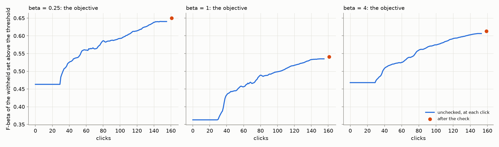
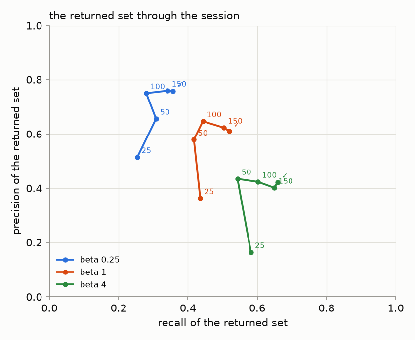
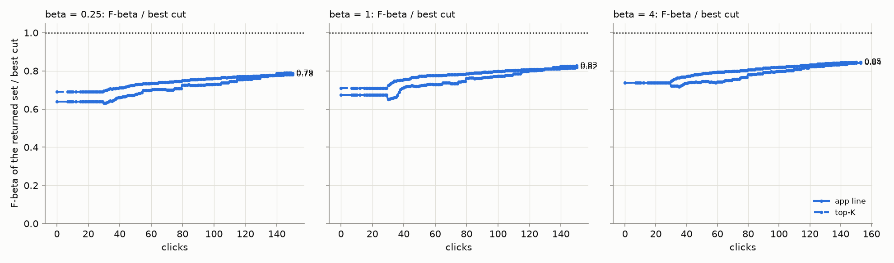
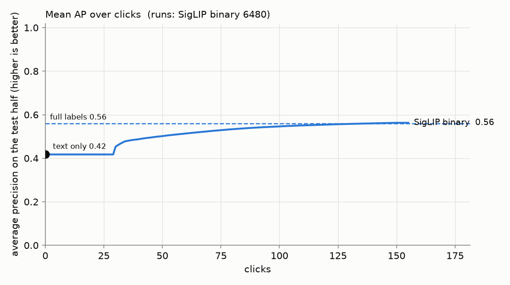
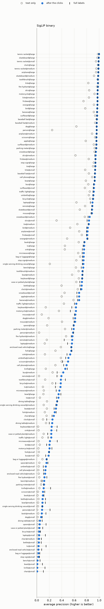
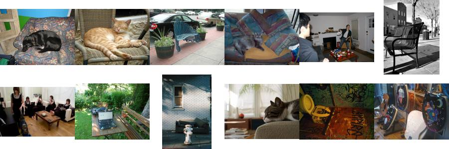
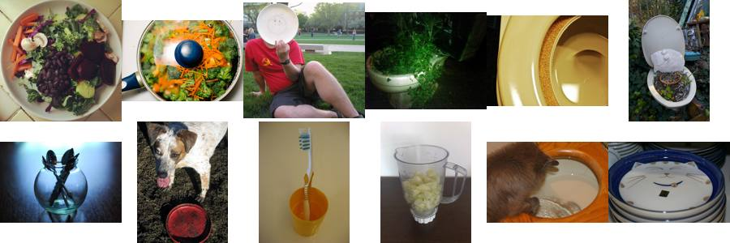
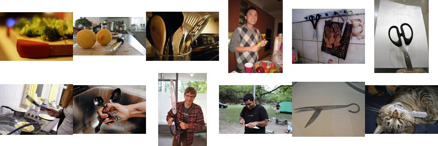
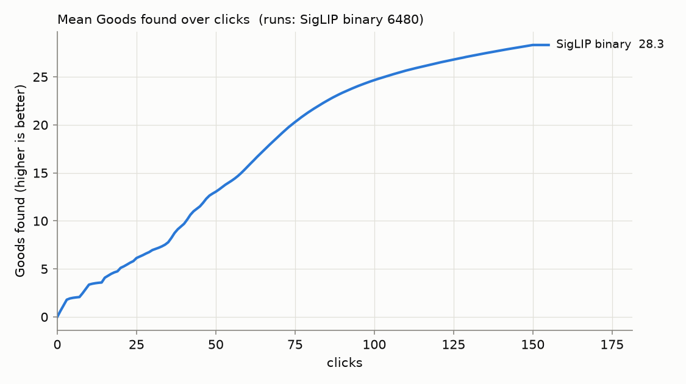

# State of the App: Binary Photo — 2026-10-16

**Issue:** #4951. **Recipe:** `.claude/skills/state-of-the-app/SKILL.md`.
**Interactive viewer:** [`viewer.html`](viewer.html), with all three session sets on one page and a chip per preset
(#4636), each averaged over all 45 seeds.
- **No per-seed lines** (`SOTA_RUNS_BUDGET_MB=0`, #4651): the average is the point. Each run's stop is kept, so
  **Show › where the app said stop** draws a dot per session (#4939).
- **The opening.** The viewer draws what the saved labels give (#4640); this report reads what the session shows.
  Until vote 30 that is the typed query's set (#4736), so the two differ through the opening.
- **At other prevalences** (#4959): one page per preset, the review's sessions beside two prevalence scenarios,
  opening on each: [β 1/4](viewer_prevalence_b025.html), [β 1](viewer_prevalence_b1.html),
  [β 4](viewer_prevalence_b4.html) ([below](#at-other-prevalences-4959)).

**App:** `dev` at `7b3a3d1e3`. A **review**, not an experiment: this maps the app as it ships, the way a user meets
it. Since the last Binary review (#4651, `6e45530b6`), about fifteen merged changes move a session:
- **The opening:** no More walk (#4742), and a Good walk that can run dry (#4741).
- **The first 30 votes:** the typed query's set stays on screen until vote 30 (#4736). Find gives the query's set
  until a trained head exists (#4758).
- **The head** starts from the Goods' centroid (#4785) and from the typed query (#4859).
- **The line:** the head's own count while the class model is thin (#4786, #4798), nearest split rounding (#4864),
  and an acquisition target of 0.5 at every preset (#4746).
- **The spot check:** prompted once a session (#4909). Folds that rank the wrong way read as no separation (#4899).
- **Done:** fires on every light green, or on the labels line's F-beta level (#4878).

**Path:** SigLIP whole-image embedding, binary (Good/Bad) votes, Autopilot's shipped session.
**Bench:** `coco_better`, all 49 classes at every size they have: 144 cells.
**Seeds:** 45 (the owner: as many as finish by morning). **Sessions:** one set per preset (`SOTA_BETA=0.25|1|4`),
6,480 each and 19,440 in all. One full-label ceiling pass at beta 1 is shared by the three.
**Runs:** `/expscratch/sgreenberg/state-of-the-app/2026-10-16-b025`, `-b1` and `-b4`, with the ceiling in
`-b1/ceiling`. Every cell ran from one frozen worktree at `7b3a3d1e3`, from 20:09 on 2026-10-15 to ~04:40.
- **Two lanes, one order.** Seeds were taken in order by cpu-partition arrays (2 CPUs a cell, filling the 360-CPU
  cap) and by up to four V100 pack jobs (the GPU hidden; #4110's kernel pins make a cell identical on any node).
  A trajectory cell took 6.7 minutes.
- **Why 45.** `/expscratch/sgreenberg` filled at ~04:40 and every cell written after that failed. Seeds 0–44 were
  complete and every file in them parses. Seeds 45–49 were partial and were deleted (#4953).

**Analysis:** `analyze.sh` per run, then `perp.py --kind balance`, `by_click.py` and `stops_by_preset.py`; the
tables are `report_tables.py` over them (Files, below).

**The objective** (#4427) is the F-beta, at the preset's beta, of the withheld test half above the threshold the
app holds: the 10,900 images Find would search, at the labels line Find draws there. **AP** measures the ranking
alone.

## Headline

**The objective, each preset off its own sessions.** Every run counts; a run whose detector the app never shows
scores its typed query's set.

| preset | 25 clicks | 50 clicks | 150 clicks, unchecked | **after the check** | returned, median (unchecked / after) | returned > 200 (unchecked / after) |
|---:|---:|---:|---:|---:|---:|---:|
| 1/4 | 0.46 | 0.54 | 0.64 | **0.65** | 15 / 17 | 0% / 0% |
| 1 | 0.36 | 0.44 | 0.53 | **0.54** | 40 / 42 | 0% / 0% |
| 4 | 0.47 | 0.52 | 0.61 | **0.61** | 82 / 80 | 18% / 19% |

1. **The presets return what they promise.** After the check:
   - the 1/4 preset returns a median of 17 images at precision 0.76 and recall 0.36;
   - the balanced preset returns 42 at 0.61 and 0.52;
   - the recall preset returns 80 at 0.42 and 0.66.
2. **For the first 30 votes the user sees the typed query's set (#4736), and the hand-over costs nothing.** Every
   session shows the query's own set at its preset's line until vote 30: a median of 19, 50 and 205 images at
   F-beta 0.46, 0.36 and 0.47. From vote 30 the app shows a detector: 85% of sessions by click 40, 89% by 50 and
   96% by 150. The objective never drops below the typed query: at click 30 it is already up +0.020, +0.002 and
   +0.005, and by click 40 +0.062, +0.070 and +0.040.
3. **150 clicks reach the full-label ranking.** Mean AP goes 0.42 (typed query) → 0.50 at 50 clicks → **0.56** at
   150, against a full-label ceiling of 0.56. Sessions find 28 Goods: 6 by click 25, 13 by 50.
4. **The end-of-session check adds little.** +0.010 ± 0.001, +0.006 ± 0.001 and +0.007 ± 0.001 per session, for
   20, 20 and 30 votes. Mid-session, Autopilot runs it in 93–94% of sessions ([below](#the-spot-check)).
5. **The app says Done early.** 90% of sessions are told they can stop, at a median of click 55, 58 and 64, with
   F-beta still to come: clicking on to 150 adds +0.07 at every preset ([below](#where-the-app-said-stop-3560-4878)).

### The returned set through the session

Per preset, the returned set's precision against its recall from the typed query through 25, 50, 100 and 150
clicks to after the check (#4519). The values are means over every run; the returned size is a median.

| preset | point | precision | recall | F-beta | returned, median |
|---:|---|---:|---:|---:|---:|
| 1/4 | typed query | 0.51 | 0.25 | 0.46 | 19 |
| 1/4 | 25 | 0.51 | 0.25 | 0.46 | 19 |
| 1/4 | 50 | 0.66 | 0.31 | 0.54 | 16 |
| 1/4 | 100 | 0.75 | 0.28 | 0.59 | 12 |
| 1/4 | 150 | 0.76 | 0.34 | 0.64 | 15 |
| 1/4 | after the check | 0.76 | 0.36 | 0.65 | 17 |
| 1 | typed query | 0.36 | 0.44 | 0.36 | 50 |
| 1 | 25 | 0.36 | 0.44 | 0.36 | 50 |
| 1 | 50 | 0.58 | 0.42 | 0.44 | 35 |
| 1 | 100 | 0.65 | 0.44 | 0.50 | 33 |
| 1 | 150 | 0.62 | 0.50 | 0.53 | 40 |
| 1 | after the check | 0.61 | 0.52 | 0.54 | 42 |
| 4 | typed query | 0.16 | 0.58 | 0.47 | 205 |
| 4 | 25 | 0.16 | 0.58 | 0.47 | 205 |
| 4 | 50 | 0.43 | 0.54 | 0.52 | 64 |
| 4 | 100 | 0.42 | 0.60 | 0.57 | 73 |
| 4 | 150 | 0.40 | 0.65 | 0.61 | 82 |
| 4 | after the check | 0.42 | 0.66 | 0.61 | 80 |

**Until click 100 the clicks buy precision; after it, recall.**
- From the typed query to click 100, precision rises +0.24, +0.28 and +0.26, while recall moves +0.03, +0.01 and
  +0.02.
- From click 100 to 150 the objective still climbs, by +0.048, +0.036 and +0.032, now through recall.
- The check buys recall (+0.015, +0.016 and +0.010). At 1/4 and 1 it gives back a little precision (−0.002 and
  −0.013); at 4 it adds some (+0.020).

### The returned set, one rule per row

Two rules, and only rows under the same rule compare:
- **"App line"** is what each sort's own line returns: the text sort's line at the preset (#4603), the detector's
  labels line, and for the full-label ceiling, Find's labels line from every training label (#4486, #4490).
- **"Top-K"** is set-constant at the old cap on every sort: 32 at beta ≤ 1 and 128 at beta 4.

The values are F-beta at the preset. The detector columns are the last click before the check.

| preset | rule | text sort | 25 clicks | 50 clicks | 150 clicks | full labels |
|---:|---|---:|---:|---:|---:|---:|
| 1/4 | app line | 0.46 | 0.46 | 0.54 | **0.64** | 0.63 |
| 1/4 | top 32 | 0.47 | 0.47 | 0.56 | **0.63** | 0.62 |
| 1 | app line | 0.36 | 0.36 | 0.45 | **0.54** | 0.53 |
| 1 | top 32 | 0.38 | 0.38 | 0.45 | **0.51** | 0.50 |
| 4 | app line | 0.47 | 0.47 | 0.52 | **0.61** | 0.65 |
| 4 | top 128 | 0.48 | 0.48 | 0.54 | **0.60** | 0.63 |

- **At 150 clicks the app's own line beats top-K at every preset** (+0.01 to +0.03).
- **On the typed query it sits 0.01 to 0.02 under top-K.**
- **With every label known, the β 4 line goes deep:** Find returns 413 images at precision 0.33. That still scores
  0.65 against the session's 0.61. At 1/4 and 1 the full-label line matches the 150-click session (0.63 against 0.64,
  0.53 against 0.54).

### The ranking

The ranking barely depends on the preset (the beta-1 sessions):

| | text only | 25 clicks | 50 clicks | 150 clicks | full labels |
|---|---:|---:|---:|---:|---:|
| **AP** | 0.42 | 0.42 | 0.50 | **0.56** | 0.56 |
| **Goods found** | — | 6 | 13 | **28** | — |

Through vote 29 the session shows the typed query, so the 25-click column is the query's. By click 50 AP is up
+0.08, and by 150 it has closed the whole gap to full labels.

**Against the last review (#4651, 2026-10-08), one note.** After the check, each preset reads about +0.02 higher
(0.63, 0.52, 0.59 then), and AP at 50 clicks is 0.50 against 0.44. The opening finds fewer Goods early (6 by click 25
against 11) but loses nothing for it: the hand-over dip of up to −0.018 is gone. Done now fires in 90% of sessions
by click 55–64, against about 80% by 81–93.

## The spot check

The check walks bands of the unvoted ranking, about 5 picks a band. It never moves the line; its picks are votes
the next retrain learns from.

- **At the end of the session**, 6,309 of 6,480 runs per preset check once.
  - The precision range runs from about 0.20 to 0.56, 0.36 to 0.37 wide: exact per band since #4483. The 10-08
    range was about 0.6 wide.
  - It held the truth in 97.5%, 98.6% and 97.9% of checks.
- **Mid-session, Autopilot runs it when the labels separate weakly** (#4496), once a session (#4909):

| preset | sessions prompted | first prompt, median click (quartiles) | checks per prompted session | clicks spent checking, median | Goods among those picks |
|---:|---:|---|---|---:|---:|
| 1/4 | 94% | 36 (18, 39) | 1: 5,638, 2: 460 | 20 (15%) | 40% |
| 1 | 94% | 36 (18, 39) | 1: 5,585, 2: 513 | 25 (17%) | 37% |
| 4 | 93% | 36 (18, 38) | 1: 5,503, 2: 548 | 30 (22%) | 29% |

The first prompt comes in `hard` in 56–58% of sessions, the rest in `new`. Nearly every session now runs a check
once, around click 36, for 20–30 clicks. Two in five of those picks are Goods at 1/4 and 1.

## Where the app said stop (#3560, #4878)

The app announces *All quality indicators are green* the first time every light is green, or when the labels
line's own F-beta reading reaches its level (#4878). A user may stop there; the simulated session clicks on to 150
either way. A session's **stop** is that first click.
- The KM median keeps the sessions that never fired, censored at click 150.
- Every column after it covers only the sessions that fired.
- The gain is Fβ at click 150 minus at the stop, paired within session, with its SE over the 49 class means.

From `stopping_by_preset.csv` (`stops_by_preset.py` over each run's `stops.csv`). The viewer's stop view draws the
same stops, one dot a session.

| preset | fired | stop, KM median | Fβ at stop (median) | gain to 150, mean ± SE | ended ≥0.02 better | ended ≥0.02 worse | short of own best (median) | clicks past own best (median) |
|---:|---:|---:|---:|---|---:|---:|---:|---:|
| 1/4 | 90% | 55 | 0.72 | +0.070 ± 0.006 | 54% | 18% | 0.09 | −24 |
| 1 | 90% | 58 | 0.51 | +0.072 ± 0.006 | 63% | 11% | 0.08 | −38 |
| 4 | 90% | 64 | 0.63 | +0.068 ± 0.005 | 62% | 8% | 0.08 | −38 |

- **The stop comes early.** Clicking on past it raises Fβ at every preset, by more than ten SEs. The median session
  stops 24–38 clicks before its own best.
- **Where the clicks before it go.** The median stopped session spends 7 clicks in the opening, 4 in Hard and 20 in
  New, then 20–30 in the check. Hard ends when Smart and Stable turn green together in 61–71% of sessions; in 22–29%
  Smart is the last to turn.
- **By band, it is the small objects that are not told.** Fired: large 100%, medium 98%, small 70–72% (KM median stop
  99, 101 and 112). Every band still gains after the stop: +0.04 to +0.10.

## Where the app does well and where it does poorly

**By size band** (beta 1, every run; the objective after the check, AP of the ranking):

| band (cells) | objective | returned, median | text AP | AP at 150 | full-label AP | Goods found |
|---|---:|---:|---:|---:|---:|---:|
| large (49) | 0.79 | 45 | 0.70 | 0.84 | 0.83 | 38 |
| medium (49) | 0.53 | 41 | 0.38 | 0.55 | 0.53 | 30 |
| small (46) | 0.29 | 34 | 0.16 | 0.29 | 0.31 | 17 |

At large and medium, 150 clicks reach or pass the full-label AP. Small is the only band with headroom left.

**Well:** sports equipment and other things a scene is *about* (beta 1, objective after the check):

| class | objective | text AP | AP at 150 | full-label AP |
|---|---:|---:|---:|---:|
| tennis racket | 0.97 | 0.96 | 0.99 | 0.99 |
| skateboard | 0.91 | 0.86 | 0.95 | 0.95 |
| kite | 0.90 | 0.81 | 0.96 | 0.96 |
| airplane | 0.88 | 0.84 | 0.92 | 0.91 |
| baseball bat | 0.88 | 0.91 | 0.95 | 0.95 |
| surfboard | 0.87 | 0.87 | 0.95 | 0.94 |

**Poorly:** furniture, tableware and cutlery, things that fill a scene rather than define it. Each class has 135
runs at beta 1; the last column counts the runs whose detector the app never shows.

| class | objective | returned, median | text AP | AP at 150 | full-label AP | never shown | why (below) |
|---|---:|---:|---:|---:|---:|---:|---|
| chair | 0.12 | 27 | 0.06 | 0.10 | 0.14 | 46 | embedding |
| bowl | 0.16 | 27 | 0.05 | 0.15 | 0.21 | 42 | loop |
| knife | 0.19 | 25 | 0.06 | 0.19 | 0.28 | 45 | loop |
| enclosed road vehicle | 0.24 | 39 | 0.15 | 0.24 | 0.25 | 1 | embedding |
| dining table | 0.24 | 40 | 0.11 | 0.21 | 0.21 | 0 | embedding |
| spoon | 0.27 | 37 | 0.07 | 0.26 | 0.30 | 15 | mixed |
| bench | 0.29 | 25 | 0.24 | 0.29 | 0.28 | 12 | embedding |
| bottle | 0.30 | 34 | 0.15 | 0.28 | 0.30 | 11 | embedding |
| bag or luggage | 0.32 | 33 | 0.27 | 0.31 | 0.31 | 3 | embedding |
| book | 0.32 | 44 | 0.24 | 0.31 | 0.34 | 2 | embedding |

**Why.** The ceiling separates two cases.
- When the ceiling is also low, the embedding can't separate the class.
- When the ceiling is high but the final AP is not, the loop failed to collect the labels.

The confusers are the images Autopilot most often showed as Bad (`why.py`, `why/why.csv`), ranked by lift over the
corpus.

- **chair: the embedding.** The ceiling is 0.14 against a final 0.10. Bad clicks most often hold a **couch (19%,
  10× the corpus rate) or a bench (12%, 8×)**, then a tv (7×) and a toilet (4×). On the sheet, pets asleep on
  armchairs and couches sit beside park benches: whole-image SigLIP sees "a seat". One of them, a cat on a wicker
  chair, may hold a chair at another size; it is on the hand-review list below.
  
- **bowl: the loop.** The ceiling is 0.21 against a final 0.15. Its Bad clicks hold **broccoli (9%, 18×) and a
  toilet (18%, 9×)**: food, and round white things.
  
- **knife: the loop.** The ceiling is 0.28 against a final 0.19. Bad clicks hold **scissors (8%, 34×)**, then
  oranges (10×) and pizza (8×). The sheet is scissors, spatulas, spoons and a zester: the head learns "a metal tool
  in a kitchen" before it learns "knife".
  
- **enclosed road vehicle: the embedding.** 17% of its Bad clicks hold none of COCO's 80 categories (20×). Buses
  (13%) and stop signs (8×) are most of the rest: the road scenes this class's boundary excludes.
- **dining table: the embedding.** 150 clicks reach the ceiling (0.21). Its Bads are couches (14%, 7×) and chairs
  (9%, 7×): "a room with furniture", whichever kind.
- **spoon: mixed.** The ceiling is 0.30 against a final 0.27. Its confusers are knives (25×) and broccoli (10×), and
  a fifth of its Bads hold a dining table.
- **bench, bottle, bag or luggage and book: the embedding.** Each ends at its ceiling.
  - Bench's Bads are fire hydrants (5×) and bicycles (4×).
  - Bottle's are vases and refrigerators (5×).
  - Bag or luggage's are bicycles (4×) and cats (3×).
  - Book's are scissors (11×), laptops (7×), couches (5×) and beds (4×).

## Headroom (full labels minus 150 clicks)

The mean is −0.002 (0.561 − 0.563): on average 150 clicks match full labels.
- **Where it concentrates:** tableware. Knife has 0.09 left, bowl 0.06, and person, spoon and chair 0.04 each.
- **At or above the ceiling:** thirty-one classes. Remote (−0.07), bus (−0.05) and clock (−0.04) are furthest above.
  A head trained on 150 chosen labels can beat one trained on every label when the extra labels are noisy.

## What the clicks bought (150 clicks minus text only)

The mean is +0.15 AP (0.42 → 0.56).
- **Most:** person gains +0.44 (0.10 → 0.54): the typed query ranks it badly and the clicks rescue it. Skis gains
  +0.32, sink +0.31, remote +0.29, and single serving drinking vessel and dog +0.27 each.
- **Least:** tennis racket gains +0.03, baseball bat and chair +0.04, bag or luggage and stop sign +0.05, bench +0.06.
  Tennis racket and baseball bat start near their ceiling (text AP 0.96 and 0.91). Chair, bag or luggage and bench
  have a low ceiling to climb to.

## Images (#4658)

Credit is what a click taught the trained head. An image is flagged when its credit, net of cell, label and phase,
passes |z| > 3, and its raw credit does too, the same way.

At beta 1, 15,786 images were clicked 10+ times on the trained head: **713 helpful, 318 harmful**. The same test
with images shuffled within their (cell, label, phase) buckets flags 7–13 helpful and 1–3 harmful, so about one flag
in a hundred is chance.
- [`images.md`](images.md) has the 12 flagged images on each side that moved AP most per click, with thumbnails.
- The hand-review list is the run's `harmful_pairs.csv`: 1,220 (image, class, label) pairs, 839 of them Bads.

**The costliest harmful images are Goods in which the class is a minor element.** Each is a Good for the class
named, and the cost is AP lost per click on the trained head:
- **218253**, a squat-toilet bathroom with a folding chair and a towel. **Chair**, 20 clicks, −0.037 a click: it
  teaches "chair" as "bathroom", which is chair's confusion (toilet, above).
- **256451**, a group of skiers lined up on snow. **Dog**, 12 clicks, −0.038 a click. No dog is visible in the
  thumbnail; check it at full size before calling it a label error.
- **21595**, a pizza filling the frame with glasses at its edge. **Single serving drinking vessel**, 12 clicks,
  −0.033 a click.
- **311706**, two men playing a video game in a classroom, a laptop in the near corner. **Laptop**, 15 clicks,
  −0.026 a click.
- **35272**, a dinner table set with plates and wine glasses. **Bowl**, 13 clicks, −0.023 a click.
- **71936**, a kitchen counter with a sink and an oven. **Microwave**, 9 clicks, −0.021 a click. The microwave is out
  of the thumbnail's frame; check it at full size.

**The most helpful images are near-miss scenes as Bads, and the class at its plainest as Goods:**
- **262284**, an empty glass shower stall: a Bad for **mouse**, 7 clicks, +0.22 a click.
- **314865**, an empty room under renovation, a fridge by the window: a Bad for **keyboard**, 11 clicks, +0.10.
- **473745**, a resort bathroom open onto a pool: a Bad for **microwave**, 16 clicks, +0.10.
- **369087**, two women swinging game remotes: a Good for **remote**, 27 clicks, +0.049.
- **108463**, a man holding a treat to a small dog on a lawn: a Good for **dog**, 19 clicks, +0.044.

## Known regimes to flag, not to fix

- **Sessions whose detector the app never shows:** 232 of 6,480 runs per preset (3.6%), 231 of them at small. They
  see the typed query for all 150 clicks and score it: an objective of 0.01–0.04 after the check. The most are chair
  (46), knife (45), bowl (42), laptop (19), spoon (15), and bench and person (12 each). The old "never trains" count
  (10-08: 87 a preset) is empty by construction now: since #4758 every run has the typed query's set as its detector
  from its first vote.
- **Runs that exhaust their positives:** 200, 178 and 146 runs per preset (3.1%, 2.7%, 2.3%) find every positive in
  their click half before click 150, mostly at large. Most are skis (69–77), snowboard (33–37) and surfboard (16–25),
  whose positives are few and easy. This is #4121's regime; the rest of those sessions vote on negatives.
- **Weak sessions still over-return at beta 4:** 19% of runs return more than 200 images after the check. At 1/4 and 1
  none do.

## At other prevalences (#4959)

Every cell of this review sits at the bench's own prevalence: 0.44% at the median, 0.42–0.65% over the 144
cells. The bench holds about 100 positives at every class and size, so the review has no spread of prevalence to
read. Two more sets of sessions ran the same app (`7b3a3d1e3`) at other prevalences, each named by its number:
- **The user's pool at 1%** (`SOTA_POOL_PREVALENCE=0.01`). The half the user clicks through is thinned to 1%
  positives. The withheld half Find is scored on stays at 0.44%, so a cell pairs with this review's same seed.
- **The whole cell at 0.1%** (`SOTA_CELL_PREVALENCE=0.001`). Positives are thinned in both halves before the split:
  about 23 a cell, 7–18 of them in the withheld half.

59 seeds each (8,496 sessions a preset), from 2026-10-16 10:22 to 2026-10-17 06:13. Each page holds one preset with
the three prevalences side by side: [β 1/4](viewer_prevalence_b025.html), [β 1](viewer_prevalence_b1.html) and
[β 4](viewer_prevalence_b4.html). All nine sets on one page would be over the repo's 4,000 KB cap, and a page that
must split splits by preset (owner, 2026-10-08). The table reads seeds 0–44 of all three, this review's 45, so every
row covers the same seeds.

| prevalence | preset | typed query | 50 clicks | **after the check** | precision / recall after | returned, median | AP: text → 150 (full labels) | told to stop | never shown |
|---|---:|---:|---:|---:|---|---:|---|---:|---:|
| 0.44% (default) | 1/4 | 0.46 | 0.54 | **0.65** | 0.76 / 0.36 | 17 | 0.42 → 0.56 (0.56) | 90% | 4% |
| 0.44% (default) | 1 | 0.36 | 0.44 | **0.54** | 0.61 / 0.52 | 42 | 0.42 → 0.56 (0.56) | 90% | 4% |
| 0.44% (default) | 4 | 0.47 | 0.52 | **0.61** | 0.42 / 0.66 | 80 | 0.42 → 0.56 (0.56) | 90% | 4% |
| pool at 1% | 1/4 | 0.47 | 0.56 | **0.66** | 0.73 / 0.41 | 23 | 0.42 → 0.57 (0.56) | 96% | 1% |
| pool at 1% | 1 | 0.37 | 0.47 | **0.55** | 0.56 / 0.58 | 51 | 0.42 → 0.57 (0.56) | 96% | 1% |
| pool at 1% | 4 | 0.47 | 0.55 | **0.64** | 0.38 / 0.72 | 111 | 0.42 → 0.57 (0.56) | 96% | 1% |
| 0.1% whole cell | 1/4 | 0.29 | 0.39 | **0.45** | 0.48 / 0.36 | 8 | 0.33 → 0.43 (0.43) | 63% | 13% |
| 0.1% whole cell | 1 | 0.21 | 0.30 | **0.37** | 0.35 / 0.46 | 16 | 0.33 → 0.43 (0.43) | 63% | 13% |
| 0.1% whole cell | 4 | 0.30 | 0.41 | **0.45** | 0.21 / 0.56 | 52 | 0.33 → 0.42 (0.43) | 62% | 13% |

- **A richer pool helps a little, most at the recall end.** Paired cell by cell with this review's 45 seeds, the
  pool at 1% lifts F-beta after the check by +0.007 ± 0.004, +0.005 ± 0.003 and +0.030 ± 0.004 (SE over the 49 class
  means). At 50 clicks it lifts it by about +0.025 at every preset.
- **With the pool at 1%, the line keeps more.** The returned set grows by a mean of +5, +20 and +65 images, at
  higher recall and lower precision.
- **With the pool at 1%, the opening ends sooner.** Only 1% of sessions never show a detector, against 4%, and
  Done fires in 96% of sessions.
- **At 0.1% the returned set is small and less precise.** After the check, F-beta reads 0.45, 0.37 and 0.45, from
  a median of 8, 16 and 52 images at precision 0.48, 0.35 and 0.21.
- **150 clicks still reach the full-label ranking at 0.1%:** AP goes 0.33 → 0.43, its ceiling. AP falls with
  prevalence (a random ranking scores the prevalence), so its level does not compare across the three rows.
- **At 0.1% the app is told to stop less often, and stays in the opening more.** Done fires in 62–63% of sessions,
  and 13% never show a detector.
- **Each set's click 0 is its sessions' own test half.** Through vote 29 a session's detector is the typed query
  (#4758), so its AP at click 1 is the text sort's AP.
  - Over all 8,496 cells of each set, the positive counts match everywhere.
  - The APs match to 1e-6 except on 17 cells at 0.1% and 99 with the pool at 1%, each within 0.0002.
  - This review's own run shows the same: 12 of its first 720 cells. The harness and the baseline break a few ties
    differently.

## What to A/B next

- **The mid-session check now fires in 93–94% of sessions, around click 36, for 20–30 clicks.** #4797 prices the weak
  check on COCO at today's head; this review is its baseline.
- **The stop comes 24–38 clicks before a session's best, with +0.07 still to come.** #4878 priced this trade and the
  owner chose `lights or level` knowing it: Done says a user *may* stop. No new A/B; read it as the cost of stopping
  at Done.
- **Small objects:** 28–30% of small sessions are never told to stop, and 231 of the 232 runs never shown a detector
  are small. #4217 asks whether region voting closes this gap.
- **The line keeps too few early in a session** (#4937): at beta 1 it reaches 0.72 of the best cut's F-beta at 50
  clicks and 0.83 at 150 (`perbeta_summary.md`'s rank frames).
- **Hand review:** the harmful Goods above where the class is out of sight in the thumbnail (256451 for dog, 71936 for
  microwave), and the wicker chair on chair's confuser sheet, are filed for a full-size look (#4954).

## Files

- `perbeta_summary.md`: every per-preset table above, from `perp.py --kind balance`.
- `precision_recall_path.csv`: each preset's returned set at 25, 50, 100 and 150 clicks and after the check.
- `objective_by_click.csv`: each preset's objective at every click (`by_click.py`).
- `stopping_by_preset.csv`: where the app said stop, per preset and band (`stops_by_preset.py`).
- `figures/`: the objective, the returned set and its path, per preset; AP and Goods over clicks; every cell.
- `why/`: the confuser sheets and `why.csv`.
- `images.md` and `images/`: the 12 flagged images each side that moved AP most per click at beta 1 (`thumbs.py`).
- `viewer_prevalence_b025|b1|b4.html`: the [prevalence pages](#at-other-prevalences-4959), from
  `viewer_prevalence.sh`. Their runs are `2026-10-16-h0.01-b*` and `-p0.001-b*`. The drivers, the analysis script
  (`final-prev.sh`) and the click-1 check (`apcheck.py`) are in `/expscratch/sgreenberg/sota-4959/`.
- **Runs and full analyses:** `/expscratch/sgreenberg/state-of-the-app/2026-10-16-b025|b1|b4/analysis-binary/`.
  `perp.py` and `by_click.py` over them are in `2026-10-16-perp/`, and the viewer's build in `2026-10-16-betas/`.
- **Scripts** are in `/expscratch/sgreenberg/sota-1016/`:
  - `go.sh`, which prepared the three preset dirs;
  - `drive.sh`, which claimed the seeds in order on both lanes while each could finish by 06:00;
  - `final.sh`, which analysed seeds 0–44 after the disk filled;
  - `report_tables.py` (output `tables-final.md`).
