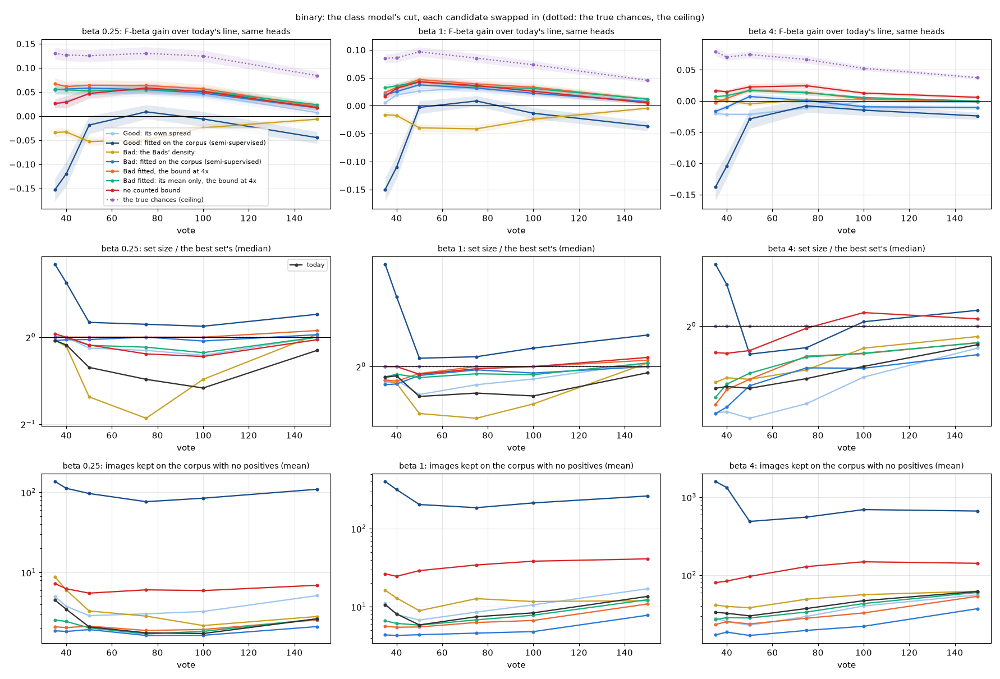
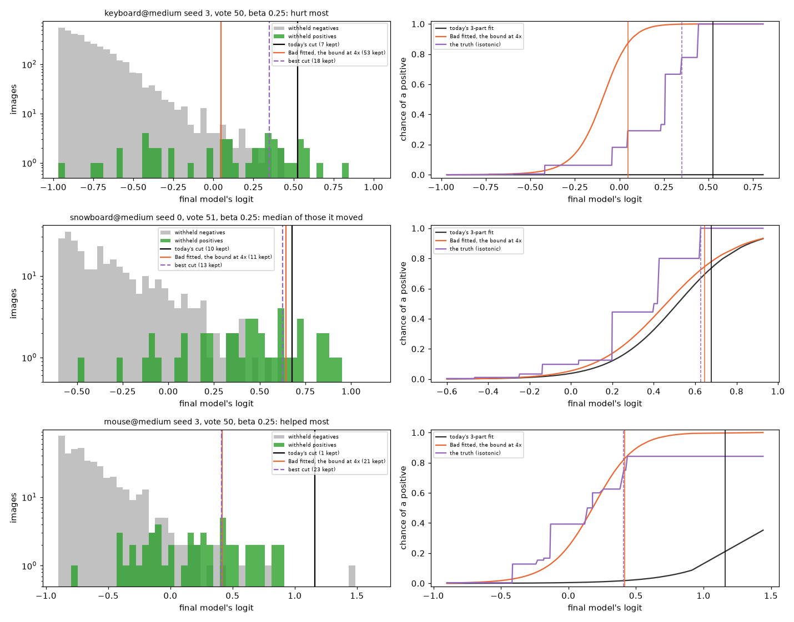
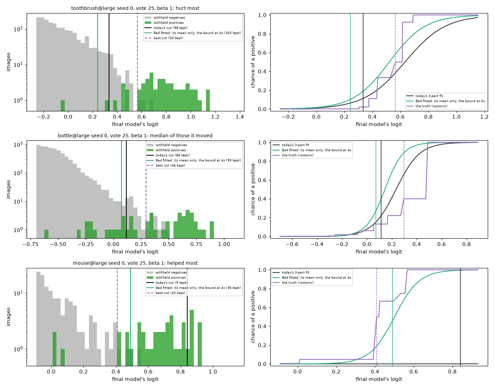
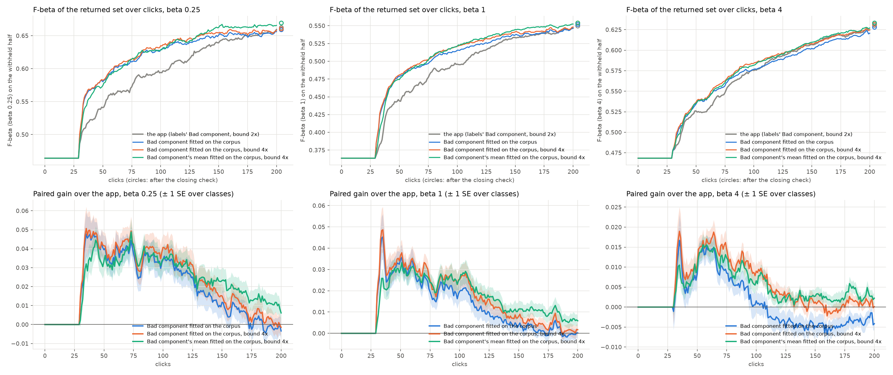

# Fitting the labels line's Bad component on the corpus gains +0.016 to +0.023 mean F-beta at beta 1/4 and 1, end to end (issue #5040)

**Status (2026-10-18): priced offline on #4937's snapshots (Binary Photo, 702 sessions at each of the three presets,
nine clicks from vote 10 to 150; Region Photo seed 0 at beta 1), every candidate the issue names and their
combinations, on the withheld half and on three corpora cut from it; the best three then A/B'd in closed loop at all
three presets (720 sessions each, 200 clicks, paired with the app's). Shipped (the owner's choice, 2026-10-18): the
Bad component's mean fitted on the corpus, with the counted bound at 4x, is the app's line in Train and Find alike.**

**On the negatives' side the labels line's chances (#4937) can be moved a good part of the way the truth moves them,
and on the Good side almost none of the way.**

1. **Fit the 3-part fit's Bad component on the corpus.** Today it is a normal pinned at the held-out Bads' mean with
   the Goods' spread, and the Bads are the ones Autopilot picked near the line and from the top. Fitted on the corpus
   being decided, the held-out Bads counted as labelled points of it, it moves to where the corpus's own negatives
   near the line are, and the chances' sum moves to the true count of positives. On the same heads it gains +0.054
   to +0.061 F-beta at beta 1/4 and +0.033 to +0.036 at beta 1 (vote 40), about 45% and 40% of the true chances'
   ceiling, with the counted bound loosened from 2x to 4x; on a corpus with no positives it keeps about as many
   images as today, or fewer.
2. **Its mean alone is the arm that shipped.** On Binary it prices with the full fit (mean and spread); on Region Photo,
   where the line was not short, the full fit overrates the positives near the line (a chance of 0.87 at the best
   set's edge against a true 0.37) and the mean alone does not (0.42 to 0.49), gaining +0.007 to +0.040 at every
   click there.
3. **End to end it holds.** In closed loop the mean alone, with the bound at 4x, gains +0.023 (± 0.004) mean F-beta
   over clicks 0-200 at beta 1/4, +0.016 (± 0.003) at beta 1 and +0.005 (± 0.001) at beta 4; +0.013, +0.010 and
   +0.003 over clicks 0-50. It is the only arm still ahead of the app at click 200 and after the closing check at
   every preset (+0.007, +0.004, +0.003), and it helps 57% to 67% of sessions against 27% to 38% it hurts. Done comes
   1 to 2 clicks sooner, at a line 0.010 to 0.033 better.
4. **The counted bound at 4x, not removed.** Loosened it reads the prevalence at 0.87 to 0.93 of the truth early
   (today 0.50 to 0.57) and gains alone at every preset; removed, a corpus with no positives keeps 84 and 148 wrong
   images at beta 4 (votes 40 and 100) where today keeps 32 and 47, which fails #4452.
5. **No Good-side candidate pays.** The Goods' own spread gains at beta 1/4 and 1 and loses 0.02 at beta 4; fitting
   the Good component on the corpus runs away (the prevalence at 13 to 14 times the truth, up to 1,600 images kept on
   an empty corpus); the spot check's Goods lose 0.03 at beta 4. The held-out Goods are selected, and nothing the app
   holds tells the corpus's hard positives from its negatives near the line. Beta 4's shortfall stays.

| closed loop, paired gain over the app (± SE over classes) | beta 1/4 | beta 1 | beta 4 |
|---|---|---|---|
| **the Bad component's mean fitted, the bound at 4x**: mean F-beta over clicks 0-50 / 0-200 | **+0.013 / +0.023** (± 0.002 / 0.004) | **+0.010 / +0.016** (± 0.001 / 0.003) | **+0.003 / +0.005** (± 0.001 / 0.001) |
| … after the closing check | +0.007 (± 0.004) | +0.004 (± 0.002) | +0.003 (± 0.001) |
| the Bad component fitted (mean and spread), the bound at 4x: 0-50 / 0-200 / after the check | +0.017 / +0.023 / -0.002 | +0.014 / +0.015 / +0.005 | +0.004 / +0.005 / +0.001 |
| the Bad component fitted, the bound at 2x: 0-50 / 0-200 / after the check | +0.017 / +0.019 / -0.003 | +0.013 / +0.012 / +0.002 | +0.003 / +0.001 / -0.003 |

| offline, class model's cut, F-beta gain over today (vote 40 / 100 / 150) | beta 1/4 | beta 1 | beta 4 |
|---|---|---|---|
| the true chances (ceiling, #4937) | +0.127 / +0.124 / +0.084 | +0.086 / +0.073 / +0.045 | +0.070 / +0.052 / +0.037 |
| the negatives' own shape (truth, #4937) | +0.098 / +0.087 / +0.048 | +0.041 / +0.041 / +0.017 | -0.006 / -0.002 / -0.005 |
| **Bad component fitted on the corpus** | **+0.056 / +0.048 / +0.017** | **+0.025 / +0.022 / +0.007** | **-0.010 / -0.009 / -0.011** |
| **… and the bound at 4x** | **+0.061 / +0.056 / +0.020** | **+0.033 / +0.033 / +0.012** | **+0.004 / +0.003 / -0.001** |
| **its mean alone fitted, the bound at 4x** | **+0.054 / +0.052 / +0.024** | **+0.036 / +0.031 / +0.012** | **+0.008 / +0.005 / -0.000** |
| the bound at 4x alone | +0.017 / +0.033 / +0.012 | +0.017 / +0.019 / +0.005 | +0.014 / +0.013 / +0.005 |
| no counted bound | +0.029 / +0.051 / +0.018 | +0.031 / +0.026 / +0.005 | +0.015 / +0.013 / +0.006 |
| the Goods' own spread | +0.031 / +0.044 / +0.007 | +0.019 / +0.025 / +0.007 | -0.021 / -0.001 / -0.002 |
| images kept on the corpus with no positives (vote 40): today / fitted / fitted, 4x / mean, 4x / no bound | 3.5 / 1.8 / 2.1 / 2.5 / 6.3 | 8.1 / 4.3 / 5.5 / 6.1 / 25 | 32 / 19 / 25 / 29 / 84 |

## The question

#4937 found that on the class model's cut the labels line's chances underrate the positives at the line: the true
chances would gain +0.13 (beta 1/4), +0.07 to +0.10 (beta 1) and +0.05 to +0.08 (beta 4) through vote 100. It split
the error into a Good side (the held-out Goods are the session's easy positives, so the Good component sits 0.3 logit
too high and too narrow) and a negatives' side (the 3-part fit's Bad component and bulk put too much negative weight
at the line), in proportions that depend on the preset. The issue asks for deployable fixes on each side, and for the
counted bound, priced in F-beta at each preset, on the same heads and then in closed loop, with Find on a corpus with
no positives still keeping close to nothing (#4452).

## What was run

| | |
|---|---|
| snapshots | #4937's: today's app (dev 73c887c27), Binary Photo, `coco_better`, 144 class@band cells x 5 seeds, at beta 1/4, 1 and 4; snapshots at votes 10 to 150 with every fold model's scores. Region Photo: #4936's seed-0 run at beta 1 (139 sessions with a head) |
| pricer | `scripts/experiments/state_of_app/chances_5040.py`: Find's line on the withheld half (`fit_labels_line(...).on_corpus(scores)`) redrawn with one candidate swapped in. Today's replay matches the library's threshold and prevalence to the last bit on all 14,253 Binary and 926 Region snapshots |
| corpora | the withheld half (~10,900 images); its negatives alone (`empty`, ~10,850, no positive); 200 of its negatives (`empty200`, #4452's case); 1,000 of its images at their own prevalence (`small1k`) |
| library arm | `corpus_posteriors(bad="corpus")`, set for a run by `labels_chances()` (`CALIB_LINE_BAD`, `CALIB_LINE_BOUND_MARGIN`). Drawn through the library on every snapshot it keeps the pricer's set exactly (`chances_5040.py verify`) |
| closed loop | `chances_5040.sh`: arms `ctl` (the app), `bssl` (the Bad component fitted on the corpus), `bssl4` (the same, the bound at 4x) and `bmean4` (its mean alone fitted, the bound at 4x), Binary Photo, beta 1/4, 1 and 4, 5 seeds x 144 cells, 200 clicks and the closing check, paired by cell and seed |

Every gain is on the same heads, at the session's own preset; every ± is one SE over classes (a class's bands and
seeds averaged first). "The class model's cut" is the snapshots where the class model draws the line (60% at vote
35, 82% at vote 100, 86% to 88% at vote 150); on the rest the head's count line serves (#4786, #5039), which no
candidate here changes. "What Find returns" counts both.

## The candidates

The issue's candidates, as each was built. Every one reads only what the app holds: the labels' held-out fold scores,
their surfacing provenance, and the scores of the corpus being decided.

| side | candidate | what changes |
|---|---|---|
| Good | the Goods' own spread | the Good component's spread is the held-out Goods' own, not pooled with the Bads (floored on the corpus as today) |
| Good | fitted on the corpus | its mean and spread fitted by EM on the corpus, the held-out Goods counted as labelled points of it, in both the 2-part total and the 3-part chances (semi-supervised) |
| Good | the spot check's Goods | its mean and spread from the held-out Goods a spot check picked (uniform within rank bands; their votes carry `flow: check`), where a session holds 3 or more |
| Bad | its own spread | the Bad component's spread is the held-out Bads' own |
| Bad | the Bads' density | the Bad component is a kernel density of the held-out Bads (#4490's shape), its weight fitted by the 3-part EM, which takes up their selection |
| Bad | fitted on the corpus | its mean and spread fitted on the corpus, the held-out Bads counted as labelled points of it; split into its mean only and its spread only |
| total | the bound at 4x / no bound / the chances' sum | the 2-part estimate may exceed the counted bound by 4x rather than 2x / is uncapped / is replaced by the chances' own sum |
| both | combinations | both classes' own spreads; both fitted; each fitted Bad with the bound at 4x or none; with the Goods' own spread |

The truth swaps from #4937 ride along on the same rows: the true chances (isotonic on the truth: the ceiling), the
negatives' own shape and the Good component's true mean and spread.

## The Bad component fitted on the corpus



*Per preset over votes, on the class model's cut: each candidate's F-beta gain over today's line on the same heads
(top), its median set size against the best set's (middle), and the mean number of images it keeps on the withheld
half's negatives alone (bottom, log scale). Dotted: the true chances.*

**Why it works.** Today's Bad component is pinned where the held-out Bads sit, and the Bads are the ones Autopilot
picked near the line and from the top. The corpus's own negatives near the line sit lower and spread differently, so
the 3-part EM can only shrink the Bad component's weight or let it eat the positives' lower tail. Fitted on the
corpus, the component moves to where those negatives are, its weight roughly doubles (0.022 to 0.096 of the corpus
at vote 50, beta 1/4, in a 25-cell sample), and the chances' sum moves to the true count of positives (32 to 45 at
vote 50 and 42 to 51 at vote 100, against about 51). At the best set's edge the chance goes from 0.69 to 0.76
(vote 40) and from 0.31 to 0.71 (vote 100) at beta 1/4, where the truth reads 0.79 and 0.75; at beta 1 from 0.15 to
0.30 (vote 50), truth 0.38.

| beta 1/4, class model's cut | vote 40 | vote 50 | vote 100 | vote 150 |
|---|---|---|---|---|
| set ÷ best (median): today / fitted / fitted, 4x | 0.94 / 0.98 / 1.00 | 0.79 / 0.98 / 1.00 | 0.67 / 0.97 / 1.00 | 0.90 / 1.02 / 1.05 |
| chance at the best set's edge: today / fitted / truth | 0.69 / 0.76 / 0.79 | 0.52 / 0.81 / 0.79 | 0.31 / 0.71 / 0.75 | 0.46 / 0.76 / 0.74 |
| expected F-beta minus F-beta: today / fitted / fitted, 4x | -0.06 / +0.03 / +0.00 | -0.11 / +0.02 / -0.00 | -0.21 / +0.00 / -0.04 | -0.17 / -0.04 / -0.06 |

- **Both moves matter, the mean more.** Fitting only the mean gains +0.046 / +0.038 at beta 1/4 (votes 40 / 100);
  only the spread +0.036 / +0.012; both +0.056 / +0.048.
- **At beta 4 it keeps fewer.** The recall cut sits deep in the positives' lower tail, where the fitted component now
  also claims some of the positives; the median set falls from 0.72 to 0.65 of the best at vote 40 and the F-beta
  falls 0.010. The Good side is the shortfall at beta 4 (#4937), and nothing here reaches it.
- **The line's own expected F-beta gets honest.** Today it underrates its set by 0.06 to 0.21 through vote 100; with
  the fitted component the error is within ±0.04 at beta 1/4 and +0.08 to -0.01 at beta 1. The stop (#4878) reads it.
- **What Find returns** (every snapshot, the head's count line where it serves): +0.034 to +0.038 at beta 1/4 (votes
  35 to 100), +0.012 to +0.026 at beta 1, -0.009 to +0.007 at beta 4.

**Its mean alone.** Fitting only the Bad component's mean, its spread kept at the class model's, moves the chances
less: at the best set's edge 0.80, 0.69 and 0.57 at votes 40, 50 and 100 (beta 1/4; the full fit 0.76, 0.81, 0.71,
the truth 0.79, 0.79, 0.75). With the bound at 4x it prices with the full fit on Binary: +0.054 / +0.052 / +0.024 at
beta 1/4 (votes 40 / 100 / 150), +0.036 / +0.031 / +0.012 at beta 1 and +0.008 / +0.005 / -0.000 at beta 4; on what
Find returns +0.031 to +0.041, +0.021 to +0.028 and +0.004 to +0.012 (votes 35 to 100). It leaves more of the
expected F-beta's error (-0.05 and -0.11 at votes 50 and 100, beta 1/4), so the stop moves less. It is the arm that
holds on Region (below), and it was priced, and added to the closed loop, because of that.

## The counted bound

The bound caps the 2-part estimate of the positives at twice the fewest any cut could hold (#4452), and #4937 found
it binds in three quarters of early snapshots and sets a prevalence of half the truth. It matters to the cut wherever
the total is larger than the chances' own sum.

| (vote 40 / 100) | beta 1/4 | beta 1 | beta 4 |
|---|---|---|---|
| prevalence ÷ truth: today / bound 4x / no bound | 0.52 / 0.88 / 1.27; 0.70 / 1.09 / 1.52 | 0.50 / 0.87 / 1.26; 0.67 / 1.07 / 1.53 | 0.51 / 0.88 / 1.26; 0.63 / 1.05 / 1.52 |
| empty corpus, images kept (mean; p90): today | 3.5; 7 / 1.7; 3 | 8.1; 19 / 8.4; 19 | 32; 74 / 47; 112 |
| … the bound at 4x | 3.7; 8 / 2.3; 5 | 10; 24 / 13; 33 | 43; 100 / 69; 168 |
| … no bound | 6.3; 17 / 6.0; 17 | 25; 57 / 38; 118 | 84; 230 / 148; 412 |
| … the Bad component fitted, the bound at 4x | 2.1; 4 / 1.9; 4 | 5.5; 11 / 6.7; 15 | 25; 47 / 33; 76 |
| … its mean alone fitted, the bound at 4x | 2.5; 5 / 1.8; 3 | 6.1; 11 / 7.8; 18 | 29; 56 / 43; 110 |

- **At 4x the estimate reads 0.87 to 0.93 of the truth early** and 1.05 to 1.09 at vote 100; uncapped it reads 1.2 to
  1.5. The bound at 4x alone gains +0.013 to +0.033 at every preset.
- **On a corpus with no positives the bound is what keeps the line small**, and that is the price of loosening it:
  removing it multiplies what an empty corpus keeps by three to four at beta 1 and 4. The fitted Bad component pays
  for the 4x bound: together they keep fewer than today at every preset, at both clicks; with its mean alone fitted,
  about as many as today (fewer at beta 1 and 4, 2.5 against 3.5 and 1.8 against 1.7 at beta 1/4).
- **#4452's own case, 200 images with no positives**, is unchanged by every Bad-side and bound candidate: 1.0 to 2.8
  images on average, the same as today.

## The Good side

| (vote 40 / 100), class model's cut | beta 1/4 | beta 1 | beta 4 | prevalence ÷ truth (vote 40) | empty corpus, beta 4 (vote 40) |
|---|---|---|---|---|---|
| the Goods' own spread | +0.031 / +0.044 | +0.019 / +0.025 | -0.021 / -0.001 | 0.78 to 0.80 | 25 |
| fitted on the corpus | -0.120 / -0.006 | -0.110 / -0.013 | -0.104 / -0.015 | 13 to 14 | 1,330 |
| the spot check's Goods | +0.033 / +0.026 | +0.015 / +0.000 | -0.036 / -0.030 | 0.84 to 0.85 | 25 |
| the Good component true (truth, #4937) | -0.027 / +0.010 | -0.008 / +0.004 | +0.028 / +0.012 | 0.92 to 0.95 | - |

- **The Goods' own spread is narrower than the pooled one** (pooling with the Bads widens it, #4937), so it moves the
  chances the wrong way for a recall cut and loses at beta 4. Its gains at beta 1/4 and 1 come through the counted
  bound: a narrower Good component reads a looser bound (0.52 to 0.80 of the truth). The bound at 4x gives the same
  without the loss at beta 4.
- **Fitted on the corpus, the Good component is not identifiable.** With its mean free the EM slides it into the
  negatives' upper tail; the held-out Goods (a median of 10 at votes 35 to 50, against about 50 positives in the
  corpus) are too few to hold it.
- **The spot check's Goods are less selected than the rest, but not by enough**: they come from the top bands of the
  ranking (the top 32 at beta <= 1, 128 above), the next-easiest positives. 86% to 87% of class-model snapshots at
  votes 35 to 50 hold 3 or more (a median of 7). They cannot be read on Region (the grouped folds carry no vote ids).

## Also tried

Three further families were prototyped before the full pricing, on the first 20 (semi-parametric) or 30 (logistic)
sessions of each preset, every class-model snapshot (scripts in the work dir, not in the repo). Each lost at beta 1 or
4 and kept hundreds of wrong images on an empty corpus at beta 4, so none went further.

| prototype (F-beta gain over today, class model's cut, all votes) | beta 1/4 | beta 1 | beta 4 | empty corpus, beta 4 (mean kept; today 30) |
|---|---|---|---|---|
| chances from a logistic fit of the held-out labels on their scores (Firth), no prevalence shift | +0.005 | -0.051 | -0.097 | 1,024 |
| … its slope, its level set by the 2-part estimate (uncapped) | +0.017 | -0.009 | -0.023 | 271 |
| a logistic fit on the spot check's held-out picks only, its level capped the same way | +0.013 | -0.002 | -0.017 | 377 |
| negatives as a leave-one-out kernel density of the corpus weighted by each image's chance of a negative (semi-parametric EM) | -0.074 | -0.069 | -0.055 | 740 |

The logistic fits read the labels' share of Goods at a score as the corpus's, and a session's labels hold far more
Goods at a given score than the corpus does. The semi-parametric negatives are not identifiable: any share of the top
of the corpus can be called negative.

## Literal examples

Sessions at vote 50 picked by rule among those the fitted Bad component with the bound at 4x moves (best set of 10
or more; `chances_5040.py examples`): the one it hurts most, the median, the one it helps most.



*Left: the withheld half's top on a log count scale, positives green, negatives grey; today's cut (black), the arm's
(orange) and the best cut (purple dashes). Right: each image's chance of a positive under today's 3-part fit, the
arm's, and the truth's (isotonic).*

| preset | picked as | session | seed | vote | kept today / arm / best | F today / arm / best | chances' sum today / arm / positives |
|---|---|---|---|---|---|---|---|
| beta 1/4 | hurt most | keyboard@medium | 3 | 50 | 7 / 53 / 18 | 0.74 / 0.55 / 0.81 | 0 / 96 / 48 |
| beta 1/4 | median | snowboard@medium | 0 | 51 | 10 / 11 / 13 | 0.83 / 0.85 / 0.88 | 27 / 31 / 44 |
| beta 1/4 | helped most | mouse@medium | 3 | 50 | 1 / 21 / 23 | 0.00 / 0.74 / 0.77 | 2 / 45 / 53 |
| beta 1 | hurt most | snowboard@medium | 3 | 53 | 32 / 22 / 35 | 0.81 / 0.64 / 0.85 | 29 / 13 / 47 |
| beta 1 | median | frisbee@large | 0 | 50 | 45 / 49 / 53 | 0.90 / 0.92 / 0.92 | 46 / 53 / 53 |
| beta 1 | helped most | mouse@medium | 1 | 50 | 6 / 30 / 57 | 0.14 / 0.55 / 0.62 | 2 / 30 / 50 |
| beta 4 | hurt most | snowboard@small | 4 | 50 | 89 / 59 / 141 | 0.81 / 0.66 / 0.85 | 0 / 0 / 51 |
| beta 4 | median | kite@large | 3 | 51 | 55 / 50 / 48 | 0.99 / 0.99 / 0.99 | 45 / 38 / 44 |
| beta 4 | helped most | orange@medium | 2 | 51 | 19 / 52 / 84 | 0.43 / 0.71 / 0.79 | 6 / 31 / 43 |

- `mouse@medium` seed 3 (beta 1/4) is the failure #4937 named: today's chances never pass 0.35, even at the top of the
  ranking, and the line keeps one image. With the Bad component fitted on the corpus the chances follow the truth's
  curve almost exactly, and the line keeps 21 where the best set is 23.
- `keyboard@medium` seed 3 (beta 1/4) is the same collapse the other way: today's chances are 0 everywhere and it
  keeps 7 by the cut's floor; the fitted chances overshoot (a sum of 96 for 48 positives) and keep 53 where the best
  is 18.
- The same panels at beta 1 and 4: `figures/binary/examples_bad_ssl_bound_x4_b1_vote50.png`, `…_b4_vote50.png`;
  picked the same way for the mean alone, `figures/binary/examples_bad_ssl_mean_bound_x4_b{025,1,4}_vote50.png`
  (`mouse@medium` seed 3 again helps most at beta 1/4: 1 kept today, 12 with the mean alone, 23 in the best set).

## Region Photo

| beta 1, class model's cut (vote 25 / 50 / 100 / 150) | F-beta gain | set ÷ best | chance at the best set's edge (truth 0.37 to 0.39) | empty corpus kept (mean) |
|---|---|---|---|---|
| today | - | 1.00 / 0.94 / 0.84 / 0.96 | 0.23 / 0.18 / 0.08 / 0.14 | 18 / 16 / 20 / 17 |
| the Bad component fitted | -0.003 / -0.001 / +0.031 / +0.001 | 1.30 / 1.32 / 1.17 / 1.12 | 0.87 / 0.80 / 0.62 / 0.56 | 26 / 26 / 18 / 13 |
| … and the bound at 4x | -0.011 / -0.005 / +0.034 / +0.003 | 1.36 / 1.33 / 1.22 / 1.18 | 0.87 / 0.80 / 0.62 / 0.56 | 27 / 29 / 21 / 17 |
| its mean only | +0.019 / +0.018 / +0.031 / +0.002 | 1.06 / 1.05 / 0.97 / 1.04 | 0.49 / 0.42 / 0.23 / 0.33 | 20 / 19 / 15 / 13 |
| … with the bound at 4x | +0.014 / +0.017 / +0.040 / +0.007 | 1.12 / 1.09 / 1.00 / 1.07 | 0.49 / 0.42 / 0.23 / 0.33 | 22 / 23 / 20 / 18 |
| the bound at 4x alone | +0.004 / +0.014 / +0.027 / +0.010 | 1.04 / 0.98 / 0.94 / 1.03 | 0.23 / 0.18 / 0.08 / 0.14 | 21 / 22 / 27 / 26 |

Region's line was not short (#4937: 1.06 of the best set at vote 25), so chances that rise everywhere overshoot: the
fitted component reads 0.87 at the edge where the truth is 0.37. F-beta holds early only because the overshoot sits
in the set's tail. On 1,000-image Region corpora it loses 0.013 to 0.032 (vote 25 to 150). Fitting the Bad
component's mean alone overshoots far less (0.42 to 0.49 at the edge early) and gains at every click, +0.007 to
+0.040 with the bound at 4x; on 1,000-image Region corpora it loses up to 0.026 too (vote 50).



*Region sessions at vote 25 picked by rule, as the Binary panels are. `toothbrush@large` keeps 98 today where the best
set is 50; the full fit keeps 261 (`figures/region/examples_bad_ssl_bound_x4_b1_vote25.png`), its mean alone 163.
`mouse@large` keeps 9 today where the best is 43; its mean alone keeps 36 at F 0.86 against the best cut's 0.91.*

## The closed loop

The chances do more than draw Find's line. Autopilot's acquisition reads them (its hard picks sample where they put
the line) and its stop reads their expected F-beta (#4878), so every session runs differently from vote 7 or 8 on,
before the detector is even shown. Each arm is the app with one change, 720 sessions per preset (144 class@band cells
x 5 seeds, Binary Photo, 200 clicks and the closing check), paired by cell and seed with the app's own sessions.



*Top: the mean F-beta of the set the app shows on the withheld half at each click (the typed query's set until the
detector is shown, about click 30); circles, after the closing check. Bottom: each arm's paired gain over the app,
± 1 SE over classes.*

| paired gain over the app (± SE over classes) | beta 1/4 | beta 1 | beta 4 |
|---|---|---|---|
| **the Bad component's mean fitted, the bound at 4x**: mean F-beta over clicks 0-50 | **+0.013 (± 0.002)** | **+0.010 (± 0.001)** | **+0.003 (± 0.001)** |
| … 0-100 | +0.024 (± 0.004) | +0.018 (± 0.003) | +0.007 (± 0.001) |
| … 0-200 | **+0.023 (± 0.004)** | **+0.016 (± 0.003)** | **+0.005 (± 0.001)** |
| … at click 200 | +0.006 (± 0.004) | +0.006 (± 0.003) | +0.002 (± 0.001) |
| … after the closing check | +0.007 (± 0.004) | +0.004 (± 0.002) | +0.003 (± 0.001) |
| … Done, clicks (the app: 53 / 57 / 63) | -2.0 (± 0.4) | -1.2 (± 0.4) | -1.2 (± 0.5) |
| … F-beta where the user stops (Done, or click 200) | +0.033 (± 0.006) | +0.025 (± 0.004) | +0.010 (± 0.003) |
| the Bad component fitted (mean and spread), the bound at 4x: 0-50 / 0-200 / at 200 / after the check | +0.017 / +0.023 / -0.002 / -0.002 | +0.014 / +0.015 / +0.002 / +0.005 | +0.004 / +0.005 / +0.000 / +0.001 |
| … Done, clicks / F-beta where the user stops | -3.3 (± 0.6) / +0.033 (± 0.007) | -2.8 (± 0.7) / +0.026 (± 0.005) | -2.6 (± 0.7) / +0.013 (± 0.003) |
| the Bad component fitted, the bound at 2x: 0-50 / 0-200 / at 200 / after the check | +0.017 / +0.019 / -0.003 / -0.003 | +0.013 / +0.012 / +0.000 / +0.002 | +0.003 / +0.001 / -0.004 / -0.003 |

- **The offline gain survives the loop.** The arms' line is better from the first click that shows the detector.
  With the full fit and the bound at 4x: +0.04 to +0.05 at beta 1/4 to click 75 and +0.03 to +0.04 to click 100,
  +0.03 to +0.05 at beta 1 to click 60, +0.01 to +0.02 at beta 4 to click 75; with the mean alone +0.03 to +0.04,
  +0.02 to +0.03 and about +0.01 over the same clicks. The gain fades as the app's own line catches up: by click 175
  the full fit is level with the app, the mean alone still +0.002 to +0.013 ahead.
- **Done comes sooner, at a better line.** The fitted chances read the line's own expected F-beta closer to the
  truth, and the stop (#4878) reads it, so Autopilot reports Done 1 to 2 clicks sooner with the mean alone fitted and
  3 with the full fit (medians 52, 56 and 63 against the app's 53, 57 and 63), with F-beta higher there by 0.010 to
  0.033.
- **The bound at 4x is what holds beta 4.** Without it the fitted Bad component drifts below the app from click 100
  (-0.004 ± 0.002 at click 200); with it every click is level or better. At beta 1/4 and 1 it adds +0.003 to +0.004
  over clicks 0-200.
- **Where the full fit gains.** Large and medium bands (+0.019 to +0.031 over clicks 0-200 at beta 1/4 and 1, +0.007 at beta
  4) and sessions that end at F-beta 0.5 or more (+0.023 to +0.031, +0.008); small bands +0.002 to +0.011, and
  sessions that end below 0.2 nothing either way. It helps 56% to 61% of sessions over clicks 0-200 and hurts 33% to
  38% (`tables/ab_splits.csv`).
- **The labels.** The full fit's sessions label about 3.4 fewer Goods by click 200 (27 against 30), the mean
  alone's about 2 fewer (28): the hard picks sample where the fitted chances put the line, lower in the ranking. Average precision at click 200 is unchanged
  (-0.001), and the shown set is better at every click up to 175.
- **Its mean alone gains less early and holds late.** Fitting only the Bad component's mean moves the chances less,
  so over clicks 0-50 it gains 0.004 less than the full fit at beta 1/4 and 1; over clicks 0-200 the two tie
  (+0.023 and +0.023, +0.016 and +0.015, +0.005 and +0.005), and from click 150 on the mean alone is the better line
  at every preset: +0.006, +0.006 and +0.002 at click 200 and +0.007, +0.004 and +0.003 after the closing check,
  where the full fit is level. It helps more sessions (62%, 67% and 57% over clicks 0-200, against 32%, 27% and
  38% it hurts), costs fewer labelled Goods (28 by click 200 against the app's 30 and the full fit's 27), and leaves
  Done closer to the app's (1 to 2 clicks sooner rather than 3). Its gains sit where the full fit's do: large and
  medium bands (+0.019 to +0.031 at beta 1/4 and 1, +0.007 at beta 4) and sessions that end at 0.5 or more.
- **Pairing.** 646 of 720 sessions per preset leave the app's picks under the full fit (604 to 619 under its mean
  alone), all at a hard pick whose acquisition threshold moved (a median of 7 votes in), or a few (1 to 10, at beta 1
  and 4) at a pick in another phase; the shown F-beta matches the app's exactly until the detector is first shown in every
  session. The rest never leave it. The mean-only arm ran from a second frozen worktree whose default path is the
  first's (a new branch behind the knob, a docstring, the Test arm's model rebuild, which is off here).

## What this leaves

- **Shipped: the Bad component's mean fitted on the corpus, with the counted bound at 4x**, as the app's line,
  Train's and Find's alike: `BAD_COMPONENT = "corpus_mean"` and `_BOUND_MARGIN = 4.0` in `labels_line.py` (the line
  before is `CALIB_LINE_BAD=labels CALIB_LINE_BOUND_MARGIN=2`, which the launcher's control now pins). It gains on
  Binary at every preset end to end, holds at click 200 and after the closing check, holds on Region offline, and
  keeps about as many images as before on a corpus with no positives.
- **Region Photo was priced offline only** (one seed, beta 1). A Region closed loop is memory-bound: about 8 hours
  for two arms of 144 sessions on the shared cap.
- **The Good side is still open.** None of the deployable Good components pays, and at beta 4 the line keeps 0.73 to
  0.86 of the best set through vote 100 on the class model's cut. #5039 (the head's count line) is the other half of
  beta 4's early shortfall.
- **The expected F-beta** (the stop's reading, #4878) moves with the chances: its error at vote 50 goes from -0.11
  to -0.05 at beta 1/4 with the mean alone fitted (+0.02 with the full fit), so Done comes sooner. The closed loop
  shows that is a better stop, not an early one: F-beta where the user stops is higher at every preset.

## Provenance

| | |
|---|---|
| snapshots | #4937's runs (dev 73c887c27): `/expscratch/sgreenberg/state-of-the-app/2026-10-16-fscale4936-early4937-binary-b{025,1,4}`; Region `/expscratch/sgreenberg/state-of-the-app/2026-10-15-fscale4936-region-b1` |
| pricing | `chances_5040.py measure` passes 1, 2 and 3 on branch `claude/chances-5040`, per-snapshot tables in `/expscratch/sgreenberg/chances-5040/m{1,2,3}-{b025,b1,b4,region}/snapshots.csv.gz`; jobs of 32 to 96 CPUs, 10 to 25 minutes each. Pass 3 (the mean alone) was added after pass 2's Region reading |
| verify | `chances_5040.py verify`: each library arm (`corpus`, `corpus` with the bound at 4x, `corpus_mean` with it) drawn on every snapshot keeps the pricer's set, on the withheld half and the empty corpus: 4,751 of 4,751 snapshots per preset and 924 of 924 on Region (2 Region snapshots have no comparable line) |
| closed loop | `chances_5040.sh`: `ctl`, `bssl` and `bssl4` from frozen worktree `vts-5040-run` at 4783a51eb, 45 cpu packs of 8 sessions (AMD) from 2026-10-17 21:59 to 02:55; `bmean4` from `vts-5040-run2` at 44831a916 (same default path), 15 packs from 02:00, cancelled at 02:53 with 479 sessions done and the other 1,681 relaunched as 45 packs, done 04:10. Dirs `/expscratch/sgreenberg/state-of-the-app/2026-10-17-chances5040-{ctl,bssl,bssl4,bmean4}-b{025,1,4}` |
| tests | the GRID suite on aba00b645 (the arm off by default): 17,253 passed; on 92a6c6b45 (shipped): 17,255 passed; pyright, ruff and the docs gates clean |
| analysis | `chances_5040.py report` / `examples`; `chances_5040_ab.py` (the closed loop) |

## Reproduce

```bash
export VTSEARCH_DATA_DIR=/expscratch/$USER/vts-cache/datadir OMP_NUM_THREADS=1
P=scripts/experiments/state_of_app/chances_5040.py
S=/expscratch/$USER/state-of-the-app/2026-10-16-fscale4936-early4937-binary
for b in b025 b1 b4; do
  python $P measure --results ${S}-$b/results --out <dir>/m1-$b --procs 96 --pass 1
  python $P measure --results ${S}-$b/results --out <dir>/m2-$b --procs 96 --pass 2
  python $P measure --results ${S}-$b/results --out <dir>/m3-$b --procs 96 --pass 3
  python $P verify --results ${S}-$b/results --priced <dir>/m2-$b/snapshots.csv.gz --procs 64   # and m3-$b
done
D=docs/experiments/2026-10-17-chances-5040
python $P report --out <dir>/m1-b025/snapshots.csv.gz ... --out <dir>/m2-b4/snapshots.csv.gz --docs $D/tables --figs $D/figures
# closed loop, from a frozen worktree
L=scripts/experiments/state_of_app/chances_5040.sh
bash $L dirs
for arm in ctl bssl4 bssl bmean4; do for b in 0.25 1 4; do
  CALIB_PACK_JOBS=5 CALIB_PACK_PAR=8 CALIB_PACK_MEM=12G SBATCH_CONSTRAINT=amd bash $L cpack $arm $b
done; done
python scripts/experiments/state_of_app/chances_5040_ab.py --root /expscratch/$USER/state-of-the-app --seeds 5 \
  --baseline <text_baseline.csv> --out <dir>/ab --docs $D/tables
```
