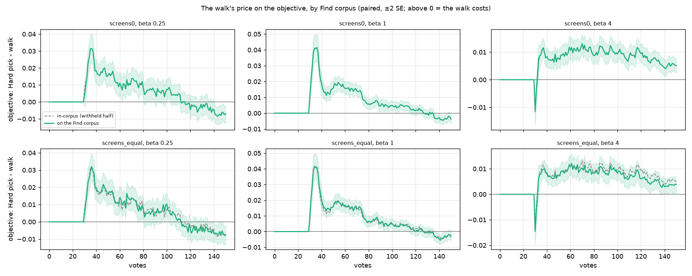
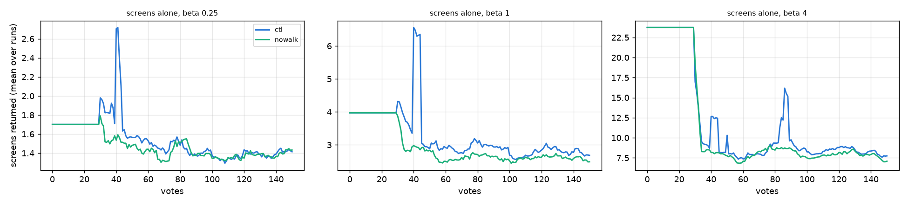
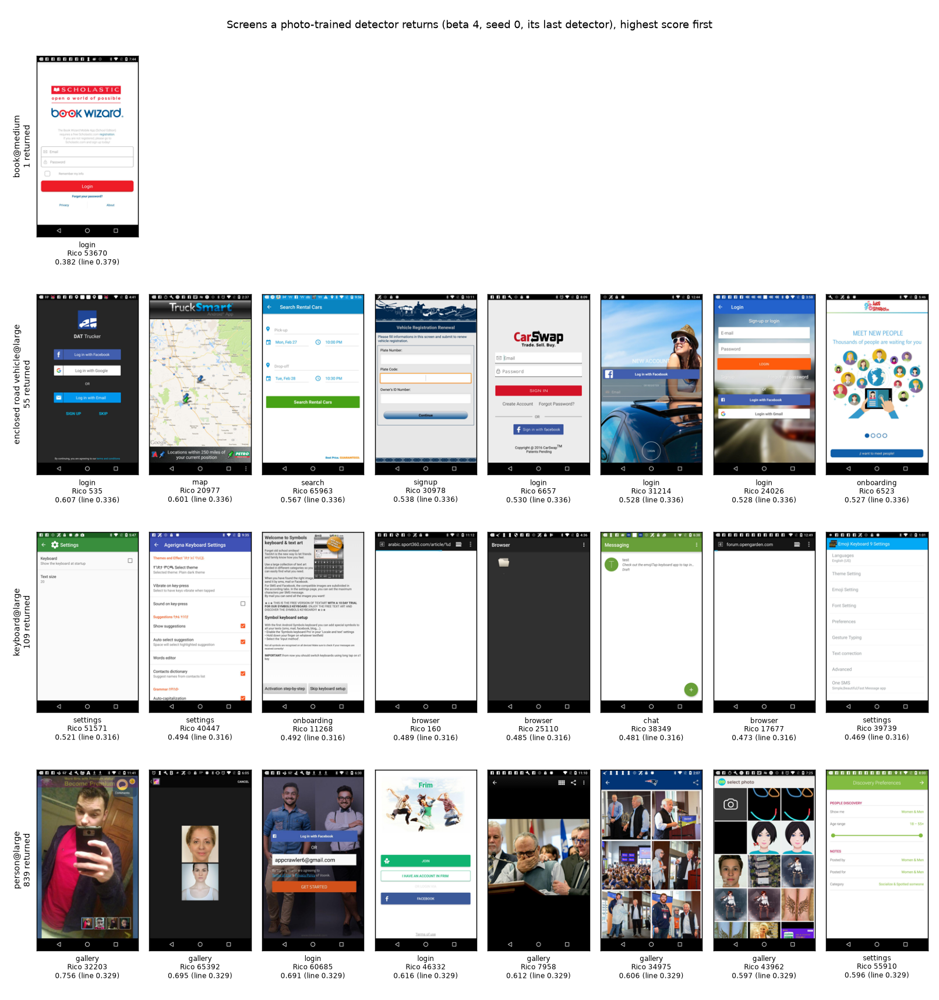
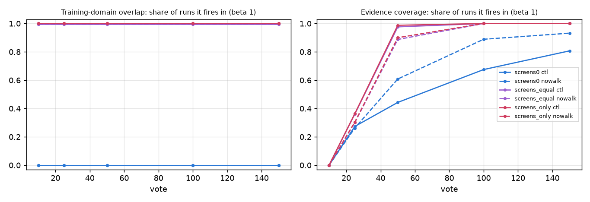

# Does the Coverage Atlas walk pay on a corpus unlike the votes'? The screens legs (issue #4739)

**Leg 1 (Objects365 Better) ran on 2026-10-23: [its report](../2026-10-23-cross-corpus-o365-4739/REPORT.md).
There the walk costs more than in-corpus (+0.010 / +0.010 / +0.009 against +0.006 / +0.007 / +0.008 on the same 107
cells), and the late crossover is gone.**

**Not on screenshots: the walk's price on the Find corpus is its in-corpus price.** Today's app is set against
New taking the Hard pick (`CALIB_NEW_WALK=hard`, #4671's arm), in 720 paired runs a preset, on #4671's bench. Each
run Finds on a second corpus beside the withheld half (#4960). The Objects365 leg, the one that can change the ship
decision, waits on #4817's build. At beta 1/4 / 1 / 4:

- **Withheld half plus Apptitude's 3,141 app screens:** the Hard pick is ahead by +0.005 / +0.007 / +0.006 over
  the session. On the withheld half alone it is ahead by +0.005 / +0.007 / +0.007. Adding a haystack region that
  neither arm has seen changes the walk's price by nothing this grid can resolve (SE 0.001).
- **The screens alone:** the walk's runs return marginally more of them, +0.1 / +0.3 / +0.7 screens a vote, out
  of 1.5 / 3.3 / 12 returned.
- **The price has a shape.** It peaks when the first detector shows: +0.032 / +0.041 at votes 34–36 at beta 1/4
  and 1. It then decays, and from about vote 115 / 131 the walk is ahead by a little (−0.007 / −0.004 at vote 150).
  At beta 4 the Hard pick stays ahead to vote 150 (+0.005).
- **The Training-domain overlap check works as an alarm here.** It is silent on the withheld half (0 of 720 runs;
  4.2% of the corpus reads atypical). It fires on both screens corpora: 717 of 720 runs with the screens mixed in
  (17% atypical), every run on the screens alone (61%).
- **The Evidence coverage check fires in-domain too:** by vote 150, in 81–83% of today's runs on the withheld
  half alone, and in 92–93% without the walk. Its verdict does not separate the corpora; its unsupported share
  does: 0.18 / 0.35 / 0.99 on no screens, screens mixed in, screens alone (today's app, beta 1). The walk lowers
  that share on the photos, 0.18 against 0.34. That is the one gain the walk shows here.
- **Done no longer needs Span** (#4878's level route). Without the walk Span never goes green, yet 53–58% of runs
  reach Done by vote 150, against 95–96% with it.

The prior the issue stated, that on this leg the walk would still lose a little F-beta, holds.

The interactive viewer is [`viewer.html`](viewer.html). It is the in-corpus read: every leg runs these
trajectories.

## The question

#4671 priced the atlas walk on COCO Better, training and Finding on two halves of one corpus. The Hard pick in New
gained +0.009 / +0.007 / +0.003 over the session. What the walk is for, a detector's blind spots, would show only
where Find meets a corpus unlike the one the votes came from. The owner (2026-10-09): price it on a cross-corpus
Find before changing anything.

The owner's design (2026-10-16) has two legs:

- **Leg 1, a second source of photos:** Objects365 Better's cell of the same name (#4815). This is the walk's own
  case: a boundary that has seen every region of its haystack, Finding on busier photos of the same classes. It
  waits on #4817 (the rulings on 18 ambiguous names, then the build).
- **Leg 2, a screenshot haystack:** the withheld half plus Apptitude's screens (#4356) as extra haystack, at shares
  `0` / `equal` / `only`. The screens are new to both arms, so a difference here is a bonus. This leg is mainly the
  alert's loudest case.

## What ran

| arm | what it changes, against today's app | knob |
|---|---|---|
| `ctl` | nothing: today's app | — |
| `nowalk` | New takes the Hard pick instead of the atlas's next under-explored item; the phase machine is unchanged | `CALIB_NEW_WALK=hard` |

| leg | the Find corpus beside the withheld half | knobs |
|---|---|---|
| `screens0` | the withheld half alone: the no-shift read, for the flags | `CALIB_FIND_CORPUS=apptitude CALIB_FIND_MIX=0` |
| `screens_equal` | the withheld half (about 11,400 photos) plus all 3,141 screens | `CALIB_FIND_MIX=equal` |
| `screens_only` | the 3,141 screens alone, which hold no positive | `CALIB_FIND_MIX=only` |
| `o365` | Objects365 Better's cell of the same name | `CALIB_FIND_CORPUS=o365_better`; not run, #4817 |

- **`equal` holds 22% screens, not half.** It means "as many foreign medias as the withheld half holds". There
  are 3,141 screens and about 11,400 photos in a withheld half, so the draw takes every screen: a share of about
  0.28 of the half.
- **Bench (#4671's):** COCO Better, binary SigLIP, 144 cells × 5 seeds, 150 votes, at beta 1/4, 1 and 4. The
  user's pool is thinned to 1% positive; the withheld half stays at 0.44%.
- **Scale and provenance:** 2 arms × 3 presets × 3 legs = 12,960 runs on one frozen commit (`vts-4739-run` @
  f576b3c75: dev be65d8946 plus the launcher). Launched by `launch_cross_corpus_4739.sh` through `drive_chunks.sh`,
  13:27–19:36 on 2026-10-18. Nothing was lost or retried.
- **The Find corpus is only ever scored:**
  - `analyze_cross_corpus_4739.py` compares every run's in-corpus rows across the legs. 8,640 runs were compared
    against `screens0` and 0 differ, so the legs are three reads of one set of trajectories.
  - On `screens0`, every Find column equals its in-corpus namesake, row for row (the timing cell).
- **The screens cell:** the Rico Suave → Apptitude rename left no pickle under the new name, so
  `apptitude__siglip.pkl` was rebuilt (job 1085192, the V100 on rack7n06 that built v0). It holds the same 3,141
  ids, with vectors equal to v0's to 1e-15.
- **Score:** the objective, F-beta at the run's preset above the line the app shows (#4427), on the Find corpus.
  - The line's corpus side is refitted there (`LabelsLine.on_corpus`, #4960).
  - Every run counts at every vote (#4631). Until a run shows a detector it scores the typed query's own set,
    read off its own typed-query rows.
  - Runs are paired by (category, seed) and summarised as session means (#4668, #4671).
  - The two reads' session levels differ by up to 0.003 before vote 30: the in-corpus read anchors on
    `text_baseline.csv`, the Find read on the runs' own query rows. The anchor is the same in both arms, so the
    paired differences are not moved.
- **The flags:** read at votes 10, 25, 50, 100 and 150 (`CALIB_FIND_FLAGS_AT`).
  - **Training-domain overlap:** `domain_shift_report` against the atlas the harness builds over the sim pool for
    New. It is built once, so the flag depends on neither the arm nor the vote.
  - **Evidence coverage:** `evidence_coverage_report`, from the votes' vectors and the Find cut.

## Result

*`nowalk` minus `ctl` at every vote, paired over 720 runs, ±2 SE; above zero the walk costs. Solid: on the Find
corpus. Dashed: in-corpus. On `screens0` the two are the same series, so the dashed line is hidden. Votes 1–29 are
flat at zero because both arms show the typed query's set until vote 30 (#4736's hold). At beta 4 the walk is
ahead for the one vote at the hand-over.*

**`nowalk` minus `ctl`**, paired over 720 runs (bold means more than 2 SE from zero; positive = the Hard pick
ahead):

| Find corpus | | beta 1/4 | beta 1 | beta 4 |
|---|---|---|---|---|
| withheld half alone (= in-corpus) | objective, votes 1–150 | **+0.005** ± 0.001 | **+0.007** ± 0.001 | **+0.007** ± 0.001 |
| | votes 1–50 | **+0.008** ± 0.001 | **+0.009** ± 0.001 | **+0.003** ± 0.000 |
| | votes 51–150 | **+0.004** ± 0.002 | **+0.006** ± 0.001 | **+0.009** ± 0.001 |
| | at vote 150 | **−0.007** ± 0.002 | **−0.004** ± 0.001 | **+0.005** ± 0.001 |
| | AP, votes 1–150 | **+0.004** ± 0.000 | **+0.005** ± 0.000 | **+0.005** ± 0.000 |
| withheld half + 3,141 screens | objective, votes 1–150 | **+0.005** ± 0.001 | **+0.007** ± 0.001 | **+0.006** ± 0.001 |
| | votes 1–50 | **+0.008** ± 0.001 | **+0.010** ± 0.001 | **+0.002** ± 0.000 |
| | votes 51–150 | **+0.003** ± 0.002 | **+0.006** ± 0.001 | **+0.008** ± 0.001 |
| | at vote 150 | **−0.008** ± 0.003 | −0.003 ± 0.001 | **+0.004** ± 0.002 |
| | AP, votes 1–150 | **+0.004** ± 0.000 | **+0.005** ± 0.000 | **+0.004** ± 0.000 |
| the screens alone | screens returned a vote, votes 1–150 | −0.1 ± 0.1 | **−0.3** ± 0.1 | **−0.7** ± 0.3 |

The levels behind them, as session means over votes 1–150:

| Find corpus | | beta 1/4 | beta 1 | beta 4 |
|---|---|---|---|---|
| withheld half alone | objective, `ctl` / `nowalk` | 0.60 / 0.60 | 0.49 / 0.49 | 0.57 / 0.58 |
| withheld half + screens | objective, `ctl` / `nowalk` | 0.59 / 0.60 | 0.48 / 0.48 | 0.57 / 0.57 |
| the screens alone | screens returned a vote, `ctl` / `nowalk` | 1.5 / 1.5 | 3.3 / 2.9 | 12 / 11 |

The screens cost both arms the same 0.005–0.010 of the objective. Every run returns at least one screen at every
vote: the line keeps the top of a corpus with no positive in it.

The vote ranges, and the per-vote paired curves, are in `screens0/paired_curve.csv` and
`screens_equal/find_paired_curve.csv`:

- **Beta 1/4:** the Hard pick is resolvably ahead from vote 30 to 100, peaking at +0.032 at vote 36. The walk is
  resolvably ahead at 12–16 votes from vote 118.
- **Beta 1:** the Hard pick is ahead from vote 30 to 114–123, peaking at +0.041 at votes 34–36. The walk is
  ahead at 9–12 votes from vote 136.
- **Beta 4:** the Hard pick is ahead from vote 33 to 150, peaking at +0.013 at votes 61–70.

*Mean over 720 runs at every vote. Before vote 30 both arms show the typed query's set. The `ctl` spikes at votes
40–45 (and 85 at beta 4) are a few runs returning many screens at once. Means, not medians: the median is 1–3 and
hides them.*

### What a photo detector returns among the screens

*Four seed-0 cells of `screens_only`, `ctl` at beta 4, re-run on the frozen tree with `VTS_DUMP_TEST_SCORES`. Each
re-run matches its grid cell exactly. The screens shown are those the last detector returns (score at or above the
Find line), highest first, with score, line, Apptitude class and Rico id. All returned screens are in
`figures/screens_examples.csv`.*

| detector | screens returned | by Apptitude class |
|---|---|---|
| `person@large` | 839 of 3,141 | login 235, signup 152, settings 148, onboarding 145, chat 40, search 33, gallery 30, player 24, map 12, browser 10, cart 9, splash 1 |
| `keyboard@large` | 109 | browser 33, chat 25, settings 23, login, onboarding, map, search 6 each, gallery 3, signup 1 |
| `enclosed road vehicle@large` | 55 | settings 13, login 10, signup 8, map 7, onboarding 5, search 5, cart 4, browser 2, gallery 1 |
| `book@medium` | 1 | login 1 (Scholastic's Book Wizard) |

Most of these are not errors by content. They are errors only by the benchmark's labels, because the screens carry
no COCO class:

- **`person@large`:** sign-in and onboarding screens with a photo of people behind the form, and gallery screens
  full of portraits.
- **`keyboard@large`:** keyboard-settings screens and screens with the soft keyboard up.
- **`enclosed road vehicle@large`:** car-rental, trucking and vehicle-registration apps.

A user who trained `person@large` on photos and Finds on a phone's screenshots gets these. That is the case the
overlap check exists to warn about (#4961).

## The flags

*Beta 1; the other presets read the same (`flags.csv`). Solid `ctl`, dashed `nowalk`. The overlap lines for the
two screens legs lie on each other at 1.0.*

| Find corpus | overlap fires | atypical share | evidence fires, vote 25 / 50 / 150, `ctl` | `nowalk` | unsupported share at vote 150, `ctl` / `nowalk` |
|---|---|---|---|---|---|
| withheld half alone | 0% | 0.042 | 27% / 44% / 81% | 26% / 61% / 93% | 0.18 / 0.34 |
| withheld half + screens | 99.6% | 0.17 | 36% / 98% / 100% | 30% / 89% / 100% | 0.35 / 0.48 |
| the screens alone | 100% | 0.61 | 36% / 99% / 100% | 30% / 90% / 100% | 0.99 / 0.99 |

- **The Training-domain overlap is the alarm the owner asked for** (#4961, shipped in #4998). It is silent with no
  shift, and it fires with the screens at both shares, at every vote. At 22% screens the atypical share is 0.17
  against the 0.042 baseline.
- **The Evidence coverage verdict fires in most in-domain sessions.** The report reads every scored item, the
  predicted negatives included, against its nearest labelled vector. It fires when more than 2α (α = 0.05) sit in
  an evidence vacuum. At 150 votes against an 11,400-photo haystack, 18% do even with no shift.
  - So the verdict reads how little of the haystack the votes cover more than any shift. Its share still separates
    the corpora (0.18 / 0.35 / 0.99).
  - The walk spreads its votes over the atlas, so fewer photos sit far from a vote: 0.18 with the walk against
    0.34 without. That is what the walk buys on this measure.

## Span and Done

Read on `screens0` (`span.csv`); every leg runs these trajectories.

| | beta 1/4 | beta 1 | beta 4 |
|---|---|---|---|
| `ctl`: Span green by vote 150 | 64% | 72% | 73% |
| `ctl`: Done by vote 150 (median vote of those Done) | 96% (52) | 96% (56) | 95% (64) |
| `nowalk`: Span green by vote 150 | 0% | 0% | 0% |
| `nowalk`: Done by vote 150 (median vote of those Done) | 58% (36) | 53% (39) | 54% (46) |
| atlas level reached by vote 150, `ctl` / `nowalk` (Span's target 40) | 32 / 7.5 | 35 / 7.5 | 36 / 7.8 |

The issue's premise was that without the walk the arm never reaches Done. That held at #4671 and no longer holds.
Since #4878, Autopilot says Done on all three lights green **or** on the labels line's level
(`stop_rule="lights|level"`).

- Without the walk Span stays red, so Done comes only by the level route, in about half the runs.
- With the walk, 95–96% reach Done. At least 22–32% of runs reach it with Span still red at vote 150, so by the
  level route.

The walk is what makes Done reachable for the other ~40% of sessions.

## Readings

- **On a haystack shift to screenshots, the walk buys no F-beta.** Its price on the Find corpus is its in-corpus
  price, peak and crossover included. The walk explores the photo haystack the votes came from. A region outside
  that haystack is outside the atlas too, so the walk cannot reach it.
- **The price moved since #4671.** There it was +0.009 / +0.007 / +0.003, all after vote 50. On today's app it is
  +0.005 / +0.007 / +0.007, concentrated at votes 30–45.
  - Several things changed between the two runs: the opening was reverted (#4742), the typed query is now held
    until vote 30 (#4736), Done has a level route (#4878), the head count changed (#5039) and the chances
    estimate changed (#5040).
  - The detector the user first sees, at vote 30, is now the one the walk's picks hurt most.
  - Late in the session, at beta 1/4 and 1, the walk's detector is a little better.
- **What the walk buys is not F-beta:**
  - Done for about 40% of sessions that would otherwise never get it;
  - a labelled set that covers more of the haystack (evidence unsupported share 0.18 against 0.34).

  Neither is priced in the objective.

## What this means

These are the owner's calls; nothing changes in the app here.

1. **Leg 1 decides the ship question.** The screens leg was never the walk's own case, and it shows only that a
   region new to both arms does not favour the walk. Objects365 Better is the case the walk was built for.
   - It needs #4817's rulings and build of `o365_better__siglip.pkl`.
   - Then `CC4739_LEG=o365` runs on the same frozen tree, which stays frozen until then: one commit for every
     leg.
2. **If Leg 1 reads like this one**, the walk's case rests on Done and on coverage, not on Find. That decision
   stays on #4739 until Leg 1 has run.
3. **The overlap check is ready as the alarm** (#4961). This is its first measured operating range: no shift 0%,
   22% screens 99.6%, all screens 100%.
4. **The Evidence coverage verdict needs a different bar** before it can serve as an alarm: it fires in 81% of
   in-domain sessions by vote 150. Its share separates; its verdict does not. #5089.

## Files

- `legs.csv`: `nowalk` minus `ctl` per leg, preset and metric (in-corpus objective and AP; on the Find corpus the
  objective, AP and returned count). Session windows and vote 150, with SE.
- `flags.csv`: per leg, preset, arm and snapshot vote, the share of runs each flag fires in, and the atypical,
  unsupported and low-trust shares.
- `span.csv`: Span green and Done by votes 25, 50, 100 and 150, their median votes, and the atlas level reached.
- `identity.csv`: per arm and leg, the runs compared against `screens0` and how many differ (0).
- `screens0/`, `screens_equal/`, `screens_only/`: `analyze_autopilot_4671.py`'s read of each leg (`--arms
  ctl,nowalk`):
  - `curves.csv`, `paired.csv`, `paired_curve.csv` (in-corpus);
  - `find_curves.csv`, `find_paired_curve.csv`, `flags.csv` (the Find corpus);
  - `REPORT_autopilot.md` and `provenance.json`.
- `REPORT_cross_corpus.md`: the analyzer's machine summary; `provenance.json`: the legs read.
- `viewer.html`: every slice of the in-corpus read, averaged over seeds.
  - Its per-seed lines are omitted: 4,320 runs bust the repo's 4 MB file cap even at the coarsest grid.
  - The page with them (5.7 MB) stays at `/expscratch/sgreenberg/cross-corpus-4739/analysis/viewer.html`.
  - `figures/fbeta_vs_clicks*.png` is the quality-over-clicks pair, every run its own line in the second.
- `figures/screens_examples.csv`: every screen the four example detectors return. It was made by
  `screens_examples_4739.py` from the `__find` dumps.
- The cells stay at `/expscratch/sgreenberg/cross-corpus-4739/`.
