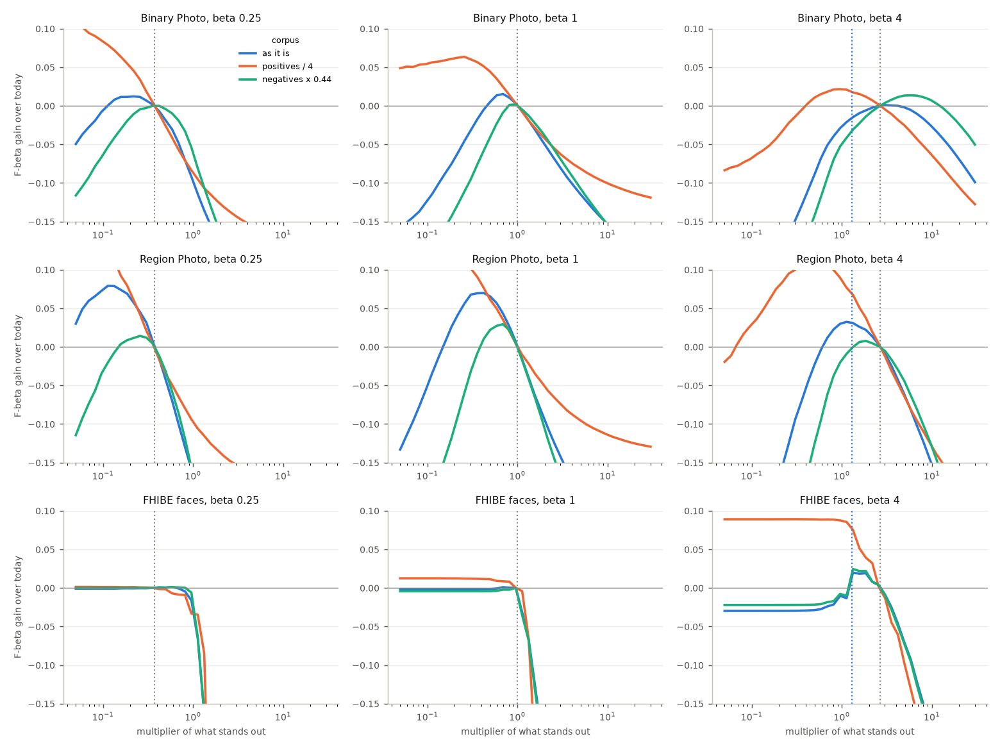
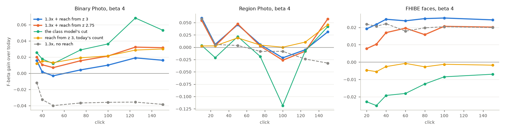
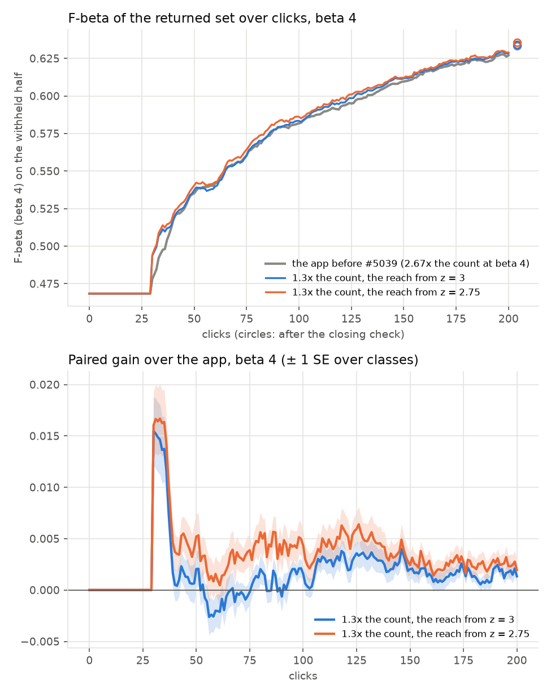
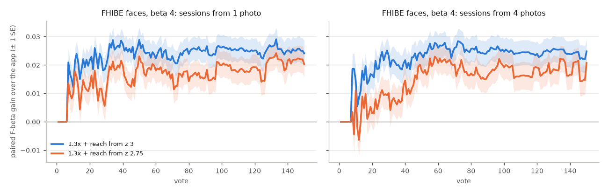
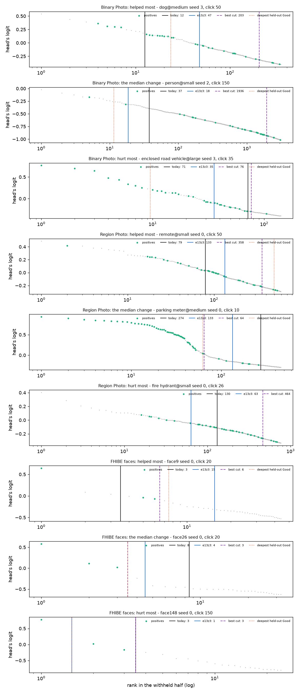

# The head's count line at beta 4: keep 1.3x what stands out, and reach down the head's tail only where a held-out Good sits below it (issue #5039)

**Status (2026-10-18): offline on every snapshot on the head's count line of three benches (Binary Photo, Region
Photo, FHIBE faces) in four corpora each, and closed loop at beta 4 on Binary Photo (720 sessions per arm) and FHIBE
faces (1,124 per arm). Region Photo is offline only. Both rules gain on both closed-loop benches; which one ships, if either, is the owner's
call: in this branch the app is unchanged (both knobs default off).**

**The count does not need to follow the balance more steeply. At beta 1 and beta 1/4 it is about the F-beta-best
count already. At beta 4 the benches pull opposite ways, and the one that sits on this line all session (faces)
wants fewer, not more.** While the class model holds fewer than 6 held-out Goods the line is the head's count
(#4786, #4798): `beta ** 0.708` times what stands out in the head's scores. #4937 read its set against the
F-beta-best set's (0.14 at beta 4, 0.57 at beta 1 and 1.2 at beta 1/4 on Binary) and asked for a count that tracks
the balance. Priced in F-beta instead of set size, on Binary, Region and faces:

1. **Below beta 4 the count is not the problem.** At beta 1 the F-beta-best multiplier on Binary is 0.69 (+0.015),
   not more than 1: a set at 0.57 of the best set's size is not what costs F-beta there. At beta 1/4 it is 0.22
   (+0.012) at 0.44% prevalence and today's at 1%. Faces are flat at both, because the count keeps the drop below a
   person's photos there.
2. **At beta 4 the benches disagree.** Faces want 1.3x what stands out (+0.020), Region 1.1x (+0.032), and Binary
   is level at today's 2.67x on average over classes, but a weak head needs far more: 10x keeps the median set from
   0.16 to 0.62 of the best set's at votes 30 to 50. A steeper exponent (the issue's first candidate) loses 0.20 on
   faces and 0.15 on Region. Faces are on this line for every trained click, Binary for 15% of its trained clicks,
   Region for 11%.
3. **What tells a weak head apart is the labels, not the scores.** Reaching down the head's tail (keeping as deep
   as its excess over a Gaussian bulk is expected to score best) helps Binary at beta 4 but costs faces 0.023 to
   0.080: 57% of face snapshots have more bulk above 3 spreads than a Gaussian puts there, and none of it is the
   person. A held-out Good ranked below what stands out is the evidence that the positives sit deeper:
   it does so in 46% of Binary's snapshots at beta 4, 38% of Region's and 22% of faces'.
4. **The rule: above beta 1, the count grows as `beta ** 0.189` (1.3x at beta 4); where a held-out Good ranks below
   what stands out, the line keeps at least as deep as the head's excess curve's expected F-beta peaks, read from 3
   bulk spreads up.** Offline it gains at beta 4 on every bench at 0.1%, 0.44% and 1% prevalence (+0.005 to +0.063),
   and keeps fewer images than today on a corpus with no positives. Beta 1/4 and 1 are today's line exactly.
5. **Closed loop at beta 4, the sessions themselves:** on faces Find's mean F-beta over votes 1 to 150 rises +0.023
   (± 0.003) from 1 photo and +0.022 (± 0.004) from 4, in 79% to 80% of people; on Binary, where this line serves 15%
   of the trained clicks, +0.0017 (± 0.0005) over clicks 0 to 200 and +0.0007 (± 0.0009) after the closing check.
   From z 2.75 the reach gives Binary twice that (+0.0035, +0.0023 after the check) and faces about a quarter less
   (+0.017, +0.015).

| beta 4, per click on the head's count line (mean over classes; people on faces) | Binary Photo | Region Photo | FHIBE faces |
|---|---|---|---|
| clicks on the head's count line (share of a session's trained clicks) | 15% (45% before vote 50) | 11% (64% before vote 25) | 100% |
| today's F-beta / the best cut's | 0.31 / 0.43 | 0.48 / 0.62 | 0.84 / 0.94 |
| **1.3x + reach from z 3**: F-beta gain at 0.44% / 0.1% / 1% | **+0.015 / +0.029 / +0.005** | **+0.041 / +0.048 / +0.018** | **+0.024 / +0.063 / +0.030** |
| 1.3x + reach from z 2.75 | +0.023 / +0.029 / +0.018 | +0.039 / +0.040 / +0.022 | +0.016 / +0.051 / +0.028 |
| 1.3x, no reach | -0.016 / +0.018 / -0.032 | +0.032 / +0.069 / -0.001 | +0.020 / +0.076 / +0.025 |
| the reach alone (today's count) | +0.014 / +0.005 / +0.014 | +0.006 / -0.007 / +0.006 | -0.003 / -0.009 / +0.000 |
| a steeper exponent: 10x what stands out | -0.027 / -0.064 / +0.007 | -0.153 / -0.129 / -0.130 | -0.196 / -0.245 / -0.203 |
| the class model's cut instead (0.44%) | +0.030 | -0.000 | -0.019 |
| images kept on a corpus with no positives: today / 1.3x + reach z 3 (mean) | 92 / 88 | 386 / 242 | 9.6 / 5.3 |
| **closed loop, 1.3x + reach z 3**: Find's mean F-beta gain per session (Binary clicks 0-200; faces votes 1-150, from 1 / 4 photos) | **+0.0017 (± 0.0005)** | not run | **+0.023 (± 0.003) / +0.022 (± 0.004)** |
| … 1.3x + reach z 2.75 | +0.0035 (± 0.0007) | not run | +0.017 (± 0.004) / +0.015 (± 0.004) |

*Faces' corpora are at a person's own prevalence (about 4 of 5,439 crops, 0.07%), their thinned and sparse
versions at about 0.02% and 0.17%. ± one SE over classes is in `tables/offline_b4.csv`: 0.004 to 0.010 on Binary and
Region, 0.002 to 0.004 on faces.*

## The question

From #4937 (`docs/experiments/2026-10-16-early-line-4937/`): early in a session a third of Binary Photo's snapshots
hold fewer than 6 held-out Goods, and their line is the head's count line (#4786, #4798). Its set is a median 0.14
of the F-beta-best set at beta 4, 0.57 at beta 1 and 1.2 at beta 1/4, because the count grows as `beta ** 0.708`
(2.7x between beta 1 and 4) while the best set grows far more. The issue asks for a count that tracks the balance,
priced in F-beta at all three presets, on the same heads and closed loop, with three candidates: a steeper or
path-specific exponent; at beta 4, handing over to the class model sooner; or anything that reads the best set's
size from the head's scores more directly.

## What was run

| | |
|---|---|
| Binary and Region snapshots | #4937's: today's app (dev 73c887c27), Binary Photo, `coco_better`, 144 class@band cells x 5 seeds at beta 1/4, 1 and 4, withheld half saved at votes 10 to 150; Region Photo from #4936's seed-0 run at beta 1. Every snapshot whose line was the head's count line (`mall/snapshots.csv.gz`'s `head_count`, outside the typed query's hold): 3,624 Binary, 201 Region |
| faces snapshots | new: FHIBE face crops at 1024 px (`fhibe_faces_roll_1024`), the face review's 562 people, sessions from 1 and from 4 photos, at beta 1 and 4, on dev 738219cc7 (after #5040), withheld half saved at votes 20 to 150 (`CALIB_SAVE_TEST_SCORES_AT`). Every snapshot is on the head's count line: 15,736 |
| corpora | each snapshot's withheld half as it is; its positives thinned to a quarter (Binary and Region about 0.1%); its negatives thinned to 0.44 (about 1%): the State of the App's three prevalences (#4959); and its negatives alone (#4452's corpus with no positives) |
| pricer | `head_count_5039.py price`: each candidate's line drawn by the library itself, `fit_labels_line` on the held-out votes and `head_count_cut` on the corpus with the class model's held-out Goods, under the candidate's knobs; every snapshot read at all three presets. `grid` reads any multiplier of what stands out with the preset's own gap floor; at `beta ** 0.708` it is the library's count on all 234,732 rows |
| library arm | `labels_line.HEAD_COUNT_RECALL_EXPONENT` and `HEAD_COUNT_RECALL_Z`, set for a run by `head_count_recall()` (`CALIB_HEAD_COUNT_RECALL_EXPONENT`, `CALIB_HEAD_COUNT_RECALL_Z`) |
| closed loop | `head_count_5039.sh` arms from frozen worktree `vts-5039-arm` (4f5963abf): `ctl` (both knobs off, the app), `e13z3` (exponent 0.18925, reach from z 3), `e13z275` (the same from z 2.75). Binary Photo at beta 4, 5 seeds x 144 cells, 200 clicks and the closing check, paired by cell and seed, as #5040's closed loop ran; FHIBE faces at beta 4 (`sota_face.sh`, 562 people x sessions from 1 and 4 photos, 1024 px, 150 votes), paired by person. Beta 1/4 and 1: two sessions each, arm against control, file for file |

Every ± is one SE over classes (a class's bands, seeds and clicks averaged first); on faces a class is a person, and
their sessions from 1 and from 4 photos and at both presets are averaged first.

## Below beta 4, the count is about right



*F-beta gain over today's line of keeping c times what stands out (the preset's gap floor kept), per bench (rows) and
preset (columns), on the head's count line's snapshots. Dotted grey: today's multiplier, `beta ** 0.708`; dotted
blue at beta 4: 1.3x.*

| best multiplier (its F-beta gain over today) at 0.44% / 0.1% / 1% | beta 1/4 (today 0.375) | beta 1 (today 1) | beta 4 (today 2.67) |
|---|---|---|---|
| Binary Photo | 0.22 (+0.012) / 0.05 (+0.106) / 0.36 (+0.000) | 0.69 (+0.015) / 0.26 (+0.064) / 0.96 (+0.002) | 3.0 (+0.001) / 0.96 (+0.022) / 5.8 (+0.014) |
| Region Photo | 0.11 (+0.079) / 0.05 (+0.196) / 0.26 (+0.014) | 0.42 (+0.070) / 0.07 (+0.156) / 0.69 (+0.029) | 1.1 (+0.032) / 0.59 (+0.109) / 1.8 (+0.008) |
| FHIBE faces (0.07% / 0.02% / 0.17%) | flat (+0.001) | flat (+0.001 / +0.012 / +0.000) | 1.3 (+0.020) / 0.30 (+0.089) / 1.3 (+0.025) |
| a multiplier of 2.7 (today's at beta 4) instead, at 0.44%: Binary / Region / faces | -0.21 / -0.30 / -0.47 | -0.07 / -0.12 / -0.30 | +0.000 / +0.003 / +0.004 |

*Mean over classes, the multiplier grid's 40 steps from 0.05 to 30 (`tables/grid_best.csv`). On faces, at beta 1/4
and 1, every multiplier at or below today's keeps the same set.*

- **Beta 1: the 0.57 set ratio is not an F-beta shortfall.** The best multiplier on Binary is 0.69 at 0.44%, 0.96 at
  1% and 0.26 at 0.1%: a count of what stands out already keeps about what F-beta wants on average, and keeping
  more loses at every prevalence. The F-beta-best set is the argmax of a flat, noisy curve; a line that keeps half
  its size can score as well.
- **Beta 1/4: a little lower would pay at 0.44% and 0.1%, not at 1%.** 0.22x instead of 0.375x gains +0.012 at
  0.44%, loses nothing at 1%, and at 0.1% the best is the floor of the grid (the drop below the top keeps the set).
  Not changed here: the trade moves with prevalence, which is the count's own problem (#5084).
- **Faces are flat at both:** the count keeps the drop below a person's photos (the gap floor), which is their set.
- **Region wants about 0.3 to 0.4x at every preset** (+0.07 to +0.08 at beta 1/4 and 1). Its max-pooled patch scores
  have a heavier upper bulk than a Gaussian (the count reads 2.6x its positives), so what stands out overcounts. That
  is a property of the patch path at every balance, not of beta: #5084.

## At beta 4 the benches pull apart

- **Faces and Region want fewer: 1.3x (+0.020) and 1.1x (+0.032).** A person's photos stand above a light-tailed bulk,
  so what stands out is their count, and 2.67x it keeps two to three bulk faces per photo.
- **Binary is level at today's 2.67x on average over classes (+0.001 at 3.0x), but not per session.** Today's line
  keeps a median 0.16 of the best set's at votes 30 to 50 and 0.09 by votes 100 to 150; 10x keeps 0.62 there. On the
  hardest classes, the ones that stay on this line longest, 10x gains; on the rest it loses. No one multiplier serves
  them both.
- **The issue's steeper exponent loses everywhere but Binary at 1%:** -0.20 to -0.25 on faces, -0.13 to -0.15 on
  Region, -0.03 to -0.06 on Binary at 0.44% and 0.1%.
- **The issue's hand-over to the class model at beta 4 gains on Binary (+0.030; +0.023 at votes 30 to 50, +0.054 by
  100 to 150) and loses on faces (-0.019) and Region (-0.000).** With 2 to 5 held-out Goods the class model's cut
  (#5040's chances) is sound on Binary's weak heads and too deep on a person's, whose line is the count all session.

## Reaching down the tail, where the labels say to



*At beta 4, on the withheld half as it is, each candidate's gain over today's line per listed click (snapshots on the
head's count line; mean over classes). 10x is off the scale (-0.03 to -0.21) and in the tables.*

The excess curve: at the k-th best image of the head's ranking, the count above it less what a Gaussian bulk (the
corpus logits' median and MAD, as #4603's count reads them) puts above its score. Read as positives found by a cut
there, with the largest excess from z bulk spreads up as the positives' total, it gives every cut an expected
F-beta, and the reach keeps at least as deep as that peaks (`_excess_depth`).

- **Ungated, it helps Binary and costs faces.** At beta 4, today's count with the reach from z 3 for every session
  gains +0.023 on Binary at 0.44% and costs faces 0.023 at 0.07% and 0.080 at 0.02%; with the count at 1.3x the
  ungated reach still costs faces 0.010 and 0.035 (`z3_open`, `e13z3_open` in `tables/offline_b4.csv`). In 57% of
  face snapshots the bulk has more crops above 3 spreads than a Gaussian puts there (median 8 against 7.3, up to
  108), none of them the person's, and the reach keeps them. An allowance for the bulk's Poisson noise, tried in
  exploration, did not separate them.
- **Gated on a held-out Good below what stands out, it helps both.** Where the class model's deepest held-out Good
  ranks below the count at beta 1, a positive the count misses is in hand. That is 46% of Binary's snapshots at beta
  4, 38% of Region's, 22% of faces' (where the reach then moves the line in 10%: their held-out Goods sit just below
  a tight count). The gate reads the count at beta 1, so the line stays monotone in beta.
- **The count at 1.3x alone gains on faces and Region and loses on Binary** (-0.016 at 0.44%): the reach is what
  makes the smaller count safe for weak heads.
- **z 3 or 2.75.** From 2.75 the reach goes deeper: +0.008 on Binary at 0.44% and +0.013 at 1%, -0.008 on faces at
  0.07% and -0.012 at 0.02%. Faces carry about seven times Binary's weight in this line's clicks (all their trained
  clicks against 15%).

| beta 4, the corpus as it is (medians) | Binary Photo | Region Photo | FHIBE faces |
|---|---|---|---|
| positives in the corpus | 50 | 50 | 4 |
| held-out Goods in the class model | 2 | 4 | 2 |
| what stands out (the count at beta 1) | 27 | 127 | 3 |
| the deepest held-out Good's rank in the corpus | 68 | 222 | 3 |
| a held-out Good ranks below what stands out (the gate opens) | 46% | 38% | 22% |
| … and the reach from z 3 moves the line | 44% | 38% | 10% |
| images above 3 bulk spreads (a Gaussian bulk's) | 128 (15) | 309 (15) | 8 (7.3) |
| snapshots with more there than a Gaussian's | 93% | 100% | 57% |

*`tables/gate_b4.csv`, `tables/bulk_z3.csv`. Region's and Binary's heads' bulk has a far heavier upper tail than a
Gaussian: most of their excess above 3 spreads is negatives, which is why the reach is a recall-only rule and why
Region's count of what stands out reads 2.6x its positives.*

## The closed loop

The head's count line is Train's line too while it serves, so the rule can change the session, not only the set Find
returns. Arms against the app, paired run for run (`tables/ab_*.csv` for Binary from `head_count_5039_ab.py`,
`tables/faces_ab*.csv` for faces from #4776's `prior_4776.py --pair`).



| Binary Photo, beta 4, 720 sessions per arm | 1.3x + reach from z 3 | 1.3x + reach from z 2.75 |
|---|---|---|
| Find's mean F-beta over clicks 0-50 / 0-200, gain (± SE over classes) | +0.0025 (± 0.0007) / **+0.0017 (± 0.0005)** | +0.0036 (± 0.0007) / **+0.0035 (± 0.0007)** |
| … after the closing check | +0.0007 (± 0.0009) | +0.0023 (± 0.0013) |
| … at the first click the detector is shown (35) | +0.014 | +0.016 |
| by band, clicks 0-200: large / medium / small | +0.0011 / +0.0018 / +0.0022 | +0.0013 / +0.0038 / +0.0055 |
| sessions that part from the control's picks; where | 20%, every one where the flow's phase does | 30%, the same |
| Done: clicks later (mean); F-beta at Done | +0.5; +0.003 (± 0.002) | +3.0; +0.011 (± 0.002) |
| Goods found by click 200 (the app's 27.8); AP at 200 | 27.8; +0.000 | 27.8; +0.000 |

- **Pairing:** every session is the control's until the rule first draws a different line. No session parted on a
  pick whose acquisition threshold had moved, none for a reason outside the flow's phase (a later Done), and the F shown agreed with the control's up to the first click that shows a detector on
  all 720 (`departed_otherwise` and `f_prefix_mismatch` 0).
- **The gain is the early clicks' and a deeper set later**, small per session because the line serves 15% of Binary's
  trained clicks. Both rules are ahead in every band, after the closing check and at Done.



| FHIBE faces, beta 4, 562 people per set | 1.3x + reach z 3: from 1 photo / from 4 | 1.3x + reach z 2.75: from 1 / from 4 |
|---|---|---|
| Find's mean F-beta over votes 1-150 (today's 0.830 / 0.846), gain | **+0.023 (± 0.003) / +0.022 (± 0.004)** | +0.017 (± 0.004) / +0.015 (± 0.004) |
| … votes 1-50 / 51-150 | +0.020 / +0.025; +0.017 / +0.025 | +0.013 / +0.018; +0.007 / +0.018 |
| people it helps / hurts over votes 1-150 | 79% / 20%; 80% / 20% | 76% / 23%; 75% / 25% |
| images Find keeps (median at votes 25 to 150; today's) | 4 (8) | 4 to 5 (8) |
| AP over votes 1-150 | +0.000 | +0.000 |

- **On faces the gain is the line's:** AP does not move, so the ranking is the control's, and the line keeps a
  median 4 images, a person's withheld photos, where today's keeps 8.
- **Beta 1/4 and 1 are today's sessions.** Two sessions per preset, arm against control: every file the cells write is
  the same value for value, but for the rank frames' `test_line_k_b4` column (what the line would keep at beta 4, a
  reading, not the session).
- **Region Photo was not run closed loop** (about a day at Region's memory, 20 GB a session); offline it gains at
  every prevalence (+0.018 to +0.048) and its line serves 11% of its trained clicks, 64% of them before vote 25.

## Literal examples

Snapshots at beta 4 on the withheld half as it is, picked by rule among those the rule (1.3x + reach from z 3)
moves: the one it helps most, the median among those whose F-beta it changes, the one it hurts most, per bench
(`head_count_5039.py examples`; `tables/examples_e13z3.csv`). "What stands out" is the count at beta 1.



*Each row is one snapshot: the withheld half's head logits by rank (log scale), positives green; today's cut
(black), the rule's (blue), the best cut (purple dashes) and the deepest held-out Good's rank (orange dots).*

| example | session | seed | click | held-out Goods | what stands out | deepest held-out Good's rank | kept today / rule / best | F-beta today / rule / best |
|---|---|---|---|---|---|---|---|---|
| Binary, helped most | dog@medium | 3 | 50 | 4 | 5 | 23 | 12 / 47 / 203 | 0.11 / 0.41 / 0.56 |
| Binary, the median change | person@small | 2 | 150 | 2 | 14 | 11 | 37 / 18 / 1,936 | 0.041 / 0.042 / 0.19 |
| Binary, hurt most | enclosed road vehicle@large | 3 | 35 | 4 | 27 | 9 | 71 / 35 / 76 | 0.62 / 0.43 / 0.64 |
| Region, helped most | remote@small | 0 | 50 | 4 | 30 | 496 | 79 / 133 / 358 | 0.23 / 0.43 / 0.49 |
| Region, the median change | parking meter@medium | 0 | 10 | 4 | 103 | 62 | 274 / 133 / 64 | 0.78 / 0.81 / 0.83 |
| Region, hurt most | fire hydrant@small | 0 | 26 | 0 | 49 | - | 130 / 63 / 464 | 0.29 / 0.13 / 0.45 |
| faces, helped most | person 9, 1 photo | 0 | 20 | 2 | 1 | 7 | 3 / 15 / 6 | 0.33 / 0.81 / 0.94 |
| faces, the median change | person 26, 1 photo | 0 | 20 | 2 | 3 | 3 | 8 / 4 / 3 | 0.91 / 0.98 / 1.00 |
| faces, hurt most | person 148, 1 photo | 0 | 150 | 2 | 1 | 1 | 3 / 1 / 3 | 1.00 / 0.35 / 1.00 |

- **`dog@medium` seed 3 is the reach at work.** Five images stand out; a held-out Good ranks 23rd, so the
  positives go deeper. Today's 2.67x keeps 12; the rule reaches to 47, where the excess curve's expected F-beta
  peaks, and F-beta goes from 0.11 to 0.41 (the best cut keeps 203 for 0.56).
- **The losses are the count at 1.3x where no Good sits below it.** `enclosed road vehicle@large` seed 3: 27 stand
  out, the held-out Goods all rank above that, and the 1.3x count keeps 35 of a best set of 76 (0.62 to 0.43). Person
  148 at click 150: one face stands out above a wide drop, so the count is 1; 2.67x of it kept the other two photos
  by luck, 1.3x keeps one. On Region `fire hydrant@small` the class model holds no held-out Good at all (a stand-in
  draws the line), so nothing opens the reach.
- **The common case on faces is the median one:** 3 photos stand out, 2.67x keeps 8, 1.3x keeps 4 (0.91 to 0.98).

## What this leaves

- **The count of what stands out counts the bulk's heavy tail: #5084.** Above 3 spreads Binary's heads hold a median
  128 images where a Gaussian bulk puts 15, Region's 309; so Region's count reads 2.6x its positives at every preset
  (best multiplier 0.11 at beta 1/4, 0.42 at beta 1), and below beta 4 Binary's best multiplier moves with
  prevalence (0.05x at 0.1%, 0.7x at 0.44%, 1x at 1%, beta 1). That is the count itself, not beta, and it needs a
  Region closed loop (about a day of Region's memory).
- **The class model's cut on Binary's weak heads** gains +0.030 at beta 4 with 2 to 5 held-out Goods (#5040's
  chances), as much as the reach, and loses 0.019 on faces. Not pursued: the reach gets most of it on Binary and
  keeps faces' gain.

## Provenance

| | |
|---|---|
| code | dev 738219cc7 (#5080 merged) for the face snapshots; the arms from frozen worktree `vts-5039-arm` at 4f5963abf (branch `claude/head-count-5039`) |
| snapshots | Binary and Region: #4937's (`/expscratch/sgreenberg/state-of-the-app/2026-10-16-fscale4936-early4937-binary-b{025,1,4}`, `2026-10-15-fscale4936-region-b1`); faces: `<FHIBE release>-derived/runs/2026-10-18-5039snap-roll-k{1,4}-b{1,4}` (owner-only), 2,248 sessions 06:15-07:05 |
| extraction | `head_count_5039.py extract` / `extract-faces` -> `/expscratch/sgreenberg/head-count-5039/x{br,f}/`; today's count reproduced on every Binary snapshot (0 mismatches of 3,624) |
| pricing | `head_count_5039.py price` (234,732 rows) and `grid` -> `/expscratch/sgreenberg/head-count-5039/{priced,grid}/`; tables in `tables/`, figures in `figures/` |
| closed loop | Binary: `/expscratch/sgreenberg/state-of-the-app/2026-10-18-headcount5039-{ctl,e13z3,e13z275}-b4`, per arm one V100 pack (GPU hidden, 360 sessions, 60 at a time) and seven cpu packs (8 at a time), 07:17-09:54; faces: `<FHIBE release>-derived/runs/2026-10-18-5039{ctl,e13z3,e13z275}-roll-k{1,4}-b4` (owner-only), one cpu pack per arm (30 at a time), 07:06-09:04; identity smokes `2026-10-18-headcount5039smoke-*-b{025,1,4}` |

## Reproduce

```bash
S=/expscratch/$USER/state-of-the-app
P=scripts/experiments/state_of_app/head_count_5039.py
python $P extract --snapshots /expscratch/$USER/early-line-4937/mall/snapshots.csv.gz \
  --results $S/2026-10-16-fscale4936-early4937-binary-b025/results --results $S/2026-10-16-fscale4936-early4937-binary-b1/results \
  --results $S/2026-10-16-fscale4936-early4937-binary-b4/results --results $S/2026-10-15-fscale4936-region-b1/results --out x --procs 32
# faces: sota_face.sh with SOTA_FACE_TAG=5039snap SOTA_FACE_ARM=roll SOTA_FACE_BASE=2026-10-11-prep-roll SOTA_FACE_BETAS="1 4"
#   SOTA_FACE_SIZES=1024 CALIB_SAVE_TEST_SCORES=1 CALIB_SAVE_TEST_SCORES_AT=20,30,40,60,80,100,150 (dirs, tasks, pack)
python $P extract-faces --runs <runs>/2026-10-18-5039snap-roll-k1-b1 ... --out x
python $P price --x x --out priced --procs 32 --class-cut
python $P grid --x x --out grid --procs 32
D=docs/experiments/2026-10-18-head-count-5039
python $P report --priced priced --grid grid --docs $D/tables --figs $D/figures --faces-ab <prior_4776 out>
python $P examples --x x --priced priced --arm e13z3 --docs $D/tables --figs $D/figures
# the closed loop, from a frozen worktree
L=scripts/experiments/state_of_app/head_count_5039.sh
bash $L dirs && for arm in ctl e13z3 e13z275; do CALIB_PACK_JOBS=15 CALIB_PACK_PAR=8 bash $L cpack $arm 4; done
python scripts/experiments/state_of_app/head_count_5039_ab.py --root $S --date 2026-10-18 --seeds 5 --betas 4 \
  --baseline <text_baseline.csv> --out <dir> --docs $D/tables
# faces: sota_face.sh per arm with SOTA_FACE_TAG=5039<arm> SOTA_FACE_BETAS=4 SOTA_FACE_SIZES=1024 and the arm's
#   CALIB_HEAD_COUNT_RECALL_EXPONENT / _Z; then scripts/experiments/fhibe/prior_4776.py --pair k1-<arm>=<arm cells>::<ctl cells> ...
```
