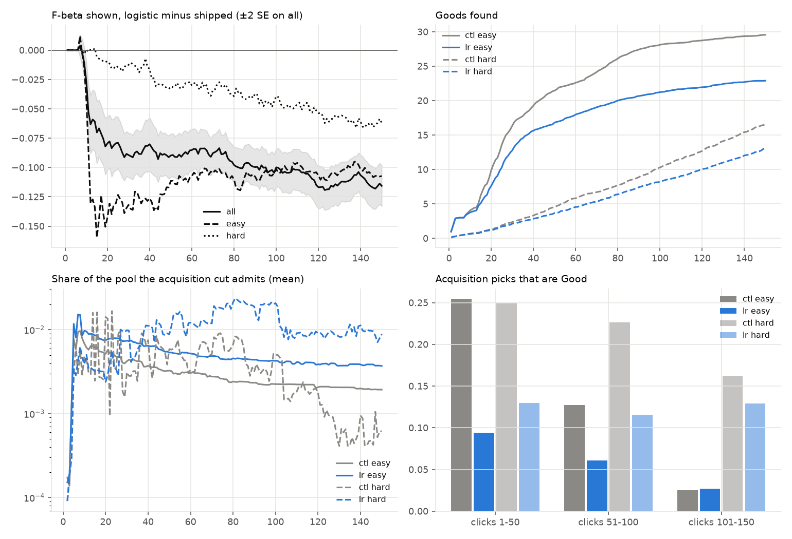
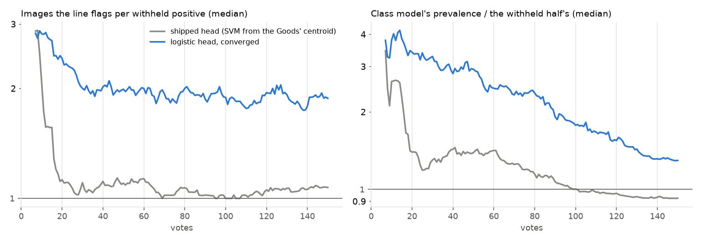

# The converged logistic head on Region Photo, re-measured on today's app: it loses through the line, not a drifting cut (issue #4278)

**Status (2026-10-19): closed loop on Region Photo at beta 1, today's shipped head against the converged logistic
head, 2 seeds x 144 cells, 288 sessions per arm paired by cell and seed. Nothing ships: neither of the issue's two
routes is worth building, and the head switch is not worth reopening on Region.**

**On today's app the logistic head loses on Region in every class, by more than it did in September, and the loss
is mostly where its line is drawn.** #4213 (2026-09-28) found the logistic head's acquisition cut drifting down as
Bad images flooded region rows into the fit, so easy classes found 11.1 positives by vote 150 against the SVM's
18.8. Acquisition and the shipped head have both changed since. Re-measured:

1. **It loses everywhere.** Over votes 1 to 150 the F-beta the app shows is **0.090 lower (± 0.007)**, and the
   user has found **7.3 fewer Goods** by vote 150 (21.4 against 28.6). It is lower in both seeds (-0.091, -0.088),
   in all 49 classes, in 85% of sessions, and in every band and stratum: easy -0.105, mid -0.110, hard -0.034.
2. **About three quarters of it is the line.** At vote 150 the logistic head's F-beta is 0.116 lower. Its
   ranking accounts for 0.027 of that (the oracle's F-beta, the best cut on the same scores), and its line for
   the rest: it sits 0.153 below its own oracle, where the shipped head's sits 0.064 below.
3. **The line is too loose because the class model over-counts the positives.** The labels line and
   Autopilot's acquisition both read one class model fitted to the head's scores (#3546, #4452). On the logistic
   head's scores it puts the prevalence at 2.9x the truth at vote 50 and 1.3x at vote 150, against 1.4x and 0.93x
   on the shipped head's. So the line flags about 1.9 images per withheld positive (shipped: 1.1) at precision 0.36
   (shipped: 0.66), and the acquisition target admits more of the pool, whose picks are Good 11% of the time
   over votes 1 to 50 against 26%. Fewer Goods found then feed fewer positives back into the fit.
4. **No hard-class ranking gain is left to protect.** The issue set a condition for reopening the head switch:
   close the easy-class loss while keeping the logistic head's ranking gain on hard classes (oracle -0.037 against
   the plain SVM in #4213). Against today's head (the SVM started from the Goods' centroid, #4785) that gain has
   reversed: oracle F-beta -0.020 (± 0.007), AP -0.017 (± 0.007) on the hard quartile.

| Region Photo, beta 1, logistic minus shipped (± one SE over classes) | all (288) | easy (72) | mid (144) | hard (72) |
|---|---|---|---|---|
| **F-beta shown, mean over votes 1-150** | **-0.090 (± 0.007)** | -0.105 (± 0.017) | -0.110 (± 0.009) | -0.034 (± 0.006) |
| F-beta shown, mean over votes 1-50 | -0.066 (± 0.008) | -0.106 (± 0.019) | -0.074 (± 0.011) | -0.012 (± 0.003) |
| F-beta at vote 150 | -0.116 (± 0.009) | -0.107 (± 0.022) | -0.147 (± 0.012) | -0.062 (± 0.013) |
| ... of which the ranking (oracle F-beta at vote 150) | -0.027 (± 0.005) | -0.024 (± 0.006) | -0.031 (± 0.008) | -0.020 (± 0.007) |
| AP at vote 150 | -0.029 (± 0.005) | -0.024 (± 0.008) | -0.037 (± 0.008) | -0.017 (± 0.007) |
| Goods found by vote 150 (shipped -> logistic) | 28.6 -> 21.4 | 29.6 -> 22.9 | 34.2 -> 24.7 | 16.6 -> 13.2 |
| Acquisition picks that are Good, votes 1-50 (shipped / logistic) | 26% / 11% | 25% / 9% | 26% / 12% | 25% / 13% |
| Images the line flags per withheld positive, vote 150 (median) | 1.07 / 1.88 | 1.06 / 1.29 | 1.10 / 2.07 | 0.99 / 3.46 |
| Class model's prevalence / the truth, vote 50 -> 150 (median) | 1.39 -> 0.93 / 2.93 -> 1.30 | 1.30 -> 1.05 / 2.10 -> 1.18 | 1.50 -> 1.00 / 3.32 -> 1.39 | 1.14 -> 0.62 / 3.83 -> 1.40 |

*Strata are #4213's, so the two studies read the same classes: the easiest and hardest quartiles of the 144
cells by the AP of an arm independent of both heads here (`docs/experiments/2026-09-28-head-switch-4219/region_categories.txt`);
mid is the 72 between them. Every number is in `tables/lr4278_summary.csv`; per session in `tables/lr4278_per_run.csv`.*



## The question

From #4219 / #4213 (`docs/experiments/2026-09-28-head-switch-4219/REPORT.md`): the converged logistic head
(`linear_logreg`, #4114) ranked better than the then-shipped linear SVM in both voting modes, but under Region
voting it lost on easy classes (cost +0.014 ± 0.004; 11.1 Goods by vote 150 against 18.8). The mechanism read off
Autopilot's picks: as Bad votes piled up, the logistic head's acquisition cut drifted down (score 0.47 -> 0.34,
against the SVM's 0.50 -> 0.42), admitted more of the pool (4.2% against 3.0%), and its late Hard picks were Good
2.4% of the time against 7.1%. The issue proposed two fixes, capping or reweighting each Bad bag's region rows in
the logistic fit, or anchoring acquisition to a pool quantile, and asked to confirm the mechanism first.

A premise check on the issue (2026-09-30) asked for a re-measure on current `dev` before anything was built,
because acquisition had already moved. By 2026-10-18 three things had changed:

- **Acquisition** samples at the labels line's 0.5 posterior (#3546), from a class model fitted to the head's own
  scores (#4452). A head whose scores all shift down cannot drag that cut down with them.
- **The shipped head** is the linear SVM started from the Goods' centroid (`linear_svm_prior`, #4785), in every
  space including Region's patch bags. On Region it ranked slightly better than the plain SVM.
- **The objective** is the withheld half's F-beta, not FPR + FNR.

So the control here is today's app, and the question is the issue's own: does the logistic head still lose on
easy Region classes, and if so, is it the cut?

## Setup

- **Arms** (`scripts/experiments/state_of_app/logreg_region_4278.sh`): `ctl`, the app as it ships
  (`CALIB_HEAD` unset, so `PRODUCTION_HEAD = linear_svm_prior`), and `lr`, `CALIB_HEAD=linear_logreg`:
  scikit-learn's `LogisticRegression(C = 1, balanced, L2)` fitted to convergence, lifted into the same
  `Linear(D, 1)`. Nothing else differs; preflight passed both, `lr` declaring `head` as its only divergence.
- **Bench:** Region Photo on COCO Better, the grid #4743 priced (`state-of-the-app/2026-10-08-b1`): DINOv3 patch
  bags with max-patch scoring, opened on SigLIP's text sort, all 144 class x band cells at 0.44% prevalence, beta 1,
  150 votes plus the closing check, trajectory pass. Seeds 0 and 1, paired by cell and seed: 288 sessions per arm.
- **Read** (`scripts/experiments/state_of_app/logreg_region_4278.py`): per vote, the F-beta the app shows (the
  typed query's set until a detector is on screen, then the detector's line, as `early_check_4664.py` scores
  it), AP, the oracle's F-beta, Goods found, the share of the pool the acquisition cut admits, and how often each
  kind of pick is Good. Means are over sessions, SEs over classes, because a class's bands and seeds are not
  independent.

## Why it loses: the class model reads the logistic head's scores as holding twice the positives



The labels line draws the detector's line where the class model expects the best F-beta. Autopilot's acquisition
samples where the same model's posterior crosses 0.5. Both read the model's idea of how many positives the corpus
holds. On the shipped head's scores that idea is close to right once the session is under way: 1.4x the truth at
vote 50, 0.93x by vote 150. On the logistic head's scores it is 2.9x at vote 50 and still 1.3x at vote 150, and it
is worst on the hard quartile (3.8x at vote 50). A model that expects twice the positives draws a looser line and
a lower acquisition target:

- **The line** flags about 2 images per withheld positive from vote 20 on, where the shipped head's flags 1.1.
  Its recall is higher (0.87 against 0.77 at vote 150), but its precision is about half (0.36 against 0.66), and at
  beta 1 that costs far more than the recall buys: the line sits 0.153 below its own oracle at vote 150, against
  0.064 for the shipped head.
- **Acquisition** admits about three times the share of the pool at vote 100 (median 0.26% against 0.09%), and its
  picks land among negatives: Good 11% of the time over votes 1 to 50 against 26%, 10% against 23% over votes 51
  to 100. The logistic arm spends more votes in Hard (24 picks a session against 14), at a Good rate of 8%
  against 21%.

Fewer Goods found means fewer positives to fit on, so part of the logistic head's ranking loss (oracle F-beta
-0.027 at vote 150) is likely its own trajectory rather than its loss function. Separating the two would take a
replay of both heads on the same votes, which this study did not run. It does not change the verdict: on the
sessions the user actually has, the logistic head ranks worse and draws a worse line.

This is not the September mechanism. The logistic head's cut does not loosen as Bad votes pile up, which is what
#4213 saw: on easy classes both heads' cuts tighten over the session, the logistic head's from a higher starting
share. Its cut admits more of the pool from the first trained vote on, through the same over-count that loosens
the line.

## What this means for the issue's routes

- **Route 1 (cap or reweight each Bad bag's region rows in the logistic fit)** targets the fit. It might reshape
  the logistic head's scores enough for the class model, but there is no ranking gain on the other side of it:
  the logistic head ranks worse than today's head in every stratum. Building it would be engineering for a head
  that loses even where it used to win.
- **Route 2 (anchor acquisition to a pool quantile)** would leave the line as it is. The line is about three
  quarters of the loss, so even a perfect cut would not close the gap.
- **The head switch** does not meet the issue's own bar for reopening: the easy-class loss is larger (-0.105 over
  votes 1 to 150), and the hard-class ranking gain is gone. If a logistic head were ever reconsidered, its line
  would need a class model that reads logistic scores correctly, and it would have to be priced against
  `linear_svm_prior` on Binary Photo as well, since #4219's Binary win was against the plain SVM under FPR + FNR.

## Checks

- **Pairing.** The opening reads no head (three Goods off the typed query's top, then the Bad phase on its sort),
  so it must be the same pick for pick in both arms. It is: 0 of 288 sessions differ before the first trained
  pick (vote 8), where the arms part as a head change should.
- **Seeds.** Seed 0: -0.091 (± 0.008) over votes 1 to 150, 7.4 fewer Goods. Seed 1: -0.088 (± 0.007), 7.1 fewer.
- **Where cells ran.** Every cell runs with the four CPU-kernel pins (#4110), so a cell's output does not depend on
  its node. The run started on two lanes and was rebalanced mid-run (see below). One cell re-run through the
  queue on a different node type (laptop@small, both arms) matched the original in all 12 output files at
  tolerance 0.
- **Completeness.** 288 of 288 cells per arm; no failed, empty or duplicated cell; no seed-2 cell in either arm.

## Provenance and ops

- **Code:** frozen worktree `vts-4278-run` at `a59929b31` (`dev` `83db1901d` plus the launcher). App venv
  `/expscratch/sgreenberg/vtsearch-venv` (torch 2.14.1, transformers 5.19, numpy 2.2.6, scikit-learn 1.9.1). Results:
  `/expscratch/sgreenberg/state-of-the-app/2026-10-18-logreg4278-{ctl,lr}-region-b1`.
- **Launched** 2026-10-18 20:32 as 3 seeds, one DGX-1 V100 pack per arm (PAR 28, GPU hidden) plus a cpu array
  per arm over the same cells, at `Nice=1000` as the issue asked. A Region cell on the DGX pack took a median
  157 min against 88 min as a cpu task, so at 00:50 the packs were paused (`SIGSTOP` on their `xargs`: in-flight
  cells finished, none started), seed 2 was dropped (2 seeds is #4213's design and resolves this effect several
  times over), and the remaining 254 cells ran from a claims queue served by 34 cpu workers and three DGX
  workers, each running a cell exactly as the launcher would (its captured environment and pack command). The
  last cell finished at 05:05. Lessons: `scripts/experiments/lessons/2026-10-19-*.md`.
- **Smoke** (2 cells x 20 votes, `2026-10-18-logreg4278smoke-*`): heads logged right, opening identical.

## Reproduce

```bash
cd /expscratch/$USER/worktrees/vts-4278-run && source gridenv.sh
L=scripts/experiments/state_of_app/logreg_region_4278.sh
LOGREG4278_SEEDS=2 bash $L dirs
IDX=$(bash $L idx 2)
for arm in ctl lr; do CALIB_CONC=20 bash $L launch $arm 1 "$IDX"; done   # or `gpack` for a V100 node
cd scripts/experiments/state_of_app
python logreg_region_4278.py --root /expscratch/$USER/state-of-the-app --seeds 2 \
    --baseline /expscratch/$USER/state-of-the-app/2026-10-08-b1/text_baseline.csv \
    --strata ../../../docs/experiments/2026-09-28-head-switch-4219/region_categories.txt \
    --out <dir> --docs ../../../docs/experiments/2026-10-18-logreg-region-4278/tables
```
