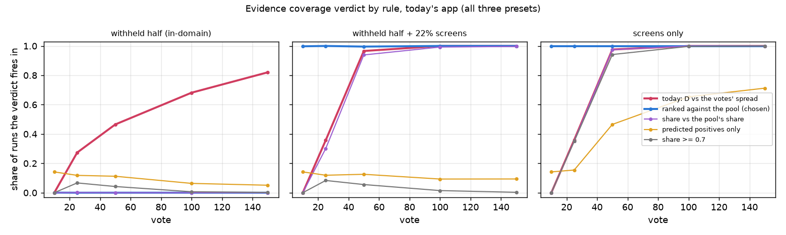
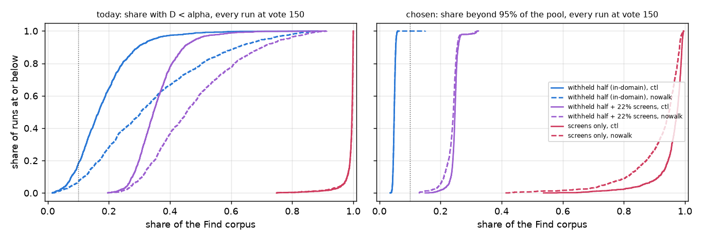

# #5089: the Evidence coverage verdict, ranked against the training haystack

**Answer.** Today's verdict ranks each item's distance to its predicted class's votes against the votes' own
leave-one-out spread. Active learning picks the votes, so they are no sample of their class, and that spread is no
null: in-domain the verdict fires on 81-83% of today's app's runs by vote 150, 93% without the Coverage Atlas walk.
Ranked instead against the training haystack's own media called that class, the verdict fires on 1 of 4,320 in-domain
runs at vote 150 (3 of 21,600 in-domain reads at any click). It still fires on 99.6-100% of runs on the corpus with 22%
screens and 100% on screens alone, at every click from vote 10, where today's verdict cannot fire at all. The owner
chose this rule; this PR ships it, with the two cuts it needs recorded on the detector.

## The bench

#4739's screens legs, re-run with the counts behind the Evidence share: COCO Better, binary SigLIP, 144 cells x 5 seeds,
150 votes, the user's pool at 1% (the withheld half at 0.44%), betas 1/4, 1 and 4, today's app (`ctl`) and New on the
Hard pick (`nowalk`). The Find corpus is the withheld half alone (in-domain), the withheld half plus Apptitude's 3,141
screens (22% of the corpus), or the screens alone. 12,960 runs, none lost.

The re-run is #4739's runs plus columns: run tree `93493df4e` (dev `7a377e33d` plus the counts), cell 0 of both legs
byte-identical to #4739's in every non-timing column, and today's verdict re-derived from the new counts matches the
recorded `evidence_unsupported` in all 64,800 snapshot reads.

At each snapshot click (votes 10, 25, 50, 100, 150) a row now carries, for the Find corpus and for the sim pool's
unvoted media found as a Find there draws it (the harness's training haystack), how many media of each predicted class
sit in an evidence vacuum, and how many Find corpus media sit farther from their class's votes than 95% of the pool's
media called that class.

## The rules

Each is a verdict from one run's counts at one click, alpha = 0.05:

| rule | fires when |
|---|---|
| **today** | the share with support p-value `D < alpha` (`D` against the votes' own spread) is z > 3 over alpha and at least 2 alpha |
| **ranked against the pool** (chosen) | the share farther from its class's votes than 95% of the pool's media called that class is z > 3 over alpha and at least 2 alpha |
| share vs the pool's share | today's share is two-proportion z > 3 over the pool's own share and at least alpha above it |
| predicted positives only | today's test over the predicted positives alone |
| share >= 0.7 | today's share, at a fixed bar |

## Results

Share of runs each verdict fires on, today's app, the range over the three betas:

| rule | in-domain, vote 25 / 150 | + 22% screens, vote 10 / 25 / 150 | screens only, vote 10 / 25 / 150 |
|---|---|---|---|
| **today** | 27% / 81-83% | 0 / 35-36% / 100% | 0 / 35-36% / 100% |
| **ranked against the pool** | **0 / 0** | **99.6-100% / 100% / 100%** | **100% / 100% / 100%** |
| share vs the pool's share | 0-0.3% / 0 | 0 / 29-31% / 99-100% | 0 / 35-36% / 100% |
| predicted positives only | 9-14% / 1-14% | 14% / 9-15% / 1-23% | 14% / 15-16% / 69-73% |
| share >= 0.7 | 6.7% / 0-0.6% | 0 / 8.3% / 0 | 0 / 34-35% / 100% |

Without the walk, today's verdict fires in-domain on 26% / 93% at votes 25 / 150, and the chosen rule on 0 / 0-0.14%.
Every leg, arm, beta and click is in [`rules.csv`](rules.csv).

Every run at vote 150, each share against the 2 alpha bar (dotted):

| Find corpus, arm | today's share, 5th / 50th / 95th percentile / max | share beyond the pool, same |
|---|---|---|
| in-domain, today's app | 0.06 / 0.17 / 0.35 / 0.88 | 0.043 / 0.049 / 0.055 / 0.061 |
| in-domain, no walk | 0.08 / 0.30 / 0.72 / 0.89 | 0.043 / 0.049 / 0.055 / 0.15 |
| + 22% screens, today's app | 0.26 / 0.35 / 0.49 / 0.91 | 0.23 / 0.25 / 0.26 / 0.32 |
| screens only, today's app | 0.96 / 1.00 / 1.00 / 1.00 | 0.86 / 0.98 / 0.99 / 1.00 |

## Why today's verdict fires in-domain

The share it reads measures how thinly the votes cover a haystack, and the training haystack reads the same:
in-domain at vote 150 today's app's Find corpus reads a mean share of 0.18, and the pool's own media 0.19. The worst cases are the
in-domain runs the chip calls hardest (nowalk, beta 1, vote 150; [`examples.csv`](examples.csv)):

| category, seed | Goods / Bads | today's share | the pool's own share | share beyond the pool |
|---|---|---|---|---|
| sink@medium, 3 | 38 / 112 | 0.89 | 0.91 | 0.045 |
| sink@medium, 2 | 40 / 110 | 0.88 | 0.90 | 0.052 |
| microwave@medium, 1 | 40 / 110 | 0.86 | 0.88 | 0.046 |
| microwave@small, 3 | 35 / 115 | 0.85 | 0.87 | 0.041 |

Nine in ten photos sit in today's vacuum, on the haystack the votes came from as much as on the withheld half. Ranked
against that haystack, the corpus reads alpha.

Today's verdict is also blind early. A support p-value against m labelled vectors cannot go below 1 / (m + 1), so a
class with fewer than 20 votes never reads unsupported: at vote 10 (a median of 5 Goods and 5 Bads) it fires on 0% of
screens-only runs. The chosen rule ranks against the pool's thousands of media, and fires on all of them from vote 10.

## Where the chosen rule fires in-domain

Three in-domain reads out of 21,600, all the same case: a beta 4 Find whose line on the withheld half calls a large
share positive, most of it far from every Good.

| arm, beta, vote | category, seed | Goods / Bads | called positive, Find corpus | called positive, pool | share beyond the pool |
|---|---|---|---|---|---|
| ctl, 4, 10 | traffic light@small, 3 | 2 / 8 | 2,536 of 11,427 (22%) | 305 of 4,390 (7%) | 0.12 |
| nowalk, 4, 10 | traffic light@small, 3 | 2 / 8 | 2,536 of 11,427 (22%) | 305 of 4,390 (7%) | 0.12 |
| nowalk, 4, 150 | laptop@small, 1 | 14 / 136 | 3,382 of 11,381 (30%) | 332 of 5,150 (6%) | 0.15 |

In the laptop run, 1,291 of the 3,382 called positive sit farther from the Goods than 95% of the pool's positives, and
the predicted negatives read 5.3%, alpha. "The detector is often calling without support" is the literal truth of that
Find, so these are kept, not tuned away.

On screens alone the chosen rule's closest call is 0.42 beyond the pool (keyboard@small seed 2, nowalk, beta 1), four
times the bar.

## The rules not chosen

- **Share vs the pool's share** is silent in-domain too, but reads today's share, so it inherits its vote floor: 0% on
  every corpus at vote 10, 29-36% at vote 25.
- **Predicted positives only** fires in-domain on 14% of runs at vote 10, where a detector with no Good yet calls every
  positive unsupported, and reaches 69-73% on screens alone by vote 150, because the Find there returns a median of one
  screen.
- **Share >= 0.7** fires in-domain on 6.7% at vote 25 and misses the 22% mix (0-8.3%).

## What ships

- `evidence_coverage_report` takes the training haystack's cuts (`reference_cutoffs`: per predicted class, the distance
  past which an item reads `p < alpha` against the haystack's media called that class) and draws `unsupported` from the
  share beyond them (`frac_beyond`, `z_beyond`). Without cuts it reports the share and draws no verdict.
- `GET /api/find/evidence-coverage` draws the cuts on the training dataset (the loaded dataset holding most of the
  detector's labels, as the overlap check infers it), from its scored media less the labelled ones as that Find calls
  them, and records them on the detector JSON under `evidence_baseline`, stamped with the embedder, its width, the
  labelset's signature, k and alpha. On any other dataset it reads them while the stamp matches; a vote since, another
  embedder or no test on the training dataset yet gives no verdict until the next test there.
- The chip reads "N% of this dataset sits farther from the detector's examples than 95% of *training dataset*", or,
  without a baseline, the vacuum share and "no verdict until you run Tune on the dataset the detector was trained on".
- The harness ranks against the sim pool's unvoted media, drawn fresh at each snapshot click (the
  `find.evidence_coverage` mirror records that as a declared divergence).

## Caveats

- The harness's training haystack and its in-domain corpus are random halves of one cell. An in-domain dataset in the
  app can differ from the training dataset by more than a random split (another shoot of the same kind of picture),
  and would then read above alpha.
- The cuts follow the Find line on the training dataset at its last test there. A training dataset that calls fewer
  than 19 of its media positive has no positive cut, and the predicted positives elsewhere then never read beyond it.
- The pool here is at 1% prevalence and the withheld half at 0.44%, so the in-domain read already includes a
  prevalence shift between haystack and corpus; the predicted negatives' share beyond the pool ran 0.036-0.064 over every in-domain run at vote 150.

## Reproduce

    CC4739_ROOT=/expscratch/$USER/evidence-5089/runs VTS_REPO=<run tree at 93493df4e> CC4739_LEG=<leg> \
      CALIB_MEM=3500M bash scripts/experiments/calibration/launch_cross_corpus_4739.sh preflight
    # one drive_chunks.sh driver per leg, PER_RUNG=15, as #4739 ran them
    python scripts/experiments/calibration/analyze_evidence_5089.py --root /expscratch/$USER/evidence-5089/runs --out OUTDIR
