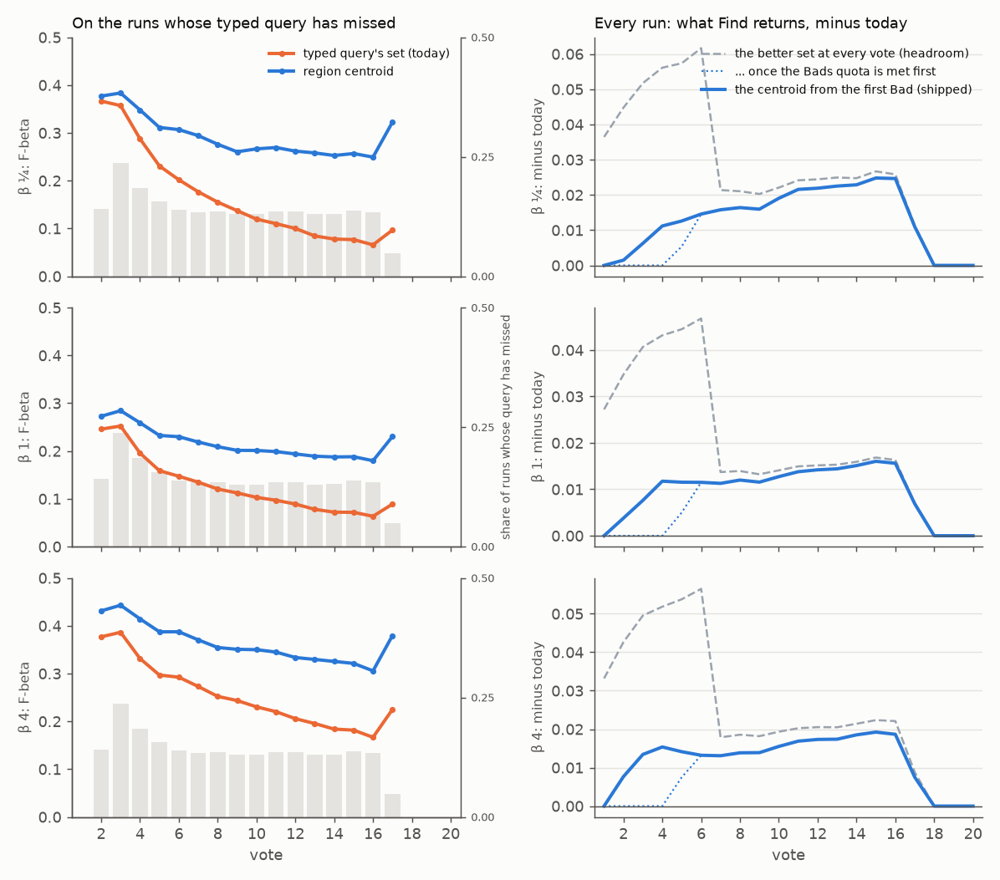

# On the Region path, once the typed query has missed, Find gives the region centroid (#4800)

**2026-10-19.** Since #4758 a typed-query detector's Find gives the typed query's own set until the label quota.
On the Region path, once that query has **missed**, the centroid of the Goods' own boxes is the better set. Here
"missed" means a Bad before the third Good, with a Good in hand. Priced at today's line rule on 864 Region sessions,
giving the centroid there gains **+0.011 / +0.009 / +0.012** F-beta over votes 1–10 at beta ¼, 1 and 4, and
+0.005 / +0.004 / +0.005 over votes 1–50: at every balance and in every seed. So it ships for the patch space: a
typed-query detector on a patch space gives the Goods' centroid from its query's first Bad before 3 Goods until the
quota (`label_quota.query_missed`, `QUERY_MISS_BADS = 1`).

| Find gives the centroid from the first Bad before 3 Goods, minus today | votes 1–10 | votes 1–50 | votes 1–150 |
|---|---|---|---|
| beta ¼ | +0.0113 ± 0.0047 | +0.0053 ± 0.0016 | +0.0018 ± 0.0005 |
| beta 1 | +0.0094 ± 0.0031 | +0.0038 ± 0.0011 | +0.0013 ± 0.0004 |
| beta 4 | +0.0120 ± 0.0044 | +0.0047 ± 0.0015 | +0.0016 ± 0.0005 |

These are F-beta of what Find returns, a session mean over each span, paired per session with SEs clustered on
the 144 categories. The centroid here is a Find on the collection being labelled, its line drawn over the unvoted
media (#4779). Drawn as a Find on another collection, every cell is within 0.0002 of these (`summary.csv`, corpus
`withheld`). The gain is concentrated: 296 of the 864 sessions (34%) miss at all. Within those 296 the rule gains
+0.027 over votes 1–10 and +0.011 over votes 1–50 at beta 1, and 68% of them gain (62% to 68% across the balances).
The gain is on small and medium instances (+0.005 and +0.006 over votes 1–50 at beta 1); on large ones it is +0.0003.

#4800 named a later fallback: the centroid once the Bads quota (4) is met before 3 Goods. On the same sessions
that gains 0.0005 to 0.0009 less over votes 1–50, at 1 to 2 SE (paired), so the two are close. **The owner chose
the first Bad** (2026-10-19), asked with both rules' numbers.



*Figure 1. The Region path, rows beta ¼, 1 and 4. Left: F-beta at each vote over the sessions whose typed query has
missed by then: the typed query's set (orange, today) and the region centroid (blue). The grey bars are the share of
sessions in that state (right axis). Right: what Find returns minus today, over every session: the shipped rule
(blue), the rule that waits for the Bads quota (dotted), and the better of the two sets at every vote under the quota
(dashed, a ceiling no rule reaches). A rule can differ from today only from vote 2, the first that can hold a Good
and a Bad, through vote 17: a vote with a Good and fewer than 3 Goods under the quota holds at most 15 Bads. So
session means over votes 1–150 are exact from these 20 votes.*

## Where the centroid is the better set

Every vote under the quota with a Good, by the Goods in hand and whether the query has missed
(`votes_under_quota.csv`, the labelled collection):

| | beta ¼: query / centroid | beta 1: query / centroid | beta 4: query / centroid | centroid better on (beta 1) |
|---|---|---|---|---|
| 1 Good, query missed (1,132 votes) | 0.14 / **0.26** | 0.11 / **0.20** | 0.22 / **0.35** | 72% |
| 2 Goods, query missed (803) | 0.24 / **0.36** | 0.17 / **0.25** | 0.32 / **0.40** | 72% |
| 1 Good, no Bad yet (549) | **0.67** / 0.51 | **0.52** / 0.37 | **0.62** / 0.54 | 30% |
| 2 Goods, no Bad yet (468) | **0.72** / 0.59 | **0.57** / 0.43 | **0.67** / 0.60 | 31% |
| 3+ Goods, waiting for the 4th Bad (1,938) | **0.72** / 0.62 | **0.56** / 0.45 | **0.67** / 0.61 | 33% |

Before any Bad, and once the query has given 3 Goods, its set is the better one at every balance, so a centroid
from the first Good loses (−0.034 ± 0.010 over votes 1–10 at beta 1; it was the design before #4758). From the first
Bad before 3 Goods it is the other way round, and the lead widens with every Bad. At beta 1 it is +0.025 with 1 Bad,
+0.06 with 2–3, +0.07 with 4–5 and +0.12 with 12–15.

**The rules priced.** The same sessions price any rule over the counts in hand (`summary.csv`):

| over votes 1–50, minus today | beta ¼ | beta 1 | beta 4 |
|---|---|---|---|
| the centroid from the first Bad before 3 Goods, **shipped** | +0.0053 ± 0.0016 | +0.0038 ± 0.0011 | +0.0047 ± 0.0015 |
| ... from 2 Bads | +0.0052 ± 0.0015 | +0.0037 ± 0.0010 | +0.0045 ± 0.0015 |
| ... from 3 Bads | +0.0050 ± 0.0014 | +0.0034 ± 0.0009 | +0.0042 ± 0.0014 |
| ... from 4 Bads, the Bads quota (#4800 as filed) | +0.0047 ± 0.0013 | +0.0032 ± 0.0009 | +0.0039 ± 0.0013 |
| ... from the first Bad, with 1 Good only | +0.0031 ± 0.0011 | +0.0023 ± 0.0007 | +0.0032 ± 0.0011 |
| the better set at every vote (a ceiling) | +0.0111 ± 0.0017 | +0.0079 ± 0.0012 | +0.0099 ± 0.0016 |

Against the Bads-quota rule, the shipped rule adds +0.0005 ± 0.0005, +0.0006 ± 0.0003 and +0.0009 ± 0.0004 over votes
1–50 (paired), and +0.003 to +0.004 over votes 1–10. It takes about half the ceiling (48% at beta 1). The rest sits on
votes no count separates: on the votes where the query is the better set on average, the centroid still wins 30% to 41%
of them.

## What was run

- **One run prices every balance.** Neither set picks, and Autopilot's opening reads no balance. So each design
  shares every session and differs only in what Find returns on the votes under the quota. Each such vote carries
  tagged rows (`CALIB_CENTROID_LINE_VARIANTS`, as #4732 did):
  - the typed query's set at each balance, `query@<beta>` (new here);
  - the centroid at the app's rule (`count_gap_floor_skip25_b1`), drawn over the withheld half and over the unvoted
    media (`~unvoted`). A typed-query run did not write the centroid's rows before; now it does, when asked.
- **The sessions.** The State of the App's Region path at beta 1, on the 2026-10-08 grid: COCO Better, DINOv3 patch
  learning on SigLIP's typed query (`siglip+dinov3_patch`, max_patch), 144 cells × 6 seeds = 864 sessions.
  - Frozen commit `6e18afc94` (worktree `vts-4800-run`); launcher `scripts/experiments/state_of_app/missed_query_4800.sh`;
    run dir `state-of-the-app/2026-10-19-missedq4800-region-b1`.
  - Cut at 20 votes: every vote a rule can name falls by vote 17 (`checks.json`), so every span's mean is exact.
- **Cheaper rows, the same rows.** The six centroid rows a vote cost two passes over every box of the cell each,
  25–33 minutes a cell and a 33 GB peak. They now share one pass of the probe the line is drawn from, with each
  line read off it (`step_trainers._centroid_cut_step`, as the typed query's step already scores by id).
  - That brings a cell to 10–13 minutes and 18–22 GB.
  - On two smoke cells at three balances (612 tagged rows) the new rows equal the old ones exactly: F-beta,
    precision, recall, flagged count and AP.
  - A test pins each variant to `_centroid_test`'s set, on a single-vector world and a patch-grid one.

The run is today's session on every vote a rule can change:

- **Against today's app at 150 votes.** Seeds 0 and 1 were checked against #4278's control run
  (`2026-10-18-logreg4278-ctl-region-b1`, the same app code). In all 288 sessions every vote through the one that
  meets the quota is the same pick, and every untagged row there is the same. Past the quota, 135 sessions part by
  vote 20. Every one parts where the 150-vote session starts a prompted weak-separation check (#4496) that a 20-vote
  budget has no room for, which is past every vote the rules read
  (`scripts/experiments/lessons/2026-10-19-a-cut-run-parts-where-a-check-prompts.md`).
- **The balance does not move the opening.** Ten sessions at beta ¼ and ten at beta 4 (the seed-0 cells whose
  query misses) cast the same votes through the quota as at beta 1.
- **The typed query's rows.** `query@1` equals the run's own untagged query rows in all 8,670 of them.
- **Nothing dropped.** Every session is in every average (#4631), all 864 cells read, and no tagged row is missing.

The analyzer is `scripts/experiments/state_of_app/missed_query_4800.py`; the figure script is
`missed_query_4800_figures.py`.

## What shipped

- **`label_quota.query_missed(n_good, n_bad, *, patch_space)`.** True on a known patch space with a Good but fewer
  than `GOOD_QUOTA`, and `QUERY_MISS_BADS` (1) to `DRY_BAD_QUOTA − 1` Bads. A single-vector space, and an embedder the
  registry does not know, keep the query. On COCO Better's Binary opening the 4-Bad rule was worth under 0.003 either
  way (#4758), and there the query holds past the quota too (#4736).
- **The app.**
  - `labelset_training._query_tier` gives the centroid there, where a Good resolved. So Test, a load, a cold Find,
    AutoFind, an export and the CLI all give it (`train_from_labelset`, `labelset_train_and_score(label_quota=True)`).
  - `model_loading.cached_head_is_current` takes a cached centroid there and refuses a cached query head.
  - `served_quota` reports the tier as `centroid`, and the Test view and AutoFind say "the Goods' centroid", as for
    a detector with no query.
  - Autopilot asks the same questions: the rule changes what Find gives, never the session.
- **The eval harness follows the app.** On a run whose media carry a patch grid, the untagged row of a missed vote
  is the centroid's (`detector_tier` `centroid`); `query_miss=False` / `CALIB_QUERY_MISS=0` is the arm before. The
  eval/app sync note for the label quota says so. **For later studies:** a Region run's Find rows on those votes move
  by the amounts above; its picks and the State of the App's session read do not.
- **Pricing tools.** `centroid_line_variants` takes `query@<beta>`, writes the centroid's rows in a typed-query run,
  and scores them from one probe pass a vote.

## Decisions

- **The first Bad, not the Bads quota.** The owner's choice, asked with both rules' numbers (2026-10-19). It is the
  best of the rules priced at every balance, by 1 to 2 SE over the one #4800 named. It was picked after the fact from
  five rules on these sessions, and it adds a count of its own, `QUERY_MISS_BADS`.
- **The labelled collection and another one get the same rule.** The two corpora differ by under 0.0002.

## Reproduce

```bash
S=/expscratch/sgreenberg/state-of-the-app
MQ4800_SEEDS=6 bash scripts/experiments/state_of_app/missed_query_4800.sh dirs
MQ4800_SEEDS=6 CALIB_MEM=26G CALIB_CONC=32 bash scripts/experiments/state_of_app/missed_query_4800.sh launch 1
python scripts/experiments/state_of_app/missed_query_4800.py --run $S/2026-10-19-missedq4800-region-b1 \
  --reference $S/2026-10-18-logreg4278-ctl-region-b1 \
  --same-session $S/2026-10-19-missedq4800-region-b025 --same-session $S/2026-10-19-missedq4800-region-b4 --out <dir>
python scripts/experiments/state_of_app/missed_query_4800_figures.py --curves <dir>/curves.csv --out <figures>
```

The run used the commit before the app change (`6e18afc94`). At today's head the untagged rows of a missed vote are
the centroid's, so a re-run reads `query@<beta>` for the typed query's set, as the analyzer already does.

Files here:

- `summary.csv`: per corpus × beta × design, each design minus today over votes 1–10, 1–50 and 1–150 with
  clustered SEs, the sessions, and the sessions the shipped rule changes.
- `votes_under_quota.csv`: every vote under the quota with a Good, by corpus, beta, Goods (3 = 3 or more), whether
  the query missed (the shipped rule) and the Bads in hand: votes, both sets' mean F-beta, and the share the
  centroid wins.
- `curves.csv`: per corpus × beta × vote, the share of sessions whose query has missed, both sets' F-beta on them,
  and each design's mean difference to today.
- `checks.json`: the run's fidelity checks above.
