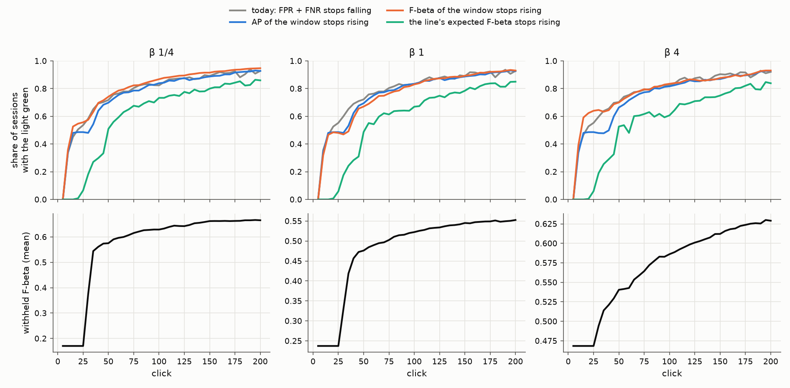
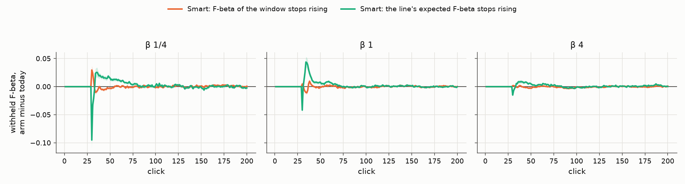

# Smart in the objective's units: F-beta going up instead of FPR + FNR going down (issue #5134)

**Status (2026-10-20): 2,160 sessions of today's app with every candidate recorded, and two candidates run in the
phase machine (2,160 sessions each), Binary Photo at beta 1/4, 1 and 4. Shipped (the owner's call, 2026-10-20): Smart
reads each recent detector's best F-beta on the current votes, at the session's balance, and goes green once it stops
rising.**

> "Even if stopping via FBeta completely ties stopping via MinCost, we'll still switch to FBeta. Everything else is
> done via FBeta. The MinCost condition was a surprise and an old throwback to previous metrics." (the owner)

## The answer

- **Re-reading Smart's window in F-beta or AP gives the same light.** Smart re-scores its last 10 models on the
  current votes. Read in AP, in F-beta at the session's beta at each model's own cut, or in the best F-beta any
  cut reaches, and turned to "green once it stops rising", it goes green at the same clicks as today's FPR + FNR
  light. The median first green is click 11 to 14 against today's 12 to 13, at every preset
  ([figure](#where-each-light-is-green)). On the votes each model's AP and F-beta are near their ceiling from the first
  window. The newest models trained on nearly all of them, so the window looks flat almost at once. FPR + FNR has
  the same property, which is why today's light greens early too.
- **Today's Smart says "you can likely stop" about as soon as it can say anything.** Its first green comes at a
  median click 12 to 13: the first click with 5 Goods, 5 Bads and 3 models, where a placebo that greens the moment
  Smart can read fires (click 11). Still to come by click 150 at that point: **0.42 / 0.28 / 0.12** of F-beta (beta
  1/4 / 1 / 4), and 78% to 83% of sessions at beta 1/4 and 1 gain more than 0.1 after it. (#4359 measured 0.15 at
  vote 42 on the app of 2026-10-07; the opening has changed since, #4740.) As a stop it is worse than the same
  stops dealt to sessions at random (−0.083 / −0.058 / −0.002 ± 0.012 / 0.008 / 0.006): it fires earliest in the
  sessions that have most to gain.
- **No threshold rescues a window reading.** Each reading was priced over 24 rules (the slope cutoff 0.005 to 0.03,
  the t cutoff 1 to 3, the slope relative to the window's mean or to its distance from 1). The best of each, chosen
  on seeds 0-1 and read on seeds 2-4, still fires at a median click 12 to 46 and loses to random dealing at beta 1/4
  and 1 (`tables/held_out.csv`).
- **The labels line's expected F-beta ("stops rising") fires later and is still a timer.** As #4878 found for every
  reading the line gives of itself: median first green at click 46 to 47, 0.07 to 0.15 still to come by 150, and an
  edge over random dealing of −0.004 / −0.010 / +0.004, where a fixed delay after Smart can first read reaches
  +0.021 / +0.010 / +0.017 and Done +0.027 / +0.008 / +0.008.
- **In the phase machine the switch is a tie, as the owner expected.** Smart read off the best F-beta of the same
  window (`fbeta_best`, what shipped), against today's light, 720 sessions per preset paired by cell and seed: the
  session's mean F-beta over clicks 1-150 moves by −0.0001 / −0.0001 / −0.0006 (± 0.0005 / 0.0004 / 0.0002), Smart's
  light is the same on 92% to 96% of clicks, and Done comes 1 to 7 clicks later on average with what those clicks buy
  (+0.000 to +0.009 F-beta at Done).

## What was run

- **Sessions.** Today's app (dev 17600e2b7 plus the recorded columns, frozen worktree `vts-5134-run` at 58780e78c),
  on the Binary Photo path of the grid #4743 priced (`2026-10-08-b1`): COCO Better, 49 classes in three size bands,
  144 cells, 5 seeds, at beta 1/4, 1 and 4. 200 clicks and the closing check, trajectory pass. 720 sessions per
  preset per arm. Launcher [`smart_fbeta_5134.sh`](../../../scripts/experiments/state_of_app/smart_fbeta_5134.sh).
- **The reading pass** (`read`, `CALIB_SMART_READINGS=1`) is today's app with every candidate's trend recorded on
  every row: the light, the picks and the scores are untouched (`tests_lib/detectors/test_smart_signal_5134.py`
  checks that a run with the readings on is the same run). It is also the A/B's control.
- **The arms** (`CALIB_SMART_SIGNAL`): the app with Smart read off one candidate, green once it stops rising. Smart
  gates Hard -> New (with Stable) and is one of Done's three lights, so an arm can move the picks and Done.
- **The candidates** (`vtscore.eval.autopilot_flow.SMART_SIGNALS`), none of which reads the served line:

  | reading | one point | kept as |
  |---|---|---|
  | `ap` | AP of one of the last 10 models on the current votes | the window, re-scored every click as the cost is |
  | `fbeta` | F-beta at the session's beta at that model's own Smart cut (the cut its cost is priced at) | the window |
  | `fbeta_best` | the best F-beta any cut through that model's scores reaches | the window |
  | `heldout_ap` | AP of the calibration folds' held-out scores of the votes | one per retrain, the last 10 |
  | `heldout_fbeta` | the best F-beta of those scores | one per retrain |
  | `line` | the labels line's expected F-beta (`stop_level_reading`) | one per retrain, from the first one its class model cuts |

  The rule is #3832's trend-and-scatter test with its sign turned over (`cost_trend.rising_status_from_scores`):
  green once the window's slope gains less than 1.5% of its mean per model, or its rise is under 2 standard errors.

## How a light is judged

As #4878 judged stop rules (`smart_fbeta_5134.py price`). A light's first green is when the app first tells the user
"you can likely stop"; a session that never sees it leaves at the horizon. On the reading pass every rule is read off
the same sessions:

- **Where it fires and what is left:** fire rate, median first green, the withheld F-beta there, and the gain from
  there to click 150 and 200, the objective still to come. The F-beta is what the app shows on the withheld half at
  the run's beta: the typed query's set until a detector is on screen, then the detector's line (as #5039's A/B).
- **Two edges**, paired by session, SE over the 49 classes: over a fixed stop at the rule's own mean leave click
  ("better than telling everyone to click N times?"), and over its own stops dealt to the sessions at random ("does it
  give the clicks to the sessions they help?").
- **Placebo:** stop N clicks after Smart can first read (5 Goods, 5 Bads, 3 models).

Today's light re-read off the recorded `smart_slope` / `smart_slope_t` agrees with the recorded light on all but 73
of 432,000 clicks (the columns are rounded to 4 and 2 places).

## Where each light is green



*Top: the share of sessions whose light is green at each click (the light flaps, so a session can count green, then
not). Bottom: the mean withheld F-beta at the same clicks, each preset at its own beta.*

The two window readings sit on today's light from the first click Smart can read to click 200. The line's reading
greens 20 to 40 clicks later and never catches up. None of the four tracks the bottom row: the F-beta still rises
through click 200 at beta 1 and 4.

## The lights as stop signals (reading pass, 720 sessions per preset)

To click 150; edges to click 200. Every candidate at the shipped thresholds (0.015, t 2).

| beta | light | fires | median first green | F-beta there | still to come by 150 | sessions gaining > 0.1 after | edge over a fixed click | edge over random dealing |
|---|---|---|---|---|---|---|---|---|
| 1/4 | **today: FPR + FNR** | 92% | 13 | 0.24 | **0.42 ± 0.02** | 83% | −0.327 ± 0.027 | −0.083 ± 0.012 |
| | AP | 91% | 13 | 0.28 | 0.38 | 78% | −0.293 | −0.092 |
| | F-beta at its cut | 92% | 12 | 0.23 | 0.44 | 84% | −0.336 | −0.088 |
| | best-cut F-beta | 92% | 12 | 0.25 | 0.41 | 81% | −0.318 | −0.085 |
| | held-out AP / F-beta | 92% | 12 | 0.23 | 0.44 | 85% | −0.337 | −0.089 |
| | the line's expected F-beta | 86% | 46 | 0.51 | 0.15 ± 0.01 | 43% | −0.099 | −0.004 ± 0.010 |
| | placebo: when Smart can first read | 92% | 11 | 0.22 | 0.44 | 85% | −0.340 | −0.089 |
| | Done | 89% | 52 | 0.61 | 0.05 | 25% | −0.001 | **+0.027 ± 0.005** |
| 1 | **today: FPR + FNR** | 92% | 12 | 0.27 | **0.28 ± 0.02** | 78% | −0.196 ± 0.020 | −0.058 ± 0.008 |
| | AP | 91% | 13 | 0.28 | 0.26 | 72% | −0.188 | −0.070 |
| | F-beta at its cut | 92% | 13 | 0.27 | 0.28 | 78% | −0.199 | −0.060 |
| | best-cut F-beta | 91% | 14 | 0.29 | 0.26 | 71% | −0.187 | −0.070 |
| | held-out AP / F-beta | 92% | 11-12 | 0.26 | 0.29 | 79% | −0.202 | −0.063 |
| | the line's expected F-beta | 86% | 47 | 0.43 | 0.11 ± 0.01 | 39% | −0.065 | −0.010 ± 0.006 |
| | placebo: when Smart can first read | 92% | 11 | 0.26 | 0.29 | 79% | −0.203 | −0.063 |
| | Done | 89% | 56 | 0.50 | 0.05 | 20% | −0.007 | **+0.008 ± 0.003** |
| 4 | **today: FPR + FNR** | 91% | 12 | 0.50 | **0.12 ± 0.01** | 54% | −0.025 ± 0.011 | −0.002 ± 0.006 |
| | AP | 91% | 13 | 0.50 | 0.11 | 52% | −0.031 | −0.007 |
| | F-beta at its cut | 91% | 13 | 0.50 | 0.12 | 54% | −0.026 | −0.003 |
| | best-cut F-beta | 91% | 11 | 0.49 | 0.12 | 56% | −0.029 | −0.005 |
| | held-out AP / F-beta | 91% | 11-12 | 0.49 | 0.12 | 56% | −0.027 | −0.004 |
| | the line's expected F-beta | 83% | 46 | 0.54 | 0.07 ± 0.01 | 36% | −0.017 | +0.004 ± 0.004 |
| | placebo: when Smart can first read | 91% | 11 | 0.49 | 0.12 | 57% | −0.027 | −0.005 |
| | Done | 85% | 62 | 0.57 | 0.05 | 20% | −0.008 | **+0.008 ± 0.004** |

*SEs of the candidates' rows are within 0.003 of today's (`tables/rules.csv.gz`). The best fixed delay after Smart can
first read, for reference: +0.021 / +0.010 / +0.017 over random dealing (55, 70 and 105 clicks).*

- **The window readings and the placebo are one rule.** Their first greens fall on the same clicks, the F-beta
  still to come within 0.06 of each other and their edges within their SEs. Turning FPR + FNR into F-beta or AP changes the words on
  the light, not when it lights.
- **Reading the session's beta does not make the light follow the preset.** The F-beta readings take the beta, but
  their first greens differ from the beta-blind AP's by at most 2 clicks at the median: on the votes the beta moves
  the level of each model's F-beta, not the slope of the window.
- **Held out** (`tables/held_out.csv`): the best variant of each window reading, chosen on seeds 0-1 by the edge over
  random dealing, scores −0.080 to −0.090 at beta 1/4, −0.054 to −0.067 at beta 1 and −0.007 to −0.002 at beta 4 on
  seeds 2-4. Done's is +0.028 / +0.009 / +0.009.

## The A/B in the phase machine

Smart gates Hard -> New (with Stable) and is one of Done's three lights, so a different light can move the picks and
Done. Two arms ran in the phase machine against the reading pass (today's app), on the same cells, seeds and commit:
`fbeta_best`, the direct replacement, and `line`, the issue's first candidate and the only one that greened at
different clicks. Paired by cell and seed, SE over the 49 classes (`smart_fbeta_5134.py ab`, `tables/ab.csv`).

| | beta 1/4 | beta 1 | beta 4 |
|---|---|---|---|
| **`fbeta_best` (shipped)**: session mean F-beta, clicks 1-150 / 1-200 | −0.0001 / +0.0002 ± 0.0005 | −0.0001 / −0.0000 ± 0.0004 | −0.0006 / −0.0004 ± 0.0002 |
| … Smart's light the same as today's | 96% of clicks | 92% | 94% |
| … Smart first green, median click (today -> arm) | 13.5 -> 13 | 13 -> 15 | 13 -> 12 |
| … still to come there by 150 (today -> arm) | 0.42 -> 0.41 | 0.28 -> 0.26 | 0.12 -> 0.12 |
| … Done, mean leave click (today -> arm) | 72.5 -> 73.5 | 76.2 -> 82.8 | 86.8 -> 88.5 |
| … Done later by (mean, paired) / F-beta at Done | +1.1 ± 0.3 / +0.000 | +7.1 ± 0.9 / +0.009 ± 0.002 | +1.7 ± 0.4 / +0.003 ± 0.002 |
| … Done's edge over random dealing (today -> arm) | +0.027 -> +0.026 | +0.008 -> +0.011 | +0.008 -> +0.010 |
| **`line`**: session mean F-beta, clicks 1-150 / 1-200 | **+0.0031 / +0.0022 ± 0.0009** | **+0.0030 / +0.0022 ± 0.0007** | +0.0010 / +0.0011 ± 0.0005 |
| … Smart's light the same as today's | 84% of clicks | 82% of clicks | 80% |
| … Smart first green, median click | 31 | 31 | 30 |
| … Done later by (mean, paired) / F-beta at Done | +4.8 ± 1.7 / +0.021 ± 0.004 | +6.2 ± 1.9 / +0.011 ± 0.003 | +3.9 ± 1.7 / +0.012 ± 0.003 |



*Each arm's withheld F-beta minus today's app's, session for session, ±1 SE over classes. The two runs are one run
until the first click their lights differ, around click 25 to 30 where the first detector goes on screen.*

- **`fbeta_best` is today's light in other words.** The two disagree on 4% to 8% of clicks, and where they do it is
  mostly a click or two around the first green. Sessions end with the same F-beta. At beta 1 Done comes 7 clicks later
  and gains what those clicks buy: its edge over a fixed click goes from −0.0075 to −0.0036, within its SE.
- **`line` holds sessions in Hard about 19 clicks longer** (first green at click 30 to 31, not 13) and buys a little:
  +0.003 at beta 1/4 and 1, +0.001 at beta 4, inside #4359's bound on what any gating can buy (+0.009). Done's stops
  land better under it (its edge over random dealing +0.027 -> +0.042, +0.008 -> +0.013, +0.008 -> +0.015). It was not
  shipped: it reads the labels line's class model, which does not exist while the head's count line serves (#4786),
  and FHIBE faces sit on that line all session (#5039), so under `line` Smart would never go green there. A Smart
  that reads `line` where there is a class model and `fbeta_best` where there is not is the open option, on #5137.

## What shipped

- **The rule:** `cost_trend.rising_status_from_scores` over `best_fbeta` points, at `smart_beta(beta)` (F1 with no
  balance). The window, the per-class minimum, the 1.5% cutoff and the 2-SE noise gate are #3832's, signs turned over.
- **The app:** `labeling_progress` reads each cached detector's best F-beta on the current votes (cut-free, so the
  progress cache keeps no Smart cut, and `inject_live_model(smart_threshold=)` is deprecated); the routes pass the
  detector's balance; the Smart memo keys on it. The progress modal's Smart chart plots F-beta, and the API's Smart
  points carry `fbeta` (`SmartPoint`; `fbeta_over_time` on `/api/labeling-progress`).
- **The harness:** `smart_signal="fbeta_best"` is the default arm; `"cost"` is the light before #5134; the readings
  stay as arms and as `smart_readings` columns.
- **The deck:** the Diminishing Returns slide (`autopilot-smart-trend`, its own slide since #5132) plots F-beta rising, then flat.

## Where the stop fires now: the deck's Past the Exit (#5141)

The deck's Past the Exit slide draws where Done fires in today's app and what clicking on buys. It read the
2026-10-16 Binary Photo review, which ran the app before Smart's switch. Since #5141 it reads the shipped arm,
`fbeta_best` (today's app with Smart on F-beta, dev 17600e2b7), read at the review's budget of 150 clicks:
`read_at_budget.py` drops every row, pick and rank frame after click 150, then `analyze.py`, `by_click.py` and
`stops_by_preset.py` run as on a review. The tables are in [`stop/`](stop/). They come from 5 seeds (720 sessions a
radio), where the review had 45.

| radio | fired | stop, KM median click | gain clicking on to 150, mean ± SE | ended ≥ 0.02 better / worse |
|---|---|---|---|---|
| β ¼ | 89% | 54 | +0.061 ± 0.007 | 49% / 16% |
| β 1 | 87% | 59 | +0.045 ± 0.004 | 56% / 7% |
| β 4 | 84% | 64 | +0.054 ± 0.005 | 58% / 7% |

For context only, the 2026-10-16 review read 90% / 90% / 90%, at clicks 55 / 58 / 64, gaining +0.070 / +0.072 /
+0.068. Between the two the app took more than Smart's switch (#5039, #5040 and others), so the difference is not
Smart's alone.

```bash
S=/expscratch/$USER/state-of-the-app P=scripts/experiments/state_of_app
for b in 025 1 4; do
  python $P/read_at_budget.py --src $S/2026-10-20-smart5134-fbeta_best-b$b/results --dst <out>/b$b/results --budget 150
  python $P/analyze.py --exp <out>/b$b --baseline $S/2026-10-08-b1/text_baseline.csv --out <out>/b$b/analysis-binary --path binary
done
python $P/by_click.py --run 0.25=<out>/b025/analysis-binary --run 1=<out>/b1/analysis-binary \
  --run 4=<out>/b4/analysis-binary --baseline $S/2026-10-08-b1/text_baseline.csv --embedder siglip \
  --out <report>/stop/objective_by_click.csv
python $P/stops_by_preset.py --run 0.25=<out>/b025/analysis-binary --run 1=<out>/b1/analysis-binary \
  --run 4=<out>/b4/analysis-binary --out <report>/stop/stopping_by_preset.csv
```

## What this leaves

- **Smart says "you can likely stop" about as soon as it can say anything, in either unit.** At a median click 13,
  with 0.28 of F-beta still to come at beta 1, and earliest in the sessions with most to gain. Done (every light, or
  the line's level, or 200 votes) is what stops a session, and Done's stops are well placed; Smart's own message is
  not. #5137 asks whether Smart's green should still tell the user they can stop.
- The window readings flatten early because the newest detectors trained on nearly all the votes they are scored on:
  a held-out reading of the same models would need votes none of them trained on, which a session does not have.

## Provenance

| | |
|---|---|
| code | branch `claude/smart-fbeta-5134`, dev 17600e2b7 + 58780e78c (the readings and the arm); runs from frozen worktree `vts-5134-run` |
| sessions | `/expscratch/sgreenberg/state-of-the-app/2026-10-20-smart5134-{read,fbeta_best,line}-b{025,1,4}`; per arm and preset seven cpu packs (16 cells at a time, 514 cells) and one V100 pack (GPU hidden, 40 at a time, 206 cells); reading pass 13:05-15:14, arms 13:27-17:59; 0 failed cells |
| analysis | `smart_fbeta_5134.py read` -> `/expscratch/sgreenberg/smart-5134/work/`, `price` -> `tables/`, `ab` -> `tables/ab.csv`, `tables/ab_curves.csv`, `figures` |
| shipped | the same branch, after the owner's call: the app's light, the API, the chart, the harness default, the deck |

## Reproduce

```bash
S=/expscratch/$USER/state-of-the-app
L=scripts/experiments/state_of_app/smart_fbeta_5134.sh   # from a frozen worktree
for arm in read fbeta_best line; do bash $L dirs $arm
  for b in 0.25 1 4; do CALIB_PACK_JOBS=7 CALIB_PACK_PAR=16 bash $L cpack $arm $b <cpu indices>
    CALIB_PACK_PAR=40 bash $L gpack $arm $b <gpu indices>; done; done
P=scripts/experiments/state_of_app/smart_fbeta_5134.py
python $P read --root $S --baseline $S/2026-10-08-b1/text_baseline.csv --work work --arms read,fbeta_best,line
python $P price --work work --out price
python $P ab --work work --out ab --arms fbeta_best,line
python $P figures --price price --ab ab --out figures
```
