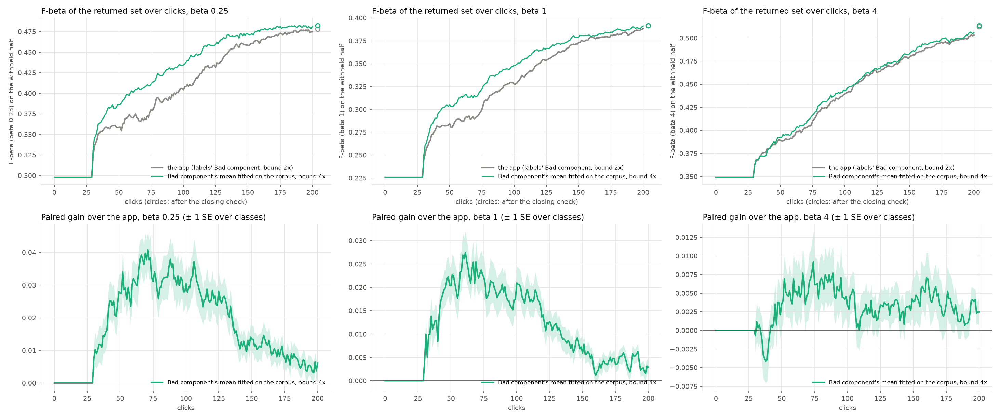

# The shipped chances (#5040) hold on o365_better: +0.018 / +0.011 / +0.003 mean F-beta over clicks 0-200 (issue #4817)

**Status (2026-10-22): `o365_better` built, verified and read once.** The owner ruled the 18 ambiguous Objects365
names from samples (2026-10-20 and 2026-10-22), the six columns were built and `--verify` is clean, and #5040's
decided contrast was re-run on it as the first confirmation: the app before #5040 (`ctl`) against the app since
(`bmean4`), Binary Photo, beta 1/4, 1 and 4, 5 seeds, 200 clicks plus the closing check, paired by cell and seed.

**The contrast holds, in sign at every preset and every horizon, at about 70% of its size on `coco_better`.**
Nothing was tuned on `o365_better`, so this is the check the bench exists for.

| paired gain of `bmean4` over `ctl` (± SE over classes) | beta 1/4 | beta 1 | beta 4 |
|---|---|---|---|
| **o365_better, 107 paired cells**: mean F-beta over clicks 0-200 | **+0.018** (± 0.0025) | **+0.011** (± 0.0016) | **+0.0030** (± 0.0014) |
| coco_better (#5040), same arms | +0.023 (± 0.004) | +0.016 (± 0.003) | +0.005 (± 0.001) |
| o365_better: over clicks 0-50 | +0.0072 | +0.0058 | +0.00002 |
| coco_better: over clicks 0-50 | +0.013 | +0.010 | +0.003 |
| o365_better: after the closing check | +0.0043 (± 0.0026) | +0.0003 (± 0.0016) | +0.0013 (± 0.0021) |
| coco_better: after the closing check | +0.007 (± 0.004) | +0.004 (± 0.002) | +0.003 (± 0.001) |
| o365_better: sessions helped / hurt over 0-200 | 62% / 26% | 62% / 27% | 51% / 38% |
| o365_better: Done, clicks sooner | 3.1 | 2.3 | 0.9 |

All 110 cells read the same to two figures (+0.017 / +0.011 / +0.0029; `tables/ab_summary_all110.csv`).



## What it says

1. **The gain is where #5040 put it.** It opens at the first click that shows a detector (about click 28), peaks
   between clicks 50 and 110 (about +0.04 at beta 1/4, +0.027 at beta 1, +0.008 at beta 4), and narrows as the labels
   fill in. It is still ahead at click 200 at every preset (+0.0062, +0.0029, +0.0025, ± 0.0029 / 0.0016 / 0.0018),
   as on `coco_better`; after the closing check beta 1 is level (+0.0003 ± 0.0016).
2. **Smaller, not different.** The 0-50 gain is about half `coco_better`'s, which is most of the shortfall. One
   candidate, not tested here: a cell's withheld half holds a median 16,700 negatives against 23,900, so the corpus
   the Bad component's mean is fitted on is smaller. Absolute F does not compare across the two benches (#4815); the
   contrast does.
3. **The pairing is clean.** 535 sessions an arm at each preset; every departure is on the line (387, 391, 384) or
   a phase (0, 1, 21), none otherwise, and the F shown agrees up to the first click with a detector in all of them.
4. **Examples.** Helped most: `orange@large` seed 2, beta 1/4, F 0.40 → 0.91 at click 100, Done at 32 clicks
   against 53. Hurt most: `remote@small` seed 2, beta 1/4, F 0.25 → 0.11 at click 100, 15 Goods by click 200
   against 19, Done at 59 against 91. Per-session rows in `tables/ab_examples.csv`.

## The bench

- **Rulings** (`pile_config.O365_NAMES` / `O365_AMBIGUOUS`): moved in Formula 1, Scooter, Pot, Toiletry, Cleaning
  Products; deleted Wheelchair, Tea pot, Side Table, Rickshaw (both), Coffee Table, Wallet/Purse, Desk, Machinery
  Vehicle; still withheld Chicken, Tricycle, Bakset, Flower, Flask. Controls 73 of 80 Good.
- **Built**: 110 cells, 18,050 images (11,000 positives, a pool of 7,989), six columns (siglip, siglip2_l, clip,
  clip_l, dinov3_patch, embeddinggemma2), 1 h 25 min on one V100. No cell crosses `SCALE_N_POS`, so
  `O365_DROPPED_CELLS` is unchanged. 107 cells pair with `coco_better`; the other three are apple, banana and orange
  at the small band (`tables/paired-107.txt`).

## Reproduce

```bash
cd scripts/experiments/state_of_app
SOTA_DATASET=o365_better SOTA_DATE=2026-10-22-o365better-grid SOTA_SEEDS=5 SOTA_PASS=trajectory \
  SOTA_MAX_STEPS=200 bash launch.sh prepare
export CHANCES5040_DATASET=o365_better CHANCES5040_GRID=<that grid>/results CHANCES5040_DATE=2026-10-22 \
  CHANCES5040_TAG=o365 CALIB_PACK_JOBS=7 CALIB_PACK_PAR=8 CALIB_PACK_MEM=12G
for arm in ctl bmean4; do bash chances_5040.sh dirs $arm; for b in 0.25 1 4; do bash chances_5040.sh cpack $arm $b; done; done
python chances_5040_ab.py --root <state-of-the-app> --date 2026-10-22 --tag o365 --seeds 5 --arms ctl,bmean4 \
  --baseline <grid>/text_baseline.csv --categories tables/paired-107.txt --out <dir>
```

3,300 sessions, about 2.5 h on 336 CPUs. Run from commit 622c75d29.
