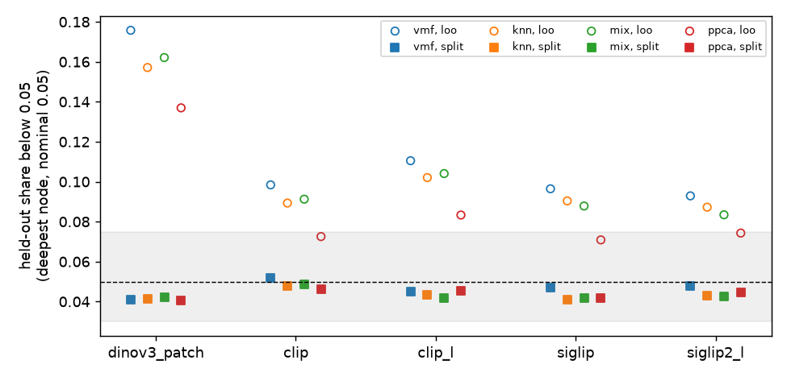
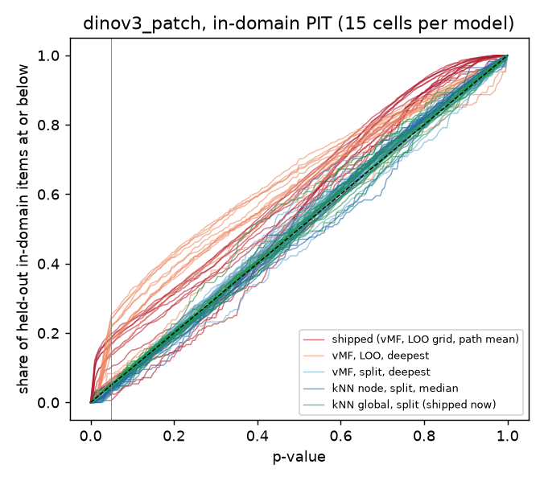
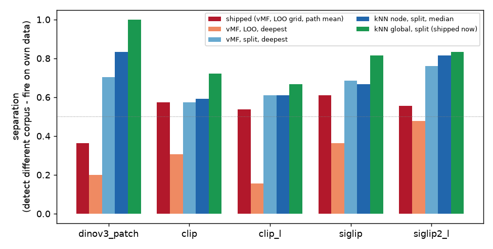

# The atlas guard on patch embedders: the calibration, not the vMF model (#3348)

**Run 2026-10-23**, 15 tasks (5 embedders x 3 seeds), job 1124928, code `ee46f1db1`
(instrument and [pre-registration](PREREG.md) committed before the first task
started). Results root `/expscratch/sgreenberg/atlas-node-3348`. Aggregates in
[`agg/`](agg/): `table.csv` holds every variant on every embedder.

## The short version

1. **The defect #3348 blamed on the vMF model is in the calibration scheme.**
   The shipped atlas ranks a query against leave-one-out scores of the very
   points its k-means cells were drawn around. Those points sit more centrally
   in their cells than a fresh item does, so a fresh in-domain item reads
   atypical. Calibrating each node on a held-back half that the partition never
   saw puts **every statistic on every embedder** inside the nominal band:
   0.041-0.052 below α = 0.05, against 0.071-0.18 for the same statistics with
   LOO.
2. **With that one change the shipped `mu . x` statistic passes the
   pre-registered rule on `dinov3_patch`.** Separation goes from 0.36 to 0.70
   and false alarms on own data from 0.60 to 0. It is no worse than shipped on
   any other embedder.
3. **The statistic matters much less than the calibration.** Among
   split-calibrated deepest-node variants, `dinov3_patch` separation is
   0.70-0.74 for vMF, mixture, PPCA and kNN alike. The pre-registered P4 (kNN
   beats vMF by ≥ 0.10) holds only through the `median` combiner (0.83 vs 0.70).
4. **The tree-free kNN conformal rule beats every atlas variant**: separation
   1.00 on `dinov3_patch`, 0.67-0.83 elsewhere, and KS 0.021-0.033 on all five
   embedders. **The owner chose to ship it** (AskUserQuestion, 2026-10-23). The
   guard now ranks the active dataset against the reference dataset's own
   vectors, and the patch-embedder refusal is lifted.

## The grid

Five embedders x three seeds; per seed and embedder, an atlas per dataset, its
held-out 20 % scored (75 PIT cells), and all 25 ordered dataset pairs scored
(375 pairs). **The datasets are not #3329's.** The `dinov3_patch` cells of
`vg_scale_any` and `vg_box_large` went with the VG machinery (#4038), so
`coco_better` (24,504 items) and `o365_better` (18,050) replace them beside
`coco_val`, `caltech101_m` and `visual_genome_m`. The shipped model was re-run
on this grid as `grid_mean_shipped`, so every comparison below is on the same
cells. Every vector came out of the pile unit-norm, so #4128's problem does not
apply here.

Candidates differ in three ways: the **statistic** (`vmf`, `knn`, `mix`,
`ppca`), the **calibration** (`loo` or `split`) and the **combiner**
(`deepest`, `mean`, `median`). They share one tree and one node-eligibility
rule. [PREREG.md](PREREG.md) defines all of them.

## Where the defect lives



*Held-out share below 0.05 at the deepest calibrated node, per embedder. Hollow
markers are leave-one-out calibration (the shipped scheme), filled markers are
split calibration; colour is the statistic. The grey band is the pre-registered
0.03-0.075. Each point is a mean over 15 cells.*

Every hollow marker sits above the band and every filled one inside it, on all
five embedders and all four statistics. The split is the only thing that moves
a point into the band; the statistic only reorders points within their group.

For `dinov3_patch`, which had the shipped guard refused:

| | statistic | calibration | rate below 0.05 | KS | false alarm | separation |
|---|---|---|---|---|---|---|
| shipped | vMF | LOO, 21-point grid, path mean | 0.12 | 0.13 | 0.60 | 0.36 |
| same statistic, exact ranks | vMF | LOO, deepest | 0.18 | 0.17 | 0.80 | 0.20 |
| **same statistic, split** | vMF | split, deepest | **0.041** | **0.042** | **0** | **0.70** |
| best node model | kNN | split, median | 0.037 | 0.034 | 0 | 0.83 |
| **control (now shipped)** | kNN, no tree | split | **0.051** | **0.031** | **0** | **1.00** |

The second row rules out the grid: exact ranks on the same LOO calibration are
*worse* than the grid, because the shipped path mean was partly masking the
deepest node's bias. That matches #3329's B2: removing the averaging made KS
worse.



*Empirical CDF of held-out in-domain p-values on `dinov3_patch`, one line per
cell. A calibrated p-value lies on the dashed diagonal. The shipped model (red)
and the same statistic with LOO ranks (orange) bow above it at small p, which
is where the false alarms come from. Split-calibrated vMF (light blue), the
best node model (dark blue) and the kNN control (green) sit on it.*

## Did each variant pass?

The pre-registered gate, on every embedder: KS ≤ 0.05, rate within
0.03-0.075, false alarm ≤ 0.10. On `dinov3_patch`, separation ≥ 0.50; on every
other embedder, separation ≥ shipped − 0.10.

| variant | dinov3_patch | clip | clip_l | siglip | siglip2_l | minimum |
|---|---|---|---|---|---|---|
| `knn_global` | **1.00** | 0.72 | 0.67 | 0.81 | 0.83 | **0.67** |
| `knn_split_median` | 0.83 | 0.59 | 0.61 | 0.67 | 0.81 | 0.59 |
| `vmf_split_deepest` | 0.70 | 0.57 | 0.61 | 0.69 | 0.76 | 0.57 |
| `ppca_split_deepest` | 0.70 | 0.57 | 0.63 | 0.69 | 0.72 | 0.57 |
| `knn_split_deepest` | 0.74 | 0.56 | 0.63 | 0.69 | 0.74 | 0.56 |
| `mix_split_deepest` | 0.72 | 0.54 | 0.57 | 0.69 | 0.78 | 0.54 |
| `ppca_split_median` | 0.72 | 0.54 | 0.61 | 0.61 | 0.74 | 0.54 |
| *`grid_mean_shipped`* | *0.36* | *0.57* | *0.54* | *0.61* | *0.56* | *0.36* |

*Separation is detection on the 54 different-source pairs minus false alarms
on the 15 own-holdout pairs, per embedder over 3 seeds. These are the seven
passers. Of the 21 that fail, 19 are LOO-calibrated or use the `mean`
combiner, and the other two are `vmf`/`mix` with split calibration and the
`median` combiner, which fall short on the patch space. Full table: [`agg/tables.md`](agg/tables.md).*



None of the seven passers fires on any own-holdout pair or on either
same-source pair (`coco_val` ↔ `coco_better`), on any embedder. The shipped
model fires on `dinov3_patch`'s same-source pairs half the time.

### Predictions

| | prediction | outcome |
|---|---|---|
| P1 | shipped replicates: patch rate > 0.10 and separation < 0.30; others' false alarm ≤ 0.2 | **partly**. Rate 0.12 and false alarm 0.60 replicate; separation is 0.36, not < 0.30 (#3329: 0.13). Others' false alarm is 0 |
| P2 | `knn_global` KS ≤ 0.05, rate 0.035-0.065 everywhere | **holds**: KS 0.021-0.033, rate 0.049-0.052 |
| P3 | `vmf_split_deepest` calibrated on the patch space | **holds**: 0.041 |
| P4 | among calibrated variants, kNN beats vMF on patch separation by ≥ 0.10 | **holds narrowly**, and only through the median combiner (0.83 vs 0.70); at the deepest node it is 0.74 vs 0.70 |

## Which one ships

The rule's tie clause picks `vmf_split_deepest` among the atlas variants: it is
within 0.05 of the best atlas minimum, and its node state is scalars. But the
control beat every atlas variant on minimum separation (0.67 vs 0.59), and the
pre-registration sent that case to the owner because it changes what the
guard reads at query time. **The owner chose `knn_global`.** What ships:

- `vtscore.coverage.domain_shift.domain_shift_report(reference, matrix)`:
  split-conformal kNN (k = 5, mean of the top-5 cosines) over the reference
  dataset's own vectors, under the same `shifted` rule as before
  (z > 3 and ≥ 2α).
- The reference is split in half by a fixed seed: one half to fit, one half to
  calibrate. That is the measured scheme.
- Sizes are capped so the automatic training-domain check stays cheap: fit at
  20,000 and calibration at 10,000 reference items, and at most 4,000 queries
  (the study's cap). In the run, scoring 25 pairs took ~7.6 s per task.
- The route no longer needs a coverage atlas, and no longer refuses patch
  embedders.
- The atlas's typicality machinery (`typicality_pvalues`, `t_quantiles`, the
  atlas `domain_shift_report`) had no other consumer and is removed.
  `next_sample` never read it (#3329, "blast radius").

## Limits

- **One α.** The rule is the shipped one at α = 0.05. The p-values are kept
  (`pvals_*.npz`), so another α can be re-scored without a re-run.
- **References up to 19,600 build items**, i.e. 9,800 per half. In production
  the 20,000-item fit cap binds only on larger references. Calibration stays
  valid under any random subsample, but power on a much larger reference is
  extrapolated.
- **The old per-class control** (`class_conformal`) reads KS 0.13 on
  `dinov3_patch` here, against 0.047 in #3329. That is a small-sample effect,
  not a harness fault. On `coco_better` and `o365_better` its target class
  leaves about 30 held-out items with 19 distinct values; on the three #3329
  datasets with enough items it reads 0.032-0.051, as before
  (`coco_val`, `visual_genome_m`). `caltech101_m`'s 838 items give 0.08-0.14,
  for the same reason. The pre-registered control was
  `knn_global`, which is clean.
- **Source groups are a convention.** VG and COCO share images, and #3329
  counted them as different sources. So does this run, and the
  different-source detection rates include those pairs.

## Reproduce

```bash
cd scripts/experiments/structure
bash launch_node_models_3348.sh prepare   # pile cells -> compact matrices
bash launch_node_models_3348.sh run       # 15 tasks, ~13-31 min each
python analyze_node_models_3348.py --results $EXP/results --out $EXP/analysis
python figures_node_models_3348.py --results $EXP/results --analysis $EXP/analysis --out figures
python selftest_node_models_3348.py           # instrument, planted answers
python selftest_analyze_node_models_3348.py   # analyzer, planted answers
```

The run imports `grid_*` from the atlas's typicality code, which this PR
removes. Re-run it at `ee46f1db1`.
